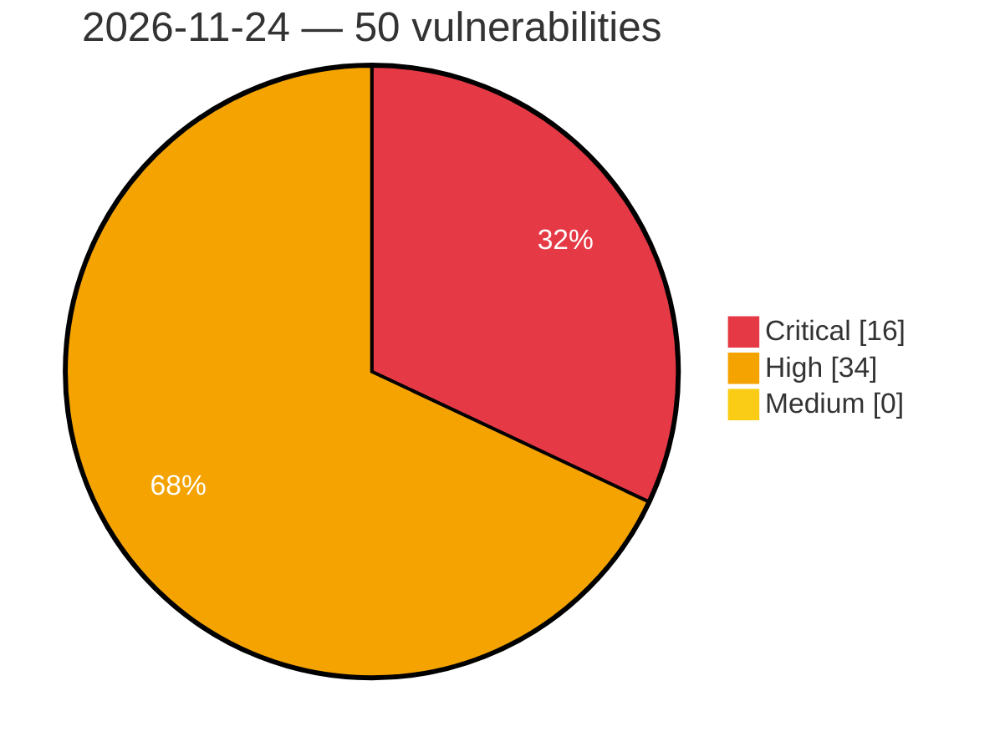

# Critical, High & Medium Severity Vulnerabilities — 2026-11-24

**Source status for this day:**

| Source | Critical | High | Medium | Total |
|--------|---------:|-----:|-------:|------:|
| cvefeed.io (High/Critical) | 16 | 34 | 0 | 50 |

**KEV (actively exploited):** 0  **Watchlist matches:** 27

## Critical (16)

| CVSS | Flags | Source | CVE / Title | Reported |
|------|-------|--------|-------------|----------|
| 10.0 | ⭐ | cvefeed.io (High/Critical) | [CVE-2026-9790 - Unauthenticated access to sensitive API endpoint information](https://cvefeed.io/vuln/detail/CVE-2026-9790) | 1 hour, 10 minutes ago |
| 10.0 | — | cvefeed.io (High/Critical) | [CVE-2026-128791 - Unauthenticated users can delete meeting recordings remotely](https://cvefeed.io/vuln/detail/CVE-2026-128791) | 1 hour, 10 minutes ago |
| 9.9 | ⭐ | cvefeed.io (High/Critical) | [CVE-2026-18530 - OS Command Injection in Lantronix S2220 Series 2 a3cli Restricted Shell](https://cvefeed.io/vuln/detail/CVE-2026-18530) | 3 hours, 9 minutes ago |
| 9.8 | — | cvefeed.io (High/Critical) | [CVE-2026-65175 - NVIDIA AIStore Unauthorized Administrative Access Vulnerability](https://cvefeed.io/vuln/detail/CVE-2026-65175) | 2 hours, 15 minutes ago |
| 9.8 | — | cvefeed.io (High/Critical) | [CVE-2026-65135 - NVIDIA Video Codec SDK Heap-Based Buffer Overflow](https://cvefeed.io/vuln/detail/CVE-2026-65135) | 2 hours, 15 minutes ago |
| 9.6 | ⭐ | cvefeed.io (High/Critical) | [CVE-2026-134401 - Google Chrome Variations Improper Input Validation Remote Code Execution](https://cvefeed.io/vuln/detail/CVE-2026-134401) | 5 hours, 10 minutes ago |
| 9.3 | ⭐ | cvefeed.io (High/Critical) | [CVE-2026-114203 - ASUS GPU Tweak III OS Command Injection Vulnerability](https://cvefeed.io/vuln/detail/CVE-2026-114203) | 3 hours, 9 minutes ago |
| 9.3 | ⭐ | cvefeed.io (High/Critical) | [CVE-2026-135693 - rConfig Core 8.0.0 before 8.2.17 and Pro before 8.4.0 Stored XSS via View Matches](https://cvefeed.io/vuln/detail/CVE-2026-135693) | 4 hours, 10 minutes ago |
| 9.2 | — | cvefeed.io (High/Critical) | [CVE-2026-135743 - FFmpeg 4.3 before 9.1 Heap Out-of-Bounds Read/Write via dynaudnorm Filter](https://cvefeed.io/vuln/detail/CVE-2026-135743) | 1 hour, 10 minutes ago |
| 9.2 | — | cvefeed.io (High/Critical) | [CVE-2026-135736 - FFmpeg 4.4 before 9.1 Heap Out-of-Bounds Write via deband Filter Coupling Command](https://cvefeed.io/vuln/detail/CVE-2026-135736) | 1 hour, 10 minutes ago |
| 9.2 | ⭐ | cvefeed.io (High/Critical) | [CVE-2026-65320 - fastcore through 2.2.44 Path Traversal via untar_dir Tar Extraction](https://cvefeed.io/vuln/detail/CVE-2026-65320) | 1 hour, 16 minutes ago |
| 9.2 | ⭐ | cvefeed.io (High/Critical) | [CVE-2026-136132 - Pangolin before 1.21.0 Authentication Bypass via URL-Encoded Slashes in Path Rules](https://cvefeed.io/vuln/detail/CVE-2026-136132) | 1 hour, 16 minutes ago |
| 9.2 | ⭐ | cvefeed.io (High/Critical) | [CVE-2026-130411 - Code execution through deserialization of pagination cursors in flop](https://cvefeed.io/vuln/detail/CVE-2026-130411) | 1 hour, 16 minutes ago |
| 9.1 | ⭐ | cvefeed.io (High/Critical) | [CVE-2026-135686 - Trilium through 0.107.0 SQL Injection via Sync Update Entity Name](https://cvefeed.io/vuln/detail/CVE-2026-135686) | 4 hours, 10 minutes ago |
| 9.1 | ⭐ | cvefeed.io (High/Critical) | [CVE-2026-136165 - Fider before 0.40.0 Account Takeover via Unverified Google OAuth Email](https://cvefeed.io/vuln/detail/CVE-2026-136165) | 1 hour, 16 minutes ago |
| 9.1 | — | cvefeed.io (High/Critical) | [CVE-2026-124286 - TLS 1.2 Client Completes Handshake Without a Server Certificate](https://cvefeed.io/vuln/detail/CVE-2026-124286) | 1 hour, 16 minutes ago |

## High (34)

| CVSS | Flags | Source | CVE / Title | Reported |
|------|-------|--------|-------------|----------|
| 8.9 | ⭐ | cvefeed.io (High/Critical) | [CVE-2026-124283 - Code execution and SQL injection via struct-wrapped values in a forged keyset pagination cursor in Ash](https://cvefeed.io/vuln/detail/CVE-2026-124283) | 2 hours, 10 minutes ago |
| 8.9 | — | cvefeed.io (High/Critical) | [CVE-2026-133555 - Code execution via the :log option of forged DBConnection.Stream structs in db_connection](https://cvefeed.io/vuln/detail/CVE-2026-133555) | 1 hour, 16 minutes ago |
| 8.8 | ⭐ | cvefeed.io (High/Critical) | [CVE-2026-135695 - rConfig Core 8.0.0 before 8.2.13 and Pro before 8.4.0 Authorization Bypass via Users API](https://cvefeed.io/vuln/detail/CVE-2026-135695) | 4 hours, 10 minutes ago |
| 8.8 | ⭐ | cvefeed.io (High/Critical) | [CVE-2026-135692 - rConfig Core 8.0.0 before 8.2.17 and Pro before 8.4.0 PHP Object Injection RCE](https://cvefeed.io/vuln/detail/CVE-2026-135692) | 4 hours, 10 minutes ago |
| 8.8 | ⭐ | cvefeed.io (High/Critical) | [CVE-2026-135691 - Open5GS WebUI through 2.8.0 Privilege Escalation via /api/db/Account](https://cvefeed.io/vuln/detail/CVE-2026-135691) | 4 hours, 10 minutes ago |
| 8.8 | ⭐ | cvefeed.io (High/Critical) | [CVE-2026-134620 - Tanium addressed a command injection vulnerability in Engage.](https://cvefeed.io/vuln/detail/CVE-2026-134620) | 5 hours, 10 minutes ago |
| 8.8 | — | cvefeed.io (High/Critical) | [CVE-2026-133960 - Tanium addressed an unauthorized code execution vulnerability in the Tanium Default Content.](https://cvefeed.io/vuln/detail/CVE-2026-133960) | 5 hours, 10 minutes ago |
| 8.8 | ⭐ | cvefeed.io (High/Critical) | [CVE-2026-134959 - WordPress WPMasterToolKit plugin <= 2.26.1 - Arbitrary Code Execution vulnerability](https://cvefeed.io/vuln/detail/CVE-2026-134959) | 18 minutes ago |
| 8.8 | ⭐ | cvefeed.io (High/Critical) | [CVE-2026-136168 - RedVector before 8.1.0 Hard-Coded API Token RCE via REST Backend](https://cvefeed.io/vuln/detail/CVE-2026-136168) | 1 hour, 16 minutes ago |
| 8.8 | ⭐ | cvefeed.io (High/Critical) | [CVE-2026-136159 - TypiCMS Core before 17.0.46 API Token Disclosure via /api/users](https://cvefeed.io/vuln/detail/CVE-2026-136159) | 1 hour, 16 minutes ago |
| 8.8 | ⭐ | cvefeed.io (High/Critical) | [CVE-2026-136158 - Valkey JSON: Use-after-free in array mutation commands through a recursive JSONPath](https://cvefeed.io/vuln/detail/CVE-2026-136158) | 1 hour, 16 minutes ago |
| 8.8 | ⭐ | cvefeed.io (High/Critical) | [CVE-2026-136156 - Valkey: Integer truncation in cluster publish message construction causes a heap buffer overflow](https://cvefeed.io/vuln/detail/CVE-2026-136156) | 1 hour, 16 minutes ago |
| 8.8 | ⭐ | cvefeed.io (High/Critical) | [CVE-2026-136155 - Valkey: Use-after-free of the Lua interpreter state through the script debugger's command cache](https://cvefeed.io/vuln/detail/CVE-2026-136155) | 1 hour, 16 minutes ago |
| 8.8 | — | cvefeed.io (High/Critical) | [CVE-2026-65136 - NVIDIA Jetson Linux Out-of-Bounds Write Vulnerability](https://cvefeed.io/vuln/detail/CVE-2026-65136) | 2 hours, 15 minutes ago |
| 8.8 | ⭐ | cvefeed.io (High/Critical) | [CVE-2026-135611 - Privilege escalation in the Internationalization component](https://cvefeed.io/vuln/detail/CVE-2026-135611) | 2 hours, 15 minutes ago |
| 8.8 | — | cvefeed.io (High/Critical) | [CVE-2026-135600 - Use-after-free in the JavaScript Engine component](https://cvefeed.io/vuln/detail/CVE-2026-135600) | 2 hours, 15 minutes ago |
| 8.7 | — | cvefeed.io (High/Critical) | [CVE-2026-135742 - FFmpeg before 9.1 Integer Truncation via zmq Filter recv_msg()](https://cvefeed.io/vuln/detail/CVE-2026-135742) | 1 hour, 10 minutes ago |
| 8.7 | — | cvefeed.io (High/Critical) | [CVE-2026-133002 - Memory leak in the icsnpp-mms Zeek analyzer when BER decoding fails](https://cvefeed.io/vuln/detail/CVE-2026-133002) | 16 minutes ago |
| 8.7 | — | cvefeed.io (High/Critical) | [CVE-2026-132887 - Memory leak in the icsnpp-acse Zeek analyzer when BER decoding fails](https://cvefeed.io/vuln/detail/CVE-2026-132887) | 16 minutes ago |
| 8.7 | — | cvefeed.io (High/Critical) | [CVE-2026-132157 - Type confusion in ICSNPP-PRES can crash a Zeek worker](https://cvefeed.io/vuln/detail/CVE-2026-132157) | 16 minutes ago |
| 8.7 | — | cvefeed.io (High/Critical) | [CVE-2026-116225 - Quadratic CPU Denial of Service in SNMP BER Object Identifier Sub-Identifier Decoding](https://cvefeed.io/vuln/detail/CVE-2026-116225) | 1 hour, 16 minutes ago |
| 8.6 | ⭐ | cvefeed.io (High/Critical) | [CVE-2026-135689 - Community Store before 2.8.0 Stored XSS via Resend Invoice Email Field](https://cvefeed.io/vuln/detail/CVE-2026-135689) | 4 hours, 10 minutes ago |
| 8.5 | — | cvefeed.io (High/Critical) | [CVE-2026-135740 - FFmpeg before 9.1 Heap Out-of-Bounds Write via readeia608 Filter Histogram](https://cvefeed.io/vuln/detail/CVE-2026-135740) | 1 hour, 10 minutes ago |
| 8.5 | — | cvefeed.io (High/Critical) | [CVE-2026-135738 - FFmpeg before 9.1 Heap Out-of-Bounds Write via signalstats Filter Histograms](https://cvefeed.io/vuln/detail/CVE-2026-135738) | 1 hour, 10 minutes ago |
| 8.5 | — | cvefeed.io (High/Critical) | [CVE-2026-135737 - FFmpeg before 9.1 Heap Out-of-Bounds Write via tmidequalizer Filter](https://cvefeed.io/vuln/detail/CVE-2026-135737) | 1 hour, 10 minutes ago |
| 8.5 | — | cvefeed.io (High/Critical) | [CVE-2026-135734 - FFmpeg before 9.1 Heap Out-of-Bounds Write via deflicker Filter Histogram](https://cvefeed.io/vuln/detail/CVE-2026-135734) | 1 hour, 10 minutes ago |
| 8.5 | — | cvefeed.io (High/Critical) | [CVE-2026-135725 - FFmpeg before 9.1 Stack-Based Buffer Overflow via ff_rtmp_packet_write()](https://cvefeed.io/vuln/detail/CVE-2026-135725) | 1 hour, 10 minutes ago |
| 8.5 | — | cvefeed.io (High/Critical) | [CVE-2026-135722 - FFmpeg before 9.1 Heap Buffer Overflow via WAV Muxer Peak Envelope Writer](https://cvefeed.io/vuln/detail/CVE-2026-135722) | 1 hour, 10 minutes ago |
| 8.5 | ⭐ | cvefeed.io (High/Critical) | [CVE-2026-136167 - vedo through 2026.6.3 Insecure Deserialization RCE via NumPy File Loading](https://cvefeed.io/vuln/detail/CVE-2026-136167) | 1 hour, 16 minutes ago |
| 8.5 | ⭐ | cvefeed.io (High/Critical) | [CVE-2026-136160 - Pyro through 1.9.2 Insecure Deserialization RCE via ParamStoreDict.load()](https://cvefeed.io/vuln/detail/CVE-2026-136160) | 1 hour, 16 minutes ago |
| 8.5 | ⭐ | cvefeed.io (High/Critical) | [CVE-2026-77672 - TXOne StellarProtect and Stellar Agent Local Privilege Escalation via Missing IPC Authorization](https://cvefeed.io/vuln/detail/CVE-2026-77672) | 2 hours, 15 minutes ago |
| 8.3 | — | cvefeed.io (High/Critical) | [CVE-2026-135739 - FFmpeg 7.1 before 9.1 Out-of-Bounds Read via Scale Filter process_command](https://cvefeed.io/vuln/detail/CVE-2026-135739) | 1 hour, 10 minutes ago |
| 8.2 | ⭐ | cvefeed.io (High/Critical) | [CVE-2026-116382 - Attacker-controlled ESI headers cause persistent atom-table growth in `inets`](https://cvefeed.io/vuln/detail/CVE-2026-116382) | 1 hour, 16 minutes ago |
| 8.0 | — | cvefeed.io (High/Critical) | [CVE-2026-134494 - Tanium addressed an argument injection vulnerability in Core Content.](https://cvefeed.io/vuln/detail/CVE-2026-134494) | 5 hours, 10 minutes ago |
