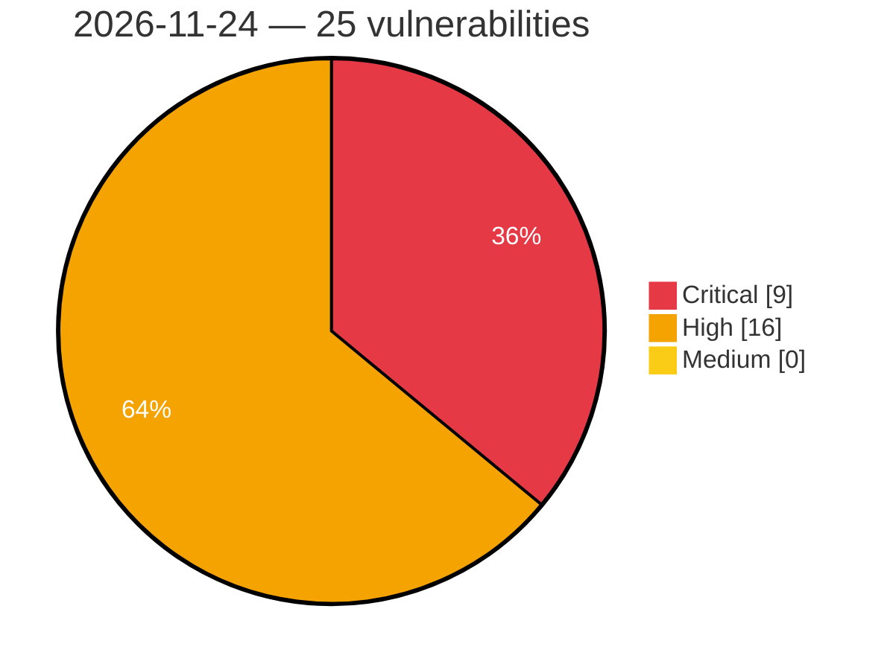

# Critical, High & Medium Severity Vulnerabilities — 2026-11-24

**Source status for this day:**

| Source | Critical | High | Medium | Total |
|--------|---------:|-----:|-------:|------:|
| cvefeed.io (High/Critical) | 9 | 16 | 0 | 25 |

**KEV (actively exploited):** 0  **Watchlist matches:** 12

## Critical (9)

| CVSS | Flags | Source | CVE / Title | Reported |
|------|-------|--------|-------------|----------|
| 10.0 | ⭐ | cvefeed.io (High/Critical) | [CVE-2026-9790 - Unauthenticated access to sensitive API endpoint information](https://cvefeed.io/vuln/detail/CVE-2026-9790) | 1 hour, 10 minutes ago |
| 10.0 | — | cvefeed.io (High/Critical) | [CVE-2026-128791 - Unauthenticated users can delete meeting recordings remotely](https://cvefeed.io/vuln/detail/CVE-2026-128791) | 1 hour, 10 minutes ago |
| 9.9 | ⭐ | cvefeed.io (High/Critical) | [CVE-2026-18530 - OS Command Injection in Lantronix S2220 Series 2 a3cli Restricted Shell](https://cvefeed.io/vuln/detail/CVE-2026-18530) | 3 hours, 9 minutes ago |
| 9.6 | ⭐ | cvefeed.io (High/Critical) | [CVE-2026-134401 - Google Chrome Variations Improper Input Validation Remote Code Execution](https://cvefeed.io/vuln/detail/CVE-2026-134401) | 5 hours, 10 minutes ago |
| 9.3 | ⭐ | cvefeed.io (High/Critical) | [CVE-2026-114203 - ASUS GPU Tweak III OS Command Injection Vulnerability](https://cvefeed.io/vuln/detail/CVE-2026-114203) | 3 hours, 9 minutes ago |
| 9.3 | ⭐ | cvefeed.io (High/Critical) | [CVE-2026-135693 - rConfig Core 8.0.0 before 8.2.17 and Pro before 8.4.0 Stored XSS via View Matches](https://cvefeed.io/vuln/detail/CVE-2026-135693) | 4 hours, 10 minutes ago |
| 9.2 | — | cvefeed.io (High/Critical) | [CVE-2026-135743 - FFmpeg 4.3 before 9.1 Heap Out-of-Bounds Read/Write via dynaudnorm Filter](https://cvefeed.io/vuln/detail/CVE-2026-135743) | 1 hour, 10 minutes ago |
| 9.2 | — | cvefeed.io (High/Critical) | [CVE-2026-135736 - FFmpeg 4.4 before 9.1 Heap Out-of-Bounds Write via deband Filter Coupling Command](https://cvefeed.io/vuln/detail/CVE-2026-135736) | 1 hour, 10 minutes ago |
| 9.1 | ⭐ | cvefeed.io (High/Critical) | [CVE-2026-135686 - Trilium through 0.107.0 SQL Injection via Sync Update Entity Name](https://cvefeed.io/vuln/detail/CVE-2026-135686) | 4 hours, 10 minutes ago |

## High (16)

| CVSS | Flags | Source | CVE / Title | Reported |
|------|-------|--------|-------------|----------|
| 8.9 | ⭐ | cvefeed.io (High/Critical) | [CVE-2026-124283 - Code execution and SQL injection via struct-wrapped values in a forged keyset pagination cursor in Ash](https://cvefeed.io/vuln/detail/CVE-2026-124283) | 2 hours, 10 minutes ago |
| 8.8 | ⭐ | cvefeed.io (High/Critical) | [CVE-2026-135695 - rConfig Core 8.0.0 before 8.2.13 and Pro before 8.4.0 Authorization Bypass via Users API](https://cvefeed.io/vuln/detail/CVE-2026-135695) | 4 hours, 10 minutes ago |
| 8.8 | ⭐ | cvefeed.io (High/Critical) | [CVE-2026-135692 - rConfig Core 8.0.0 before 8.2.17 and Pro before 8.4.0 PHP Object Injection RCE](https://cvefeed.io/vuln/detail/CVE-2026-135692) | 4 hours, 10 minutes ago |
| 8.8 | ⭐ | cvefeed.io (High/Critical) | [CVE-2026-135691 - Open5GS WebUI through 2.8.0 Privilege Escalation via /api/db/Account](https://cvefeed.io/vuln/detail/CVE-2026-135691) | 4 hours, 10 minutes ago |
| 8.8 | ⭐ | cvefeed.io (High/Critical) | [CVE-2026-134620 - Tanium addressed a command injection vulnerability in Engage.](https://cvefeed.io/vuln/detail/CVE-2026-134620) | 5 hours, 10 minutes ago |
| 8.8 | — | cvefeed.io (High/Critical) | [CVE-2026-133960 - Tanium addressed an unauthorized code execution vulnerability in the Tanium Default Content.](https://cvefeed.io/vuln/detail/CVE-2026-133960) | 5 hours, 10 minutes ago |
| 8.7 | — | cvefeed.io (High/Critical) | [CVE-2026-135742 - FFmpeg before 9.1 Integer Truncation via zmq Filter recv_msg()](https://cvefeed.io/vuln/detail/CVE-2026-135742) | 1 hour, 10 minutes ago |
| 8.6 | ⭐ | cvefeed.io (High/Critical) | [CVE-2026-135689 - Community Store before 2.8.0 Stored XSS via Resend Invoice Email Field](https://cvefeed.io/vuln/detail/CVE-2026-135689) | 4 hours, 10 minutes ago |
| 8.5 | — | cvefeed.io (High/Critical) | [CVE-2026-135740 - FFmpeg before 9.1 Heap Out-of-Bounds Write via readeia608 Filter Histogram](https://cvefeed.io/vuln/detail/CVE-2026-135740) | 1 hour, 10 minutes ago |
| 8.5 | — | cvefeed.io (High/Critical) | [CVE-2026-135738 - FFmpeg before 9.1 Heap Out-of-Bounds Write via signalstats Filter Histograms](https://cvefeed.io/vuln/detail/CVE-2026-135738) | 1 hour, 10 minutes ago |
| 8.5 | — | cvefeed.io (High/Critical) | [CVE-2026-135737 - FFmpeg before 9.1 Heap Out-of-Bounds Write via tmidequalizer Filter](https://cvefeed.io/vuln/detail/CVE-2026-135737) | 1 hour, 10 minutes ago |
| 8.5 | — | cvefeed.io (High/Critical) | [CVE-2026-135734 - FFmpeg before 9.1 Heap Out-of-Bounds Write via deflicker Filter Histogram](https://cvefeed.io/vuln/detail/CVE-2026-135734) | 1 hour, 10 minutes ago |
| 8.5 | — | cvefeed.io (High/Critical) | [CVE-2026-135725 - FFmpeg before 9.1 Stack-Based Buffer Overflow via ff_rtmp_packet_write()](https://cvefeed.io/vuln/detail/CVE-2026-135725) | 1 hour, 10 minutes ago |
| 8.5 | — | cvefeed.io (High/Critical) | [CVE-2026-135722 - FFmpeg before 9.1 Heap Buffer Overflow via WAV Muxer Peak Envelope Writer](https://cvefeed.io/vuln/detail/CVE-2026-135722) | 1 hour, 10 minutes ago |
| 8.3 | — | cvefeed.io (High/Critical) | [CVE-2026-135739 - FFmpeg 7.1 before 9.1 Out-of-Bounds Read via Scale Filter process_command](https://cvefeed.io/vuln/detail/CVE-2026-135739) | 1 hour, 10 minutes ago |
| 8.0 | — | cvefeed.io (High/Critical) | [CVE-2026-134494 - Tanium addressed an argument injection vulnerability in Core Content.](https://cvefeed.io/vuln/detail/CVE-2026-134494) | 5 hours, 10 minutes ago |
