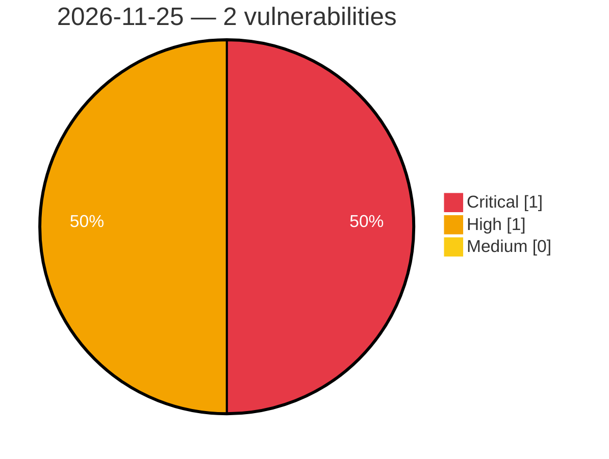

# Critical, High & Medium Severity Vulnerabilities — 2026-11-25

**Source status for this day:**

| Source | Critical | High | Medium | Total |
|--------|---------:|-----:|-------:|------:|
| cvefeed.io (High/Critical) | 1 | 1 | 0 | 2 |

**KEV (actively exploited):** 0  **Watchlist matches:** 0

## Critical (1)

| CVSS | Flags | Source | CVE / Title | Reported |
|------|-------|--------|-------------|----------|
| 10.0 | — | cvefeed.io (High/Critical) | [CVE-2026-136136 - Netis WF2409E CGI skk_set.cgi improper authentication](https://cvefeed.io/vuln/detail/CVE-2026-136136) | 1 hour, 33 minutes ago |

## High (1)

| CVSS | Flags | Source | CVE / Title | Reported |
|------|-------|--------|-------------|----------|
| 8.7 | — | cvefeed.io (High/Critical) | [CVE-2026-133462 - AutoGPT Platform Backend: MCPToolBlock Auto-Lookup Lets a Shared Agent's Author Use the Runner's MCP Credentials](https://cvefeed.io/vuln/detail/CVE-2026-133462) | 1 hour, 33 minutes ago |
