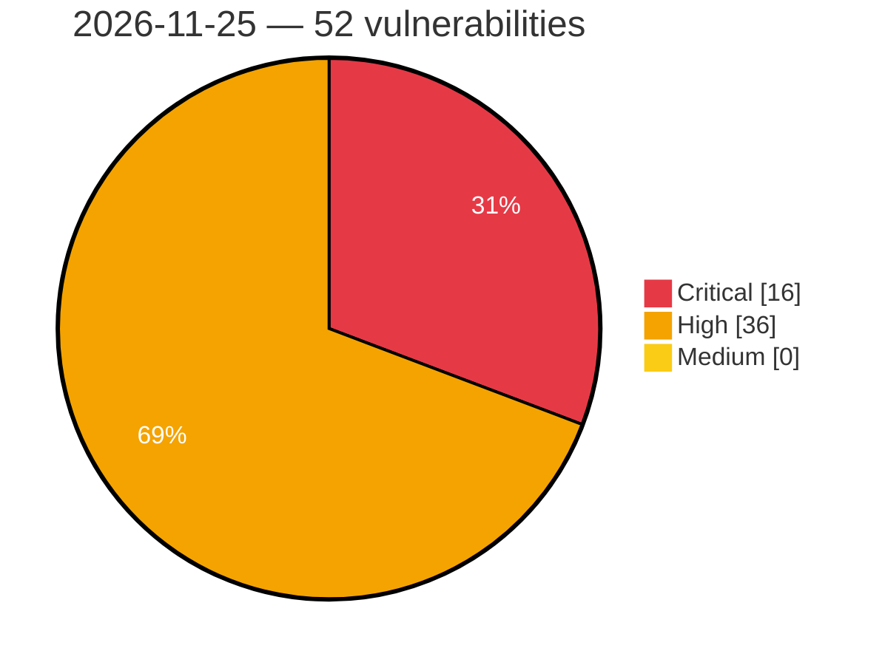

# Critical, High & Medium Severity Vulnerabilities — 2026-11-25

**Source status for this day:**

| Source | Critical | High | Medium | Total |
|--------|---------:|-----:|-------:|------:|
| cvefeed.io (High/Critical) | 16 | 36 | 0 | 52 |

**KEV (actively exploited):** 0  **Watchlist matches:** 31

## Critical (16)

| CVSS | Flags | Source | CVE / Title | Reported |
|------|-------|--------|-------------|----------|
| 10.0 | — | cvefeed.io (High/Critical) | [CVE-2026-136136 - Netis WF2409E CGI skk_set.cgi improper authentication](https://cvefeed.io/vuln/detail/CVE-2026-136136) | 1 hour, 33 minutes ago |
| 10.0 | — | cvefeed.io (High/Critical) | [CVE-2026-78114 - Apache JSPWiki: Session fixation in the login flow](https://cvefeed.io/vuln/detail/CVE-2026-78114) | 9 minutes ago |
| 10.0 | — | cvefeed.io (High/Critical) | [CVE-2026-136553 - Tenda RX3 fast_setting_wifi_set improper authentication](https://cvefeed.io/vuln/detail/CVE-2026-136553) | 3 hours, 14 minutes ago |
| 10.0 | ⭐ | cvefeed.io (High/Critical) | [CVE-2026-136549 - Tenda RX3 SetRemoteWebCfg formSetSafeWanWebMan command injection](https://cvefeed.io/vuln/detail/CVE-2026-136549) | 4 hours, 14 minutes ago |
| 10.0 | — | cvefeed.io (High/Critical) | [CVE-2026-136548 - Tenda RX3 GBK-to-UTF-8 Conversion auto_discover stack-based overflow](https://cvefeed.io/vuln/detail/CVE-2026-136548) | 4 hours, 14 minutes ago |
| 9.9 | — | cvefeed.io (High/Critical) | [CVE-2026-136835 - Jenkins Script Security Plugin Sandbox Bypass](https://cvefeed.io/vuln/detail/CVE-2026-136835) | 2 hours, 30 minutes ago |
| 9.8 | ⭐ | cvefeed.io (High/Critical) | [CVE-2026-137090 - build-git-clone before 1.0.4 OS Command Injection in clone() via repository URL](https://cvefeed.io/vuln/detail/CVE-2026-137090) | 15 minutes ago |
| 9.8 | ⭐ | cvefeed.io (High/Critical) | [CVE-2026-133467 - CodeSafe: safe_eval Sandbox Escape via Indirect Subscript Call](https://cvefeed.io/vuln/detail/CVE-2026-133467) | 26 minutes ago |
| 9.8 | ⭐ | cvefeed.io (High/Critical) | [CVE-2026-135400 - Ever Gauzy: Deactivated user account retains full API access via JWT validation not re-checking isActive/isArchived](https://cvefeed.io/vuln/detail/CVE-2026-135400) | 2 hours, 30 minutes ago |
| 9.3 | ⭐ | cvefeed.io (High/Critical) | [CVE-2026-136706 - SQL Injection Vulnerability in DIGIT Platform](https://cvefeed.io/vuln/detail/CVE-2026-136706) | 14 minutes ago |
| 9.2 | ⭐ | cvefeed.io (High/Critical) | [CVE-2026-137086 - Teracom TCW122B-CM before 4.07 Predictable Session Cookie Session Hijacking](https://cvefeed.io/vuln/detail/CVE-2026-137086) | 15 minutes ago |
| 9.2 | ⭐ | cvefeed.io (High/Critical) | [CVE-2026-77230 - Camunda 8 Insecure Deserialization via Web Session Storage](https://cvefeed.io/vuln/detail/CVE-2026-77230) | 30 minutes ago |
| 9.1 | ⭐ | cvefeed.io (High/Critical) | [CVE-2026-136552 - Tenda RX3 multiWAN setIPv6Status formSetIPv6status command injection](https://cvefeed.io/vuln/detail/CVE-2026-136552) | 3 hours, 14 minutes ago |
| 9.1 | ⭐ | cvefeed.io (High/Critical) | [CVE-2026-136550 - Tenda RX3 AdvSetMacMtuWan fromAdvSetMacMtuWan command injection](https://cvefeed.io/vuln/detail/CVE-2026-136550) | 4 hours, 14 minutes ago |
| 9.1 | — | cvefeed.io (High/Critical) | [CVE-2026-133464 - SeaweedFS: SFTP accepts an empty password for any user account configured without a password (public-key-only users)](https://cvefeed.io/vuln/detail/CVE-2026-133464) | 30 minutes ago |
| 9.1 | — | cvefeed.io (High/Critical) | [CVE-2026-135146 - Improper certificate revocation check for stapled OCSP responses in the Python Driver](https://cvefeed.io/vuln/detail/CVE-2026-135146) | 1 hour, 29 minutes ago |

## High (36)

| CVSS | Flags | Source | CVE / Title | Reported |
|------|-------|--------|-------------|----------|
| 8.8 | ⭐ | cvefeed.io (High/Critical) | [CVE-2026-135840 - WordPress Timetics plugin <= 1.0.67 - Cross Site Request Forgery (CSRF) vulnerability](https://cvefeed.io/vuln/detail/CVE-2026-135840) | 1 hour, 14 minutes ago |
| 8.8 | ⭐ | cvefeed.io (High/Critical) | [CVE-2026-135049 - WordPress Presto Player plugin <= 4.5.6 - Cross Site Request Forgery (CSRF) vulnerability](https://cvefeed.io/vuln/detail/CVE-2026-135049) | 1 hour, 14 minutes ago |
| 8.8 | ⭐ | cvefeed.io (High/Critical) | [CVE-2026-135040 - WordPress Hydra Booking plugin <= 1.2.11 - Cross Site Request Forgery (CSRF) vulnerability](https://cvefeed.io/vuln/detail/CVE-2026-135040) | 1 hour, 14 minutes ago |
| 8.8 | ⭐ | cvefeed.io (High/Critical) | [CVE-2026-135008 - WordPress Tainacan plugin <= 1.4.1 - Cross Site Request Forgery (CSRF) vulnerability](https://cvefeed.io/vuln/detail/CVE-2026-135008) | 1 hour, 14 minutes ago |
| 8.8 | ⭐ | cvefeed.io (High/Critical) | [CVE-2026-134706 - WordPress Soro &#8211; SEO Autopilot &amp; AI Content Writer plugin <= 1.4.3 - Cross Site Request Forgery (CSRF) vulnerability](https://cvefeed.io/vuln/detail/CVE-2026-134706) | 1 hour, 14 minutes ago |
| 8.8 | ⭐ | cvefeed.io (High/Critical) | [CVE-2026-134942 - WordPress ElasticPress plugin <= 5.3.5 - Cross Site Request Forgery (CSRF) vulnerability](https://cvefeed.io/vuln/detail/CVE-2026-134942) | 2 hours, 14 minutes ago |
| 8.8 | ⭐ | cvefeed.io (High/Critical) | [CVE-2026-134478 - WordPress Fluent CRM plugin <= 3.3.1 - Cross Site Request Forgery (CSRF) vulnerability](https://cvefeed.io/vuln/detail/CVE-2026-134478) | 2 hours, 14 minutes ago |
| 8.8 | ⭐ | cvefeed.io (High/Critical) | [CVE-2026-134476 - WordPress Fluent Support plugin <= 2.5.0 - Cross Site Request Forgery (CSRF) vulnerability](https://cvefeed.io/vuln/detail/CVE-2026-134476) | 2 hours, 14 minutes ago |
| 8.8 | ⭐ | cvefeed.io (High/Critical) | [CVE-2026-134475 - WordPress FluentCart plugin <= 2.3.2 - Cross Site Request Forgery (CSRF) vulnerability](https://cvefeed.io/vuln/detail/CVE-2026-134475) | 2 hours, 14 minutes ago |
| 8.8 | ⭐ | cvefeed.io (High/Critical) | [CVE-2026-134473 - WordPress WP Social Ninja plugin <= 4.5.0 - Cross Site Request Forgery (CSRF) vulnerability](https://cvefeed.io/vuln/detail/CVE-2026-134473) | 2 hours, 14 minutes ago |
| 8.8 | ⭐ | cvefeed.io (High/Critical) | [CVE-2026-137056 - DeepSeek-Reasonix before 2.53.0 Command Execution via Auto-Approved git blame](https://cvefeed.io/vuln/detail/CVE-2026-137056) | 14 minutes ago |
| 8.8 | — | cvefeed.io (High/Critical) | [CVE-2026-135898 - Out-of-bounds read in BSON array decoding in the Python Driver C extension](https://cvefeed.io/vuln/detail/CVE-2026-135898) | 1 hour, 29 minutes ago |
| 8.8 | ⭐ | cvefeed.io (High/Critical) | [CVE-2026-73517 - KubeSphere Command Injection via Terminal File Download](https://cvefeed.io/vuln/detail/CVE-2026-73517) | 2 hours, 29 minutes ago |
| 8.8 | ⭐ | cvefeed.io (High/Critical) | [CVE-2026-136837 - Jenkins Warnings Plugin Remote Code Execution](https://cvefeed.io/vuln/detail/CVE-2026-136837) | 2 hours, 30 minutes ago |
| 8.8 | — | cvefeed.io (High/Critical) | [CVE-2026-136834 - Jenkins Pipeline: Groovy Plugin Sandbox Bypass](https://cvefeed.io/vuln/detail/CVE-2026-136834) | 2 hours, 30 minutes ago |
| 8.8 | ⭐ | cvefeed.io (High/Critical) | [CVE-2026-136267 - Improper neutralization of special elements used in an OS command in Kiro Web](https://cvefeed.io/vuln/detail/CVE-2026-136267) | 2 hours, 30 minutes ago |
| 8.7 | — | cvefeed.io (High/Critical) | [CVE-2026-133462 - AutoGPT Platform Backend: MCPToolBlock Auto-Lookup Lets a Shared Agent's Author Use the Runner's MCP Credentials](https://cvefeed.io/vuln/detail/CVE-2026-133462) | 1 hour, 33 minutes ago |
| 8.7 | — | cvefeed.io (High/Critical) | [CVE-2026-134791 - Unclosed Comments Make the Lexer of ExpressionLanguage Quadratic, Letting Untrusted Expressions Hold a Process](https://cvefeed.io/vuln/detail/CVE-2026-134791) | 14 minutes ago |
| 8.7 | — | cvefeed.io (High/Critical) | [CVE-2026-133761 - CsvEncoder Nests Rows Once per Key Separator of a Header, Letting a Small CSV Payload Crash PHP](https://cvefeed.io/vuln/detail/CVE-2026-133761) | 14 minutes ago |
| 8.7 | — | cvefeed.io (High/Critical) | [CVE-2026-133760 - Nested Short Ternaries Make the Nesting Check of the Expression Parser Exponential, Letting Untrusted Expressions Hang It](https://cvefeed.io/vuln/detail/CVE-2026-133760) | 14 minutes ago |
| 8.7 | — | cvefeed.io (High/Critical) | [CVE-2026-137057 - llama.cpp b7118 before b12604 Integer Underflow in Grammar Parser parse_sequence](https://cvefeed.io/vuln/detail/CVE-2026-137057) | 14 minutes ago |
| 8.7 | — | cvefeed.io (High/Critical) | [CVE-2026-137058 - cron-parser through 5.10.0 Unbounded Memory Allocation via CronExpressionParser.parse()](https://cvefeed.io/vuln/detail/CVE-2026-137058) | 14 minutes ago |
| 8.7 | — | cvefeed.io (High/Critical) | [CVE-2026-135226 - Type confusion in DBPointer handling in BSON Ruby Extended JSON parsing](https://cvefeed.io/vuln/detail/CVE-2026-135226) | 1 hour, 29 minutes ago |
| 8.6 | — | cvefeed.io (High/Critical) | [CVE-2026-135141 - Incorrect authorization from a discarded default scope in Mongoid](https://cvefeed.io/vuln/detail/CVE-2026-135141) | 1 hour, 29 minutes ago |
| 8.6 | ⭐ | cvefeed.io (High/Critical) | [CVE-2026-135402 - Ever Gauzy: GitHub App webhook receiver never verifies HMAC signature — forgeable events allow unauthenticated tenant-integration deletion and fake issue injection](https://cvefeed.io/vuln/detail/CVE-2026-135402) | 2 hours, 30 minutes ago |
| 8.5 | ⭐ | cvefeed.io (High/Critical) | [CVE-2026-137060 - paramz through 0.10.0 Insecure Deserialization RCE via load()](https://cvefeed.io/vuln/detail/CVE-2026-137060) | 14 minutes ago |
| 8.5 | — | cvefeed.io (High/Critical) | [CVE-2026-137093 - Assimp before 6.0.6 Out-of-Bounds Write via MD5 Importer LoadMD5MeshFile](https://cvefeed.io/vuln/detail/CVE-2026-137093) | 15 minutes ago |
| 8.4 | ⭐ | cvefeed.io (High/Critical) | [CVE-2026-80283 - Dell Secure Connect Gateway Virtual Edition Missing Authentication Vulnerability](https://cvefeed.io/vuln/detail/CVE-2026-80283) | 14 minutes ago |
| 8.4 | ⭐ | cvefeed.io (High/Critical) | [CVE-2026-80273 - Dell Secure Connect Gateway OS Command Injection Vulnerability](https://cvefeed.io/vuln/detail/CVE-2026-80273) | 14 minutes ago |
| 8.4 | ⭐ | cvefeed.io (High/Critical) | [CVE-2026-80247 - Dell Secure Connect Gateway Virtual Edition Missing Authentication Vulnerability](https://cvefeed.io/vuln/detail/CVE-2026-80247) | 2 hours, 14 minutes ago |
| 8.3 | ⭐ | cvefeed.io (High/Critical) | [CVE-2026-134792 - HttpClient Lets the Proxy Header of a Request Choose the Proxy of Outgoing Requests in HTTP Workers That Run Under the CLI SAPI](https://cvefeed.io/vuln/detail/CVE-2026-134792) | 14 minutes ago |
| 8.3 | — | cvefeed.io (High/Critical) | [CVE-2026-137077 - FreeRDP before 3.33.0 Heap Out-of-Bounds Write via H.264 Encoder Height Change](https://cvefeed.io/vuln/detail/CVE-2026-137077) | 14 minutes ago |
| 8.3 | — | cvefeed.io (High/Critical) | [CVE-2026-135227 - Improper restriction of object attributes in Mongoid belongs_to assignment](https://cvefeed.io/vuln/detail/CVE-2026-135227) | 1 hour, 29 minutes ago |
| 8.2 | — | cvefeed.io (High/Critical) | [CVE-2026-133757 - NoPrivateNetworkHttpClient Sends the Default Credentials of the Client It Decorates to Other Origins on Redirects](https://cvefeed.io/vuln/detail/CVE-2026-133757) | 14 minutes ago |
| 8.2 | ⭐ | cvefeed.io (High/Critical) | [CVE-2026-137059 - ToolJet 3.16.0 before 3.20.256 Stripe Webhook Signature Verification Bypass](https://cvefeed.io/vuln/detail/CVE-2026-137059) | 14 minutes ago |
| 8.0 | ⭐ | cvefeed.io (High/Critical) | [CVE-2026-134070 - Improper input validation in the AWS Systems Manager Automation runbook AWSConfigRemediation-EnableSystemsManagerSessionManagerAuditLogsToS3](https://cvefeed.io/vuln/detail/CVE-2026-134070) | 10 minutes ago |
