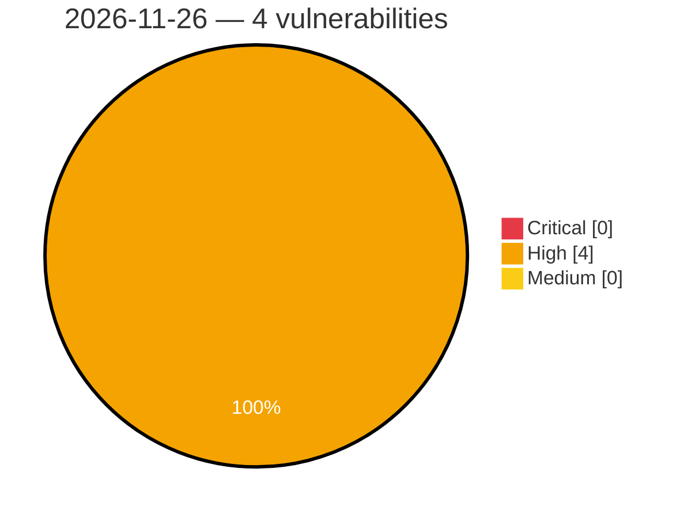

# Critical, High & Medium Severity Vulnerabilities — 2026-11-26

**Source status for this day:**

| Source | Critical | High | Medium | Total |
|--------|---------:|-----:|-------:|------:|
| cvefeed.io (High/Critical) | 0 | 4 | 0 | 4 |

**KEV (actively exploited):** 0  **Watchlist matches:** 3

## High (4)

| CVSS | Flags | Source | CVE / Title | Reported |
|------|-------|--------|-------------|----------|
| 8.8 | — | cvefeed.io (High/Critical) | [CVE-2026-137305 - Grav Form Plugin before 9.2.4 Code Injection via File Field Upload Destination](https://cvefeed.io/vuln/detail/CVE-2026-137305) | 21 minutes ago |
| 8.8 | ⭐ | cvefeed.io (High/Critical) | [CVE-2026-115576 - NetBird: Local Privilege Escalation via Unauthenticated IPC Socket](https://cvefeed.io/vuln/detail/CVE-2026-115576) | 22 minutes ago |
| 8.7 | ⭐ | cvefeed.io (High/Critical) | [CVE-2026-66784 - Submariner: submariner: shared cluster-set ipsec psk with self-asserted ike identities enables cross-cluster traffic interception](https://cvefeed.io/vuln/detail/CVE-2026-66784) | 1 hour, 21 minutes ago |
| 8.3 | ⭐ | cvefeed.io (High/Critical) | [CVE-2026-137308 - markdownify-mcp before 1.2.0 SSRF Protection Bypass via validateUrl and validateRepoUrl](https://cvefeed.io/vuln/detail/CVE-2026-137308) | 21 minutes ago |
