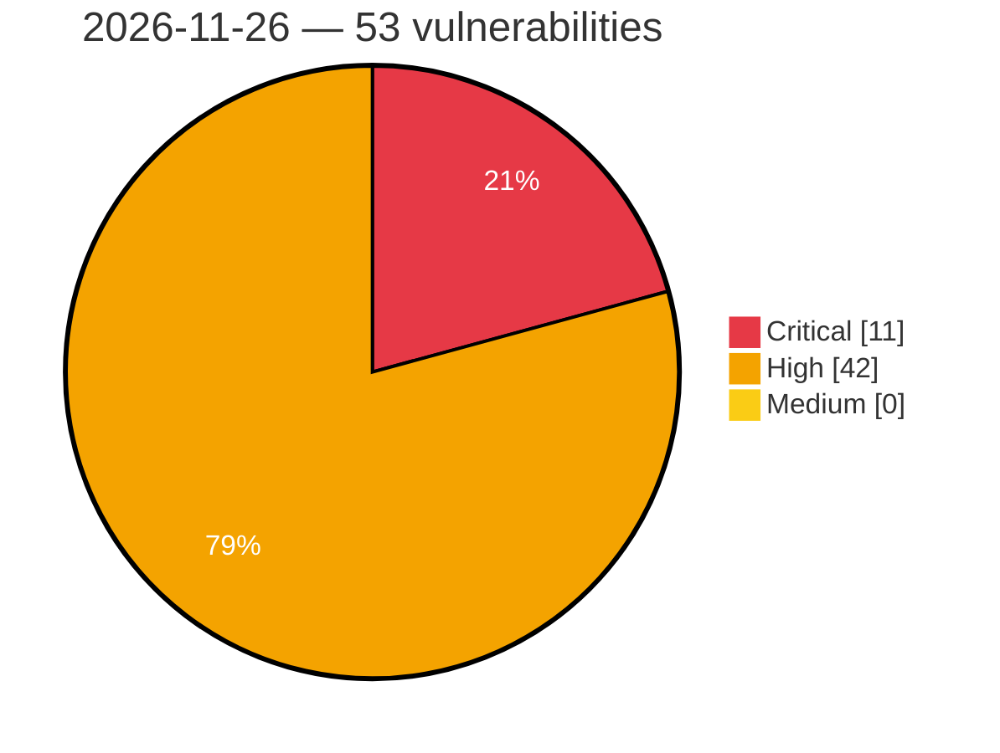

# Critical, High & Medium Severity Vulnerabilities — 2026-11-26

**Source status for this day:**

| Source | Critical | High | Medium | Total |
|--------|---------:|-----:|-------:|------:|
| cvefeed.io (High/Critical) | 11 | 42 | 0 | 53 |

**KEV (actively exploited):** 0  **Watchlist matches:** 44

## Critical (11)

| CVSS | Flags | Source | CVE / Title | Reported |
|------|-------|--------|-------------|----------|
| 10.0 | — | cvefeed.io (High/Critical) | [CVE-2026-137043 - TOTOLINK N350RT cstecgi.cgi setLanguageCfg authorization](https://cvefeed.io/vuln/detail/CVE-2026-137043) | 8 hours, 35 minutes ago |
| 9.8 | ⭐ | cvefeed.io (High/Critical) | [CVE-2026-123911 - ESX use-after-free vulnerability](https://cvefeed.io/vuln/detail/CVE-2026-123911) | 34 minutes ago |
| 9.8 | ⭐ | cvefeed.io (High/Critical) | [CVE-2026-123910 - ESX heap out-of-bounds write vulnerability](https://cvefeed.io/vuln/detail/CVE-2026-123910) | 34 minutes ago |
| 9.8 | ⭐ | cvefeed.io (High/Critical) | [CVE-2026-123903 - vCenter authentication-bypass vulnerability](https://cvefeed.io/vuln/detail/CVE-2026-123903) | 34 minutes ago |
| 9.8 | — | cvefeed.io (High/Critical) | [CVE-2026-137550 - Frappe Framework before 15.122.0 Authorization Bypass via Document.update()](https://cvefeed.io/vuln/detail/CVE-2026-137550) | 4 hours, 11 minutes ago |
| 9.5 | ⭐ | cvefeed.io (High/Critical) | [CVE-2026-133336 - Joomla Extension - chronoengine.com - Unauthenticated arbitrary file upload in ChronoForms extension 8.0.0-8.0.53](https://cvefeed.io/vuln/detail/CVE-2026-133336) | 3 hours, 34 minutes ago |
| 9.4 | — | cvefeed.io (High/Critical) | [CVE-2026-135203 - JavaScript payload-mapping sandbox escape allows arbitrary code execution in the connectivity service](https://cvefeed.io/vuln/detail/CVE-2026-135203) | 34 minutes ago |
| 9.4 | ⭐ | cvefeed.io (High/Critical) | [CVE-2026-137544 - LaraDashboard before 1.5.0 Path Traversal RCE via module.json Namespace Parsing](https://cvefeed.io/vuln/detail/CVE-2026-137544) | 4 hours, 11 minutes ago |
| 9.3 | ⭐ | cvefeed.io (High/Critical) | [CVE-2026-123912 - Out-of-bounds write vulnerability in XHCI USB controller](https://cvefeed.io/vuln/detail/CVE-2026-123912) | 34 minutes ago |
| 9.2 | ⭐ | cvefeed.io (High/Critical) | [CVE-2026-137547 - Coder from 2.39.0 before 2.39.1 Database Password Exposure via API Errors](https://cvefeed.io/vuln/detail/CVE-2026-137547) | 4 hours, 11 minutes ago |
| 9.1 | ⭐ | cvefeed.io (High/Critical) | [CVE-2026-135279 - @fastify/express vulnerable to middleware bypass via empty route parameters in Express routers and sub-applications](https://cvefeed.io/vuln/detail/CVE-2026-135279) | 3 hours, 12 minutes ago |

## High (42)

| CVSS | Flags | Source | CVE / Title | Reported |
|------|-------|--------|-------------|----------|
| 8.8 | — | cvefeed.io (High/Critical) | [CVE-2026-137305 - Grav Form Plugin before 9.2.4 Code Injection via File Field Upload Destination](https://cvefeed.io/vuln/detail/CVE-2026-137305) | 21 minutes ago |
| 8.8 | ⭐ | cvefeed.io (High/Critical) | [CVE-2026-115576 - NetBird: Local Privilege Escalation via Unauthenticated IPC Socket](https://cvefeed.io/vuln/detail/CVE-2026-115576) | 22 minutes ago |
| 8.8 | ⭐ | cvefeed.io (High/Critical) | [CVE-2026-127041 - Using encrypted credentials in Bizum Pay for Android](https://cvefeed.io/vuln/detail/CVE-2026-127041) | 1 hour, 34 minutes ago |
| 8.8 | ⭐ | cvefeed.io (High/Critical) | [CVE-2026-137390 - Openfind｜Mail2000 - OS Command Injection](https://cvefeed.io/vuln/detail/CVE-2026-137390) | 2 hours, 34 minutes ago |
| 8.8 | ⭐ | cvefeed.io (High/Critical) | [CVE-2026-137389 - Openfind｜MailGates/MailAudit - Command Injection](https://cvefeed.io/vuln/detail/CVE-2026-137389) | 2 hours, 34 minutes ago |
| 8.8 | ⭐ | cvefeed.io (High/Critical) | [CVE-2026-133525 - WordPress Fusion Builder plugin < 3.17.1 - PHP Object Injection vulnerability](https://cvefeed.io/vuln/detail/CVE-2026-133525) | 3 hours, 34 minutes ago |
| 8.8 | ⭐ | cvefeed.io (High/Critical) | [CVE-2026-123685 - Stellar Agent Remote Code Execution Vulnerability](https://cvefeed.io/vuln/detail/CVE-2026-123685) | 8 hours, 35 minutes ago |
| 8.8 | ⭐ | cvefeed.io (High/Critical) | [CVE-2026-137539 - lastversion before 3.6.20 Arbitrary File Write via Tar Symlink Members](https://cvefeed.io/vuln/detail/CVE-2026-137539) | 27 minutes ago |
| 8.8 | ⭐ | cvefeed.io (High/Critical) | [CVE-2026-134705 - WordPress miniorange otp verification plugin <= 5.6.2 - Privilege Escalation vulnerability](https://cvefeed.io/vuln/detail/CVE-2026-134705) | 29 minutes ago |
| 8.8 | ⭐ | cvefeed.io (High/Critical) | [CVE-2026-76075 - Warehouse Cargo <= 2.7.4 - Authenticated (Subscriber+) Arbitrary File Upload via 'plugin_details[plugin_url]' Parameter](https://cvefeed.io/vuln/detail/CVE-2026-76075) | 4 hours, 11 minutes ago |
| 8.8 | ⭐ | cvefeed.io (High/Critical) | [CVE-2026-137556 - Dockhand before 1.0.57 Path Traversal RCE via composePath](https://cvefeed.io/vuln/detail/CVE-2026-137556) | 4 hours, 11 minutes ago |
| 8.7 | ⭐ | cvefeed.io (High/Critical) | [CVE-2026-66784 - Submariner: submariner: shared cluster-set ipsec psk with self-asserted ike identities enables cross-cluster traffic interception](https://cvefeed.io/vuln/detail/CVE-2026-66784) | 1 hour, 21 minutes ago |
| 8.7 | ⭐ | cvefeed.io (High/Critical) | [CVE-2026-133342 - Joomla Extension - joomdonation.com - Unauthenticated SQL injection in event registration in Events Booking < 5.12.0](https://cvefeed.io/vuln/detail/CVE-2026-133342) | 34 minutes ago |
| 8.7 | ⭐ | cvefeed.io (High/Critical) | [CVE-2017-20291 - Broadcom SiteMinder Secure Proxy Server (Access Gateway) Federation Web Services XXE Injection Vulnerability](https://cvefeed.io/vuln/detail/CVE-2017-20291) | 4 hours, 35 minutes ago |
| 8.7 | ⭐ | cvefeed.io (High/Critical) | [CVE-2026-137657 - InternLM LMDeploy 0.9.0 through 0.18.0 Memory Exhaustion via /distserve/connection_warmup](https://cvefeed.io/vuln/detail/CVE-2026-137657) | 27 minutes ago |
| 8.7 | ⭐ | cvefeed.io (High/Critical) | [CVE-2026-137552 - Frappe Framework before 16.35.0 2FA Bypass via OAuth2 Password Grant](https://cvefeed.io/vuln/detail/CVE-2026-137552) | 4 hours, 11 minutes ago |
| 8.7 | ⭐ | cvefeed.io (High/Critical) | [CVE-2026-137549 - pypdf before 7.0.1 Excessive Memory Usage via Crafted PDF Images](https://cvefeed.io/vuln/detail/CVE-2026-137549) | 4 hours, 11 minutes ago |
| 8.6 | ⭐ | cvefeed.io (High/Critical) | [CVE-2026-133339 - Joomla Extension - vi-solutions - SQL injection via form IDs in administrative form export in Visforms extension 1.0.0-5.6.5, 6.0.0-6.2.2](https://cvefeed.io/vuln/detail/CVE-2026-133339) | 2 hours, 34 minutes ago |
| 8.6 | — | cvefeed.io (High/Critical) | [CVE-2026-135772 - Realtek｜Realtek RTL8762C MCU (Bluetooth/MCU Chip)RTL8762C MCU - Improper Protection Against Voltage and Clock Glitches](https://cvefeed.io/vuln/detail/CVE-2026-135772) | 3 hours, 34 minutes ago |
| 8.6 | ⭐ | cvefeed.io (High/Critical) | [CVE-2026-123689 - StellarOne SQL Injection Vulnerability](https://cvefeed.io/vuln/detail/CVE-2026-123689) | 7 hours, 34 minutes ago |
| 8.6 | — | cvefeed.io (High/Critical) | [CVE-2026-123687 - StellarOne Arbitrary File Write Vulnerability](https://cvefeed.io/vuln/detail/CVE-2026-123687) | 8 hours, 35 minutes ago |
| 8.6 | ⭐ | cvefeed.io (High/Critical) | [CVE-2026-123682 - StellarOne Arbitrary Code Execution Vulnerability](https://cvefeed.io/vuln/detail/CVE-2026-123682) | 8 hours, 35 minutes ago |
| 8.6 | ⭐ | cvefeed.io (High/Critical) | [CVE-2026-123680 - StellarOne Firmware Update Remote Code Execution Vulnerability](https://cvefeed.io/vuln/detail/CVE-2026-123680) | 8 hours, 35 minutes ago |
| 8.6 | — | cvefeed.io (High/Critical) | [CVE-2026-137551 - Frappe before 16.36.0 Jinja Sandbox Bypass via Module-Path Hooks](https://cvefeed.io/vuln/detail/CVE-2026-137551) | 4 hours, 11 minutes ago |
| 8.5 | — | cvefeed.io (High/Critical) | [CVE-2026-137506 - ezdxf through 1.4.5 Code Injection via dxf2code DXF Table Entry Names](https://cvefeed.io/vuln/detail/CVE-2026-137506) | 27 minutes ago |
| 8.5 | ⭐ | cvefeed.io (High/Critical) | [CVE-2026-137518 - pyfda through 0.9.5 Code Execution via Insecure Deserialization in load_filter()](https://cvefeed.io/vuln/detail/CVE-2026-137518) | 27 minutes ago |
| 8.5 | ⭐ | cvefeed.io (High/Critical) | [CVE-2026-137529 - JAL through 2026.11.3 Arbitrary File Overwrite via Symlink in Backup Archive](https://cvefeed.io/vuln/detail/CVE-2026-137529) | 27 minutes ago |
| 8.4 | ⭐ | cvefeed.io (High/Critical) | [CVE-2026-123686 - StellarOne vShell OS Command Injection Vulnerability](https://cvefeed.io/vuln/detail/CVE-2026-123686) | 8 hours, 35 minutes ago |
| 8.4 | — | cvefeed.io (High/Critical) | [CVE-2026-137546 - Coder from 2.39.0 before 2.39.1 Session Token Leak via coder open app](https://cvefeed.io/vuln/detail/CVE-2026-137546) | 4 hours, 11 minutes ago |
| 8.3 | ⭐ | cvefeed.io (High/Critical) | [CVE-2026-137308 - markdownify-mcp before 1.2.0 SSRF Protection Bypass via validateUrl and validateRepoUrl](https://cvefeed.io/vuln/detail/CVE-2026-137308) | 21 minutes ago |
| 8.3 | ⭐ | cvefeed.io (High/Critical) | [CVE-2026-137543 - LaraDashboard before 1.5.2 SSRF via ai_ollama_base_url and generate-seo endpoint](https://cvefeed.io/vuln/detail/CVE-2026-137543) | 4 hours, 11 minutes ago |
| 8.2 | ⭐ | cvefeed.io (High/Critical) | [CVE-2026-123913 - ESX VMkernel stack-based buffer-overflow vulnerability](https://cvefeed.io/vuln/detail/CVE-2026-123913) | 34 minutes ago |
| 8.2 | ⭐ | cvefeed.io (High/Critical) | [CVE-2026-133337 - Joomla Extension - chronoengine.com - Unauthenticated SQL injection in table sorting in ChronoForms extension 8.0.0-8.0.53](https://cvefeed.io/vuln/detail/CVE-2026-133337) | 3 hours, 34 minutes ago |
| 8.2 | ⭐ | cvefeed.io (High/Critical) | [CVE-2026-137582 - Web-token jwt-framework before 3.4.13 DoS via JWE/JWS Multiple Recipients](https://cvefeed.io/vuln/detail/CVE-2026-137582) | 4 hours, 11 minutes ago |
| 8.2 | ⭐ | cvefeed.io (High/Critical) | [CVE-2026-137581 - web-token jwt-framework before 3.4.13 Denial of Service via Unbounded JSON Decoding](https://cvefeed.io/vuln/detail/CVE-2026-137581) | 4 hours, 11 minutes ago |
| 8.2 | ⭐ | cvefeed.io (High/Critical) | [CVE-2026-137580 - web-token jwt-framework before 3.4.13 Denial of Service via JSONGeneralSerializer](https://cvefeed.io/vuln/detail/CVE-2026-137580) | 4 hours, 11 minutes ago |
| 8.2 | ⭐ | cvefeed.io (High/Critical) | [CVE-2026-137579 - Web-token jwt-framework before 3.4.13 RSA Private Key Timing Side Channel](https://cvefeed.io/vuln/detail/CVE-2026-137579) | 4 hours, 11 minutes ago |
| 8.2 | ⭐ | cvefeed.io (High/Critical) | [CVE-2026-137564 - web-token jwt-framework before 3.4.13 Missing Key Size Check in Direct Encryption](https://cvefeed.io/vuln/detail/CVE-2026-137564) | 4 hours, 11 minutes ago |
| 8.2 | ⭐ | cvefeed.io (High/Critical) | [CVE-2026-137560 - Web-token jwt-framework before 3.4.13 Denial of Service via Unbounded RSA Key Size](https://cvefeed.io/vuln/detail/CVE-2026-137560) | 4 hours, 11 minutes ago |
| 8.2 | ⭐ | cvefeed.io (High/Critical) | [CVE-2026-137559 - web-token jwt-framework before 3.4.13 ECDH-ES DoS via Oversized epk Coordinate](https://cvefeed.io/vuln/detail/CVE-2026-137559) | 4 hours, 11 minutes ago |
| 8.2 | ⭐ | cvefeed.io (High/Critical) | [CVE-2026-137553 - Frappe before 16.33.0 Blind SQL Injection via X-Frappe-Request-Id Header](https://cvefeed.io/vuln/detail/CVE-2026-137553) | 4 hours, 11 minutes ago |
| 8.1 | ⭐ | cvefeed.io (High/Critical) | [CVE-2026-130805 - Groundhogg <= 4.11 - Cross-Site Request Forgery](https://cvefeed.io/vuln/detail/CVE-2026-130805) | 1 hour, 34 minutes ago |
