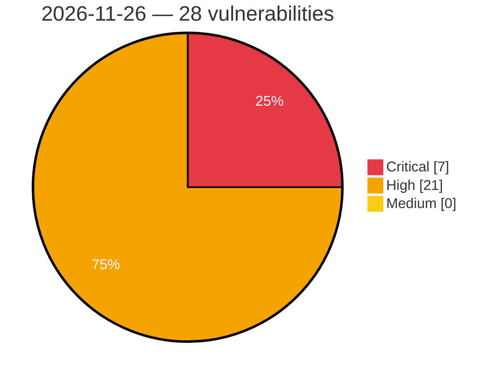

# Critical, High & Medium Severity Vulnerabilities — 2026-11-26

**Source status for this day:**

| Source | Critical | High | Medium | Total |
|--------|---------:|-----:|-------:|------:|
| cvefeed.io (High/Critical) | 7 | 21 | 0 | 28 |

**KEV (actively exploited):** 0  **Watchlist matches:** 23

## Critical (7)

| CVSS | Flags | Source | CVE / Title | Reported |
|------|-------|--------|-------------|----------|
| 10.0 | — | cvefeed.io (High/Critical) | [CVE-2026-137043 - TOTOLINK N350RT cstecgi.cgi setLanguageCfg authorization](https://cvefeed.io/vuln/detail/CVE-2026-137043) | 8 hours, 35 minutes ago |
| 9.8 | ⭐ | cvefeed.io (High/Critical) | [CVE-2026-123911 - ESX use-after-free vulnerability](https://cvefeed.io/vuln/detail/CVE-2026-123911) | 34 minutes ago |
| 9.8 | ⭐ | cvefeed.io (High/Critical) | [CVE-2026-123910 - ESX heap out-of-bounds write vulnerability](https://cvefeed.io/vuln/detail/CVE-2026-123910) | 34 minutes ago |
| 9.8 | ⭐ | cvefeed.io (High/Critical) | [CVE-2026-123903 - vCenter authentication-bypass vulnerability](https://cvefeed.io/vuln/detail/CVE-2026-123903) | 34 minutes ago |
| 9.5 | ⭐ | cvefeed.io (High/Critical) | [CVE-2026-133336 - Joomla Extension - chronoengine.com - Unauthenticated arbitrary file upload in ChronoForms extension 8.0.0-8.0.53](https://cvefeed.io/vuln/detail/CVE-2026-133336) | 3 hours, 34 minutes ago |
| 9.4 | — | cvefeed.io (High/Critical) | [CVE-2026-135203 - JavaScript payload-mapping sandbox escape allows arbitrary code execution in the connectivity service](https://cvefeed.io/vuln/detail/CVE-2026-135203) | 34 minutes ago |
| 9.3 | ⭐ | cvefeed.io (High/Critical) | [CVE-2026-123912 - Out-of-bounds write vulnerability in XHCI USB controller](https://cvefeed.io/vuln/detail/CVE-2026-123912) | 34 minutes ago |

## High (21)

| CVSS | Flags | Source | CVE / Title | Reported |
|------|-------|--------|-------------|----------|
| 8.8 | — | cvefeed.io (High/Critical) | [CVE-2026-137305 - Grav Form Plugin before 9.2.4 Code Injection via File Field Upload Destination](https://cvefeed.io/vuln/detail/CVE-2026-137305) | 21 minutes ago |
| 8.8 | ⭐ | cvefeed.io (High/Critical) | [CVE-2026-115576 - NetBird: Local Privilege Escalation via Unauthenticated IPC Socket](https://cvefeed.io/vuln/detail/CVE-2026-115576) | 22 minutes ago |
| 8.8 | ⭐ | cvefeed.io (High/Critical) | [CVE-2026-127041 - Using encrypted credentials in Bizum Pay for Android](https://cvefeed.io/vuln/detail/CVE-2026-127041) | 1 hour, 34 minutes ago |
| 8.8 | ⭐ | cvefeed.io (High/Critical) | [CVE-2026-137390 - Openfind｜Mail2000 - OS Command Injection](https://cvefeed.io/vuln/detail/CVE-2026-137390) | 2 hours, 34 minutes ago |
| 8.8 | ⭐ | cvefeed.io (High/Critical) | [CVE-2026-137389 - Openfind｜MailGates/MailAudit - Command Injection](https://cvefeed.io/vuln/detail/CVE-2026-137389) | 2 hours, 34 minutes ago |
| 8.8 | ⭐ | cvefeed.io (High/Critical) | [CVE-2026-133525 - WordPress Fusion Builder plugin < 3.17.1 - PHP Object Injection vulnerability](https://cvefeed.io/vuln/detail/CVE-2026-133525) | 3 hours, 34 minutes ago |
| 8.8 | ⭐ | cvefeed.io (High/Critical) | [CVE-2026-123685 - Stellar Agent Remote Code Execution Vulnerability](https://cvefeed.io/vuln/detail/CVE-2026-123685) | 8 hours, 35 minutes ago |
| 8.7 | ⭐ | cvefeed.io (High/Critical) | [CVE-2026-66784 - Submariner: submariner: shared cluster-set ipsec psk with self-asserted ike identities enables cross-cluster traffic interception](https://cvefeed.io/vuln/detail/CVE-2026-66784) | 1 hour, 21 minutes ago |
| 8.7 | ⭐ | cvefeed.io (High/Critical) | [CVE-2026-133342 - Joomla Extension - joomdonation.com - Unauthenticated SQL injection in event registration in Events Booking < 5.12.0](https://cvefeed.io/vuln/detail/CVE-2026-133342) | 34 minutes ago |
| 8.7 | ⭐ | cvefeed.io (High/Critical) | [CVE-2017-20291 - Broadcom SiteMinder Secure Proxy Server (Access Gateway) Federation Web Services XXE Injection Vulnerability](https://cvefeed.io/vuln/detail/CVE-2017-20291) | 4 hours, 35 minutes ago |
| 8.6 | ⭐ | cvefeed.io (High/Critical) | [CVE-2026-133339 - Joomla Extension - vi-solutions - SQL injection via form IDs in administrative form export in Visforms extension 1.0.0-5.6.5, 6.0.0-6.2.2](https://cvefeed.io/vuln/detail/CVE-2026-133339) | 2 hours, 34 minutes ago |
| 8.6 | — | cvefeed.io (High/Critical) | [CVE-2026-135772 - Realtek｜Realtek RTL8762C MCU (Bluetooth/MCU Chip)RTL8762C MCU - Improper Protection Against Voltage and Clock Glitches](https://cvefeed.io/vuln/detail/CVE-2026-135772) | 3 hours, 34 minutes ago |
| 8.6 | ⭐ | cvefeed.io (High/Critical) | [CVE-2026-123689 - StellarOne SQL Injection Vulnerability](https://cvefeed.io/vuln/detail/CVE-2026-123689) | 7 hours, 34 minutes ago |
| 8.6 | — | cvefeed.io (High/Critical) | [CVE-2026-123687 - StellarOne Arbitrary File Write Vulnerability](https://cvefeed.io/vuln/detail/CVE-2026-123687) | 8 hours, 35 minutes ago |
| 8.6 | ⭐ | cvefeed.io (High/Critical) | [CVE-2026-123682 - StellarOne Arbitrary Code Execution Vulnerability](https://cvefeed.io/vuln/detail/CVE-2026-123682) | 8 hours, 35 minutes ago |
| 8.6 | ⭐ | cvefeed.io (High/Critical) | [CVE-2026-123680 - StellarOne Firmware Update Remote Code Execution Vulnerability](https://cvefeed.io/vuln/detail/CVE-2026-123680) | 8 hours, 35 minutes ago |
| 8.4 | ⭐ | cvefeed.io (High/Critical) | [CVE-2026-123686 - StellarOne vShell OS Command Injection Vulnerability](https://cvefeed.io/vuln/detail/CVE-2026-123686) | 8 hours, 35 minutes ago |
| 8.3 | ⭐ | cvefeed.io (High/Critical) | [CVE-2026-137308 - markdownify-mcp before 1.2.0 SSRF Protection Bypass via validateUrl and validateRepoUrl](https://cvefeed.io/vuln/detail/CVE-2026-137308) | 21 minutes ago |
| 8.2 | ⭐ | cvefeed.io (High/Critical) | [CVE-2026-123913 - ESX VMkernel stack-based buffer-overflow vulnerability](https://cvefeed.io/vuln/detail/CVE-2026-123913) | 34 minutes ago |
| 8.2 | ⭐ | cvefeed.io (High/Critical) | [CVE-2026-133337 - Joomla Extension - chronoengine.com - Unauthenticated SQL injection in table sorting in ChronoForms extension 8.0.0-8.0.53](https://cvefeed.io/vuln/detail/CVE-2026-133337) | 3 hours, 34 minutes ago |
| 8.1 | ⭐ | cvefeed.io (High/Critical) | [CVE-2026-130805 - Groundhogg <= 4.11 - Cross-Site Request Forgery](https://cvefeed.io/vuln/detail/CVE-2026-130805) | 1 hour, 34 minutes ago |
