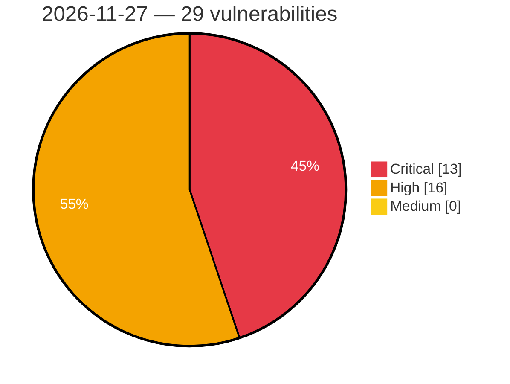

# Critical, High & Medium Severity Vulnerabilities — 2026-11-27

**Source status for this day:**

| Source | Critical | High | Medium | Total |
|--------|---------:|-----:|-------:|------:|
| cvefeed.io (High/Critical) | 13 | 16 | 0 | 29 |

**KEV (actively exploited):** 0  **Watchlist matches:** 16

## Critical (13)

| CVSS | Flags | Source | CVE / Title | Reported |
|------|-------|--------|-------------|----------|
| 10.0 | — | cvefeed.io (High/Critical) | [CVE-2026-137724 - Mitel OpenScape 4000 and OpenScape 4000 Manager Improper Authentication Vulnerability](https://cvefeed.io/vuln/detail/CVE-2026-137724) | 5 hours, 38 minutes ago |
| 10.0 | ⭐ | cvefeed.io (High/Critical) | [CVE-2026-137721 - Mitel OpenScape 4000 Command Injection Vulnerability](https://cvefeed.io/vuln/detail/CVE-2026-137721) | 5 hours, 38 minutes ago |
| 9.9 | — | cvefeed.io (High/Critical) | [CVE-2026-137706 - Direk Tech｜Smart Portal - Missing Authorization](https://cvefeed.io/vuln/detail/CVE-2026-137706) | 37 minutes ago |
| 9.8 | ⭐ | cvefeed.io (High/Critical) | [CVE-2026-115867 - Database for Contact Form 7, WPforms, Elementor forms <= 1.5.5 - Unauthenticated Arbitrary File Upload via Ninja Forms Submission](https://cvefeed.io/vuln/detail/CVE-2026-115867) | 1 hour, 37 minutes ago |
| 9.8 | ⭐ | cvefeed.io (High/Critical) | [CVE-2026-106125 - Sneeit Framework <= 8.7 - Unauthenticated Remote Code Execution via sneeit_compact_menu_mega_content_callback](https://cvefeed.io/vuln/detail/CVE-2026-106125) | 1 hour, 37 minutes ago |
| 9.8 | — | cvefeed.io (High/Critical) | [CVE-2026-59103 - MONEO ERP unauthenticated session forging via the public Ping JSON-RPC method](https://cvefeed.io/vuln/detail/CVE-2026-59103) | 2 hours, 38 minutes ago |
| 9.8 | ⭐ | cvefeed.io (High/Critical) | [CVE-2026-137738 - RealVNC Remote Code Execution Vulnerability](https://cvefeed.io/vuln/detail/CVE-2026-137738) | 5 hours, 38 minutes ago |
| 9.6 | ⭐ | cvefeed.io (High/Critical) | [CVE-2026-137723 - Mitel OpenScape 4000 Command Injection Vulnerability](https://cvefeed.io/vuln/detail/CVE-2026-137723) | 5 hours, 38 minutes ago |
| 9.3 | ⭐ | cvefeed.io (High/Critical) | [CVE-2026-133941 - JTL-Shop: Reflected cross-site scripting in the backend country manager via the activeSortOrder parameter](https://cvefeed.io/vuln/detail/CVE-2026-133941) | 2 hours, 38 minutes ago |
| 9.3 | ⭐ | cvefeed.io (High/Critical) | [CVE-2026-133939 - JTL-Shop: Reflected cross-site scripting in the OPC start menu via the search term](https://cvefeed.io/vuln/detail/CVE-2026-133939) | 2 hours, 38 minutes ago |
| 9.3 | ⭐ | cvefeed.io (High/Critical) | [CVE-2026-133938 - JTL-Shop: Missing CSRF protection in the backend language switch leads to cross-site scripting in the administration backend](https://cvefeed.io/vuln/detail/CVE-2026-133938) | 2 hours, 38 minutes ago |
| 9.2 | ⭐ | cvefeed.io (High/Critical) | [CVE-2026-135384 - lxd: Improper authentication in OIDC bearer token verification](https://cvefeed.io/vuln/detail/CVE-2026-135384) | 3 hours, 37 minutes ago |
| 9.1 | — | cvefeed.io (High/Critical) | [CVE-2026-127163 - pylxd: Improper certificate validation in websocket connections](https://cvefeed.io/vuln/detail/CVE-2026-127163) | 3 hours, 37 minutes ago |

## High (16)

| CVSS | Flags | Source | CVE / Title | Reported |
|------|-------|--------|-------------|----------|
| 8.8 | — | cvefeed.io (High/Critical) | [CVE-2026-137704 - D-Link｜D-Link DWM-222W - Use of Hard-coded Credentials](https://cvefeed.io/vuln/detail/CVE-2026-137704) | 37 minutes ago |
| 8.8 | ⭐ | cvefeed.io (High/Critical) | [CVE-2026-113774 - Schema & Structured Data for WP & AMP <= 1.68 - Unauthenticated Deserialization of Untrusted Data to Arbitrary File Deletion via 'saswp_reviewer_name' Parameter via Public Review Form](https://cvefeed.io/vuln/detail/CVE-2026-113774) | 1 hour, 37 minutes ago |
| 8.8 | — | cvefeed.io (High/Critical) | [CVE-2026-115283 - Missing authentication vulnerability in BS2500/BS500 Virtage Firmware](https://cvefeed.io/vuln/detail/CVE-2026-115283) | 6 hours, 36 minutes ago |
| 8.8 | — | cvefeed.io (High/Critical) | [CVE-2026-105917 - File Permission Vulnerability in RV3000 Log Monitor for VMware](https://cvefeed.io/vuln/detail/CVE-2026-105917) | 6 hours, 36 minutes ago |
| 8.7 | ⭐ | cvefeed.io (High/Critical) | [CVE-2026-137705 - Direk Tech｜Smart Portal - Arbitrary File Read](https://cvefeed.io/vuln/detail/CVE-2026-137705) | 37 minutes ago |
| 8.5 | — | cvefeed.io (High/Critical) | [CVE-2026-136976 - lxd: Improper link resolution in recursive file pull client handling](https://cvefeed.io/vuln/detail/CVE-2026-136976) | 3 hours, 37 minutes ago |
| 8.4 | ⭐ | cvefeed.io (High/Critical) | [CVE-2026-80477 - Dell Secure Connect Gateway SQL Injection Vulnerability](https://cvefeed.io/vuln/detail/CVE-2026-80477) | 1 hour, 38 minutes ago |
| 8.4 | — | cvefeed.io (High/Critical) | [CVE-2026-80453 - Dell Secure Connect Gateway Virtual Edition Improper Integrity Check Vulnerability](https://cvefeed.io/vuln/detail/CVE-2026-80453) | 2 hours, 38 minutes ago |
| 8.4 | — | cvefeed.io (High/Critical) | [CVE-2026-115288 - Missing authentication vulnerability in BS2500/BS500 Virtage Firmware](https://cvefeed.io/vuln/detail/CVE-2026-115288) | 6 hours, 36 minutes ago |
| 8.4 | — | cvefeed.io (High/Critical) | [CVE-2026-115284 - Missing authentication vulnerability in BS2500/BS500 Virtage Firmware](https://cvefeed.io/vuln/detail/CVE-2026-115284) | 6 hours, 36 minutes ago |
| 8.3 | ⭐ | cvefeed.io (High/Critical) | [CVE-2026-132890 - Eclipse Dataspace Components HashiCorp Vault Extension Path Traversal Vulnerability](https://cvefeed.io/vuln/detail/CVE-2026-132890) | 2 hours, 38 minutes ago |
| 8.2 | ⭐ | cvefeed.io (High/Critical) | [CVE-2026-133940 - JTL-Shop: Database and file backups in export/backup can be downloaded without authentication](https://cvefeed.io/vuln/detail/CVE-2026-133940) | 2 hours, 38 minutes ago |
| 8.2 | ⭐ | cvefeed.io (High/Critical) | [CVE-2026-133842 - Flatpak: flatpak: flatpak-system-helper extra-data privilege escalation if canonicalizing permissions fails with emfile](https://cvefeed.io/vuln/detail/CVE-2026-133842) | 2 hours, 38 minutes ago |
| 8.1 | — | cvefeed.io (High/Critical) | [CVE-2026-137702 - Exim Heap Out-of-Bounds Write](https://cvefeed.io/vuln/detail/CVE-2026-137702) | 1 hour, 37 minutes ago |
| 8.1 | ⭐ | cvefeed.io (High/Critical) | [CVE-2026-80472 - Dell Secure Connect Gateway OS Command Injection Vulnerability](https://cvefeed.io/vuln/detail/CVE-2026-80472) | 1 hour, 38 minutes ago |
| 8.1 | — | cvefeed.io (High/Critical) | [CVE-2026-119071 - W3 Total Cache <= 2.11.0 - Authenticated (Author+) File Deletion via 'w3tc_imageservice' Post Meta](https://cvefeed.io/vuln/detail/CVE-2026-119071) | 6 hours, 36 minutes ago |
