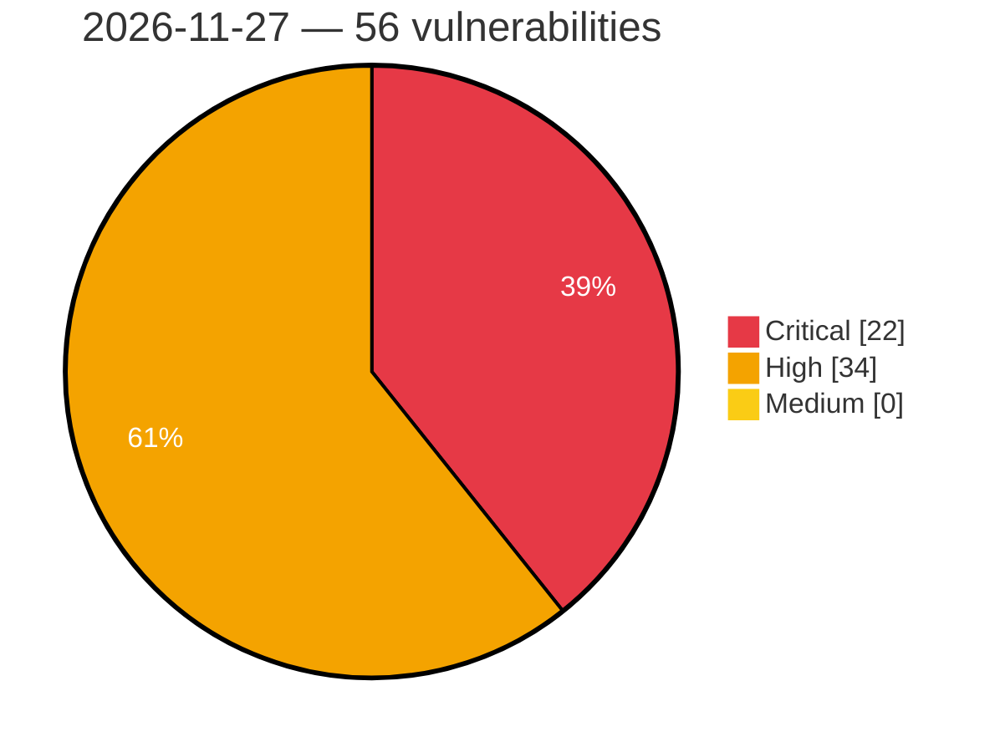

# Critical, High & Medium Severity Vulnerabilities — 2026-11-27

**Source status for this day:**

| Source | Critical | High | Medium | Total |
|--------|---------:|-----:|-------:|------:|
| cvefeed.io (High/Critical) | 22 | 34 | 0 | 56 |

**KEV (actively exploited):** 0  **Watchlist matches:** 39

## Critical (22)

| CVSS | Flags | Source | CVE / Title | Reported |
|------|-------|--------|-------------|----------|
| 10.0 | — | cvefeed.io (High/Critical) | [CVE-2026-137724 - Mitel OpenScape 4000 and OpenScape 4000 Manager Improper Authentication Vulnerability](https://cvefeed.io/vuln/detail/CVE-2026-137724) | 5 hours, 38 minutes ago |
| 10.0 | ⭐ | cvefeed.io (High/Critical) | [CVE-2026-137721 - Mitel OpenScape 4000 Command Injection Vulnerability](https://cvefeed.io/vuln/detail/CVE-2026-137721) | 5 hours, 38 minutes ago |
| 10.0 | ⭐ | cvefeed.io (High/Critical) | [CVE-2026-138004 - TRENDnet TEW-751DR/TEW-733GR UPnP Igd Control Endpoint soap.cgi soapcgi_main os command injection](https://cvefeed.io/vuln/detail/CVE-2026-138004) | 4 hours, 42 minutes ago |
| 9.9 | — | cvefeed.io (High/Critical) | [CVE-2026-137706 - Direk Tech｜Smart Portal - Missing Authorization](https://cvefeed.io/vuln/detail/CVE-2026-137706) | 37 minutes ago |
| 9.8 | ⭐ | cvefeed.io (High/Critical) | [CVE-2026-115867 - Database for Contact Form 7, WPforms, Elementor forms <= 1.5.5 - Unauthenticated Arbitrary File Upload via Ninja Forms Submission](https://cvefeed.io/vuln/detail/CVE-2026-115867) | 1 hour, 37 minutes ago |
| 9.8 | ⭐ | cvefeed.io (High/Critical) | [CVE-2026-106125 - Sneeit Framework <= 8.7 - Unauthenticated Remote Code Execution via sneeit_compact_menu_mega_content_callback](https://cvefeed.io/vuln/detail/CVE-2026-106125) | 1 hour, 37 minutes ago |
| 9.8 | — | cvefeed.io (High/Critical) | [CVE-2026-59103 - MONEO ERP unauthenticated session forging via the public Ping JSON-RPC method](https://cvefeed.io/vuln/detail/CVE-2026-59103) | 2 hours, 38 minutes ago |
| 9.8 | ⭐ | cvefeed.io (High/Critical) | [CVE-2026-137738 - RealVNC Remote Code Execution Vulnerability](https://cvefeed.io/vuln/detail/CVE-2026-137738) | 5 hours, 38 minutes ago |
| 9.8 | ⭐ | cvefeed.io (High/Critical) | [CVE-2026-136115 - WordPress MemberPress Discord Addon plugin <= 1.1.5 - Privilege Escalation vulnerability](https://cvefeed.io/vuln/detail/CVE-2026-136115) | 2 hours, 26 minutes ago |
| 9.8 | ⭐ | cvefeed.io (High/Critical) | [CVE-2026-137964 - ToolJet before 3.21.96-LTS Command Injection via Release Workflow Pull Request Title](https://cvefeed.io/vuln/detail/CVE-2026-137964) | 5 hours, 25 minutes ago |
| 9.8 | ⭐ | cvefeed.io (High/Critical) | [CVE-2026-134994 - WordPress Revertix – Backup, Migration, Staging & Clone plugin <= 1.0.3 - PHP Object Injection vulnerability](https://cvefeed.io/vuln/detail/CVE-2026-134994) | 7 hours, 26 minutes ago |
| 9.6 | ⭐ | cvefeed.io (High/Critical) | [CVE-2026-137723 - Mitel OpenScape 4000 Command Injection Vulnerability](https://cvefeed.io/vuln/detail/CVE-2026-137723) | 5 hours, 38 minutes ago |
| 9.3 | ⭐ | cvefeed.io (High/Critical) | [CVE-2026-133941 - JTL-Shop: Reflected cross-site scripting in the backend country manager via the activeSortOrder parameter](https://cvefeed.io/vuln/detail/CVE-2026-133941) | 2 hours, 38 minutes ago |
| 9.3 | ⭐ | cvefeed.io (High/Critical) | [CVE-2026-133939 - JTL-Shop: Reflected cross-site scripting in the OPC start menu via the search term](https://cvefeed.io/vuln/detail/CVE-2026-133939) | 2 hours, 38 minutes ago |
| 9.3 | ⭐ | cvefeed.io (High/Critical) | [CVE-2026-133938 - JTL-Shop: Missing CSRF protection in the backend language switch leads to cross-site scripting in the administration backend](https://cvefeed.io/vuln/detail/CVE-2026-133938) | 2 hours, 38 minutes ago |
| 9.3 | ⭐ | cvefeed.io (High/Critical) | [CVE-2026-136113 - WordPress Hello Clever Gateway for WooCommerce plugin <= 1.8.4 - SQL Injection vulnerability](https://cvefeed.io/vuln/detail/CVE-2026-136113) | 2 hours, 26 minutes ago |
| 9.3 | ⭐ | cvefeed.io (High/Critical) | [CVE-2026-85258 - Unauthorized Access to User Conversations in Google Cloud Vertex AI Assistant](https://cvefeed.io/vuln/detail/CVE-2026-85258) | 7 hours, 26 minutes ago |
| 9.3 | ⭐ | cvefeed.io (High/Critical) | [CVE-2026-135009 - WordPress Media LIbrary Assistant plugin <= 3.43 - SQL Injection vulnerability](https://cvefeed.io/vuln/detail/CVE-2026-135009) | 7 hours, 26 minutes ago |
| 9.2 | ⭐ | cvefeed.io (High/Critical) | [CVE-2026-135384 - lxd: Improper authentication in OIDC bearer token verification](https://cvefeed.io/vuln/detail/CVE-2026-135384) | 3 hours, 37 minutes ago |
| 9.1 | — | cvefeed.io (High/Critical) | [CVE-2026-127163 - pylxd: Improper certificate validation in websocket connections](https://cvefeed.io/vuln/detail/CVE-2026-127163) | 3 hours, 37 minutes ago |
| 9.0 | ⭐ | cvefeed.io (High/Critical) | [CVE-2026-110739 - Privilege Escalation in GKE Fleet Scopes via Namespace Onboarding](https://cvefeed.io/vuln/detail/CVE-2026-110739) | 6 hours, 25 minutes ago |
| 9.0 | — | cvefeed.io (High/Critical) | [CVE-2026-138003 - TRENDnet TEW-751DR UPnP/WFA wfadev.cgi FUN_0040ed90 stack-based overflow](https://cvefeed.io/vuln/detail/CVE-2026-138003) | 5 hours, 40 minutes ago |

## High (34)

| CVSS | Flags | Source | CVE / Title | Reported |
|------|-------|--------|-------------|----------|
| 8.8 | — | cvefeed.io (High/Critical) | [CVE-2026-137704 - D-Link｜D-Link DWM-222W - Use of Hard-coded Credentials](https://cvefeed.io/vuln/detail/CVE-2026-137704) | 37 minutes ago |
| 8.8 | ⭐ | cvefeed.io (High/Critical) | [CVE-2026-113774 - Schema & Structured Data for WP & AMP <= 1.68 - Unauthenticated Deserialization of Untrusted Data to Arbitrary File Deletion via 'saswp_reviewer_name' Parameter via Public Review Form](https://cvefeed.io/vuln/detail/CVE-2026-113774) | 1 hour, 37 minutes ago |
| 8.8 | — | cvefeed.io (High/Critical) | [CVE-2026-115283 - Missing authentication vulnerability in BS2500/BS500 Virtage Firmware](https://cvefeed.io/vuln/detail/CVE-2026-115283) | 6 hours, 36 minutes ago |
| 8.8 | — | cvefeed.io (High/Critical) | [CVE-2026-105917 - File Permission Vulnerability in RV3000 Log Monitor for VMware](https://cvefeed.io/vuln/detail/CVE-2026-105917) | 6 hours, 36 minutes ago |
| 8.8 | ⭐ | cvefeed.io (High/Critical) | [CVE-2026-137953 - Pydantic Deep 0.2.18 before 0.4.0 Missing Authentication in DeepResearch App](https://cvefeed.io/vuln/detail/CVE-2026-137953) | 5 hours, 25 minutes ago |
| 8.8 | ⭐ | cvefeed.io (High/Critical) | [CVE-2026-135048 - WordPress WP ERP plugin <= 2.0.0 - Privilege Escalation vulnerability](https://cvefeed.io/vuln/detail/CVE-2026-135048) | 7 hours, 26 minutes ago |
| 8.7 | ⭐ | cvefeed.io (High/Critical) | [CVE-2026-137705 - Direk Tech｜Smart Portal - Arbitrary File Read](https://cvefeed.io/vuln/detail/CVE-2026-137705) | 37 minutes ago |
| 8.7 | ⭐ | cvefeed.io (High/Critical) | [CVE-2026-138034 - bigcommerce-api-mcp before 1.0.1 Missing Authentication via SSE Transport Routes](https://cvefeed.io/vuln/detail/CVE-2026-138034) | 1 hour, 25 minutes ago |
| 8.7 | ⭐ | cvefeed.io (High/Critical) | [CVE-2026-134129 - smalot/pdfparser before 2.14.0 Quadratic-Time DoS via formatContent()](https://cvefeed.io/vuln/detail/CVE-2026-134129) | 2 hours, 26 minutes ago |
| 8.7 | — | cvefeed.io (High/Critical) | [CVE-2026-137992 - libexpat through 2.11.0 Denial of Service via defineAttribute Duplicate Declarations](https://cvefeed.io/vuln/detail/CVE-2026-137992) | 4 hours, 25 minutes ago |
| 8.7 | ⭐ | cvefeed.io (High/Critical) | [CVE-2026-137963 - ToolJet before 3.21.96-LTS Hard-Coded JWT and Encryption Keys in Helm Chart](https://cvefeed.io/vuln/detail/CVE-2026-137963) | 5 hours, 25 minutes ago |
| 8.7 | ⭐ | cvefeed.io (High/Critical) | [CVE-2026-137954 - Pydantic Deep 0.2.18 before 0.4.0 SSRF and File Read via /export/pdf](https://cvefeed.io/vuln/detail/CVE-2026-137954) | 5 hours, 25 minutes ago |
| 8.7 | ⭐ | cvefeed.io (High/Critical) | [CVE-2026-137952 - svglib before 2.5.0 Denial of Service via Recursive Image Fragment References](https://cvefeed.io/vuln/detail/CVE-2026-137952) | 5 hours, 25 minutes ago |
| 8.6 | ⭐ | cvefeed.io (High/Critical) | [CVE-2026-135968 - WordPress theMarketer plugin <= 1.5.9 - Arbitrary File Upload vulnerability](https://cvefeed.io/vuln/detail/CVE-2026-135968) | 5 hours, 25 minutes ago |
| 8.6 | ⭐ | cvefeed.io (High/Critical) | [CVE-2026-134987 - WordPress WordPress File Upload plugin <= 5.3.1 - Arbitrary File Deletion vulnerability](https://cvefeed.io/vuln/detail/CVE-2026-134987) | 7 hours, 26 minutes ago |
| 8.5 | — | cvefeed.io (High/Critical) | [CVE-2026-136976 - lxd: Improper link resolution in recursive file pull client handling](https://cvefeed.io/vuln/detail/CVE-2026-136976) | 3 hours, 37 minutes ago |
| 8.5 | — | cvefeed.io (High/Critical) | [CVE-2026-137999 - JSONSchema2PoPo2 through 3.0.3 Code Injection via python_class.tmpl Template](https://cvefeed.io/vuln/detail/CVE-2026-137999) | 4 hours, 25 minutes ago |
| 8.5 | ⭐ | cvefeed.io (High/Critical) | [CVE-2026-137998 - Detoxify 0.5.3 through 0.5.4 Insecure Deserialization RCE via load_checkpoint](https://cvefeed.io/vuln/detail/CVE-2026-137998) | 4 hours, 25 minutes ago |
| 8.5 | ⭐ | cvefeed.io (High/Critical) | [CVE-2026-137997 - HCIPy through 0.7.1 Insecure Deserialization via Pickle Files in io.py](https://cvefeed.io/vuln/detail/CVE-2026-137997) | 4 hours, 25 minutes ago |
| 8.5 | ⭐ | cvefeed.io (High/Critical) | [CVE-2026-137994 - Leo through 6.8.10 Insecure Deserialization RCE via .leo Outline Attributes](https://cvefeed.io/vuln/detail/CVE-2026-137994) | 4 hours, 25 minutes ago |
| 8.4 | ⭐ | cvefeed.io (High/Critical) | [CVE-2026-80477 - Dell Secure Connect Gateway SQL Injection Vulnerability](https://cvefeed.io/vuln/detail/CVE-2026-80477) | 1 hour, 38 minutes ago |
| 8.4 | — | cvefeed.io (High/Critical) | [CVE-2026-80453 - Dell Secure Connect Gateway Virtual Edition Improper Integrity Check Vulnerability](https://cvefeed.io/vuln/detail/CVE-2026-80453) | 2 hours, 38 minutes ago |
| 8.4 | — | cvefeed.io (High/Critical) | [CVE-2026-115288 - Missing authentication vulnerability in BS2500/BS500 Virtage Firmware](https://cvefeed.io/vuln/detail/CVE-2026-115288) | 6 hours, 36 minutes ago |
| 8.4 | — | cvefeed.io (High/Critical) | [CVE-2026-115284 - Missing authentication vulnerability in BS2500/BS500 Virtage Firmware](https://cvefeed.io/vuln/detail/CVE-2026-115284) | 6 hours, 36 minutes ago |
| 8.4 | — | cvefeed.io (High/Critical) | [CVE-2026-80507 - Dell Secure Connect Gateway Virtual Edition Heap-based Buffer Overflow Vulnerability](https://cvefeed.io/vuln/detail/CVE-2026-80507) | 6 hours, 25 minutes ago |
| 8.4 | ⭐ | cvefeed.io (High/Critical) | [CVE-2026-80485 - Dell Secure Connect Gateway OS Command Injection Vulnerability](https://cvefeed.io/vuln/detail/CVE-2026-80485) | 7 hours, 26 minutes ago |
| 8.3 | ⭐ | cvefeed.io (High/Critical) | [CVE-2026-132890 - Eclipse Dataspace Components HashiCorp Vault Extension Path Traversal Vulnerability](https://cvefeed.io/vuln/detail/CVE-2026-132890) | 2 hours, 38 minutes ago |
| 8.2 | ⭐ | cvefeed.io (High/Critical) | [CVE-2026-133940 - JTL-Shop: Database and file backups in export/backup can be downloaded without authentication](https://cvefeed.io/vuln/detail/CVE-2026-133940) | 2 hours, 38 minutes ago |
| 8.2 | ⭐ | cvefeed.io (High/Critical) | [CVE-2026-133842 - Flatpak: flatpak: flatpak-system-helper extra-data privilege escalation if canonicalizing permissions fails with emfile](https://cvefeed.io/vuln/detail/CVE-2026-133842) | 2 hours, 38 minutes ago |
| 8.2 | ⭐ | cvefeed.io (High/Critical) | [CVE-2026-137959 - n8n before 1.123.96, 2.47.6, 2.48.3, and 3.2.2 Improper Authorization in Workflow Activation Trigger Credentials](https://cvefeed.io/vuln/detail/CVE-2026-137959) | 5 hours, 25 minutes ago |
| 8.2 | ⭐ | cvefeed.io (High/Critical) | [CVE-2026-137957 - n8n before 1.123.96, 2.47.6, 2.48.3, and 3.2.2 Path Traversal in Integration Nodes](https://cvefeed.io/vuln/detail/CVE-2026-137957) | 5 hours, 25 minutes ago |
| 8.1 | — | cvefeed.io (High/Critical) | [CVE-2026-137702 - Exim Heap Out-of-Bounds Write](https://cvefeed.io/vuln/detail/CVE-2026-137702) | 1 hour, 37 minutes ago |
| 8.1 | ⭐ | cvefeed.io (High/Critical) | [CVE-2026-80472 - Dell Secure Connect Gateway OS Command Injection Vulnerability](https://cvefeed.io/vuln/detail/CVE-2026-80472) | 1 hour, 38 minutes ago |
| 8.1 | — | cvefeed.io (High/Critical) | [CVE-2026-119071 - W3 Total Cache <= 2.11.0 - Authenticated (Author+) File Deletion via 'w3tc_imageservice' Post Meta](https://cvefeed.io/vuln/detail/CVE-2026-119071) | 6 hours, 36 minutes ago |
