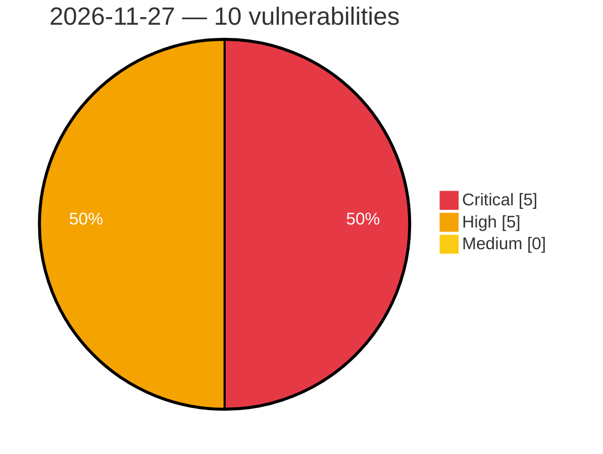

# Critical, High & Medium Severity Vulnerabilities — 2026-11-27

**Source status for this day:**

| Source | Critical | High | Medium | Total |
|--------|---------:|-----:|-------:|------:|
| cvefeed.io (High/Critical) | 5 | 5 | 0 | 10 |

**KEV (actively exploited):** 0  **Watchlist matches:** 5

## Critical (5)

| CVSS | Flags | Source | CVE / Title | Reported |
|------|-------|--------|-------------|----------|
| 9.9 | — | cvefeed.io (High/Critical) | [CVE-2026-137706 - Direk Tech｜Smart Portal - Missing Authorization](https://cvefeed.io/vuln/detail/CVE-2026-137706) | 37 minutes ago |
| 9.8 | ⭐ | cvefeed.io (High/Critical) | [CVE-2026-115867 - Database for Contact Form 7, WPforms, Elementor forms <= 1.5.5 - Unauthenticated Arbitrary File Upload via Ninja Forms Submission](https://cvefeed.io/vuln/detail/CVE-2026-115867) | 1 hour, 37 minutes ago |
| 9.8 | ⭐ | cvefeed.io (High/Critical) | [CVE-2026-106125 - Sneeit Framework <= 8.7 - Unauthenticated Remote Code Execution via sneeit_compact_menu_mega_content_callback](https://cvefeed.io/vuln/detail/CVE-2026-106125) | 1 hour, 37 minutes ago |
| 9.2 | ⭐ | cvefeed.io (High/Critical) | [CVE-2026-135384 - lxd: Improper authentication in OIDC bearer token verification](https://cvefeed.io/vuln/detail/CVE-2026-135384) | 3 hours, 37 minutes ago |
| 9.1 | — | cvefeed.io (High/Critical) | [CVE-2026-127163 - pylxd: Improper certificate validation in websocket connections](https://cvefeed.io/vuln/detail/CVE-2026-127163) | 3 hours, 37 minutes ago |

## High (5)

| CVSS | Flags | Source | CVE / Title | Reported |
|------|-------|--------|-------------|----------|
| 8.8 | — | cvefeed.io (High/Critical) | [CVE-2026-137704 - D-Link｜D-Link DWM-222W - Use of Hard-coded Credentials](https://cvefeed.io/vuln/detail/CVE-2026-137704) | 37 minutes ago |
| 8.8 | ⭐ | cvefeed.io (High/Critical) | [CVE-2026-113774 - Schema & Structured Data for WP & AMP <= 1.68 - Unauthenticated Deserialization of Untrusted Data to Arbitrary File Deletion via 'saswp_reviewer_name' Parameter via Public Review Form](https://cvefeed.io/vuln/detail/CVE-2026-113774) | 1 hour, 37 minutes ago |
| 8.7 | ⭐ | cvefeed.io (High/Critical) | [CVE-2026-137705 - Direk Tech｜Smart Portal - Arbitrary File Read](https://cvefeed.io/vuln/detail/CVE-2026-137705) | 37 minutes ago |
| 8.5 | — | cvefeed.io (High/Critical) | [CVE-2026-136976 - lxd: Improper link resolution in recursive file pull client handling](https://cvefeed.io/vuln/detail/CVE-2026-136976) | 3 hours, 37 minutes ago |
| 8.1 | — | cvefeed.io (High/Critical) | [CVE-2026-137702 - Exim Heap Out-of-Bounds Write](https://cvefeed.io/vuln/detail/CVE-2026-137702) | 1 hour, 37 minutes ago |
