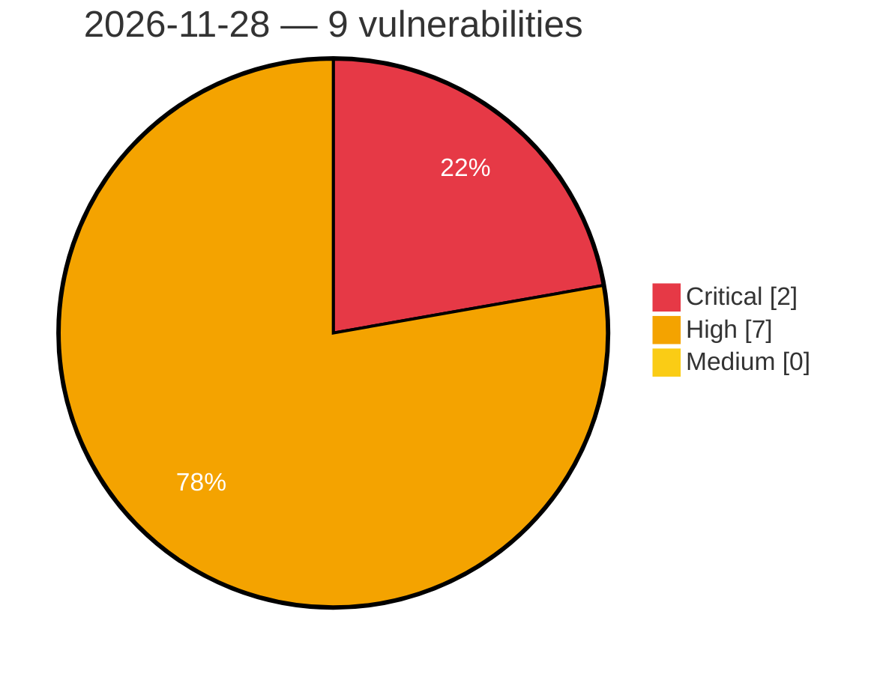

# Critical, High & Medium Severity Vulnerabilities — 2026-11-28

**Source status for this day:**

| Source | Critical | High | Medium | Total |
|--------|---------:|-----:|-------:|------:|
| cvefeed.io (High/Critical) | 2 | 7 | 0 | 9 |

**KEV (actively exploited):** 0  **Watchlist matches:** 3

## Critical (2)

| CVSS | Flags | Source | CVE / Title | Reported |
|------|-------|--------|-------------|----------|
| 10.0 | ⭐ | cvefeed.io (High/Critical) | [CVE-2026-138005 - TRENDnet TEW-751DR UPnP Event gena.php GENA_notify_init os command injection](https://cvefeed.io/vuln/detail/CVE-2026-138005) | 53 minutes ago |
| 9.3 | — | cvefeed.io (High/Critical) | [CVE-2026-138154 - POSTAL 2 before build 26810491 Workshop Mod Sandbox Escape Code Execution via ConsoleCommand](https://cvefeed.io/vuln/detail/CVE-2026-138154) | 41 minutes ago |

## High (7)

| CVSS | Flags | Source | CVE / Title | Reported |
|------|-------|--------|-------------|----------|
| 8.8 | ⭐ | cvefeed.io (High/Critical) | [CVE-2026-138119 - Kestra before 1.3.36 Reflected XSS via Executions Page Sort Parameter](https://cvefeed.io/vuln/detail/CVE-2026-138119) | 1 hour, 41 minutes ago |
| 8.5 | — | cvefeed.io (High/Critical) | [CVE-2026-138163 - Gammu before 1.45.2 Heap Buffer Overflow via ReadWAPSettingsEntry()](https://cvefeed.io/vuln/detail/CVE-2026-138163) | 41 minutes ago |
| 8.5 | — | cvefeed.io (High/Critical) | [CVE-2026-138161 - Gammu before 1.45.2 Buffer Overflow via LoadBackup() MD5 Checksum](https://cvefeed.io/vuln/detail/CVE-2026-138161) | 41 minutes ago |
| 8.5 | — | cvefeed.io (High/Critical) | [CVE-2026-138160 - Gammu before 1.45.2 Stack-Based Buffer Overflow via ReadBackupTextLen()](https://cvefeed.io/vuln/detail/CVE-2026-138160) | 41 minutes ago |
| 8.5 | ⭐ | cvefeed.io (High/Critical) | [CVE-2026-138118 - HyperSpy 1.4.0 before 2.6.0 Insecure Deserialization RCE via Stored Model Restoration](https://cvefeed.io/vuln/detail/CVE-2026-138118) | 1 hour, 41 minutes ago |
| 8.5 | — | cvefeed.io (High/Critical) | [CVE-2026-138117 - HyperSpy before 2.6.0 Code Execution via sympy.sympify() in HSPY/ZSPY Files](https://cvefeed.io/vuln/detail/CVE-2026-138117) | 1 hour, 41 minutes ago |
| 8.2 | — | cvefeed.io (High/Critical) | [CVE-2026-138151 - bgpq4 before 1.17 Heap Buffer Overflow via IRRd A<len> Reply Handling](https://cvefeed.io/vuln/detail/CVE-2026-138151) | 1 hour, 41 minutes ago |
