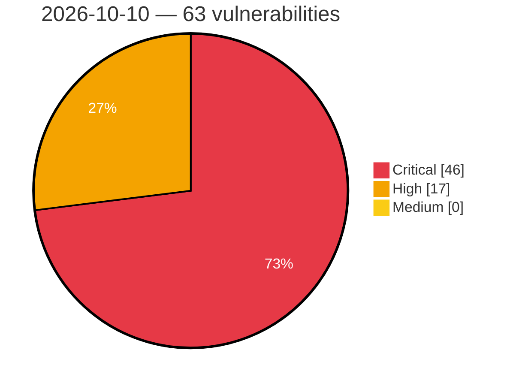

# Critical, High & Medium Severity Vulnerabilities — 2026-10-10

**Source status for this day:**

| Source | Critical | High | Medium | Total |
|--------|---------:|-----:|-------:|------:|
| cvefeed.io (High/Critical) | 46 | 17 | 0 | 63 |

**KEV (actively exploited):** 0  **Watchlist matches:** 38

## Critical (46)

| CVSS | Flags | Source | CVE / Title | Reported |
|------|-------|--------|-------------|----------|
| 9.9 | ⭐ | cvefeed.io (High/Critical) | [CVE-2026-62129 - WordPress Creator LMS plugin <= 1.2.21 - Arbitrary File Upload vulnerability](https://cvefeed.io/vuln/detail/CVE-2026-62129) | 1 hour, 34 minutes ago |
| 9.8 | ⭐ | cvefeed.io (High/Critical) | [CVE-2026-108474 - JetBrains Exposed SQL Injection](https://cvefeed.io/vuln/detail/CVE-2026-108474) | 1 hour, 33 minutes ago |
| 9.8 | ⭐ | cvefeed.io (High/Critical) | [CVE-2026-93945 - WordPress Balance theme <= 1.12.0 - PHP Object Injection vulnerability](https://cvefeed.io/vuln/detail/CVE-2026-93945) | 1 hour, 6 minutes ago |
| 9.8 | ⭐ | cvefeed.io (High/Critical) | [CVE-2026-93944 - WordPress Camelia theme <= 1.2.15 - PHP Object Injection vulnerability](https://cvefeed.io/vuln/detail/CVE-2026-93944) | 1 hour, 6 minutes ago |
| 9.8 | ⭐ | cvefeed.io (High/Critical) | [CVE-2026-93943 - WordPress Convex theme <= 1.16.0 - PHP Object Injection vulnerability](https://cvefeed.io/vuln/detail/CVE-2026-93943) | 1 hour, 6 minutes ago |
| 9.8 | ⭐ | cvefeed.io (High/Critical) | [CVE-2026-93942 - WordPress Dwell theme <= 1.16.0 - PHP Object Injection vulnerability](https://cvefeed.io/vuln/detail/CVE-2026-93942) | 1 hour, 6 minutes ago |
| 9.8 | ⭐ | cvefeed.io (High/Critical) | [CVE-2026-93941 - WordPress Edema theme <= 1.2.2.2 - PHP Object Injection vulnerability](https://cvefeed.io/vuln/detail/CVE-2026-93941) | 1 hour, 6 minutes ago |
| 9.8 | ⭐ | cvefeed.io (High/Critical) | [CVE-2026-93940 - WordPress Greeny theme <= 2.10.0 - PHP Object Injection vulnerability](https://cvefeed.io/vuln/detail/CVE-2026-93940) | 1 hour, 6 minutes ago |
| 9.8 | ⭐ | cvefeed.io (High/Critical) | [CVE-2026-93938 - WordPress Hogwords theme <= 1.2.7 - PHP Object Injection vulnerability](https://cvefeed.io/vuln/detail/CVE-2026-93938) | 1 hour, 6 minutes ago |
| 9.8 | ⭐ | cvefeed.io (High/Critical) | [CVE-2026-93937 - WordPress Hygia theme <= 1.21.0 - PHP Object Injection vulnerability](https://cvefeed.io/vuln/detail/CVE-2026-93937) | 1 hour, 6 minutes ago |
| 9.8 | ⭐ | cvefeed.io (High/Critical) | [CVE-2026-93936 - WordPress IPharm theme <= 1.2.4 - PHP Object Injection vulnerability](https://cvefeed.io/vuln/detail/CVE-2026-93936) | 1 hour, 6 minutes ago |
| 9.8 | ⭐ | cvefeed.io (High/Critical) | [CVE-2026-93935 - WordPress Let's Play theme <= 1.1.15 - PHP Object Injection vulnerability](https://cvefeed.io/vuln/detail/CVE-2026-93935) | 1 hour, 6 minutes ago |
| 9.8 | ⭐ | cvefeed.io (High/Critical) | [CVE-2026-93934 - WordPress Partiso theme <= 1.1.13 - PHP Object Injection vulnerability](https://cvefeed.io/vuln/detail/CVE-2026-93934) | 1 hour, 6 minutes ago |
| 9.8 | ⭐ | cvefeed.io (High/Critical) | [CVE-2026-93933 - WordPress Rosalinda theme <= 1.2.4 - PHP Object Injection vulnerability](https://cvefeed.io/vuln/detail/CVE-2026-93933) | 1 hour, 6 minutes ago |
| 9.8 | ⭐ | cvefeed.io (High/Critical) | [CVE-2026-93932 - WordPress Smart Casa theme <= 1.0.12 - PHP Object Injection vulnerability](https://cvefeed.io/vuln/detail/CVE-2026-93932) | 1 hour, 6 minutes ago |
| 9.8 | ⭐ | cvefeed.io (High/Critical) | [CVE-2026-93931 - WordPress Smash theme <= 1.12.0 - PHP Object Injection vulnerability](https://cvefeed.io/vuln/detail/CVE-2026-93931) | 1 hour, 6 minutes ago |
| 9.8 | ⭐ | cvefeed.io (High/Critical) | [CVE-2026-93930 - WordPress Tantra theme <= 2.9.0 - PHP Object Injection vulnerability](https://cvefeed.io/vuln/detail/CVE-2026-93930) | 1 hour, 6 minutes ago |
| 9.8 | ⭐ | cvefeed.io (High/Critical) | [CVE-2026-93929 - WordPress Travesia theme <= 1.1.16 - PHP Object Injection vulnerability](https://cvefeed.io/vuln/detail/CVE-2026-93929) | 1 hour, 6 minutes ago |
| 9.8 | ⭐ | cvefeed.io (High/Critical) | [CVE-2026-93927 - WordPress Veto theme <= 1.6.0 - PHP Object Injection vulnerability](https://cvefeed.io/vuln/detail/CVE-2026-93927) | 1 hour, 6 minutes ago |
| 9.8 | ⭐ | cvefeed.io (High/Critical) | [CVE-2026-62046 - WordPress Gutentype theme <= 2.1.12 - PHP Object Injection vulnerability](https://cvefeed.io/vuln/detail/CVE-2026-62046) | 1 hour, 6 minutes ago |
| 9.8 | ⭐ | cvefeed.io (High/Critical) | [CVE-2026-62045 - WordPress Booklovers theme <= 2.13.0 - PHP Object Injection vulnerability](https://cvefeed.io/vuln/detail/CVE-2026-62045) | 1 hour, 6 minutes ago |
| 9.8 | ⭐ | cvefeed.io (High/Critical) | [CVE-2026-104803 - WPCOM Member <= 1.7.27 - Unauthenticated Authentication Bypass via 'uuid' and 'code' Parameters on Social-Login Callback](https://cvefeed.io/vuln/detail/CVE-2026-104803) | 1 hour, 6 minutes ago |
| 9.8 | ⭐ | cvefeed.io (High/Critical) | [CVE-2026-106610 - WordPress miniorange otp verification plugin <= 5.5.7 - Privilege Escalation vulnerability](https://cvefeed.io/vuln/detail/CVE-2026-106610) | 53 minutes ago |
| 9.8 | ⭐ | cvefeed.io (High/Critical) | [CVE-2026-105892 - WordPress rtMedia for WordPress, BuddyPress and bbPress plugin <= 4.7.13 - Arbitrary File Deletion vulnerability](https://cvefeed.io/vuln/detail/CVE-2026-105892) | 53 minutes ago |
| 9.8 | ⭐ | cvefeed.io (High/Critical) | [CVE-2026-104398 - WordPress AFFI – Affiliate Marketing for WooCommerce plugin <= 1.0.10 - PHP Object Injection vulnerability](https://cvefeed.io/vuln/detail/CVE-2026-104398) | 1 hour, 45 minutes ago |
| 9.8 | ⭐ | cvefeed.io (High/Critical) | [CVE-2026-108551 - openapi-typescript-codegen through 0.31.0 Code Injection via Handlebars Templates](https://cvefeed.io/vuln/detail/CVE-2026-108551) | 3 hours, 45 minutes ago |
| 9.8 | — | cvefeed.io (High/Critical) | [CVE-2026-81797 - WordPress Buzz Stone \| Magazine & Viral Blog WordPress Theme theme <= 1.0.2 - PHP Object Injection vulnerability](https://cvefeed.io/vuln/detail/CVE-2026-81797) | 1 hour, 33 minutes ago |
| 9.8 | — | cvefeed.io (High/Critical) | [CVE-2026-78535 - WordPress Photolia theme <= 1.0.3 - PHP Object Injection vulnerability](https://cvefeed.io/vuln/detail/CVE-2026-78535) | 1 hour, 33 minutes ago |
| 9.8 | — | cvefeed.io (High/Critical) | [CVE-2026-78533 - WordPress Qwery theme <= 3.6.1 - PHP Object Injection vulnerability](https://cvefeed.io/vuln/detail/CVE-2026-78533) | 1 hour, 33 minutes ago |
| 9.8 | — | cvefeed.io (High/Critical) | [CVE-2026-78531 - WordPress Jacqueline theme <= 2.22 - PHP Object Injection vulnerability](https://cvefeed.io/vuln/detail/CVE-2026-78531) | 1 hour, 33 minutes ago |
| 9.8 | — | cvefeed.io (High/Critical) | [CVE-2026-78529 - WordPress Alliance theme <= 3.11 - PHP Object Injection vulnerability](https://cvefeed.io/vuln/detail/CVE-2026-78529) | 1 hour, 33 minutes ago |
| 9.8 | — | cvefeed.io (High/Critical) | [CVE-2026-66569 - WordPress Kicker theme <= 2.2.1 - PHP Object Injection vulnerability](https://cvefeed.io/vuln/detail/CVE-2026-66569) | 1 hour, 33 minutes ago |
| 9.8 | — | cvefeed.io (High/Critical) | [CVE-2026-66568 - WordPress Original theme <= 1.9.0 - PHP Object Injection vulnerability](https://cvefeed.io/vuln/detail/CVE-2026-66568) | 1 hour, 33 minutes ago |
| 9.8 | — | cvefeed.io (High/Critical) | [CVE-2026-66567 - WordPress Anesta theme <= 1.5.3 - PHP Object Injection vulnerability](https://cvefeed.io/vuln/detail/CVE-2026-66567) | 1 hour, 33 minutes ago |
| 9.8 | — | cvefeed.io (High/Critical) | [CVE-2026-66565 - WordPress FC United theme <= 1.1.1 - PHP Object Injection vulnerability](https://cvefeed.io/vuln/detail/CVE-2026-66565) | 1 hour, 33 minutes ago |
| 9.8 | — | cvefeed.io (High/Critical) | [CVE-2026-66564 - WordPress ShiftCV theme <= 3.0.14 - PHP Object Injection vulnerability](https://cvefeed.io/vuln/detail/CVE-2026-66564) | 1 hour, 33 minutes ago |
| 9.8 | — | cvefeed.io (High/Critical) | [CVE-2026-66563 - WordPress Windsor theme <= 2.10 - PHP Object Injection vulnerability](https://cvefeed.io/vuln/detail/CVE-2026-66563) | 1 hour, 33 minutes ago |
| 9.8 | — | cvefeed.io (High/Critical) | [CVE-2026-66483 - WordPress Education Center theme <= 3.6.12 - PHP Object Injection vulnerability](https://cvefeed.io/vuln/detail/CVE-2026-66483) | 1 hour, 34 minutes ago |
| 9.8 | — | cvefeed.io (High/Critical) | [CVE-2026-66482 - WordPress Drone Media theme <= 2.2.0 - PHP Object Injection vulnerability](https://cvefeed.io/vuln/detail/CVE-2026-66482) | 1 hour, 34 minutes ago |
| 9.8 | — | cvefeed.io (High/Critical) | [CVE-2026-62125 - WordPress Asia Garden theme <= 1.3.1 - PHP Object Injection vulnerability](https://cvefeed.io/vuln/detail/CVE-2026-62125) | 1 hour, 34 minutes ago |
| 9.8 | — | cvefeed.io (High/Critical) | [CVE-2026-62124 - WordPress N7 \| Golf Club Sports & Events theme <= 2.21 - PHP Object Injection vulnerability](https://cvefeed.io/vuln/detail/CVE-2026-62124) | 1 hour, 34 minutes ago |
| 9.8 | — | cvefeed.io (High/Critical) | [CVE-2026-62123 - WordPress Invetex theme <= 2.18 - PHP Object Injection vulnerability](https://cvefeed.io/vuln/detail/CVE-2026-62123) | 1 hour, 34 minutes ago |
| 9.8 | — | cvefeed.io (High/Critical) | [CVE-2026-62120 - WordPress Law Office theme <= 3.20 - PHP Object Injection vulnerability](https://cvefeed.io/vuln/detail/CVE-2026-62120) | 1 hour, 34 minutes ago |
| 9.3 | ⭐ | cvefeed.io (High/Critical) | [CVE-2026-105889 - WordPress Tickera plugin <= 3.6.0.6 - SQL Injection vulnerability](https://cvefeed.io/vuln/detail/CVE-2026-105889) | 1 hour, 45 minutes ago |
| 9.2 | — | cvefeed.io (High/Critical) | [CVE-2026-108549 - cc-connect through 1.5.0 Missing Authentication via MAX Webhook Sender Spoofing](https://cvefeed.io/vuln/detail/CVE-2026-108549) | 3 hours, 45 minutes ago |
| 9.1 | ⭐ | cvefeed.io (High/Critical) | [CVE-2026-104801 - PPOM <= 34.0.10 - Unauthenticated Arbitrary File Deletion via 'ppom[fields][<data_name>][n][org]' Parameter](https://cvefeed.io/vuln/detail/CVE-2026-104801) | 2 hours, 6 minutes ago |

## High (17)

| CVSS | Flags | Source | CVE / Title | Reported |
|------|-------|--------|-------------|----------|
| 8.8 | ⭐ | cvefeed.io (High/Critical) | [CVE-2026-83526 - FV Player 8 <= 8.1.7 - Authenticated (Subscriber+) Arbitrary File Upload via videos[].fv_wp_flowplayer_field_src Parameter](https://cvefeed.io/vuln/detail/CVE-2026-83526) | 3 hours, 6 minutes ago |
| 8.8 | ⭐ | cvefeed.io (High/Critical) | [CVE-2026-108550 - SkillHub before 0.2.22 Account Takeover via Account Merge Flow](https://cvefeed.io/vuln/detail/CVE-2026-108550) | 3 hours, 45 minutes ago |
| 8.8 | ⭐ | cvefeed.io (High/Critical) | [CVE-2026-105885 - WordPress Slider by 10Web plugin <= 1.2.62 - PHP Object Injection vulnerability](https://cvefeed.io/vuln/detail/CVE-2026-105885) | 4 hours, 45 minutes ago |
| 8.5 | ⭐ | cvefeed.io (High/Critical) | [CVE-2026-62117 - WordPress Barcode Scanner with Inventory & Order Manager plugin <= 1.13.1 - SQL Injection vulnerability](https://cvefeed.io/vuln/detail/CVE-2026-62117) | 1 hour, 34 minutes ago |
| 8.2 | ⭐ | cvefeed.io (High/Critical) | [CVE-2026-96341 - WordPress Forminator plugin <= 1.57.3 - Privilege Escalation vulnerability](https://cvefeed.io/vuln/detail/CVE-2026-96341) | 53 minutes ago |
| 8.2 | ⭐ | cvefeed.io (High/Critical) | [CVE-2026-108545 - SillyTavern 1.12.13 through 1.19.0 Pre-Authentication Denial of Service via Body Parsing](https://cvefeed.io/vuln/detail/CVE-2026-108545) | 3 hours, 45 minutes ago |
| 8.1 | ⭐ | cvefeed.io (High/Critical) | [CVE-2026-104759 - WPO365 \| SEAMLESS WORDPRESS + MICROSOFT INTEGRATION (WPO365 \| LOGIN) <= 44.1 - Unauthenticated Authentication Bypass via OIDC Nonce Replay via id_token Nonce Verification](https://cvefeed.io/vuln/detail/CVE-2026-104759) | 1 hour, 6 minutes ago |
| 8.1 | — | cvefeed.io (High/Critical) | [CVE-2026-94538 - WP File Download <= 6.3.9 - Missing Authorization to Authenticated (Subscriber+) Arbitrary File Deletion/Modification via 'task' Parameter to Multiple Functions](https://cvefeed.io/vuln/detail/CVE-2026-94538) | 2 hours, 6 minutes ago |
| 8.1 | ⭐ | cvefeed.io (High/Critical) | [CVE-2026-92975 - Groundhogg <= 4.8.3 - Unauthenticated Privilege Escalation to Support User Identity Confusion](https://cvefeed.io/vuln/detail/CVE-2026-92975) | 3 hours, 6 minutes ago |
| 8.1 | ⭐ | cvefeed.io (High/Critical) | [CVE-2026-94257 - SMS Alert 3.9.6 - 4.0.0 - Unauthenticated Privilege Escalation via Arbitrary Password Reset](https://cvefeed.io/vuln/detail/CVE-2026-94257) | 7 hours, 14 minutes ago |
| 8.1 | ⭐ | cvefeed.io (High/Critical) | [CVE-2026-94256 - SMS Alert 4.0.0 - Unauthenticated Authentication Bypass via Login with OTP](https://cvefeed.io/vuln/detail/CVE-2026-94256) | 7 hours, 14 minutes ago |
| 8.1 | — | cvefeed.io (High/Critical) | [CVE-2026-66566 - WordPress Ambient theme <= 1.7 - Local File Inclusion vulnerability](https://cvefeed.io/vuln/detail/CVE-2026-66566) | 1 hour, 33 minutes ago |
| 8.1 | — | cvefeed.io (High/Critical) | [CVE-2026-62115 - WordPress KuteShop theme <= 4.2.9 - Local File Inclusion vulnerability](https://cvefeed.io/vuln/detail/CVE-2026-62115) | 1 hour, 34 minutes ago |
| 8.1 | — | cvefeed.io (High/Critical) | [CVE-2026-62099 - WordPress Boutique theme <= 2.3.3 - Local File Inclusion vulnerability](https://cvefeed.io/vuln/detail/CVE-2026-62099) | 1 hour, 34 minutes ago |
| 8.1 | — | cvefeed.io (High/Critical) | [CVE-2026-62096 - WordPress Biolife theme <= 3.2.3 - Local File Inclusion vulnerability](https://cvefeed.io/vuln/detail/CVE-2026-62096) | 1 hour, 34 minutes ago |
| 8.1 | — | cvefeed.io (High/Critical) | [CVE-2026-62094 - WordPress TechOne theme <= 3.0.3 - Local File Inclusion vulnerability](https://cvefeed.io/vuln/detail/CVE-2026-62094) | 1 hour, 34 minutes ago |
| 8.1 | — | cvefeed.io (High/Critical) | [CVE-2026-62092 - WordPress Armania theme <= 1.4.8 - Local File Inclusion vulnerability](https://cvefeed.io/vuln/detail/CVE-2026-62092) | 1 hour, 34 minutes ago |
