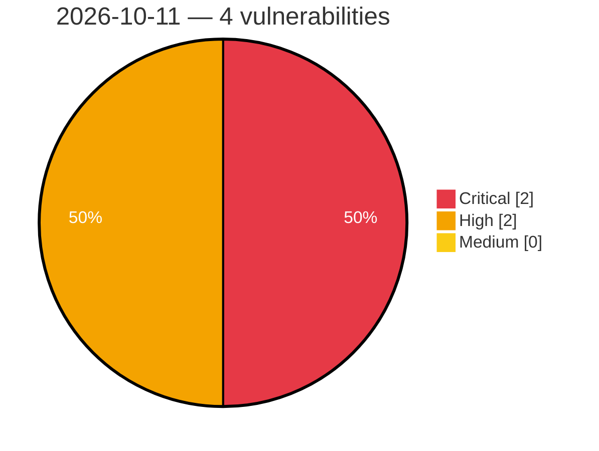

# Critical, High & Medium Severity Vulnerabilities — 2026-10-11

**Source status for this day:**

| Source | Critical | High | Medium | Total |
|--------|---------:|-----:|-------:|------:|
| cvefeed.io (High/Critical) | 2 | 2 | 0 | 4 |

**KEV (actively exploited):** 0  **Watchlist matches:** 3

## Critical (2)

| CVSS | Flags | Source | CVE / Title | Reported |
|------|-------|--------|-------------|----------|
| 9.9 | ⭐ | cvefeed.io (High/Critical) | [CVE-2026-108540 - OpenSpug File Transfer transfer os command injection](https://cvefeed.io/vuln/detail/CVE-2026-108540) | 17 minutes ago |
| 9.8 | ⭐ | cvefeed.io (High/Critical) | [CVE-2026-108707 - Wukong_HRM through commit 186115e Authentication Bypass via ParamAspect](https://cvefeed.io/vuln/detail/CVE-2026-108707) | 5 hours, 18 minutes ago |

## High (2)

| CVSS | Flags | Source | CVE / Title | Reported |
|------|-------|--------|-------------|----------|
| 8.8 | — | cvefeed.io (High/Critical) | [CVE-2026-108708 - Wukong_HRM through commit 186115e Missing Authorization via EmployeeAspect and EmployeeUtil](https://cvefeed.io/vuln/detail/CVE-2026-108708) | 5 hours, 18 minutes ago |
| 8.3 | ⭐ | cvefeed.io (High/Critical) | [CVE-2026-108522 - Studio-Saelix Sencho Login Endpoint login improper authentication](https://cvefeed.io/vuln/detail/CVE-2026-108522) | 3 hours, 17 minutes ago |
