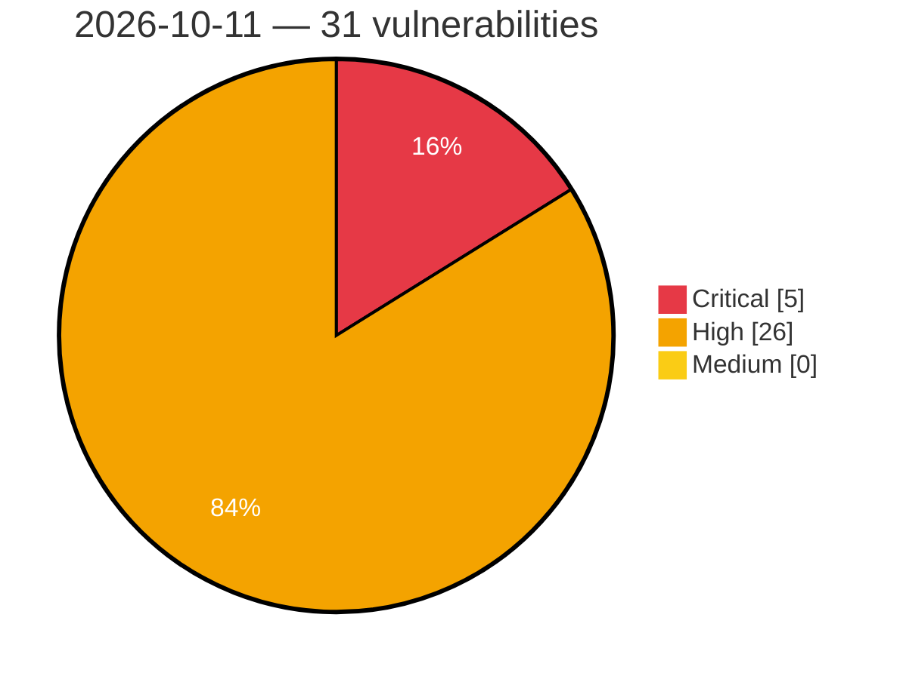

# Critical, High & Medium Severity Vulnerabilities — 2026-10-11

**Source status for this day:**

| Source | Critical | High | Medium | Total |
|--------|---------:|-----:|-------:|------:|
| cvefeed.io (High/Critical) | 5 | 26 | 0 | 31 |

**KEV (actively exploited):** 0  **Watchlist matches:** 23

## Critical (5)

| CVSS | Flags | Source | CVE / Title | Reported |
|------|-------|--------|-------------|----------|
| 10.0 | ⭐ | cvefeed.io (High/Critical) | [CVE-2026-108576 - TOZED X300 IPPingDiagnostics process_ping os command injection](https://cvefeed.io/vuln/detail/CVE-2026-108576) | 33 minutes ago |
| 9.9 | ⭐ | cvefeed.io (High/Critical) | [CVE-2026-108540 - OpenSpug File Transfer transfer os command injection](https://cvefeed.io/vuln/detail/CVE-2026-108540) | 17 minutes ago |
| 9.8 | ⭐ | cvefeed.io (High/Critical) | [CVE-2026-108707 - Wukong_HRM through commit 186115e Authentication Bypass via ParamAspect](https://cvefeed.io/vuln/detail/CVE-2026-108707) | 5 hours, 18 minutes ago |
| 9.4 | ⭐ | cvefeed.io (High/Critical) | [CVE-2026-108753 - Agnaistic agnai through 1.0.555 Hard-Coded Credentials in self-host Docker Compose](https://cvefeed.io/vuln/detail/CVE-2026-108753) | 33 minutes ago |
| 9.3 | ⭐ | cvefeed.io (High/Critical) | [CVE-2026-108860 - BotSharp through 5.2.0 Authentication Bypass via Hard-Coded JWT Signing Key](https://cvefeed.io/vuln/detail/CVE-2026-108860) | 24 minutes ago |

## High (26)

| CVSS | Flags | Source | CVE / Title | Reported |
|------|-------|--------|-------------|----------|
| 8.8 | — | cvefeed.io (High/Critical) | [CVE-2026-108708 - Wukong_HRM through commit 186115e Missing Authorization via EmployeeAspect and EmployeeUtil](https://cvefeed.io/vuln/detail/CVE-2026-108708) | 5 hours, 18 minutes ago |
| 8.8 | ⭐ | cvefeed.io (High/Critical) | [CVE-2026-108865 - AmoyLab Unla through 0.10.0 OAuth2 Authentication Bypass via /authorize](https://cvefeed.io/vuln/detail/CVE-2026-108865) | 24 minutes ago |
| 8.8 | — | cvefeed.io (High/Critical) | [CVE-2026-108758 - Easy!Appointments through 1.6.0 Authorization Bypass via booking/register Endpoint](https://cvefeed.io/vuln/detail/CVE-2026-108758) | 33 minutes ago |
| 8.8 | ⭐ | cvefeed.io (High/Critical) | [CVE-2026-108746 - Vearch 3.5.2 through 3.5.9 Incorrect Authorization via Role.HasPermissionForResources](https://cvefeed.io/vuln/detail/CVE-2026-108746) | 33 minutes ago |
| 8.8 | ⭐ | cvefeed.io (High/Critical) | [CVE-2026-96227 - Piotnet Forms <= 1.0.30 - Unauthenticated Stored XSS via File Upload](https://cvefeed.io/vuln/detail/CVE-2026-96227) | 6 hours, 33 minutes ago |
| 8.7 | ⭐ | cvefeed.io (High/Critical) | [CVE-2026-108863 - Katanemo Plano through 0.4.37 Missing Authentication on Envoy Admin Interface](https://cvefeed.io/vuln/detail/CVE-2026-108863) | 24 minutes ago |
| 8.7 | — | cvefeed.io (High/Critical) | [CVE-2026-108859 - mcp-go through 1.2.1 Denial of Service via Unbounded POST Body Buffering](https://cvefeed.io/vuln/detail/CVE-2026-108859) | 24 minutes ago |
| 8.7 | ⭐ | cvefeed.io (High/Critical) | [CVE-2026-108739 - OpenAgents Workspace through launcher-v1.0.17 Unauthenticated Credential Exposure via /v1/workspaces](https://cvefeed.io/vuln/detail/CVE-2026-108739) | 33 minutes ago |
| 8.7 | — | cvefeed.io (High/Critical) | [CVE-2026-108714 - MCP Kotlin SDK through 0.15.0 Memory Exhaustion via Application.mcpWebSocket](https://cvefeed.io/vuln/detail/CVE-2026-108714) | 33 minutes ago |
| 8.7 | ⭐ | cvefeed.io (High/Critical) | [CVE-2026-108905 - pH7Builder before 18.6.0 Hard-Coded API Key Bypass via Host Header](https://cvefeed.io/vuln/detail/CVE-2026-108905) | 2 hours, 9 minutes ago |
| 8.6 | ⭐ | cvefeed.io (High/Critical) | [CVE-2026-108718 - Rill 0.77.0 through 0.90.5 OAuth Missing Authorization via Dynamic Client Registration](https://cvefeed.io/vuln/detail/CVE-2026-108718) | 33 minutes ago |
| 8.6 | ⭐ | cvefeed.io (High/Critical) | [CVE-2026-89302 - Post Voting System <= 1.0 - Unauthenticated SQLi via 'id' Parameter](https://cvefeed.io/vuln/detail/CVE-2026-89302) | 6 hours, 33 minutes ago |
| 8.6 | ⭐ | cvefeed.io (High/Critical) | [CVE-2026-89299 - WP Verify API <= 1.0.0 - Unauthenticated SQLi via 'verify' Parameter](https://cvefeed.io/vuln/detail/CVE-2026-89299) | 6 hours, 33 minutes ago |
| 8.6 | ⭐ | cvefeed.io (High/Critical) | [CVE-2026-89297 - Loja Automática <= 1.0.0 - Unauthenticated SQLi via 'id' Parameter](https://cvefeed.io/vuln/detail/CVE-2026-89297) | 6 hours, 33 minutes ago |
| 8.6 | ⭐ | cvefeed.io (High/Critical) | [CVE-2026-89287 - ASPL Product Quotation <= 1.1.0 - Unauthenticated SQLi via 'quote_id' Parameter](https://cvefeed.io/vuln/detail/CVE-2026-89287) | 6 hours, 33 minutes ago |
| 8.6 | ⭐ | cvefeed.io (High/Critical) | [CVE-2026-89285 - Datalist it <= 0.0.3 - Unauthenticated SQLi via dli_fronted_action](https://cvefeed.io/vuln/detail/CVE-2026-89285) | 6 hours, 33 minutes ago |
| 8.6 | — | cvefeed.io (High/Critical) | [CVE-2026-89283 - WP Posts Password Batch Manager <= 1.1 - Unauthenticated Bulk Post Password Rewrite](https://cvefeed.io/vuln/detail/CVE-2026-89283) | 6 hours, 33 minutes ago |
| 8.6 | ⭐ | cvefeed.io (High/Critical) | [CVE-2026-89234 - WP-Partner <= 1.2.1 - Unauthenticated SQLi via 'id' Parameter](https://cvefeed.io/vuln/detail/CVE-2026-89234) | 6 hours, 33 minutes ago |
| 8.6 | ⭐ | cvefeed.io (High/Critical) | [CVE-2026-89232 - RecordBrowser <= 1.1.7 - Unauthenticated SQLi via 'recordid' Parameter](https://cvefeed.io/vuln/detail/CVE-2026-89232) | 6 hours, 33 minutes ago |
| 8.3 | ⭐ | cvefeed.io (High/Critical) | [CVE-2026-108522 - Studio-Saelix Sencho Login Endpoint login improper authentication](https://cvefeed.io/vuln/detail/CVE-2026-108522) | 3 hours, 17 minutes ago |
| 8.3 | — | cvefeed.io (High/Critical) | [CVE-2026-108699 - hyper-mcp through 0.8.3 Improper Signature Verification of OCI WebAssembly Plugins](https://cvefeed.io/vuln/detail/CVE-2026-108699) | 25 minutes ago |
| 8.3 | — | cvefeed.io (High/Critical) | [CVE-2026-108698 - hyper-mcp through 0.8.3 OCI Plugin Signature Verification TOCTOU Race Condition](https://cvefeed.io/vuln/detail/CVE-2026-108698) | 25 minutes ago |
| 8.3 | ⭐ | cvefeed.io (High/Critical) | [CVE-2026-108740 - GoatCounter through 2.7.0 Privilege Escalation via /user/pref Mass Assignment](https://cvefeed.io/vuln/detail/CVE-2026-108740) | 33 minutes ago |
| 8.2 | — | cvefeed.io (High/Critical) | [CVE-2026-108729 - Corteza through 2024.9.10 Unauthenticated Attachment Access via Compose Attachment Endpoints](https://cvefeed.io/vuln/detail/CVE-2026-108729) | 33 minutes ago |
| 8.1 | ⭐ | cvefeed.io (High/Critical) | [CVE-2026-108853 - UnicomAI Wanwu before 0.6.3 IDOR via DELETE /v1/appspace/app](https://cvefeed.io/vuln/detail/CVE-2026-108853) | 24 minutes ago |
| 8.1 | ⭐ | cvefeed.io (High/Critical) | [CVE-2026-108902 - pH7Builder before 18.5.0 Path Traversal Arbitrary File Deletion via picture_link](https://cvefeed.io/vuln/detail/CVE-2026-108902) | 2 hours, 9 minutes ago |
