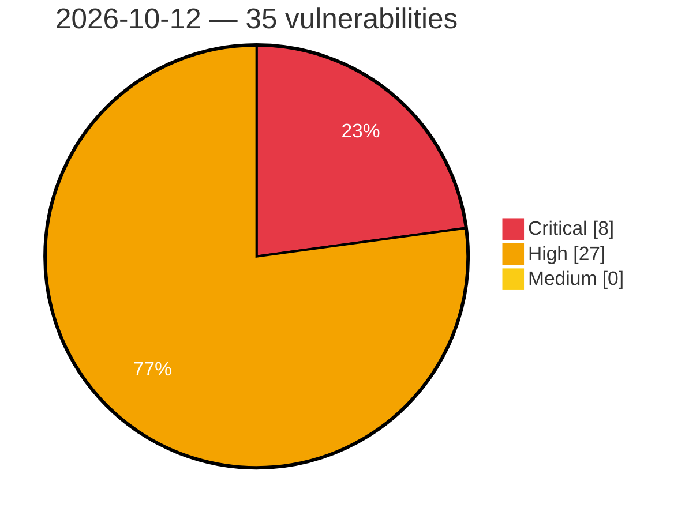

# Critical, High & Medium Severity Vulnerabilities — 2026-10-12

**Source status for this day:**

| Source | Critical | High | Medium | Total |
|--------|---------:|-----:|-------:|------:|
| cvefeed.io (High/Critical) | 8 | 27 | 0 | 35 |

**KEV (actively exploited):** 0  **Watchlist matches:** 23

## Critical (8)

| CVSS | Flags | Source | CVE / Title | Reported |
|------|-------|--------|-------------|----------|
| 10.0 | ⭐ | cvefeed.io (High/Critical) | [CVE-2026-108804 - TRENDnet TEW-751DR/TEW-752DRU/TEW733GR Web Management Backend pigwidgeon.cgi fwrite os command injection](https://cvefeed.io/vuln/detail/CVE-2026-108804) | 1 hour, 10 minutes ago |
| 9.8 | ⭐ | cvefeed.io (High/Critical) | [CVE-2026-66086 - Stack-based Buffer Overflow in Modem](https://cvefeed.io/vuln/detail/CVE-2026-66086) | 5 hours, 10 minutes ago |
| 9.4 | ⭐ | cvefeed.io (High/Critical) | [CVE-2026-93582 - Authentication Bypass via Spoofed Remote-User Header in HTTP Basic Authentication](https://cvefeed.io/vuln/detail/CVE-2026-93582) | 37 minutes ago |
| 9.3 | ⭐ | cvefeed.io (High/Critical) | [CVE-2026-109372 - ZITADEL 3.0.0 before 4.19.2 Account Takeover via SAML Identity-Provider Confusion](https://cvefeed.io/vuln/detail/CVE-2026-109372) | 51 minutes ago |
| 9.3 | ⭐ | cvefeed.io (High/Critical) | [CVE-2026-109321 - Grav Login OAuth Plugin before 1.4.3 Predictable Local Credentials Authentication Bypass](https://cvefeed.io/vuln/detail/CVE-2026-109321) | 51 minutes ago |
| 9.2 | ⭐ | cvefeed.io (High/Critical) | [CVE-2026-109373 - ZITADEL 3.0.0 before 4.19.2 Account Takeover via Unsigned Login V2 Session Cookie](https://cvefeed.io/vuln/detail/CVE-2026-109373) | 51 minutes ago |
| 9.2 | ⭐ | cvefeed.io (High/Critical) | [CVE-2026-109357 - LibreNMS before 26.9.0 LDAP Filter Injection Authentication Bypass via Authorization Header](https://cvefeed.io/vuln/detail/CVE-2026-109357) | 51 minutes ago |
| 9.1 | ⭐ | cvefeed.io (High/Critical) | [CVE-2026-78357 - Insufficient Session Revocation for JWT Authentication](https://cvefeed.io/vuln/detail/CVE-2026-78357) | 38 minutes ago |

## High (27)

| CVSS | Flags | Source | CVE / Title | Reported |
|------|-------|--------|-------------|----------|
| 8.9 | — | cvefeed.io (High/Critical) | [CVE-2026-21120 - WSM Service Use-After-Free Vulnerability](https://cvefeed.io/vuln/detail/CVE-2026-21120) | 2 hours, 10 minutes ago |
| 8.8 | ⭐ | cvefeed.io (High/Critical) | [CVE-2026-87690 - Metasploit Framework ios_image_gather Path Traversal Leading to Arbitrary File Write and Code Execution](https://cvefeed.io/vuln/detail/CVE-2026-87690) | 2 hours, 10 minutes ago |
| 8.8 | ⭐ | cvefeed.io (High/Critical) | [CVE-2026-108980 - Blinko Directory Traversal Remote Code Execution](https://cvefeed.io/vuln/detail/CVE-2026-108980) | 5 hours, 10 minutes ago |
| 8.8 | — | cvefeed.io (High/Critical) | [CVE-2026-109371 - ZITADEL 3.0.0 before 4.18.0 Unauthenticated Username Change via Login V1](https://cvefeed.io/vuln/detail/CVE-2026-109371) | 51 minutes ago |
| 8.8 | ⭐ | cvefeed.io (High/Critical) | [CVE-2026-109318 - Grav Git Sync 1.0.2 through 3.4.12 Command Injection via Commit Author](https://cvefeed.io/vuln/detail/CVE-2026-109318) | 51 minutes ago |
| 8.8 | ⭐ | cvefeed.io (High/Critical) | [CVE-2026-109308 - Craft CMS 4.0.0 before 4.18.7 and 5.0.0 before 5.10.14 RCE via actionCacheUpdates Behavior Injection](https://cvefeed.io/vuln/detail/CVE-2026-109308) | 51 minutes ago |
| 8.8 | ⭐ | cvefeed.io (High/Critical) | [CVE-2026-109305 - Craft CMS 5.10.2 before 5.10.14 Twig Sandbox Bypass RCE via has some/has every](https://cvefeed.io/vuln/detail/CVE-2026-109305) | 51 minutes ago |
| 8.7 | ⭐ | cvefeed.io (High/Critical) | [CVE-2026-78355 - Path Traversal in SendSupportBundle allows File Deletion Outside the Intended Directory](https://cvefeed.io/vuln/detail/CVE-2026-78355) | 38 minutes ago |
| 8.7 | — | cvefeed.io (High/Critical) | [CVE-2026-109363 - Zebra 6.4.0 before 6.4.2 Denial of Service via Malformed v6 Transaction](https://cvefeed.io/vuln/detail/CVE-2026-109363) | 51 minutes ago |
| 8.7 | — | cvefeed.io (High/Critical) | [CVE-2026-109359 - Contrast 1.8.0 before 1.24.1 Mesh CA Key Cross-Manifest Exposure via Peer Recovery](https://cvefeed.io/vuln/detail/CVE-2026-109359) | 51 minutes ago |
| 8.7 | — | cvefeed.io (High/Critical) | [CVE-2026-109326 - Grav before 2.1.7 Information Disclosure via Nested .git Directories](https://cvefeed.io/vuln/detail/CVE-2026-109326) | 51 minutes ago |
| 8.7 | ⭐ | cvefeed.io (High/Critical) | [CVE-2026-109325 - Grav from 2.0.22 before 2.1.7 Clockwork Profiler Authentication Bypass via Proxy](https://cvefeed.io/vuln/detail/CVE-2026-109325) | 51 minutes ago |
| 8.6 | — | cvefeed.io (High/Critical) | [CVE-2026-21125 - Samsung libsimba.heifdec.media.so Improper Input Validation Arbitrary Code Execution](https://cvefeed.io/vuln/detail/CVE-2026-21125) | 2 hours, 10 minutes ago |
| 8.6 | — | cvefeed.io (High/Critical) | [CVE-2026-21124 - Samsung libsimba.heifdec.media.so Improper Input Validation Arbitrary Code Execution](https://cvefeed.io/vuln/detail/CVE-2026-21124) | 2 hours, 10 minutes ago |
| 8.6 | ⭐ | cvefeed.io (High/Critical) | [CVE-2026-109347 - Adminer before 6.1.1 RCE via UTF-8 BOM SQLite ATTACH Bypass](https://cvefeed.io/vuln/detail/CVE-2026-109347) | 51 minutes ago |
| 8.6 | — | cvefeed.io (High/Critical) | [CVE-2026-109343 - SurrealDB before 3.3.0 Cross-Tenant Access via USE Statement](https://cvefeed.io/vuln/detail/CVE-2026-109343) | 51 minutes ago |
| 8.6 | — | cvefeed.io (High/Critical) | [CVE-2026-109334 - SurrealDB before 3.3.0 Cross-Tenant Access via Surreal-NS/Surreal-DB Headers and RPC use](https://cvefeed.io/vuln/detail/CVE-2026-109334) | 51 minutes ago |
| 8.6 | ⭐ | cvefeed.io (High/Critical) | [CVE-2026-109317 - Grav API Plugin before 1.0.36 Privilege Escalation via Scalar Access Grants](https://cvefeed.io/vuln/detail/CVE-2026-109317) | 51 minutes ago |
| 8.6 | ⭐ | cvefeed.io (High/Critical) | [CVE-2026-109313 - Grav Login Plugin 2.7.0 before 3.9.9 2FA Bypass via Remember-Me Cookie](https://cvefeed.io/vuln/detail/CVE-2026-109313) | 51 minutes ago |
| 8.6 | ⭐ | cvefeed.io (High/Critical) | [CVE-2026-109312 - Grav Login Plugin 2.7.0 before 3.9.9 2FA Bypass via Profile Update Form](https://cvefeed.io/vuln/detail/CVE-2026-109312) | 51 minutes ago |
| 8.5 | ⭐ | cvefeed.io (High/Critical) | [CVE-2026-109358 - Edgeless Systems Contrast 1.8.0 before 1.24.1 World-Writable Containerd Config Privilege Escalation](https://cvefeed.io/vuln/detail/CVE-2026-109358) | 51 minutes ago |
| 8.5 | — | cvefeed.io (High/Critical) | [CVE-2026-109346 - better-auth 1.3.8-beta.3 before 1.7.0-rc.3 Device Authorization Phishing via /device](https://cvefeed.io/vuln/detail/CVE-2026-109346) | 51 minutes ago |
| 8.5 | ⭐ | cvefeed.io (High/Critical) | [CVE-2026-109329 - Admidio 4.3.2 through 4.3.17 and 5.0.0 before 5.0.15 Cross-Organization Access Control Bypass via members_assignment.php](https://cvefeed.io/vuln/detail/CVE-2026-109329) | 51 minutes ago |
| 8.5 | — | cvefeed.io (High/Critical) | [CVE-2026-109314 - Grav Login Plugin 1.2.0 before 3.9.9 Password Reset Token Disclosure via Reset Page](https://cvefeed.io/vuln/detail/CVE-2026-109314) | 51 minutes ago |
| 8.2 | ⭐ | cvefeed.io (High/Critical) | [CVE-2026-109301 - Parse Server before 8.6.95 and 9.0.0 before 9.10.2-alpha.3 Denial of Service via File Pointer Without URL](https://cvefeed.io/vuln/detail/CVE-2026-109301) | 51 minutes ago |
| 8.1 | ⭐ | cvefeed.io (High/Critical) | [CVE-2026-108479 - WordPress Patreon WordPress plugin <= 1.9.17 - Cross Site Request Forgery (CSRF) vulnerability](https://cvefeed.io/vuln/detail/CVE-2026-108479) | 34 minutes ago |
| 8.0 | — | cvefeed.io (High/Critical) | [CVE-2026-85965 - Use-after-free in Progress MarkLogic Server JavaScript engine integration](https://cvefeed.io/vuln/detail/CVE-2026-85965) | 51 minutes ago |
