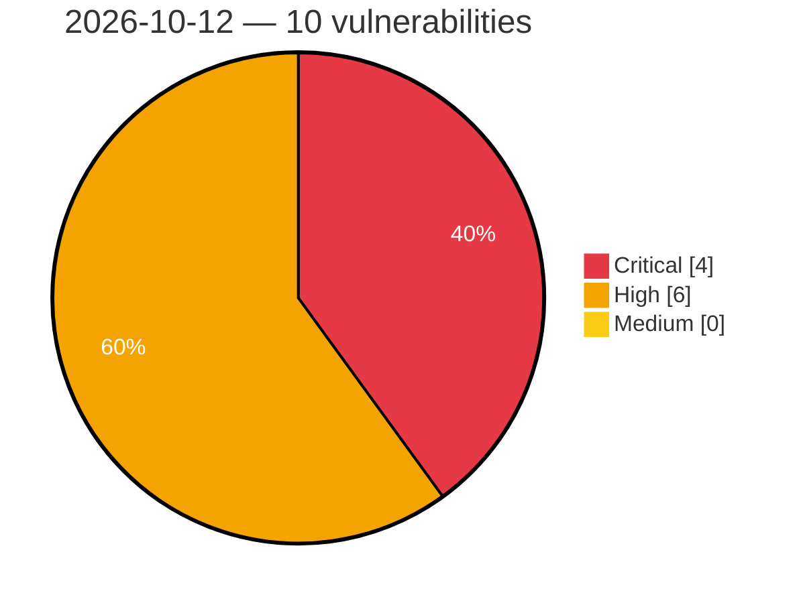

# Critical, High & Medium Severity Vulnerabilities — 2026-10-12

**Source status for this day:**

| Source | Critical | High | Medium | Total |
|--------|---------:|-----:|-------:|------:|
| cvefeed.io (High/Critical) | 4 | 6 | 0 | 10 |

**KEV (actively exploited):** 0  **Watchlist matches:** 7

## Critical (4)

| CVSS | Flags | Source | CVE / Title | Reported |
|------|-------|--------|-------------|----------|
| 10.0 | ⭐ | cvefeed.io (High/Critical) | [CVE-2026-108804 - TRENDnet TEW-751DR/TEW-752DRU/TEW733GR Web Management Backend pigwidgeon.cgi fwrite os command injection](https://cvefeed.io/vuln/detail/CVE-2026-108804) | 1 hour, 10 minutes ago |
| 9.8 | ⭐ | cvefeed.io (High/Critical) | [CVE-2026-66086 - Stack-based Buffer Overflow in Modem](https://cvefeed.io/vuln/detail/CVE-2026-66086) | 5 hours, 10 minutes ago |
| 9.4 | ⭐ | cvefeed.io (High/Critical) | [CVE-2026-93582 - Authentication Bypass via Spoofed Remote-User Header in HTTP Basic Authentication](https://cvefeed.io/vuln/detail/CVE-2026-93582) | 37 minutes ago |
| 9.1 | ⭐ | cvefeed.io (High/Critical) | [CVE-2026-78357 - Insufficient Session Revocation for JWT Authentication](https://cvefeed.io/vuln/detail/CVE-2026-78357) | 38 minutes ago |

## High (6)

| CVSS | Flags | Source | CVE / Title | Reported |
|------|-------|--------|-------------|----------|
| 8.9 | — | cvefeed.io (High/Critical) | [CVE-2026-21120 - WSM Service Use-After-Free Vulnerability](https://cvefeed.io/vuln/detail/CVE-2026-21120) | 2 hours, 10 minutes ago |
| 8.8 | ⭐ | cvefeed.io (High/Critical) | [CVE-2026-87690 - Metasploit Framework ios_image_gather Path Traversal Leading to Arbitrary File Write and Code Execution](https://cvefeed.io/vuln/detail/CVE-2026-87690) | 2 hours, 10 minutes ago |
| 8.8 | ⭐ | cvefeed.io (High/Critical) | [CVE-2026-108980 - Blinko Directory Traversal Remote Code Execution](https://cvefeed.io/vuln/detail/CVE-2026-108980) | 5 hours, 10 minutes ago |
| 8.7 | ⭐ | cvefeed.io (High/Critical) | [CVE-2026-78355 - Path Traversal in SendSupportBundle allows File Deletion Outside the Intended Directory](https://cvefeed.io/vuln/detail/CVE-2026-78355) | 38 minutes ago |
| 8.6 | — | cvefeed.io (High/Critical) | [CVE-2026-21125 - Samsung libsimba.heifdec.media.so Improper Input Validation Arbitrary Code Execution](https://cvefeed.io/vuln/detail/CVE-2026-21125) | 2 hours, 10 minutes ago |
| 8.6 | — | cvefeed.io (High/Critical) | [CVE-2026-21124 - Samsung libsimba.heifdec.media.so Improper Input Validation Arbitrary Code Execution](https://cvefeed.io/vuln/detail/CVE-2026-21124) | 2 hours, 10 minutes ago |
