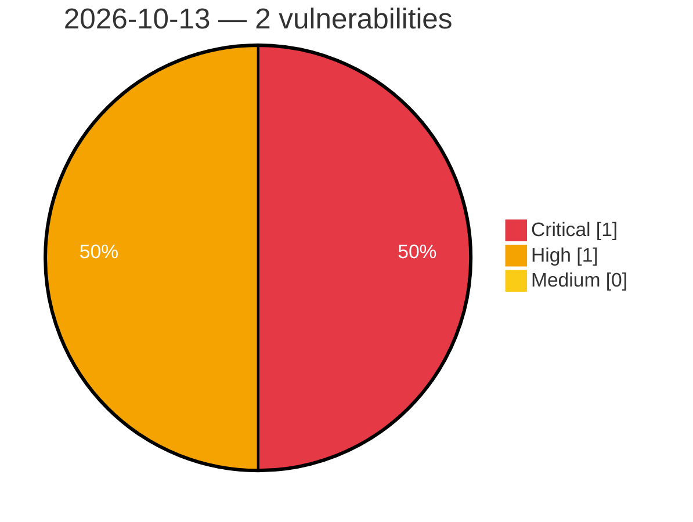

# Critical, High & Medium Severity Vulnerabilities — 2026-10-13

**Source status for this day:**

| Source | Critical | High | Medium | Total |
|--------|---------:|-----:|-------:|------:|
| cvefeed.io (High/Critical) | 1 | 1 | 0 | 2 |

**KEV (actively exploited):** 0  **Watchlist matches:** 0

## Critical (1)

| CVSS | Flags | Source | CVE / Title | Reported |
|------|-------|--------|-------------|----------|
| 9.9 | — | cvefeed.io (High/Critical) | [CVE-2026-96119 - IBM i is Affected By An Improper Control of Code Generation Vulnerability in HTTP Server Administration GUI](https://cvefeed.io/vuln/detail/CVE-2026-96119) | 15 minutes ago |

## High (1)

| CVSS | Flags | Source | CVE / Title | Reported |
|------|-------|--------|-------------|----------|
| 8.3 | — | cvefeed.io (High/Critical) | [CVE-2026-93886 - IBM i is Affected By An Improper Neutralization of Input Vulnerability in HTTP Server Administration GUI](https://cvefeed.io/vuln/detail/CVE-2026-93886) | 15 minutes ago |
