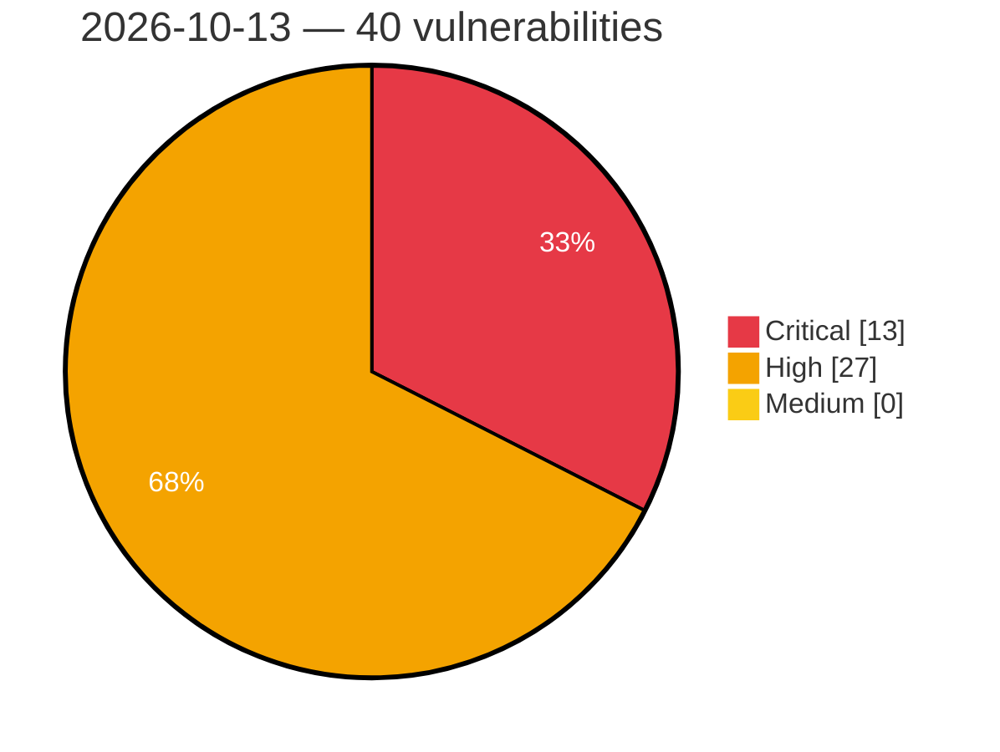

# Critical, High & Medium Severity Vulnerabilities — 2026-10-13

**Source status for this day:**

| Source | Critical | High | Medium | Total |
|--------|---------:|-----:|-------:|------:|
| cvefeed.io (High/Critical) | 13 | 27 | 0 | 40 |

**KEV (actively exploited):** 0  **Watchlist matches:** 22

## Critical (13)

| CVSS | Flags | Source | CVE / Title | Reported |
|------|-------|--------|-------------|----------|
| 10.0 | — | cvefeed.io (High/Critical) | [CVE-2026-97229 - Integer Overflow or Wraparound in GitLab](https://cvefeed.io/vuln/detail/CVE-2026-97229) | 4 hours, 20 minutes ago |
| 10.0 | ⭐ | cvefeed.io (High/Critical) | [CVE-2026-89111 - OAuth2 SSRF vulnerability in SAP Cloud SDK for Python](https://cvefeed.io/vuln/detail/CVE-2026-89111) | 5 hours, 20 minutes ago |
| 9.9 | — | cvefeed.io (High/Critical) | [CVE-2026-96119 - IBM i is Affected By An Improper Control of Code Generation Vulnerability in HTTP Server Administration GUI](https://cvefeed.io/vuln/detail/CVE-2026-96119) | 15 minutes ago |
| 9.9 | ⭐ | cvefeed.io (High/Critical) | [CVE-2026-89110 - Broken Access Control in SAP NetWeaver Visual Composer](https://cvefeed.io/vuln/detail/CVE-2026-89110) | 5 hours, 20 minutes ago |
| 9.9 | — | cvefeed.io (High/Critical) | [CVE-2026-89107 - Code Injection vulnerability in SAP S/4HANA (Manage Substitution/Validation Rules)](https://cvefeed.io/vuln/detail/CVE-2026-89107) | 5 hours, 20 minutes ago |
| 9.8 | ⭐ | cvefeed.io (High/Critical) | [CVE-2026-87689 - Metasploit Framework Web Service REST API Missing Authentication on Credential Endpoints](https://cvefeed.io/vuln/detail/CVE-2026-87689) | 5 hours, 20 minutes ago |
| 9.4 | — | cvefeed.io (High/Critical) | [CVE-2026-74041 - Wazuh 4.14.3 before 4.14.8 Remote Command Validation Bypass via Case Mismatch](https://cvefeed.io/vuln/detail/CVE-2026-74041) | 39 minutes ago |
| 9.4 | ⭐ | cvefeed.io (High/Critical) | [CVE-2026-74040 - Wazuh 3.9.0 before 4.14.8 Arbitrary File Overwrite RCE via process_files_from_worker](https://cvefeed.io/vuln/detail/CVE-2026-74040) | 39 minutes ago |
| 9.3 | ⭐ | cvefeed.io (High/Critical) | [CVE-2026-109758 - Perforce Helix Authentication Service Hardcoded Credential and Prototype Pollution Vulnerability](https://cvefeed.io/vuln/detail/CVE-2026-109758) | 2 hours, 19 minutes ago |
| 9.3 | — | cvefeed.io (High/Critical) | [CVE-2026-77099 - CVFS Command Execution](https://cvefeed.io/vuln/detail/CVE-2026-77099) | 30 minutes ago |
| 9.3 | ⭐ | cvefeed.io (High/Critical) | [CVE-2026-109520 - Colorful iGameCenter Dispatch AMDRyzenMasterDriver.sys MmMapIoSpace privilege defined with unsafe actions](https://cvefeed.io/vuln/detail/CVE-2026-109520) | 40 minutes ago |
| 9.1 | ⭐ | cvefeed.io (High/Critical) | [CVE-2026-89108 - Missing Authorization check in SAP Manufacturing Integration and Intelligence (Configuration Service)](https://cvefeed.io/vuln/detail/CVE-2026-89108) | 5 hours, 20 minutes ago |
| 9.0 | ⭐ | cvefeed.io (High/Critical) | [CVE-2026-74043 - Wazuh 4.1.1 before 4.14.8 Path Traversal via Cluster Upload Functions](https://cvefeed.io/vuln/detail/CVE-2026-74043) | 39 minutes ago |

## High (27)

| CVSS | Flags | Source | CVE / Title | Reported |
|------|-------|--------|-------------|----------|
| 10.0 | — | cvefeed.io (High/Critical) | [CVE-2026-108971 - D-Link DCS-930L Emergency HTTP Recovery Server bootloader_region.bin mpfd_decode signature verification](https://cvefeed.io/vuln/detail/CVE-2026-108971) | 20 minutes ago |
| 8.8 | ⭐ | cvefeed.io (High/Critical) | [CVE-2026-89113 - SQL Injection vulnerability in SAP Commerce Cloud (OOTB Code)](https://cvefeed.io/vuln/detail/CVE-2026-89113) | 5 hours, 20 minutes ago |
| 8.8 | — | cvefeed.io (High/Critical) | [CVE-2026-109676 - FreeRDP 3.0.0-beta1 before 3.32.0 Use-After-Free via Smartcard Connect](https://cvefeed.io/vuln/detail/CVE-2026-109676) | 40 minutes ago |
| 8.7 | ⭐ | cvefeed.io (High/Critical) | [CVE-2026-92883 - Improper Neutralization of Input During Web Page Generation ('Cross-site Scripting') in GitLab](https://cvefeed.io/vuln/detail/CVE-2026-92883) | 4 hours, 20 minutes ago |
| 8.7 | ⭐ | cvefeed.io (High/Critical) | [CVE-2026-97334 - Network messaging layer decompression resource exhaustion](https://cvefeed.io/vuln/detail/CVE-2026-97334) | 30 minutes ago |
| 8.7 | — | cvefeed.io (High/Critical) | [CVE-2026-77100 - MediaAgent Denial of Service](https://cvefeed.io/vuln/detail/CVE-2026-77100) | 30 minutes ago |
| 8.7 | ⭐ | cvefeed.io (High/Critical) | [CVE-2026-77090 - CVFS Information Disclosure](https://cvefeed.io/vuln/detail/CVE-2026-77090) | 30 minutes ago |
| 8.7 | — | cvefeed.io (High/Critical) | [CVE-2026-74034 - Wazuh 4.1.0 before 4.14.8 Arbitrary File Read via upgrade_custom Command](https://cvefeed.io/vuln/detail/CVE-2026-74034) | 40 minutes ago |
| 8.7 | — | cvefeed.io (High/Critical) | [CVE-2026-109967 - yt-dlp-web-ui through 4.0.0 NULL Pointer Dereference DoS via Service.Formats](https://cvefeed.io/vuln/detail/CVE-2026-109967) | 40 minutes ago |
| 8.7 | ⭐ | cvefeed.io (High/Critical) | [CVE-2026-109960 - Froxlor 2.0.0 before 2.3.14 Stored XSS via Customer Theme Value](https://cvefeed.io/vuln/detail/CVE-2026-109960) | 40 minutes ago |
| 8.6 | ⭐ | cvefeed.io (High/Critical) | [CVE-2026-65198 - Huawei Default SNMPv3 USM key](https://cvefeed.io/vuln/detail/CVE-2026-65198) | 39 minutes ago |
| 8.6 | — | cvefeed.io (High/Critical) | [CVE-2026-74037 - Wazuh 4.0.0 before 4.14.8 Session Invalidation Bypass in check_token](https://cvefeed.io/vuln/detail/CVE-2026-74037) | 39 minutes ago |
| 8.6 | ⭐ | cvefeed.io (High/Critical) | [CVE-2026-74036 - Wazuh 4.3.0 before 4.14.8 Remote Code Execution via SCA Command Policies](https://cvefeed.io/vuln/detail/CVE-2026-74036) | 39 minutes ago |
| 8.6 | ⭐ | cvefeed.io (High/Critical) | [CVE-2026-74035 - Wazuh 4.6.0 before 4.14.8 Authentication Bypass via Empty Password in update_user](https://cvefeed.io/vuln/detail/CVE-2026-74035) | 39 minutes ago |
| 8.5 | — | cvefeed.io (High/Critical) | [CVE-2026-16301 - Incorrect Authorization in GitLab](https://cvefeed.io/vuln/detail/CVE-2026-16301) | 4 hours, 20 minutes ago |
| 8.5 | ⭐ | cvefeed.io (High/Critical) | [CVE-2026-109961 - Froxlor 0.10.0 before 2.3.14 Newline Injection via Ftps.add additional_members](https://cvefeed.io/vuln/detail/CVE-2026-109961) | 40 minutes ago |
| 8.4 | — | cvefeed.io (High/Critical) | [CVE-2026-35001 - OpenS100 S-102 Parser Integer Overflow Heap Buffer Overflow](https://cvefeed.io/vuln/detail/CVE-2026-35001) | 4 hours, 20 minutes ago |
| 8.4 | ⭐ | cvefeed.io (High/Critical) | [CVE-2026-74033 - Wazuh from 4.1.1 before 4.14.8 Path Traversal in CDB List Cluster Handlers](https://cvefeed.io/vuln/detail/CVE-2026-74033) | 40 minutes ago |
| 8.4 | ⭐ | cvefeed.io (High/Critical) | [CVE-2026-109965 - Serena before 2.0.0 Symlink Following in File Tools Allows Access Outside Project Root](https://cvefeed.io/vuln/detail/CVE-2026-109965) | 40 minutes ago |
| 8.3 | — | cvefeed.io (High/Critical) | [CVE-2026-93886 - IBM i is Affected By An Improper Neutralization of Input Vulnerability in HTTP Server Administration GUI](https://cvefeed.io/vuln/detail/CVE-2026-93886) | 15 minutes ago |
| 8.3 | ⭐ | cvefeed.io (High/Critical) | [CVE-2026-109956 - NLTK through 3.10.3 Path Traversal via WekaClassifier Model Path](https://cvefeed.io/vuln/detail/CVE-2026-109956) | 40 minutes ago |
| 8.3 | — | cvefeed.io (High/Critical) | [CVE-2026-109954 - Parse Server 9.0.0 before 9.10.2-alpha.5 Transactional Batch Request Write Interference](https://cvefeed.io/vuln/detail/CVE-2026-109954) | 40 minutes ago |
| 8.3 | ⭐ | cvefeed.io (High/Critical) | [CVE-2026-109519 - YouTransfer Template Rendering template path traversal](https://cvefeed.io/vuln/detail/CVE-2026-109519) | 40 minutes ago |
| 8.2 | — | cvefeed.io (High/Critical) | [CVE-2026-14814 - Permissive Regular Expression in GitLab](https://cvefeed.io/vuln/detail/CVE-2026-14814) | 4 hours, 20 minutes ago |
| 8.1 | — | cvefeed.io (High/Critical) | [CVE-2026-93907 - IBM WebSphere Application Server is affected by a bypass authentication vulnerability](https://cvefeed.io/vuln/detail/CVE-2026-93907) | 39 minutes ago |
| 8.0 | ⭐ | cvefeed.io (High/Critical) | [CVE-2026-53420 - Zoom Workplace Buffer Overflow Privilege Escalation](https://cvefeed.io/vuln/detail/CVE-2026-53420) | 35 minutes ago |
| 8.0 | — | cvefeed.io (High/Critical) | [CVE-2026-95680 - IBM WebSphere Application Server is affected by an authorization bypass](https://cvefeed.io/vuln/detail/CVE-2026-95680) | 39 minutes ago |
