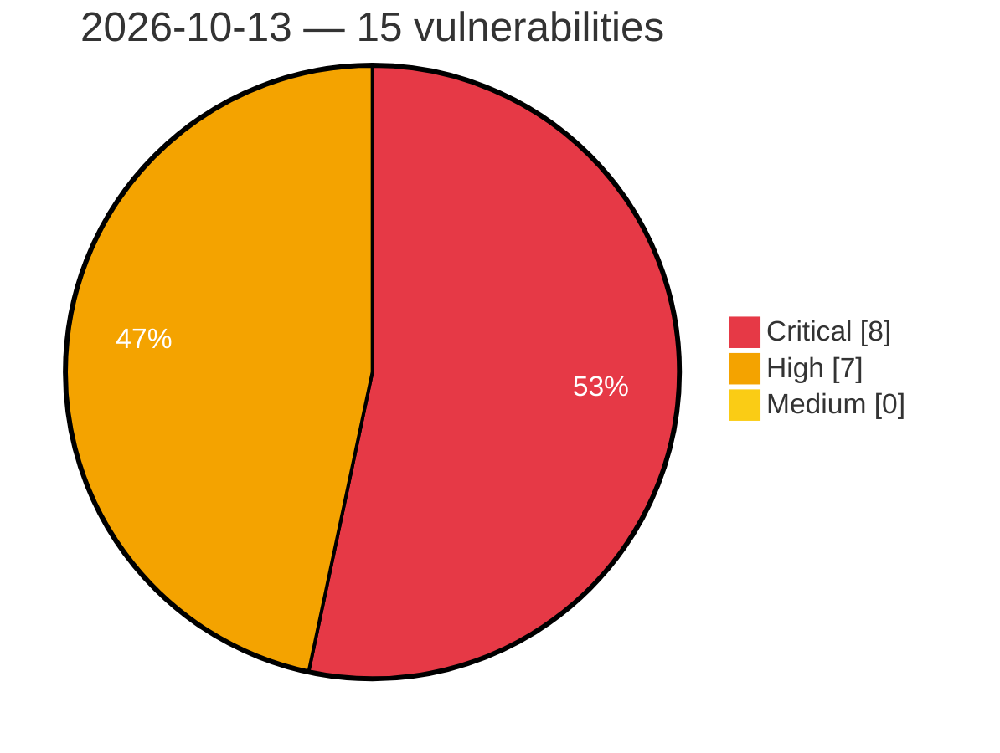

# Critical, High & Medium Severity Vulnerabilities — 2026-10-13

**Source status for this day:**

| Source | Critical | High | Medium | Total |
|--------|---------:|-----:|-------:|------:|
| cvefeed.io (High/Critical) | 8 | 7 | 0 | 15 |

**KEV (actively exploited):** 0  **Watchlist matches:** 7

## Critical (8)

| CVSS | Flags | Source | CVE / Title | Reported |
|------|-------|--------|-------------|----------|
| 10.0 | — | cvefeed.io (High/Critical) | [CVE-2026-97229 - Integer Overflow or Wraparound in GitLab](https://cvefeed.io/vuln/detail/CVE-2026-97229) | 4 hours, 20 minutes ago |
| 10.0 | ⭐ | cvefeed.io (High/Critical) | [CVE-2026-89111 - OAuth2 SSRF vulnerability in SAP Cloud SDK for Python](https://cvefeed.io/vuln/detail/CVE-2026-89111) | 5 hours, 20 minutes ago |
| 9.9 | — | cvefeed.io (High/Critical) | [CVE-2026-96119 - IBM i is Affected By An Improper Control of Code Generation Vulnerability in HTTP Server Administration GUI](https://cvefeed.io/vuln/detail/CVE-2026-96119) | 15 minutes ago |
| 9.9 | ⭐ | cvefeed.io (High/Critical) | [CVE-2026-89110 - Broken Access Control in SAP NetWeaver Visual Composer](https://cvefeed.io/vuln/detail/CVE-2026-89110) | 5 hours, 20 minutes ago |
| 9.9 | — | cvefeed.io (High/Critical) | [CVE-2026-89107 - Code Injection vulnerability in SAP S/4HANA (Manage Substitution/Validation Rules)](https://cvefeed.io/vuln/detail/CVE-2026-89107) | 5 hours, 20 minutes ago |
| 9.8 | ⭐ | cvefeed.io (High/Critical) | [CVE-2026-87689 - Metasploit Framework Web Service REST API Missing Authentication on Credential Endpoints](https://cvefeed.io/vuln/detail/CVE-2026-87689) | 5 hours, 20 minutes ago |
| 9.3 | ⭐ | cvefeed.io (High/Critical) | [CVE-2026-109758 - Perforce Helix Authentication Service Hardcoded Credential and Prototype Pollution Vulnerability](https://cvefeed.io/vuln/detail/CVE-2026-109758) | 2 hours, 19 minutes ago |
| 9.1 | ⭐ | cvefeed.io (High/Critical) | [CVE-2026-89108 - Missing Authorization check in SAP Manufacturing Integration and Intelligence (Configuration Service)](https://cvefeed.io/vuln/detail/CVE-2026-89108) | 5 hours, 20 minutes ago |

## High (7)

| CVSS | Flags | Source | CVE / Title | Reported |
|------|-------|--------|-------------|----------|
| 10.0 | — | cvefeed.io (High/Critical) | [CVE-2026-108971 - D-Link DCS-930L Emergency HTTP Recovery Server bootloader_region.bin mpfd_decode signature verification](https://cvefeed.io/vuln/detail/CVE-2026-108971) | 20 minutes ago |
| 8.8 | ⭐ | cvefeed.io (High/Critical) | [CVE-2026-89113 - SQL Injection vulnerability in SAP Commerce Cloud (OOTB Code)](https://cvefeed.io/vuln/detail/CVE-2026-89113) | 5 hours, 20 minutes ago |
| 8.7 | ⭐ | cvefeed.io (High/Critical) | [CVE-2026-92883 - Improper Neutralization of Input During Web Page Generation ('Cross-site Scripting') in GitLab](https://cvefeed.io/vuln/detail/CVE-2026-92883) | 4 hours, 20 minutes ago |
| 8.5 | — | cvefeed.io (High/Critical) | [CVE-2026-16301 - Incorrect Authorization in GitLab](https://cvefeed.io/vuln/detail/CVE-2026-16301) | 4 hours, 20 minutes ago |
| 8.4 | — | cvefeed.io (High/Critical) | [CVE-2026-35001 - OpenS100 S-102 Parser Integer Overflow Heap Buffer Overflow](https://cvefeed.io/vuln/detail/CVE-2026-35001) | 4 hours, 20 minutes ago |
| 8.3 | — | cvefeed.io (High/Critical) | [CVE-2026-93886 - IBM i is Affected By An Improper Neutralization of Input Vulnerability in HTTP Server Administration GUI](https://cvefeed.io/vuln/detail/CVE-2026-93886) | 15 minutes ago |
| 8.2 | — | cvefeed.io (High/Critical) | [CVE-2026-14814 - Permissive Regular Expression in GitLab](https://cvefeed.io/vuln/detail/CVE-2026-14814) | 4 hours, 20 minutes ago |
