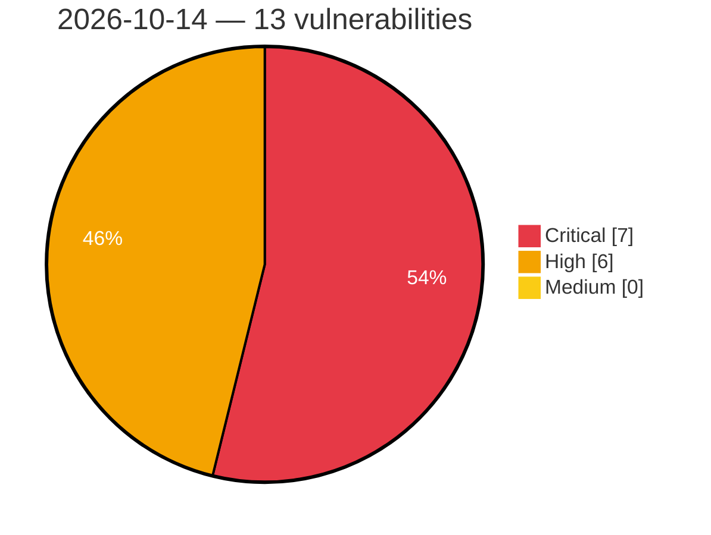

# Critical, High & Medium Severity Vulnerabilities — 2026-10-14

**Source status for this day:**

| Source | Critical | High | Medium | Total |
|--------|---------:|-----:|-------:|------:|
| cvefeed.io (High/Critical) | 7 | 6 | 0 | 13 |

**KEV (actively exploited):** 0  **Watchlist matches:** 9

## Critical (7)

| CVSS | Flags | Source | CVE / Title | Reported |
|------|-------|--------|-------------|----------|
| 9.8 | ⭐ | cvefeed.io (High/Critical) | [CVE-2026-97668 - Abandoned Cart Pro for WooCommerce <= 10.8.0 - Unauthenticated SQL Injection via Guest Persistent Cart meta_value](https://cvefeed.io/vuln/detail/CVE-2026-97668) | 17 minutes ago |
| 9.8 | ⭐ | cvefeed.io (High/Critical) | [CVE-2026-97657 - Abandoned Cart Pro for WooCommerce <= 10.8.0 - Unauthenticated Authentication Bypass via Malleable Encryption and Bypassable HMAC via Recovery Link 'validate' Parameter](https://cvefeed.io/vuln/detail/CVE-2026-97657) | 17 minutes ago |
| 9.8 | ⭐ | cvefeed.io (High/Critical) | [CVE-2026-110002 - Snazzy Social Media Feed <= 2.5 - Unauthenticated Arbitrary File Upload via 'pluginURL' Parameter](https://cvefeed.io/vuln/detail/CVE-2026-110002) | 18 minutes ago |
| 9.8 | ⭐ | cvefeed.io (High/Critical) | [CVE-2026-93388 - Printcart Store - Web to Print Product Designer for WooCommerce (PCDesigner) <= 2.9.1 - Unauthenticated Arbitrary File Upload to Remote Code Execution via nbdesigner_copy_image_from_url](https://cvefeed.io/vuln/detail/CVE-2026-93388) | 1 hour, 18 minutes ago |
| 9.8 | ⭐ | cvefeed.io (High/Critical) | [CVE-2026-110392 - Samsung QA-Board — Unauthenticated OS command injection via output redo/tuning](https://cvefeed.io/vuln/detail/CVE-2026-110392) | 1 hour, 18 minutes ago |
| 9.2 | ⭐ | cvefeed.io (High/Critical) | [CVE-2026-110447 - Collabora Online CODE Server OS Command Injection Vulnerability](https://cvefeed.io/vuln/detail/CVE-2026-110447) | 18 minutes ago |
| 9.1 | — | cvefeed.io (High/Critical) | [CVE-2026-92097 - Click to Chat <= 4.44 - Unauthenticated Arbitrary Shortcode Execution via REQUEST_URI via {url} Placeholder](https://cvefeed.io/vuln/detail/CVE-2026-92097) | 1 hour, 18 minutes ago |

## High (6)

| CVSS | Flags | Source | CVE / Title | Reported |
|------|-------|--------|-------------|----------|
| 8.8 | — | cvefeed.io (High/Critical) | [CVE-2026-110445 - TEAMPLUS TECHNOLOGY｜TeamPlus Messenger - Code Injection](https://cvefeed.io/vuln/detail/CVE-2026-110445) | 18 minutes ago |
| 8.8 | — | cvefeed.io (High/Critical) | [CVE-2026-110444 - TEAMPLUS TECHNOLOGY｜TeamPlus Messenger - Code Injection](https://cvefeed.io/vuln/detail/CVE-2026-110444) | 18 minutes ago |
| 8.7 | ⭐ | cvefeed.io (High/Critical) | [CVE-2026-110385 - ONLYOFFICE Document Server Remote Code Execution Vulnerability](https://cvefeed.io/vuln/detail/CVE-2026-110385) | 2 hours, 18 minutes ago |
| 8.7 | ⭐ | cvefeed.io (High/Critical) | [CVE-2026-108473 - Improper Authentication and Credential Exposure in Multiple TP-Link Kasa Devices](https://cvefeed.io/vuln/detail/CVE-2026-108473) | 2 hours, 18 minutes ago |
| 8.1 | — | cvefeed.io (High/Critical) | [CVE-2026-17092 - Directorist: AI-Powered Business Directory, Listings & Classified Ads <= 8.10.2.1 - Missing Authorization to Authenticated (Subscriber+) Arbitrary Listing Deletion via 'listing_id' Parameter](https://cvefeed.io/vuln/detail/CVE-2026-17092) | 1 hour, 18 minutes ago |
| 8.1 | ⭐ | cvefeed.io (High/Critical) | [CVE-2026-104995 - BP Profile Search <= 5.9 - Unauthenticated Local File Inclusion to Remote Code Execution via 'bps_directory' Cookie 'ajax_template' Value](https://cvefeed.io/vuln/detail/CVE-2026-104995) | 1 hour, 18 minutes ago |
