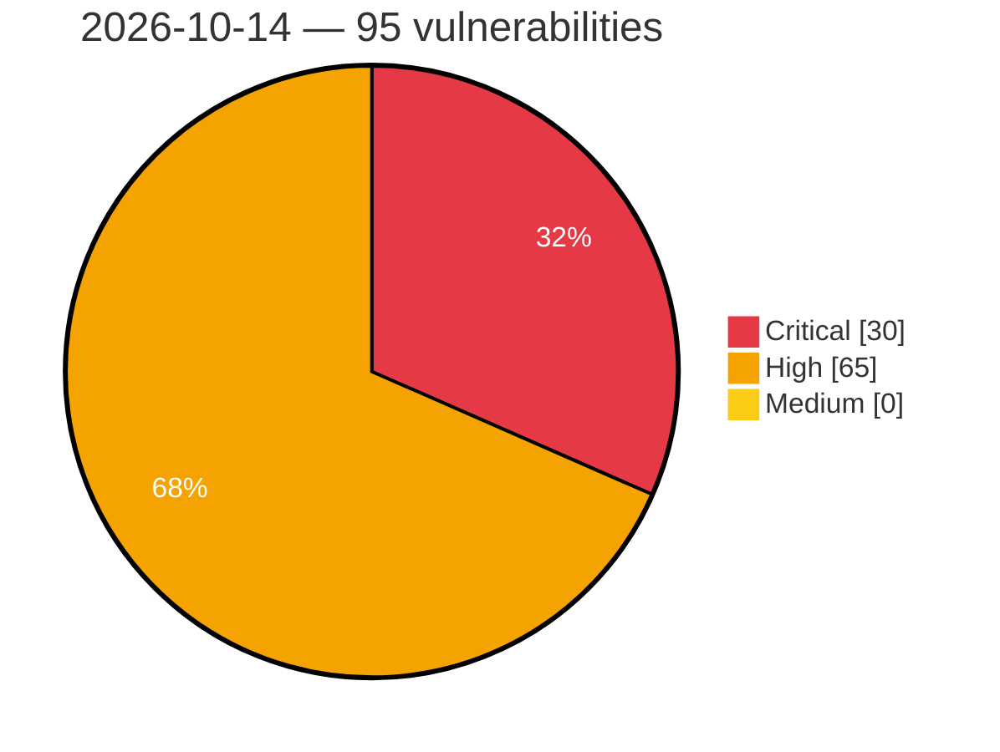

# Critical, High & Medium Severity Vulnerabilities — 2026-10-14

**Source status for this day:**

| Source | Critical | High | Medium | Total |
|--------|---------:|-----:|-------:|------:|
| cvefeed.io (High/Critical) | 30 | 65 | 0 | 95 |

**KEV (actively exploited):** 0  **Watchlist matches:** 70

## Critical (30)

| CVSS | Flags | Source | CVE / Title | Reported |
|------|-------|--------|-------------|----------|
| 10.0 | ⭐ | cvefeed.io (High/Critical) | [CVE-2026-55572 - e107: SQL injection in alt_auth plugin (otherdb / e107db backends) via login username](https://cvefeed.io/vuln/detail/CVE-2026-55572) | 42 minutes ago |
| 10.0 | ⭐ | cvefeed.io (High/Critical) | [CVE-2026-110536 - D-Link DIR-868L HNAP CGI cgibin system os command injection](https://cvefeed.io/vuln/detail/CVE-2026-110536) | 2 hours, 13 minutes ago |
| 9.9 | ⭐ | cvefeed.io (High/Critical) | [CVE-2026-89310 - SQL Command Injection Vulnerability in JTL-WMS](https://cvefeed.io/vuln/detail/CVE-2026-89310) | 1 hour, 15 minutes ago |
| 9.9 | — | cvefeed.io (High/Critical) | [CVE-2026-108390 - HestiaCP Low-Privileged User to Root via Config-Field Injection and PATH Hijacking](https://cvefeed.io/vuln/detail/CVE-2026-108390) | 42 minutes ago |
| 9.8 | ⭐ | cvefeed.io (High/Critical) | [CVE-2026-97668 - Abandoned Cart Pro for WooCommerce <= 10.8.0 - Unauthenticated SQL Injection via Guest Persistent Cart meta_value](https://cvefeed.io/vuln/detail/CVE-2026-97668) | 17 minutes ago |
| 9.8 | ⭐ | cvefeed.io (High/Critical) | [CVE-2026-97657 - Abandoned Cart Pro for WooCommerce <= 10.8.0 - Unauthenticated Authentication Bypass via Malleable Encryption and Bypassable HMAC via Recovery Link 'validate' Parameter](https://cvefeed.io/vuln/detail/CVE-2026-97657) | 17 minutes ago |
| 9.8 | ⭐ | cvefeed.io (High/Critical) | [CVE-2026-110002 - Snazzy Social Media Feed <= 2.5 - Unauthenticated Arbitrary File Upload via 'pluginURL' Parameter](https://cvefeed.io/vuln/detail/CVE-2026-110002) | 18 minutes ago |
| 9.8 | ⭐ | cvefeed.io (High/Critical) | [CVE-2026-93388 - Printcart Store - Web to Print Product Designer for WooCommerce (PCDesigner) <= 2.9.1 - Unauthenticated Arbitrary File Upload to Remote Code Execution via nbdesigner_copy_image_from_url](https://cvefeed.io/vuln/detail/CVE-2026-93388) | 1 hour, 18 minutes ago |
| 9.8 | ⭐ | cvefeed.io (High/Critical) | [CVE-2026-110392 - Samsung QA-Board — Unauthenticated OS command injection via output redo/tuning](https://cvefeed.io/vuln/detail/CVE-2026-110392) | 1 hour, 18 minutes ago |
| 9.8 | ⭐ | cvefeed.io (High/Critical) | [CVE-2026-104748 - SimpleForm <= 3.10.0 - Unauthenticated Privilege Escalation to wp_capabilities Mass Assignment via simpleform_wp_register](https://cvefeed.io/vuln/detail/CVE-2026-104748) | 15 minutes ago |
| 9.8 | ⭐ | cvefeed.io (High/Critical) | [CVE-2026-87855 - JTL-Connector for WooCommerce <= 2.4.3 - Unauthenticated Arbitrary File Upload via 'image.push' Method](https://cvefeed.io/vuln/detail/CVE-2026-87855) | 4 hours, 13 minutes ago |
| 9.8 | ⭐ | cvefeed.io (High/Critical) | [CVE-2026-104800 - AGE-GATE <= 1.0 - Unauthenticated Remote Code Execution via PHP Code Injection via 'width'/'height' Parameters to Standalone admin.php](https://cvefeed.io/vuln/detail/CVE-2026-104800) | 4 hours, 13 minutes ago |
| 9.8 | ⭐ | cvefeed.io (High/Critical) | [CVE-2026-16741 - OS Command in TR7 Cyber ​​Defense's TR7 ASP](https://cvefeed.io/vuln/detail/CVE-2026-16741) | 23 minutes ago |
| 9.8 | ⭐ | cvefeed.io (High/Critical) | [CVE-2026-16740 - Missing Authentication for Critical Function in TR7 Cyber ​​Defense's TR7 ASP](https://cvefeed.io/vuln/detail/CVE-2026-16740) | 23 minutes ago |
| 9.8 | ⭐ | cvefeed.io (High/Critical) | [CVE-2026-108291 - WordPress Affiliates plugin <= 7.0.1 - PHP Object Injection vulnerability](https://cvefeed.io/vuln/detail/CVE-2026-108291) | 23 minutes ago |
| 9.8 | ⭐ | cvefeed.io (High/Critical) | [CVE-2026-107424 - WordPress Frontend Dashboard plugin <= 3.0.7 - Privilege Escalation vulnerability](https://cvefeed.io/vuln/detail/CVE-2026-107424) | 23 minutes ago |
| 9.8 | ⭐ | cvefeed.io (High/Critical) | [CVE-2026-55573 - e107: Unsafe deserialization in install.php allows unauthenticated RCE via POP chain](https://cvefeed.io/vuln/detail/CVE-2026-55573) | 42 minutes ago |
| 9.8 | ⭐ | cvefeed.io (High/Critical) | [CVE-2026-55684 - WeGIA: SQL Injection in html/socio/sistema/cadastro_cobrancas_geracao.php](https://cvefeed.io/vuln/detail/CVE-2026-55684) | 1 hour, 13 minutes ago |
| 9.8 | ⭐ | cvefeed.io (High/Critical) | [CVE-2026-55683 - WeGIA: SQL Injection in html/socio/sistema/cadastro_cobranca.php](https://cvefeed.io/vuln/detail/CVE-2026-55683) | 1 hour, 13 minutes ago |
| 9.8 | ⭐ | cvefeed.io (High/Critical) | [CVE-2026-55680 - WeGIA: Unauthenticated SQL Injection in cadastro_cobranca.php via "codigo" parameter](https://cvefeed.io/vuln/detail/CVE-2026-55680) | 1 hour, 13 minutes ago |
| 9.3 | ⭐ | cvefeed.io (High/Critical) | [CVE-2026-103904 - Stored XSS Vulnerability in JTL-Shop](https://cvefeed.io/vuln/detail/CVE-2026-103904) | 2 hours, 23 minutes ago |
| 9.3 | ⭐ | cvefeed.io (High/Critical) | [CVE-2026-92152 - F´: Unvalidated Port Index in GenericHub](https://cvefeed.io/vuln/detail/CVE-2026-92152) | 40 minutes ago |
| 9.3 | ⭐ | cvefeed.io (High/Critical) | [CVE-2026-77371 - Redash: DuckDB query runner allows arbitrary file read/write via unrestricted external access](https://cvefeed.io/vuln/detail/CVE-2026-77371) | 42 minutes ago |
| 9.3 | — | cvefeed.io (High/Critical) | [CVE-2026-103415 - TLS Client Memory Corruption via HelloRetryRequest Cookie](https://cvefeed.io/vuln/detail/CVE-2026-103415) | 43 minutes ago |
| 9.2 | ⭐ | cvefeed.io (High/Critical) | [CVE-2026-110447 - Collabora Online CODE Server OS Command Injection Vulnerability](https://cvefeed.io/vuln/detail/CVE-2026-110447) | 18 minutes ago |
| 9.2 | — | cvefeed.io (High/Critical) | [CVE-2026-14851 - Unauthorised disclosure of information on Copart’s online billing service](https://cvefeed.io/vuln/detail/CVE-2026-14851) | 8 minutes ago |
| 9.2 | ⭐ | cvefeed.io (High/Critical) | [CVE-2026-110770 - Databasus 3.7.0 through 3.61.0 Account Takeover via Password Reset Brute-Force](https://cvefeed.io/vuln/detail/CVE-2026-110770) | 2 hours, 13 minutes ago |
| 9.1 | — | cvefeed.io (High/Critical) | [CVE-2026-92097 - Click to Chat <= 4.44 - Unauthenticated Arbitrary Shortcode Execution via REQUEST_URI via {url} Placeholder](https://cvefeed.io/vuln/detail/CVE-2026-92097) | 1 hour, 18 minutes ago |
| 9.1 | ⭐ | cvefeed.io (High/Critical) | [CVE-2026-85714 - Stirling-PDF: Remote Code Execution via H2](https://cvefeed.io/vuln/detail/CVE-2026-85714) | 37 minutes ago |
| 9.1 | — | cvefeed.io (High/Critical) | [CVE-2026-102476 - Eclipse Vert.x Improper SSL Context Caching Vulnerability](https://cvefeed.io/vuln/detail/CVE-2026-102476) | 43 minutes ago |

## High (65)

| CVSS | Flags | Source | CVE / Title | Reported |
|------|-------|--------|-------------|----------|
| 8.9 | ⭐ | cvefeed.io (High/Critical) | [CVE-2026-105429 - NetBird client SSH config Match line injection via peer FQDN or hostname allows local command execution](https://cvefeed.io/vuln/detail/CVE-2026-105429) | 3 hours, 15 minutes ago |
| 8.8 | — | cvefeed.io (High/Critical) | [CVE-2026-110445 - TEAMPLUS TECHNOLOGY｜TeamPlus Messenger - Code Injection](https://cvefeed.io/vuln/detail/CVE-2026-110445) | 18 minutes ago |
| 8.8 | — | cvefeed.io (High/Critical) | [CVE-2026-110444 - TEAMPLUS TECHNOLOGY｜TeamPlus Messenger - Code Injection](https://cvefeed.io/vuln/detail/CVE-2026-110444) | 18 minutes ago |
| 8.8 | ⭐ | cvefeed.io (High/Critical) | [CVE-2026-105106 - Koha authenticated OS command injection in tools/scheduler.pl via the jobid parameter when deleting a scheduled task](https://cvefeed.io/vuln/detail/CVE-2026-105106) | 15 minutes ago |
| 8.8 | ⭐ | cvefeed.io (High/Critical) | [CVE-2026-82026 - Radar < 1.12.2 Missing Authorization via /api/local-terminal](https://cvefeed.io/vuln/detail/CVE-2026-82026) | 23 minutes ago |
| 8.8 | ⭐ | cvefeed.io (High/Critical) | [CVE-2026-106599 - WordPress SureCart plugin <= 4.9.3 - PHP Object Injection vulnerability](https://cvefeed.io/vuln/detail/CVE-2026-106599) | 23 minutes ago |
| 8.8 | ⭐ | cvefeed.io (High/Critical) | [CVE-2026-104795 - Insights-runtime-extractor: insights-runtime-extractor: container escape via privileged binary execution](https://cvefeed.io/vuln/detail/CVE-2026-104795) | 2 hours, 23 minutes ago |
| 8.8 | — | cvefeed.io (High/Critical) | [CVE-2026-63626 - Mongoose: ppp_handle_ipv6cp() uses attacker-controlled length without bounds check — OOB read and heap overflow (PPP/PPPoE, MG_ENABLE_IPV6)](https://cvefeed.io/vuln/detail/CVE-2026-63626) | 34 minutes ago |
| 8.8 | — | cvefeed.io (High/Critical) | [CVE-2026-88164 - Microsoft Office SharePoint Elevation of Privilege Vulnerability](https://cvefeed.io/vuln/detail/CVE-2026-88164) | 40 minutes ago |
| 8.8 | — | cvefeed.io (High/Critical) | [CVE-2026-86848 - Dpdk: dpdk: time-of-check/time-of-use vulnerability allowing guest-triggered out-of-bounds write in vhost-crypto](https://cvefeed.io/vuln/detail/CVE-2026-86848) | 41 minutes ago |
| 8.8 | — | cvefeed.io (High/Critical) | [CVE-2026-86567 - Dpdk: dpdk: vduse handler fails to invalidate vring pointers when iotlb is invalidated, leading to use-after-unmap](https://cvefeed.io/vuln/detail/CVE-2026-86567) | 41 minutes ago |
| 8.8 | ⭐ | cvefeed.io (High/Critical) | [CVE-2026-86461 - FV Flowplayer Video Player <= 7.5.54.7212 - Authenticated (Subscriber+) Arbitrary File Upload via 'video_url' Parameter](https://cvefeed.io/vuln/detail/CVE-2026-86461) | 41 minutes ago |
| 8.8 | ⭐ | cvefeed.io (High/Critical) | [CVE-2026-107350 - Authentication bypass via second StartupMessage during SCRAM authentication in PgBouncer](https://cvefeed.io/vuln/detail/CVE-2026-107350) | 42 minutes ago |
| 8.8 | ⭐ | cvefeed.io (High/Critical) | [CVE-2026-55681 - WeGIA: SQL Injection in html/matPat/restaurar_produto_desocultar.php via id_produto parameter](https://cvefeed.io/vuln/detail/CVE-2026-55681) | 1 hour, 13 minutes ago |
| 8.8 | ⭐ | cvefeed.io (High/Critical) | [CVE-2026-54525 - Markdown Preview Enhanced: One Click RCE via Markdown Link Command Injection on Windows](https://cvefeed.io/vuln/detail/CVE-2026-54525) | 2 hours, 13 minutes ago |
| 8.8 | — | cvefeed.io (High/Critical) | [CVE-2026-110761 - ILIAS before 9.24, 10.12, and 11.5 PHP Object Injection via Test Results Import](https://cvefeed.io/vuln/detail/CVE-2026-110761) | 2 hours, 13 minutes ago |
| 8.7 | ⭐ | cvefeed.io (High/Critical) | [CVE-2026-110385 - ONLYOFFICE Document Server Remote Code Execution Vulnerability](https://cvefeed.io/vuln/detail/CVE-2026-110385) | 2 hours, 18 minutes ago |
| 8.7 | ⭐ | cvefeed.io (High/Critical) | [CVE-2026-108473 - Improper Authentication and Credential Exposure in Multiple TP-Link Kasa Devices](https://cvefeed.io/vuln/detail/CVE-2026-108473) | 2 hours, 18 minutes ago |
| 8.7 | ⭐ | cvefeed.io (High/Critical) | [CVE-2026-108071 - Improper Multi-Factor Authentication Validation Allows Authentication Bypass](https://cvefeed.io/vuln/detail/CVE-2026-108071) | 2 hours, 23 minutes ago |
| 8.7 | ⭐ | cvefeed.io (High/Critical) | [CVE-2026-108070 - Improper Access Control Allows Unauthorized Access to Protected Internal Web Resources in TSplus Remote Access](https://cvefeed.io/vuln/detail/CVE-2026-108070) | 2 hours, 23 minutes ago |
| 8.7 | — | cvefeed.io (High/Critical) | [CVE-2026-103905 - Unauthenticated Plugin Safe Mode Toggle Vulnerability in JTL-Shop](https://cvefeed.io/vuln/detail/CVE-2026-103905) | 2 hours, 23 minutes ago |
| 8.7 | — | cvefeed.io (High/Critical) | [CVE-2026-101341 - Stack overwrite from specially formatted TXT-DATA RDATA field](https://cvefeed.io/vuln/detail/CVE-2026-101341) | 2 hours, 23 minutes ago |
| 8.7 | ⭐ | cvefeed.io (High/Critical) | [CVE-2026-101339 - Stack overwrite from a specially crafted and formatted HIP RR](https://cvefeed.io/vuln/detail/CVE-2026-101339) | 2 hours, 23 minutes ago |
| 8.7 | — | cvefeed.io (High/Critical) | [CVE-2026-101338 - Stack overwrite from a specially crafted and formatted SVCB or HTTPS RR](https://cvefeed.io/vuln/detail/CVE-2026-101338) | 2 hours, 23 minutes ago |
| 8.7 | — | cvefeed.io (High/Critical) | [CVE-2026-101337 - Stack overwrite from specially formatted base64 RDATA field](https://cvefeed.io/vuln/detail/CVE-2026-101337) | 2 hours, 23 minutes ago |
| 8.7 | — | cvefeed.io (High/Critical) | [CVE-2026-102479 - Eclipse Vert.x HTTP Request Smuggling Vulnerability](https://cvefeed.io/vuln/detail/CVE-2026-102479) | 16 minutes ago |
| 8.7 | ⭐ | cvefeed.io (High/Critical) | [CVE-2026-42093 - Redash: SQL Injection via Query Results parameterized query substitution](https://cvefeed.io/vuln/detail/CVE-2026-42093) | 42 minutes ago |
| 8.7 | ⭐ | cvefeed.io (High/Critical) | [CVE-2026-106465 - NetX Secure DTLS Improper Verification of Cryptographic Signature](https://cvefeed.io/vuln/detail/CVE-2026-106465) | 42 minutes ago |
| 8.7 | — | cvefeed.io (High/Critical) | [CVE-2026-106464 - Azure RTOS NetX Secure Integer Underflow Vulnerability](https://cvefeed.io/vuln/detail/CVE-2026-106464) | 42 minutes ago |
| 8.7 | ⭐ | cvefeed.io (High/Critical) | [CVE-2026-102077 - Junos OS: MX Series with SPC3: In a source NAT scenario malformed packets will lead to resource leaks and eventually traffic stops](https://cvefeed.io/vuln/detail/CVE-2026-102077) | 43 minutes ago |
| 8.7 | — | cvefeed.io (High/Critical) | [CVE-2026-110767 - Gitingest through 0.3.1 Arbitrary File Read via Symlink in Blob Ingestion](https://cvefeed.io/vuln/detail/CVE-2026-110767) | 2 hours, 13 minutes ago |
| 8.7 | ⭐ | cvefeed.io (High/Critical) | [CVE-2026-104143 - DataEase: Stored SQL Injection via dateFormat field templates](https://cvefeed.io/vuln/detail/CVE-2026-104143) | 2 hours, 13 minutes ago |
| 8.6 | ⭐ | cvefeed.io (High/Critical) | [CVE-2026-110459 - UniFi Protect AI Key Improper Access Control Vulnerability](https://cvefeed.io/vuln/detail/CVE-2026-110459) | 2 hours, 15 minutes ago |
| 8.6 | ⭐ | cvefeed.io (High/Critical) | [CVE-2026-102460 - Eclipse Vert.x Web ChainAuthHandler Scope Bypass Vulnerability](https://cvefeed.io/vuln/detail/CVE-2026-102460) | 23 minutes ago |
| 8.6 | — | cvefeed.io (High/Critical) | [CVE-2026-110769 - holaOS through 2026.822.1 Missing Authorization in Channel-Gateway Connectors](https://cvefeed.io/vuln/detail/CVE-2026-110769) | 2 hours, 13 minutes ago |
| 8.5 | ⭐ | cvefeed.io (High/Critical) | [CVE-2026-109901 - WordPress CP Multi View Event Calendar  plugin <= 1.4.41 - SQL Injection vulnerability](https://cvefeed.io/vuln/detail/CVE-2026-109901) | 15 minutes ago |
| 8.5 | ⭐ | cvefeed.io (High/Critical) | [CVE-2026-50218 - Akamai Guardicore Platform Agent JWT Validation Vulnerability](https://cvefeed.io/vuln/detail/CVE-2026-50218) | 2 hours, 15 minutes ago |
| 8.5 | ⭐ | cvefeed.io (High/Critical) | [CVE-2026-106931 - SiteGuard Server Edition OS Command Injection Vulnerability](https://cvefeed.io/vuln/detail/CVE-2026-106931) | 3 hours, 15 minutes ago |
| 8.5 | ⭐ | cvefeed.io (High/Critical) | [CVE-2026-105067 - WordPress Modern Events Calendar Lite plugin < 7.37.0 - SQL Injection vulnerability](https://cvefeed.io/vuln/detail/CVE-2026-105067) | 2 hours, 23 minutes ago |
| 8.5 | ⭐ | cvefeed.io (High/Critical) | [CVE-2026-54566 - Markdown Preview Enhanced: Remote Code Execution via VM Sandbox Escape in `.crossnote/config.js` and `.crossnote/parser.js`](https://cvefeed.io/vuln/detail/CVE-2026-54566) | 1 hour, 13 minutes ago |
| 8.4 | ⭐ | cvefeed.io (High/Critical) | [CVE-2026-86476 - Gstreamer1-plugins-base: gst-plugins-base: heap buffer overflow via unvalidated gstvideometa plane extents in gst_video_frame_map_id and video_meta_deserialize](https://cvefeed.io/vuln/detail/CVE-2026-86476) | 3 hours, 22 minutes ago |
| 8.4 | ⭐ | cvefeed.io (High/Critical) | [CVE-2026-103414 - GUIX Binary Resource Loader Heap-based Buffer Overflow](https://cvefeed.io/vuln/detail/CVE-2026-103414) | 43 minutes ago |
| 8.4 | — | cvefeed.io (High/Critical) | [CVE-2026-55786 - Flyto2 Core: Unauthenticated Command Execution via HTTP MCP `execute_module`](https://cvefeed.io/vuln/detail/CVE-2026-55786) | 2 hours, 13 minutes ago |
| 8.2 | — | cvefeed.io (High/Critical) | [CVE-2026-73798 - HPE NonStop DNS 9.2.3 Non Secure Version](https://cvefeed.io/vuln/detail/CVE-2026-73798) | 1 hour, 23 minutes ago |
| 8.2 | — | cvefeed.io (High/Critical) | [CVE-2026-73790 - HPE NonStop iTP WebServer - Memory corruption vulnerability](https://cvefeed.io/vuln/detail/CVE-2026-73790) | 4 hours, 23 minutes ago |
| 8.2 | ⭐ | cvefeed.io (High/Critical) | [CVE-2026-108480 - WordPress Skydropx plugin <= 2.1.4 - Broken Access Control vulnerability](https://cvefeed.io/vuln/detail/CVE-2026-108480) | 42 minutes ago |
| 8.2 | ⭐ | cvefeed.io (High/Critical) | [CVE-2026-71854 - OpenAEV has unauthenticated access and missing object-level authorization on player lessons API](https://cvefeed.io/vuln/detail/CVE-2026-71854) | 13 minutes ago |
| 8.2 | ⭐ | cvefeed.io (High/Critical) | [CVE-2026-61843 - FileRise: Unauthenticated File Overwrite Through Upload-Enabled Folder Shares](https://cvefeed.io/vuln/detail/CVE-2026-61843) | 13 minutes ago |
| 8.2 | ⭐ | cvefeed.io (High/Critical) | [CVE-2026-55383 - InvoiceShelf: Public EmailLog token type confusion allows cross-company invoice disclosure](https://cvefeed.io/vuln/detail/CVE-2026-55383) | 1 hour, 13 minutes ago |
| 8.2 | ⭐ | cvefeed.io (High/Critical) | [CVE-2026-110765 - FlexPrice through 2.1.38 QuickBooks Webhook Signature Verification Bypass](https://cvefeed.io/vuln/detail/CVE-2026-110765) | 2 hours, 13 minutes ago |
| 8.1 | — | cvefeed.io (High/Critical) | [CVE-2026-17092 - Directorist: AI-Powered Business Directory, Listings & Classified Ads <= 8.10.2.1 - Missing Authorization to Authenticated (Subscriber+) Arbitrary Listing Deletion via 'listing_id' Parameter](https://cvefeed.io/vuln/detail/CVE-2026-17092) | 1 hour, 18 minutes ago |
| 8.1 | ⭐ | cvefeed.io (High/Critical) | [CVE-2026-104995 - BP Profile Search <= 5.9 - Unauthenticated Local File Inclusion to Remote Code Execution via 'bps_directory' Cookie 'ajax_template' Value](https://cvefeed.io/vuln/detail/CVE-2026-104995) | 1 hour, 18 minutes ago |
| 8.1 | ⭐ | cvefeed.io (High/Critical) | [CVE-2026-104909 - Mang Board <= 2.4.3 - Unauthenticated Local File Inclusion via '<mode>_type' Parameter](https://cvefeed.io/vuln/detail/CVE-2026-104909) | 15 minutes ago |
| 8.1 | ⭐ | cvefeed.io (High/Critical) | [CVE-2026-103367 - ShopMagic <= 4.9.0 - Unauthenticated Local File Inclusion via 'billing.first_name' Parameter](https://cvefeed.io/vuln/detail/CVE-2026-103367) | 15 minutes ago |
| 8.1 | ⭐ | cvefeed.io (High/Critical) | [CVE-2026-110455 - UniFi Protect AI Key Command Injection Vulnerability](https://cvefeed.io/vuln/detail/CVE-2026-110455) | 3 hours, 15 minutes ago |
| 8.1 | ⭐ | cvefeed.io (High/Critical) | [CVE-2026-92154 - F´: File size bounds bypass in Svc::FileUplink via unsigned integer overflow in DATA packet validation](https://cvefeed.io/vuln/detail/CVE-2026-92154) | 40 minutes ago |
| 8.1 | ⭐ | cvefeed.io (High/Critical) | [CVE-2026-79957 - ServiceNext Insecure Direct Object Reference via GetUsarios](https://cvefeed.io/vuln/detail/CVE-2026-79957) | 42 minutes ago |
| 8.1 | ⭐ | cvefeed.io (High/Critical) | [CVE-2026-104103 - Ludwig: Path traversal in dataset archive extraction allows arbitrary file write via symlink members](https://cvefeed.io/vuln/detail/CVE-2026-104103) | 42 minutes ago |
| 8.1 | ⭐ | cvefeed.io (High/Critical) | [CVE-2026-57490 - FileRise: WebDAV authentication bypasses TOTP/MFA entirely](https://cvefeed.io/vuln/detail/CVE-2026-57490) | 13 minutes ago |
| 8.1 | ⭐ | cvefeed.io (High/Critical) | [CVE-2026-57489 - FileRise: AUTH_BYPASS reverse-proxy header trust without source IP validation enables full authentication bypass](https://cvefeed.io/vuln/detail/CVE-2026-57489) | 13 minutes ago |
| 8.1 | ⭐ | cvefeed.io (High/Critical) | [CVE-2026-104108 - FileRise OIDC login can bind an attacker identity to an existing local account](https://cvefeed.io/vuln/detail/CVE-2026-104108) | 13 minutes ago |
| 8.1 | ⭐ | cvefeed.io (High/Critical) | [CVE-2026-103977 - FileRise: Session-scoped TOTP rate limiting permits repeated verification attempts](https://cvefeed.io/vuln/detail/CVE-2026-103977) | 13 minutes ago |
| 8.1 | — | cvefeed.io (High/Critical) | [CVE-2026-55682 - WeGIA: Session Fixation via User-Controlled PHPSESSID Cookie + DB_HOST Leak in html/seguranca/sessionStart.php](https://cvefeed.io/vuln/detail/CVE-2026-55682) | 1 hour, 13 minutes ago |
| 8.1 | ⭐ | cvefeed.io (High/Critical) | [CVE-2026-102986 - Plane: Any Authenticated User Can Upload and Delete Assets in Any Published Project via /api/public/assets/v2/anchor/{anchor}/](https://cvefeed.io/vuln/detail/CVE-2026-102986) | 1 hour, 13 minutes ago |
| 8.0 | ⭐ | cvefeed.io (High/Critical) | [CVE-2026-110450 - Nix and Lix Privilege Escalation Vulnerability](https://cvefeed.io/vuln/detail/CVE-2026-110450) | 3 hours, 15 minutes ago |
