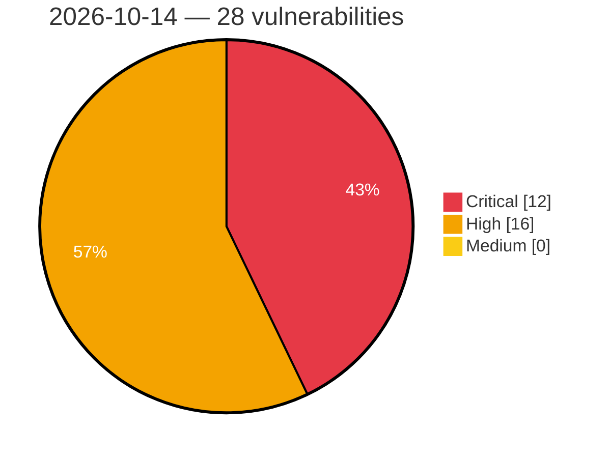

# Critical, High & Medium Severity Vulnerabilities — 2026-10-14

**Source status for this day:**

| Source | Critical | High | Medium | Total |
|--------|---------:|-----:|-------:|------:|
| cvefeed.io (High/Critical) | 12 | 16 | 0 | 28 |

**KEV (actively exploited):** 0  **Watchlist matches:** 23

## Critical (12)

| CVSS | Flags | Source | CVE / Title | Reported |
|------|-------|--------|-------------|----------|
| 9.9 | ⭐ | cvefeed.io (High/Critical) | [CVE-2026-89310 - SQL Command Injection Vulnerability in JTL-WMS](https://cvefeed.io/vuln/detail/CVE-2026-89310) | 1 hour, 15 minutes ago |
| 9.8 | ⭐ | cvefeed.io (High/Critical) | [CVE-2026-97668 - Abandoned Cart Pro for WooCommerce <= 10.8.0 - Unauthenticated SQL Injection via Guest Persistent Cart meta_value](https://cvefeed.io/vuln/detail/CVE-2026-97668) | 17 minutes ago |
| 9.8 | ⭐ | cvefeed.io (High/Critical) | [CVE-2026-97657 - Abandoned Cart Pro for WooCommerce <= 10.8.0 - Unauthenticated Authentication Bypass via Malleable Encryption and Bypassable HMAC via Recovery Link 'validate' Parameter](https://cvefeed.io/vuln/detail/CVE-2026-97657) | 17 minutes ago |
| 9.8 | ⭐ | cvefeed.io (High/Critical) | [CVE-2026-110002 - Snazzy Social Media Feed <= 2.5 - Unauthenticated Arbitrary File Upload via 'pluginURL' Parameter](https://cvefeed.io/vuln/detail/CVE-2026-110002) | 18 minutes ago |
| 9.8 | ⭐ | cvefeed.io (High/Critical) | [CVE-2026-93388 - Printcart Store - Web to Print Product Designer for WooCommerce (PCDesigner) <= 2.9.1 - Unauthenticated Arbitrary File Upload to Remote Code Execution via nbdesigner_copy_image_from_url](https://cvefeed.io/vuln/detail/CVE-2026-93388) | 1 hour, 18 minutes ago |
| 9.8 | ⭐ | cvefeed.io (High/Critical) | [CVE-2026-110392 - Samsung QA-Board — Unauthenticated OS command injection via output redo/tuning](https://cvefeed.io/vuln/detail/CVE-2026-110392) | 1 hour, 18 minutes ago |
| 9.8 | ⭐ | cvefeed.io (High/Critical) | [CVE-2026-104748 - SimpleForm <= 3.10.0 - Unauthenticated Privilege Escalation to wp_capabilities Mass Assignment via simpleform_wp_register](https://cvefeed.io/vuln/detail/CVE-2026-104748) | 15 minutes ago |
| 9.8 | ⭐ | cvefeed.io (High/Critical) | [CVE-2026-87855 - JTL-Connector for WooCommerce <= 2.4.3 - Unauthenticated Arbitrary File Upload via 'image.push' Method](https://cvefeed.io/vuln/detail/CVE-2026-87855) | 4 hours, 13 minutes ago |
| 9.8 | ⭐ | cvefeed.io (High/Critical) | [CVE-2026-104800 - AGE-GATE <= 1.0 - Unauthenticated Remote Code Execution via PHP Code Injection via 'width'/'height' Parameters to Standalone admin.php](https://cvefeed.io/vuln/detail/CVE-2026-104800) | 4 hours, 13 minutes ago |
| 9.2 | ⭐ | cvefeed.io (High/Critical) | [CVE-2026-110447 - Collabora Online CODE Server OS Command Injection Vulnerability](https://cvefeed.io/vuln/detail/CVE-2026-110447) | 18 minutes ago |
| 9.2 | — | cvefeed.io (High/Critical) | [CVE-2026-14851 - Unauthorised disclosure of information on Copart’s online billing service](https://cvefeed.io/vuln/detail/CVE-2026-14851) | 8 minutes ago |
| 9.1 | — | cvefeed.io (High/Critical) | [CVE-2026-92097 - Click to Chat <= 4.44 - Unauthenticated Arbitrary Shortcode Execution via REQUEST_URI via {url} Placeholder](https://cvefeed.io/vuln/detail/CVE-2026-92097) | 1 hour, 18 minutes ago |

## High (16)

| CVSS | Flags | Source | CVE / Title | Reported |
|------|-------|--------|-------------|----------|
| 8.9 | ⭐ | cvefeed.io (High/Critical) | [CVE-2026-105429 - NetBird client SSH config Match line injection via peer FQDN or hostname allows local command execution](https://cvefeed.io/vuln/detail/CVE-2026-105429) | 3 hours, 15 minutes ago |
| 8.8 | — | cvefeed.io (High/Critical) | [CVE-2026-110445 - TEAMPLUS TECHNOLOGY｜TeamPlus Messenger - Code Injection](https://cvefeed.io/vuln/detail/CVE-2026-110445) | 18 minutes ago |
| 8.8 | — | cvefeed.io (High/Critical) | [CVE-2026-110444 - TEAMPLUS TECHNOLOGY｜TeamPlus Messenger - Code Injection](https://cvefeed.io/vuln/detail/CVE-2026-110444) | 18 minutes ago |
| 8.8 | ⭐ | cvefeed.io (High/Critical) | [CVE-2026-105106 - Koha authenticated OS command injection in tools/scheduler.pl via the jobid parameter when deleting a scheduled task](https://cvefeed.io/vuln/detail/CVE-2026-105106) | 15 minutes ago |
| 8.7 | ⭐ | cvefeed.io (High/Critical) | [CVE-2026-110385 - ONLYOFFICE Document Server Remote Code Execution Vulnerability](https://cvefeed.io/vuln/detail/CVE-2026-110385) | 2 hours, 18 minutes ago |
| 8.7 | ⭐ | cvefeed.io (High/Critical) | [CVE-2026-108473 - Improper Authentication and Credential Exposure in Multiple TP-Link Kasa Devices](https://cvefeed.io/vuln/detail/CVE-2026-108473) | 2 hours, 18 minutes ago |
| 8.6 | ⭐ | cvefeed.io (High/Critical) | [CVE-2026-110459 - UniFi Protect AI Key Improper Access Control Vulnerability](https://cvefeed.io/vuln/detail/CVE-2026-110459) | 2 hours, 15 minutes ago |
| 8.5 | ⭐ | cvefeed.io (High/Critical) | [CVE-2026-109901 - WordPress CP Multi View Event Calendar  plugin <= 1.4.41 - SQL Injection vulnerability](https://cvefeed.io/vuln/detail/CVE-2026-109901) | 15 minutes ago |
| 8.5 | ⭐ | cvefeed.io (High/Critical) | [CVE-2026-50218 - Akamai Guardicore Platform Agent JWT Validation Vulnerability](https://cvefeed.io/vuln/detail/CVE-2026-50218) | 2 hours, 15 minutes ago |
| 8.5 | ⭐ | cvefeed.io (High/Critical) | [CVE-2026-106931 - SiteGuard Server Edition OS Command Injection Vulnerability](https://cvefeed.io/vuln/detail/CVE-2026-106931) | 3 hours, 15 minutes ago |
| 8.1 | — | cvefeed.io (High/Critical) | [CVE-2026-17092 - Directorist: AI-Powered Business Directory, Listings & Classified Ads <= 8.10.2.1 - Missing Authorization to Authenticated (Subscriber+) Arbitrary Listing Deletion via 'listing_id' Parameter](https://cvefeed.io/vuln/detail/CVE-2026-17092) | 1 hour, 18 minutes ago |
| 8.1 | ⭐ | cvefeed.io (High/Critical) | [CVE-2026-104995 - BP Profile Search <= 5.9 - Unauthenticated Local File Inclusion to Remote Code Execution via 'bps_directory' Cookie 'ajax_template' Value](https://cvefeed.io/vuln/detail/CVE-2026-104995) | 1 hour, 18 minutes ago |
| 8.1 | ⭐ | cvefeed.io (High/Critical) | [CVE-2026-104909 - Mang Board <= 2.4.3 - Unauthenticated Local File Inclusion via '<mode>_type' Parameter](https://cvefeed.io/vuln/detail/CVE-2026-104909) | 15 minutes ago |
| 8.1 | ⭐ | cvefeed.io (High/Critical) | [CVE-2026-103367 - ShopMagic <= 4.9.0 - Unauthenticated Local File Inclusion via 'billing.first_name' Parameter](https://cvefeed.io/vuln/detail/CVE-2026-103367) | 15 minutes ago |
| 8.1 | ⭐ | cvefeed.io (High/Critical) | [CVE-2026-110455 - UniFi Protect AI Key Command Injection Vulnerability](https://cvefeed.io/vuln/detail/CVE-2026-110455) | 3 hours, 15 minutes ago |
| 8.0 | ⭐ | cvefeed.io (High/Critical) | [CVE-2026-110450 - Nix and Lix Privilege Escalation Vulnerability](https://cvefeed.io/vuln/detail/CVE-2026-110450) | 3 hours, 15 minutes ago |
