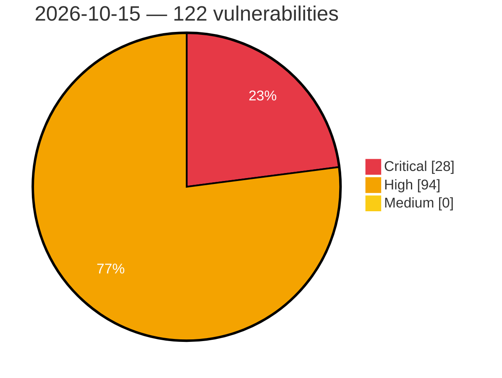

# Critical, High & Medium Severity Vulnerabilities — 2026-10-15

**Source status for this day:**

| Source | Critical | High | Medium | Total |
|--------|---------:|-----:|-------:|------:|
| cvefeed.io (High/Critical) | 28 | 94 | 0 | 122 |

**KEV (actively exploited):** 0  **Watchlist matches:** 91

## Critical (28)

| CVSS | Flags | Source | CVE / Title | Reported |
|------|-------|--------|-------------|----------|
| 9.9 | ⭐ | cvefeed.io (High/Critical) | [CVE-2026-105037 - EnergizeLab Station Middleware Authenticated Path Traversal Arbitrary File Read](https://cvefeed.io/vuln/detail/CVE-2026-105037) | 38 minutes ago |
| 9.8 | ⭐ | cvefeed.io (High/Critical) | [CVE-2026-110911 - Wheels SQL Injection Vulnerability](https://cvefeed.io/vuln/detail/CVE-2026-110911) | 42 minutes ago |
| 9.8 | ⭐ | cvefeed.io (High/Critical) | [CVE-2026-108587 - 10Web Booster <= 2.34.10 - Unauthenticated Arbitrary File Upload via 'page_id' Parameter](https://cvefeed.io/vuln/detail/CVE-2026-108587) | 3 hours, 15 minutes ago |
| 9.8 | ⭐ | cvefeed.io (High/Critical) | [CVE-2026-109892 - WordPress Frontend Admin by DynamiApps plugin <= 3.29.13 - Privilege Escalation vulnerability](https://cvefeed.io/vuln/detail/CVE-2026-109892) | 16 minutes ago |
| 9.8 | ⭐ | cvefeed.io (High/Critical) | [CVE-2026-109686 - WordPress Link Whisper Free plugin <= 0.9.7 - PHP Object Injection vulnerability](https://cvefeed.io/vuln/detail/CVE-2026-109686) | 16 minutes ago |
| 9.8 | ⭐ | cvefeed.io (High/Critical) | [CVE-2026-109694 - WordPress Fluent CRM plugin <= 3.2.5 - Privilege Escalation vulnerability](https://cvefeed.io/vuln/detail/CVE-2026-109694) | 2 hours, 16 minutes ago |
| 9.8 | ⭐ | cvefeed.io (High/Critical) | [CVE-2026-105038 - EnergizeLab Eilik Unauthenticated AI Model Administration and Runtime Model Switching](https://cvefeed.io/vuln/detail/CVE-2026-105038) | 38 minutes ago |
| 9.8 | — | cvefeed.io (High/Critical) | [CVE-2026-111329 - JuggleIM im-server through 1.8.16 Default Admin Credentials in Admin Console](https://cvefeed.io/vuln/detail/CVE-2026-111329) | 58 minutes ago |
| 9.8 | ⭐ | cvefeed.io (High/Critical) | [CVE-2026-111322 - Archon 0.2.13 through 0.11.1 Missing Authentication via /api/* Control API](https://cvefeed.io/vuln/detail/CVE-2026-111322) | 58 minutes ago |
| 9.8 | ⭐ | cvefeed.io (High/Critical) | [CVE-2026-111281 - Jooan JA-A12 Unauthenticated Root RCE via SetDiagMode Hard-Coded Credentials](https://cvefeed.io/vuln/detail/CVE-2026-111281) | 58 minutes ago |
| 9.6 | ⭐ | cvefeed.io (High/Critical) | [CVE-2026-105039 - EnergizeLab Station Middleware Admin APIs Missing Role Checks](https://cvefeed.io/vuln/detail/CVE-2026-105039) | 38 minutes ago |
| 9.5 | ⭐ | cvefeed.io (High/Critical) | [CVE-2026-93483 - Znuny Authentication Bypass via HTTP Header Manipulation](https://cvefeed.io/vuln/detail/CVE-2026-93483) | 4 hours, 14 minutes ago |
| 9.5 | ⭐ | cvefeed.io (High/Critical) | [CVE-2026-111283 - BMC Helix Network Management before 26.3.01 Authentication Bypass via SAML Configuration](https://cvefeed.io/vuln/detail/CVE-2026-111283) | 58 minutes ago |
| 9.4 | ⭐ | cvefeed.io (High/Critical) | [CVE-2026-50612 - Import Symlink Following Remote Code Execution Vulnerability in QuMagie](https://cvefeed.io/vuln/detail/CVE-2026-50612) | 3 hours, 16 minutes ago |
| 9.3 | — | cvefeed.io (High/Critical) | [CVE-2026-99999 - ipv4: validate checksum_start before completing checksum](https://cvefeed.io/vuln/detail/CVE-2026-99999) | 16 minutes ago |
| 9.3 | ⭐ | cvefeed.io (High/Critical) | [CVE-2026-109698 - WordPress Mang Board WP plugin <= 2.4.4 - SQL Injection vulnerability](https://cvefeed.io/vuln/detail/CVE-2026-109698) | 16 minutes ago |
| 9.3 | ⭐ | cvefeed.io (High/Critical) | [CVE-2026-109688 - WordPress Link Whisper Free plugin <= 0.9.7 - SQL Injection vulnerability](https://cvefeed.io/vuln/detail/CVE-2026-109688) | 16 minutes ago |
| 9.3 | ⭐ | cvefeed.io (High/Critical) | [CVE-2026-108497 - WordPress Amelia plugin <= 2.4.10 - SQL Injection vulnerability](https://cvefeed.io/vuln/detail/CVE-2026-108497) | 2 hours, 16 minutes ago |
| 9.3 | ⭐ | cvefeed.io (High/Critical) | [CVE-2026-50619 - Unauthenticated remote code execution vulnerability](https://cvefeed.io/vuln/detail/CVE-2026-50619) | 3 hours, 16 minutes ago |
| 9.3 | ⭐ | cvefeed.io (High/Critical) | [CVE-2026-47786 - Pre-Authentication Command Injection](https://cvefeed.io/vuln/detail/CVE-2026-47786) | 3 hours, 16 minutes ago |
| 9.3 | — | cvefeed.io (High/Critical) | [CVE-2026-34006 - Pre-Authentication Multiple Critical Vulnerabilities in QNAP sMedioDTCPServer](https://cvefeed.io/vuln/detail/CVE-2026-34006) | 3 hours, 16 minutes ago |
| 9.3 | ⭐ | cvefeed.io (High/Critical) | [CVE-2026-19863 - EthereumAuthenticator Authentication Bypass Vulnerability](https://cvefeed.io/vuln/detail/CVE-2026-19863) | 3 hours, 16 minutes ago |
| 9.2 | ⭐ | cvefeed.io (High/Critical) | [CVE-2026-102469 - Eclipse Vert.x DB2 Client Insecure Deserialization Vulnerability](https://cvefeed.io/vuln/detail/CVE-2026-102469) | 21 minutes ago |
| 9.2 | ⭐ | cvefeed.io (High/Critical) | [CVE-2026-111312 - OpenHealth through 0.2.0 Missing Authentication via /api/health-data/[id] Route](https://cvefeed.io/vuln/detail/CVE-2026-111312) | 58 minutes ago |
| 9.1 | ⭐ | cvefeed.io (High/Critical) | [CVE-2026-111235 - OpenNMS REST authorization bypass via non-canonical HTTP method](https://cvefeed.io/vuln/detail/CVE-2026-111235) | 24 minutes ago |
| 9.1 | ⭐ | cvefeed.io (High/Critical) | [CVE-2026-102946 - joserfc: JWS signature verification bypass via empty signatures array in jws.deserialize_json](https://cvefeed.io/vuln/detail/CVE-2026-102946) | 41 minutes ago |
| 9.1 | ⭐ | cvefeed.io (High/Critical) | [CVE-2026-55240 - Tianji: Remote Code Execution via lodash template evaluate pattern in survey feed templates](https://cvefeed.io/vuln/detail/CVE-2026-55240) | 54 minutes ago |
| 9.1 | ⭐ | cvefeed.io (High/Critical) | [CVE-2026-111356 - MacCMS v10 through 2026.1000.4056 Account Takeover via Password Recovery Brute-Force](https://cvefeed.io/vuln/detail/CVE-2026-111356) | 58 minutes ago |

## High (94)

| CVSS | Flags | Source | CVE / Title | Reported |
|------|-------|--------|-------------|----------|
| 10.0 | ⭐ | cvefeed.io (High/Critical) | [CVE-2026-84731 - Pre-Authentication Admin Bypass and Remote Code Execution in Nutanix Prism Gateway inside AOS](https://cvefeed.io/vuln/detail/CVE-2026-84731) | 52 minutes ago |
| 8.9 | — | cvefeed.io (High/Critical) | [CVE-2026-39997 - Unauthenticated Remote Input Injection in QNAP HD Station's remotepad](https://cvefeed.io/vuln/detail/CVE-2026-39997) | 3 hours, 16 minutes ago |
| 8.9 | ⭐ | cvefeed.io (High/Critical) | [CVE-2026-62679 - Lychee: Path traversal in `SecurePathController` allows authenticated arbitrary file read](https://cvefeed.io/vuln/detail/CVE-2026-62679) | 1 hour, 52 minutes ago |
| 8.8 | ⭐ | cvefeed.io (High/Critical) | [CVE-2026-110908 - Netgate pfSense FRR Package OS Command Injection Vulnerability](https://cvefeed.io/vuln/detail/CVE-2026-110908) | 29 minutes ago |
| 8.8 | ⭐ | cvefeed.io (High/Critical) | [CVE-2026-77931 - MoviePilot 3.1.5 Command Injection via ExecuteCommandTool](https://cvefeed.io/vuln/detail/CVE-2026-77931) | 1 hour, 26 minutes ago |
| 8.8 | ⭐ | cvefeed.io (High/Critical) | [CVE-2026-81534 - Email Customizer for WooCommerce (Pro) <= 3.9.5 - Authenticated (Subscriber+) Remote Code Execution via 'template' Parameter](https://cvefeed.io/vuln/detail/CVE-2026-81534) | 1 hour, 14 minutes ago |
| 8.8 | ⭐ | cvefeed.io (High/Critical) | [CVE-2026-109693 - WordPress Fluent CRM plugin <= 3.2.5 - Privilege Escalation vulnerability](https://cvefeed.io/vuln/detail/CVE-2026-109693) | 16 minutes ago |
| 8.8 | ⭐ | cvefeed.io (High/Critical) | [CVE-2026-55239 - Tianji: SQL Injection via unsanitized timezone parameter in analytics queries](https://cvefeed.io/vuln/detail/CVE-2026-55239) | 55 minutes ago |
| 8.8 | ⭐ | cvefeed.io (High/Critical) | [CVE-2026-85634 - Wildfly-core: wildfly-core: deployer rbac role privilege escalation via path traversal in deployment name](https://cvefeed.io/vuln/detail/CVE-2026-85634) | 1 hour, 52 minutes ago |
| 8.8 | ⭐ | cvefeed.io (High/Critical) | [CVE-2026-108452 - Microsoft Office SharePoint Remote Code Execution Vulnerability](https://cvefeed.io/vuln/detail/CVE-2026-108452) | 24 minutes ago |
| 8.8 | ⭐ | cvefeed.io (High/Critical) | [CVE-2026-108451 - Microsoft Office Word Remote Code Execution Vulnerability](https://cvefeed.io/vuln/detail/CVE-2026-108451) | 24 minutes ago |
| 8.8 | ⭐ | cvefeed.io (High/Critical) | [CVE-2026-108450 - Microsoft Office Word Remote Code Execution Vulnerability](https://cvefeed.io/vuln/detail/CVE-2026-108450) | 24 minutes ago |
| 8.8 | ⭐ | cvefeed.io (High/Critical) | [CVE-2026-108449 - Microsoft Office Word Remote Code Execution Vulnerability](https://cvefeed.io/vuln/detail/CVE-2026-108449) | 24 minutes ago |
| 8.8 | ⭐ | cvefeed.io (High/Critical) | [CVE-2026-108447 - Microsoft Office Word Remote Code Execution Vulnerability](https://cvefeed.io/vuln/detail/CVE-2026-108447) | 24 minutes ago |
| 8.8 | ⭐ | cvefeed.io (High/Critical) | [CVE-2026-108446 - Microsoft Office Excel Remote Code Execution Vulnerability](https://cvefeed.io/vuln/detail/CVE-2026-108446) | 24 minutes ago |
| 8.8 | ⭐ | cvefeed.io (High/Critical) | [CVE-2026-108445 - Microsoft Office Word Remote Code Execution Vulnerability](https://cvefeed.io/vuln/detail/CVE-2026-108445) | 24 minutes ago |
| 8.8 | ⭐ | cvefeed.io (High/Critical) | [CVE-2026-108444 - Microsoft Office Remote Code Execution Vulnerability](https://cvefeed.io/vuln/detail/CVE-2026-108444) | 24 minutes ago |
| 8.8 | ⭐ | cvefeed.io (High/Critical) | [CVE-2026-108443 - Microsoft Office Word Remote Code Execution Vulnerability](https://cvefeed.io/vuln/detail/CVE-2026-108443) | 24 minutes ago |
| 8.8 | ⭐ | cvefeed.io (High/Critical) | [CVE-2026-108442 - Microsoft Office Word Remote Code Execution Vulnerability](https://cvefeed.io/vuln/detail/CVE-2026-108442) | 24 minutes ago |
| 8.8 | ⭐ | cvefeed.io (High/Critical) | [CVE-2026-108441 - Microsoft Office Word Remote Code Execution Vulnerability](https://cvefeed.io/vuln/detail/CVE-2026-108441) | 24 minutes ago |
| 8.8 | ⭐ | cvefeed.io (High/Critical) | [CVE-2026-108440 - Microsoft Office Word Remote Code Execution Vulnerability](https://cvefeed.io/vuln/detail/CVE-2026-108440) | 24 minutes ago |
| 8.8 | ⭐ | cvefeed.io (High/Critical) | [CVE-2026-108439 - Microsoft Office Word Remote Code Execution Vulnerability](https://cvefeed.io/vuln/detail/CVE-2026-108439) | 24 minutes ago |
| 8.8 | ⭐ | cvefeed.io (High/Critical) | [CVE-2026-108437 - Microsoft Office Word Remote Code Execution Vulnerability](https://cvefeed.io/vuln/detail/CVE-2026-108437) | 24 minutes ago |
| 8.8 | ⭐ | cvefeed.io (High/Critical) | [CVE-2026-108432 - Microsoft Office Word Remote Code Execution Vulnerability](https://cvefeed.io/vuln/detail/CVE-2026-108432) | 24 minutes ago |
| 8.8 | ⭐ | cvefeed.io (High/Critical) | [CVE-2026-108431 - Microsoft Office Word Remote Code Execution Vulnerability](https://cvefeed.io/vuln/detail/CVE-2026-108431) | 24 minutes ago |
| 8.8 | ⭐ | cvefeed.io (High/Critical) | [CVE-2026-108430 - Microsoft Office Word Remote Code Execution Vulnerability](https://cvefeed.io/vuln/detail/CVE-2026-108430) | 24 minutes ago |
| 8.8 | ⭐ | cvefeed.io (High/Critical) | [CVE-2026-108429 - Microsoft Office Word Remote Code Execution Vulnerability](https://cvefeed.io/vuln/detail/CVE-2026-108429) | 24 minutes ago |
| 8.8 | ⭐ | cvefeed.io (High/Critical) | [CVE-2026-108428 - Microsoft Office Word Remote Code Execution Vulnerability](https://cvefeed.io/vuln/detail/CVE-2026-108428) | 24 minutes ago |
| 8.8 | ⭐ | cvefeed.io (High/Critical) | [CVE-2026-108427 - Microsoft Office Word Remote Code Execution Vulnerability](https://cvefeed.io/vuln/detail/CVE-2026-108427) | 24 minutes ago |
| 8.8 | ⭐ | cvefeed.io (High/Critical) | [CVE-2026-108426 - Microsoft Office Word Remote Code Execution Vulnerability](https://cvefeed.io/vuln/detail/CVE-2026-108426) | 24 minutes ago |
| 8.8 | — | cvefeed.io (High/Critical) | [CVE-2026-105040 - EnergizeLab Eilik User-ID Mass Assignment Account Takeover](https://cvefeed.io/vuln/detail/CVE-2026-105040) | 38 minutes ago |
| 8.8 | ⭐ | cvefeed.io (High/Critical) | [CVE-2026-111352 - ThinkCMF through 8.0.1 Incorrect Authorization in Admin REST API](https://cvefeed.io/vuln/detail/CVE-2026-111352) | 58 minutes ago |
| 8.8 | — | cvefeed.io (High/Critical) | [CVE-2026-111282 - iso14229 before 0.10.1 Out-of-Bounds Read via Handle_0x38_RequestFileTransfer](https://cvefeed.io/vuln/detail/CVE-2026-111282) | 58 minutes ago |
| 8.8 | — | cvefeed.io (High/Critical) | [CVE-2026-110922 - Google Chrome Prerender Use-After-Free Vulnerability](https://cvefeed.io/vuln/detail/CVE-2026-110922) | 5 hours, 33 minutes ago |
| 8.8 | — | cvefeed.io (High/Critical) | [CVE-2026-110921 - Google Chrome V8 Use-After-Free Vulnerability](https://cvefeed.io/vuln/detail/CVE-2026-110921) | 5 hours, 33 minutes ago |
| 8.8 | — | cvefeed.io (High/Critical) | [CVE-2026-110920 - Google Chrome V8 Memory Corruption](https://cvefeed.io/vuln/detail/CVE-2026-110920) | 5 hours, 33 minutes ago |
| 8.8 | — | cvefeed.io (High/Critical) | [CVE-2026-110919 - Google Chrome V8 Use-After-Free Vulnerability](https://cvefeed.io/vuln/detail/CVE-2026-110919) | 5 hours, 33 minutes ago |
| 8.7 | — | cvefeed.io (High/Critical) | [CVE-2026-76660 - HPE NonStop CIPSAM - Memory corruption vulnerability](https://cvefeed.io/vuln/detail/CVE-2026-76660) | 1 hour, 26 minutes ago |
| 8.7 | ⭐ | cvefeed.io (High/Critical) | [CVE-2026-76066 - IntentKit 2.6.3 Executor Tool Authorization Bypass via ToolNode](https://cvefeed.io/vuln/detail/CVE-2026-76066) | 1 hour, 26 minutes ago |
| 8.7 | ⭐ | cvefeed.io (High/Critical) | [CVE-2026-109430 - Ellucian WebAdvisor 3.2 Unauthenticated XXE Injection](https://cvefeed.io/vuln/detail/CVE-2026-109430) | 1 hour, 27 minutes ago |
| 8.7 | — | cvefeed.io (High/Critical) | [CVE-2026-0993 - SODOLA SL902-SWTGW124AS Buffer Overflow DoS via Multipart Boundary Parser](https://cvefeed.io/vuln/detail/CVE-2026-0993) | 2 hours, 26 minutes ago |
| 8.7 | ⭐ | cvefeed.io (High/Critical) | [CVE-2026-102477 - Eclipse Vert.x gRPC Server Compression Bomb Denial of Service Vulnerability](https://cvefeed.io/vuln/detail/CVE-2026-102477) | 4 minutes ago |
| 8.7 | ⭐ | cvefeed.io (High/Critical) | [CVE-2026-102461 - Eclipse Vert.x JSON Schema Denial of Service Vulnerability](https://cvefeed.io/vuln/detail/CVE-2026-102461) | 8 minutes ago |
| 8.7 | ⭐ | cvefeed.io (High/Critical) | [CVE-2026-102475 - Eclipse Vert.x HTTP Proxy Memory Exhaustion Vulnerability](https://cvefeed.io/vuln/detail/CVE-2026-102475) | 16 minutes ago |
| 8.7 | — | cvefeed.io (High/Critical) | [CVE-2026-102467 - Eclipse Vert.x WebSocket Decompression Denial of Service Vulnerability](https://cvefeed.io/vuln/detail/CVE-2026-102467) | 16 minutes ago |
| 8.7 | ⭐ | cvefeed.io (High/Critical) | [CVE-2026-41544 - Path Traversal leading to Arbitrary File Move, Docker Escape, and Host RCE in /calapi/renameUpload endpoint](https://cvefeed.io/vuln/detail/CVE-2026-41544) | 1 hour, 14 minutes ago |
| 8.7 | ⭐ | cvefeed.io (High/Critical) | [CVE-2026-39993 - Path Traversal to Root RCE in QNAP Download Station via Addon/Search addon Parameter](https://cvefeed.io/vuln/detail/CVE-2026-39993) | 1 hour, 14 minutes ago |
| 8.7 | ⭐ | cvefeed.io (High/Critical) | [CVE-2026-53882 - Path Traversal in Virtualization Station VM Import](https://cvefeed.io/vuln/detail/CVE-2026-53882) | 3 hours, 16 minutes ago |
| 8.7 | — | cvefeed.io (High/Critical) | [CVE-2026-44084 - Access Code Forgery in Video Station leading to unauthorized media access](https://cvefeed.io/vuln/detail/CVE-2026-44084) | 3 hours, 16 minutes ago |
| 8.7 | ⭐ | cvefeed.io (High/Critical) | [CVE-2026-34015 - Remote Code Execution in upload.php of Video Station](https://cvefeed.io/vuln/detail/CVE-2026-34015) | 3 hours, 16 minutes ago |
| 8.7 | ⭐ | cvefeed.io (High/Critical) | [CVE-2026-111160 - LightLLM through 1.2.0 Unauthenticated DoS via pd_kv_trans_params Deserialization](https://cvefeed.io/vuln/detail/CVE-2026-111160) | 11 minutes ago |
| 8.7 | ⭐ | cvefeed.io (High/Critical) | [CVE-2026-55872 - GYM One admin user list is vulnerable to stored cross-site scripting](https://cvefeed.io/vuln/detail/CVE-2026-55872) | 42 minutes ago |
| 8.7 | — | cvefeed.io (High/Critical) | [CVE-2026-111279 - Dragonfly through 2.0.2 Unbounded Memory Allocation via Negative COUNT in HRANDFIELD, ZRANDMEMBER and SRANDMEMBER](https://cvefeed.io/vuln/detail/CVE-2026-111279) | 58 minutes ago |
| 8.7 | — | cvefeed.io (High/Critical) | [CVE-2026-111277 - NivoCart through 2.5.1 Guest Order Invoice Disclosure via account/order/download](https://cvefeed.io/vuln/detail/CVE-2026-111277) | 58 minutes ago |
| 8.6 | ⭐ | cvefeed.io (High/Critical) | [CVE-2026-93484 - Znuny SQL Injection Vulnerability](https://cvefeed.io/vuln/detail/CVE-2026-93484) | 4 hours, 14 minutes ago |
| 8.6 | ⭐ | cvefeed.io (High/Critical) | [CVE-2026-41545 - WebSocket timelapse path traversal and command injection](https://cvefeed.io/vuln/detail/CVE-2026-41545) | 3 hours, 16 minutes ago |
| 8.6 | — | cvefeed.io (High/Critical) | [CVE-2026-111231 - Netgate pfSense CE through 2.9.0 Authorization Bypass via config_restore() and config_install()](https://cvefeed.io/vuln/detail/CVE-2026-111231) | 22 minutes ago |
| 8.6 | ⭐ | cvefeed.io (High/Critical) | [CVE-2026-111229 - Netgate pfSense CE 2.7.0 through 2.9.0 Command Injection via Captive Portal HA Sync](https://cvefeed.io/vuln/detail/CVE-2026-111229) | 23 minutes ago |
| 8.6 | ⭐ | cvefeed.io (High/Critical) | [CVE-2026-111226 - Netgate pfSense CE 2.4.5 through 2.9.0 OS Command Injection via system_advanced_admin.php](https://cvefeed.io/vuln/detail/CVE-2026-111226) | 23 minutes ago |
| 8.6 | ⭐ | cvefeed.io (High/Critical) | [CVE-2026-111223 - Netgate pfSense CE 2.7.0 through 2.9.0 Command Injection via IPsec Mobile Login Banner](https://cvefeed.io/vuln/detail/CVE-2026-111223) | 23 minutes ago |
| 8.6 | — | cvefeed.io (High/Critical) | [CVE-2026-111220 - Netgate pfSense CE through 2.9.0 Crontab Injection via PPP Periodic Reset ptpid](https://cvefeed.io/vuln/detail/CVE-2026-111220) | 23 minutes ago |
| 8.6 | ⭐ | cvefeed.io (High/Critical) | [CVE-2026-111218 - Netgate pfSense CE 2.7.0 through 2.9.0 OS Command Injection via Traffic Shaper Limiters](https://cvefeed.io/vuln/detail/CVE-2026-111218) | 23 minutes ago |
| 8.6 | ⭐ | cvefeed.io (High/Critical) | [CVE-2026-111217 - Netgate pfSense CE through 2.9.0 OS Command Injection via CARP VHID](https://cvefeed.io/vuln/detail/CVE-2026-111217) | 23 minutes ago |
| 8.6 | ⭐ | cvefeed.io (High/Critical) | [CVE-2026-111216 - Netgate pfSense CE through 2.9.0 OS Command Injection via Gateway Monitor IP](https://cvefeed.io/vuln/detail/CVE-2026-111216) | 23 minutes ago |
| 8.6 | ⭐ | cvefeed.io (High/Critical) | [CVE-2026-111215 - Netgate pfSense CE through 2.9.0 OS Command Injection via Wireless Parent Interface](https://cvefeed.io/vuln/detail/CVE-2026-111215) | 23 minutes ago |
| 8.6 | ⭐ | cvefeed.io (High/Critical) | [CVE-2026-111214 - Netgate pfSense CE 2.7.0 through 2.9.0 OS Command Injection via interfaces_qinq_edit.php](https://cvefeed.io/vuln/detail/CVE-2026-111214) | 23 minutes ago |
| 8.6 | ⭐ | cvefeed.io (High/Critical) | [CVE-2026-55103 - Discourse ActivityPub: Fix inbound actor validation and apply outbound request SSRF hardening](https://cvefeed.io/vuln/detail/CVE-2026-55103) | 52 minutes ago |
| 8.6 | — | cvefeed.io (High/Critical) | [CVE-2026-111366 - cool-admin-midway through 8.0.0 Authorization Bypass via /admin/sys/user Endpoints](https://cvefeed.io/vuln/detail/CVE-2026-111366) | 58 minutes ago |
| 8.5 | ⭐ | cvefeed.io (High/Critical) | [CVE-2024-22031 - Rancher users who can create Projects can gain access to arbitrary projects](https://cvefeed.io/vuln/detail/CVE-2024-22031) | 11 minutes ago |
| 8.5 | ⭐ | cvefeed.io (High/Critical) | [CVE-2026-34008 - **Privilege Escalation** World-writable crontab path monitored and executed by root-owned process](https://cvefeed.io/vuln/detail/CVE-2026-34008) | 3 hours, 16 minutes ago |
| 8.4 | ⭐ | cvefeed.io (High/Critical) | [CVE-2026-104025 - Path traversal in PeaZip object preview allows execution of arbitrary programs via a crafted archive entry name](https://cvefeed.io/vuln/detail/CVE-2026-104025) | 16 minutes ago |
| 8.4 | ⭐ | cvefeed.io (High/Critical) | [CVE-2026-34014 - ds-move-files.sh is writable and executed as root](https://cvefeed.io/vuln/detail/CVE-2026-34014) | 3 hours, 16 minutes ago |
| 8.4 | ⭐ | cvefeed.io (High/Critical) | [CVE-2026-34009 - **Container Escape** Host user home directory mounted with write access into application container](https://cvefeed.io/vuln/detail/CVE-2026-34009) | 3 hours, 16 minutes ago |
| 8.3 | ⭐ | cvefeed.io (High/Critical) | [CVE-2026-77470 - Lychee: Webshop checkout lets the client override the payment `amount` sent to the gateway via malicious crafted POST request](https://cvefeed.io/vuln/detail/CVE-2026-77470) | 1 hour, 52 minutes ago |
| 8.3 | ⭐ | cvefeed.io (High/Critical) | [CVE-2026-77466 - Lychee: Webshop payment bypass via unrestricted "Dummy" gateway selection](https://cvefeed.io/vuln/detail/CVE-2026-77466) | 1 hour, 52 minutes ago |
| 8.3 | — | cvefeed.io (High/Critical) | [CVE-2026-111280 - snap7 through 1.4.3 Out-of-Bounds Write via TSnap7MicroClient::opReadArea](https://cvefeed.io/vuln/detail/CVE-2026-111280) | 58 minutes ago |
| 8.2 | ⭐ | cvefeed.io (High/Critical) | [CVE-2026-102464 - Eclipse Vert.x MQTT Denial of Service via Unbounded Inbound QoS 2 Message Retention](https://cvefeed.io/vuln/detail/CVE-2026-102464) | 6 minutes ago |
| 8.2 | — | cvefeed.io (High/Critical) | [CVE-2026-103224 - Eclipse Vert.x MySQL Client Unbounded Memory Allocation Denial of Service](https://cvefeed.io/vuln/detail/CVE-2026-103224) | 10 minutes ago |
| 8.2 | — | cvefeed.io (High/Critical) | [CVE-2026-103223 - Eclipse Vert.x PostgreSQL Client Unbounded Memory Allocation Vulnerability](https://cvefeed.io/vuln/detail/CVE-2026-103223) | 12 minutes ago |
| 8.2 | — | cvefeed.io (High/Critical) | [CVE-2026-102465 - Eclipse Vert.x Redis Client Memory Allocation Denial of Service](https://cvefeed.io/vuln/detail/CVE-2026-102465) | 16 minutes ago |
| 8.2 | — | cvefeed.io (High/Critical) | [CVE-2026-102466 - Eclipse Vert.x MySQL Client Denial of Service Vulnerability](https://cvefeed.io/vuln/detail/CVE-2026-102466) | 17 minutes ago |
| 8.2 | ⭐ | cvefeed.io (High/Critical) | [CVE-2026-102463 - Eclipse Vert.x PostgreSQL Client Uncontrolled Resource Consumption Vulnerability](https://cvefeed.io/vuln/detail/CVE-2026-102463) | 19 minutes ago |
| 8.2 | — | cvefeed.io (High/Critical) | [CVE-2026-102462 - Eclipse Vert.x MSSQL Client Memory Exhaustion Vulnerability](https://cvefeed.io/vuln/detail/CVE-2026-102462) | 23 minutes ago |
| 8.2 | — | cvefeed.io (High/Critical) | [CVE-2026-79821 - HPE NonStop SOAP 4.0 - Memory corruption](https://cvefeed.io/vuln/detail/CVE-2026-79821) | 1 hour, 14 minutes ago |
| 8.2 | ⭐ | cvefeed.io (High/Critical) | [CVE-2026-88794 - XML External Entity injection in Sparx Enterprise Architect](https://cvefeed.io/vuln/detail/CVE-2026-88794) | 16 minutes ago |
| 8.2 | — | cvefeed.io (High/Critical) | [CVE-2026-79829 - HPE NonStop HTTP WEBSERVER - Memory corruption vulnerability](https://cvefeed.io/vuln/detail/CVE-2026-79829) | 3 hours, 16 minutes ago |
| 8.2 | — | cvefeed.io (High/Critical) | [CVE-2026-111234 - SimplePie through 1.9.0 Local File Read via file:// Redirect](https://cvefeed.io/vuln/detail/CVE-2026-111234) | 22 minutes ago |
| 8.2 | ⭐ | cvefeed.io (High/Critical) | [CVE-2026-61838 - Lychee: Album password bypass in ZIP downloads](https://cvefeed.io/vuln/detail/CVE-2026-61838) | 1 hour, 52 minutes ago |
| 8.2 | — | cvefeed.io (High/Critical) | [CVE-2026-111347 - go-ldap-admin through 0.6.2 Hard-Coded RSA Private Key via /base/decryptpwd](https://cvefeed.io/vuln/detail/CVE-2026-111347) | 58 minutes ago |
| 8.2 | ⭐ | cvefeed.io (High/Critical) | [CVE-2026-111330 - JuggleIM im-server through 1.8.16 Weak Password Hashing via Unsalted SHA-1](https://cvefeed.io/vuln/detail/CVE-2026-111330) | 58 minutes ago |
| 8.1 | ⭐ | cvefeed.io (High/Critical) | [CVE-2026-17031 - Checkout Field Manager (Checkout Manager) for WooCommerce <= 7.9.6 - Missing Authorization to Authenticated (Subscriber+) Arbitrary Media Deletion via Checkout File Field Attachment ID](https://cvefeed.io/vuln/detail/CVE-2026-17031) | 2 hours, 15 minutes ago |
| 8.1 | ⭐ | cvefeed.io (High/Critical) | [CVE-2026-55587 - AliasVault: Browser extension WebAuthn bridge accepts forged origin/RP ID](https://cvefeed.io/vuln/detail/CVE-2026-55587) | 47 minutes ago |
| 8.0 | — | cvefeed.io (High/Critical) | [CVE-2023-32198 - Steve doesn’t verify a server’s certificate and is susceptible to man-in-the-middle (MitM) attacks](https://cvefeed.io/vuln/detail/CVE-2023-32198) | 9 minutes ago |
| 8.0 | — | cvefeed.io (High/Critical) | [CVE-2026-79824 - HPE NonStop Python 3.x - Directory traversal vulnerability](https://cvefeed.io/vuln/detail/CVE-2026-79824) | 3 hours, 16 minutes ago |
