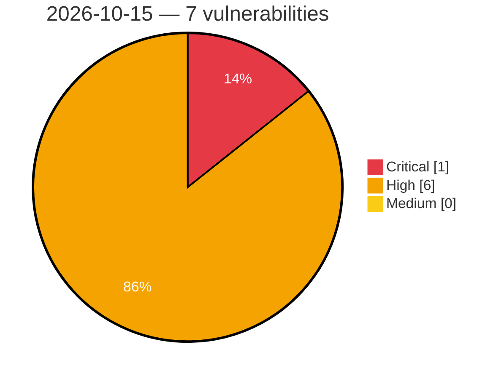

# Critical, High & Medium Severity Vulnerabilities — 2026-10-15

**Source status for this day:**

| Source | Critical | High | Medium | Total |
|--------|---------:|-----:|-------:|------:|
| cvefeed.io (High/Critical) | 1 | 6 | 0 | 7 |

**KEV (actively exploited):** 0  **Watchlist matches:** 5

## Critical (1)

| CVSS | Flags | Source | CVE / Title | Reported |
|------|-------|--------|-------------|----------|
| 9.8 | ⭐ | cvefeed.io (High/Critical) | [CVE-2026-110911 - Wheels SQL Injection Vulnerability](https://cvefeed.io/vuln/detail/CVE-2026-110911) | 42 minutes ago |

## High (6)

| CVSS | Flags | Source | CVE / Title | Reported |
|------|-------|--------|-------------|----------|
| 8.8 | ⭐ | cvefeed.io (High/Critical) | [CVE-2026-110908 - Netgate pfSense FRR Package OS Command Injection Vulnerability](https://cvefeed.io/vuln/detail/CVE-2026-110908) | 29 minutes ago |
| 8.8 | ⭐ | cvefeed.io (High/Critical) | [CVE-2026-77931 - MoviePilot 3.1.5 Command Injection via ExecuteCommandTool](https://cvefeed.io/vuln/detail/CVE-2026-77931) | 1 hour, 26 minutes ago |
| 8.7 | — | cvefeed.io (High/Critical) | [CVE-2026-76660 - HPE NonStop CIPSAM - Memory corruption vulnerability](https://cvefeed.io/vuln/detail/CVE-2026-76660) | 1 hour, 26 minutes ago |
| 8.7 | ⭐ | cvefeed.io (High/Critical) | [CVE-2026-76066 - IntentKit 2.6.3 Executor Tool Authorization Bypass via ToolNode](https://cvefeed.io/vuln/detail/CVE-2026-76066) | 1 hour, 26 minutes ago |
| 8.7 | ⭐ | cvefeed.io (High/Critical) | [CVE-2026-109430 - Ellucian WebAdvisor 3.2 Unauthenticated XXE Injection](https://cvefeed.io/vuln/detail/CVE-2026-109430) | 1 hour, 27 minutes ago |
| 8.7 | — | cvefeed.io (High/Critical) | [CVE-2026-0993 - SODOLA SL902-SWTGW124AS Buffer Overflow DoS via Multipart Boundary Parser](https://cvefeed.io/vuln/detail/CVE-2026-0993) | 2 hours, 26 minutes ago |
