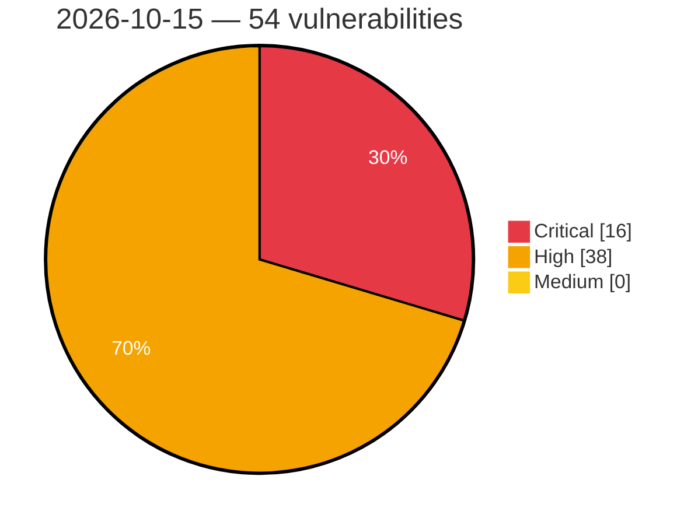

# Critical, High & Medium Severity Vulnerabilities — 2026-10-15

**Source status for this day:**

| Source | Critical | High | Medium | Total |
|--------|---------:|-----:|-------:|------:|
| cvefeed.io (High/Critical) | 16 | 38 | 0 | 54 |

**KEV (actively exploited):** 0  **Watchlist matches:** 38

## Critical (16)

| CVSS | Flags | Source | CVE / Title | Reported |
|------|-------|--------|-------------|----------|
| 9.8 | ⭐ | cvefeed.io (High/Critical) | [CVE-2026-110911 - Wheels SQL Injection Vulnerability](https://cvefeed.io/vuln/detail/CVE-2026-110911) | 42 minutes ago |
| 9.8 | ⭐ | cvefeed.io (High/Critical) | [CVE-2026-108587 - 10Web Booster <= 2.34.10 - Unauthenticated Arbitrary File Upload via 'page_id' Parameter](https://cvefeed.io/vuln/detail/CVE-2026-108587) | 3 hours, 15 minutes ago |
| 9.8 | ⭐ | cvefeed.io (High/Critical) | [CVE-2026-109892 - WordPress Frontend Admin by DynamiApps plugin <= 3.29.13 - Privilege Escalation vulnerability](https://cvefeed.io/vuln/detail/CVE-2026-109892) | 16 minutes ago |
| 9.8 | ⭐ | cvefeed.io (High/Critical) | [CVE-2026-109686 - WordPress Link Whisper Free plugin <= 0.9.7 - PHP Object Injection vulnerability](https://cvefeed.io/vuln/detail/CVE-2026-109686) | 16 minutes ago |
| 9.8 | ⭐ | cvefeed.io (High/Critical) | [CVE-2026-109694 - WordPress Fluent CRM plugin <= 3.2.5 - Privilege Escalation vulnerability](https://cvefeed.io/vuln/detail/CVE-2026-109694) | 2 hours, 16 minutes ago |
| 9.5 | ⭐ | cvefeed.io (High/Critical) | [CVE-2026-93483 - Znuny Authentication Bypass via HTTP Header Manipulation](https://cvefeed.io/vuln/detail/CVE-2026-93483) | 4 hours, 14 minutes ago |
| 9.4 | ⭐ | cvefeed.io (High/Critical) | [CVE-2026-50612 - Import Symlink Following Remote Code Execution Vulnerability in QuMagie](https://cvefeed.io/vuln/detail/CVE-2026-50612) | 3 hours, 16 minutes ago |
| 9.3 | — | cvefeed.io (High/Critical) | [CVE-2026-99999 - ipv4: validate checksum_start before completing checksum](https://cvefeed.io/vuln/detail/CVE-2026-99999) | 16 minutes ago |
| 9.3 | ⭐ | cvefeed.io (High/Critical) | [CVE-2026-109698 - WordPress Mang Board WP plugin <= 2.4.4 - SQL Injection vulnerability](https://cvefeed.io/vuln/detail/CVE-2026-109698) | 16 minutes ago |
| 9.3 | ⭐ | cvefeed.io (High/Critical) | [CVE-2026-109688 - WordPress Link Whisper Free plugin <= 0.9.7 - SQL Injection vulnerability](https://cvefeed.io/vuln/detail/CVE-2026-109688) | 16 minutes ago |
| 9.3 | ⭐ | cvefeed.io (High/Critical) | [CVE-2026-108497 - WordPress Amelia plugin <= 2.4.10 - SQL Injection vulnerability](https://cvefeed.io/vuln/detail/CVE-2026-108497) | 2 hours, 16 minutes ago |
| 9.3 | ⭐ | cvefeed.io (High/Critical) | [CVE-2026-50619 - Unauthenticated remote code execution vulnerability](https://cvefeed.io/vuln/detail/CVE-2026-50619) | 3 hours, 16 minutes ago |
| 9.3 | ⭐ | cvefeed.io (High/Critical) | [CVE-2026-47786 - Pre-Authentication Command Injection](https://cvefeed.io/vuln/detail/CVE-2026-47786) | 3 hours, 16 minutes ago |
| 9.3 | — | cvefeed.io (High/Critical) | [CVE-2026-34006 - Pre-Authentication Multiple Critical Vulnerabilities in QNAP sMedioDTCPServer](https://cvefeed.io/vuln/detail/CVE-2026-34006) | 3 hours, 16 minutes ago |
| 9.3 | ⭐ | cvefeed.io (High/Critical) | [CVE-2026-19863 - EthereumAuthenticator Authentication Bypass Vulnerability](https://cvefeed.io/vuln/detail/CVE-2026-19863) | 3 hours, 16 minutes ago |
| 9.2 | ⭐ | cvefeed.io (High/Critical) | [CVE-2026-102469 - Eclipse Vert.x DB2 Client Insecure Deserialization Vulnerability](https://cvefeed.io/vuln/detail/CVE-2026-102469) | 21 minutes ago |

## High (38)

| CVSS | Flags | Source | CVE / Title | Reported |
|------|-------|--------|-------------|----------|
| 8.9 | — | cvefeed.io (High/Critical) | [CVE-2026-39997 - Unauthenticated Remote Input Injection in QNAP HD Station's remotepad](https://cvefeed.io/vuln/detail/CVE-2026-39997) | 3 hours, 16 minutes ago |
| 8.8 | ⭐ | cvefeed.io (High/Critical) | [CVE-2026-110908 - Netgate pfSense FRR Package OS Command Injection Vulnerability](https://cvefeed.io/vuln/detail/CVE-2026-110908) | 29 minutes ago |
| 8.8 | ⭐ | cvefeed.io (High/Critical) | [CVE-2026-77931 - MoviePilot 3.1.5 Command Injection via ExecuteCommandTool](https://cvefeed.io/vuln/detail/CVE-2026-77931) | 1 hour, 26 minutes ago |
| 8.8 | ⭐ | cvefeed.io (High/Critical) | [CVE-2026-81534 - Email Customizer for WooCommerce (Pro) <= 3.9.5 - Authenticated (Subscriber+) Remote Code Execution via 'template' Parameter](https://cvefeed.io/vuln/detail/CVE-2026-81534) | 1 hour, 14 minutes ago |
| 8.8 | ⭐ | cvefeed.io (High/Critical) | [CVE-2026-109693 - WordPress Fluent CRM plugin <= 3.2.5 - Privilege Escalation vulnerability](https://cvefeed.io/vuln/detail/CVE-2026-109693) | 16 minutes ago |
| 8.7 | — | cvefeed.io (High/Critical) | [CVE-2026-76660 - HPE NonStop CIPSAM - Memory corruption vulnerability](https://cvefeed.io/vuln/detail/CVE-2026-76660) | 1 hour, 26 minutes ago |
| 8.7 | ⭐ | cvefeed.io (High/Critical) | [CVE-2026-76066 - IntentKit 2.6.3 Executor Tool Authorization Bypass via ToolNode](https://cvefeed.io/vuln/detail/CVE-2026-76066) | 1 hour, 26 minutes ago |
| 8.7 | ⭐ | cvefeed.io (High/Critical) | [CVE-2026-109430 - Ellucian WebAdvisor 3.2 Unauthenticated XXE Injection](https://cvefeed.io/vuln/detail/CVE-2026-109430) | 1 hour, 27 minutes ago |
| 8.7 | — | cvefeed.io (High/Critical) | [CVE-2026-0993 - SODOLA SL902-SWTGW124AS Buffer Overflow DoS via Multipart Boundary Parser](https://cvefeed.io/vuln/detail/CVE-2026-0993) | 2 hours, 26 minutes ago |
| 8.7 | ⭐ | cvefeed.io (High/Critical) | [CVE-2026-102477 - Eclipse Vert.x gRPC Server Compression Bomb Denial of Service Vulnerability](https://cvefeed.io/vuln/detail/CVE-2026-102477) | 4 minutes ago |
| 8.7 | ⭐ | cvefeed.io (High/Critical) | [CVE-2026-102461 - Eclipse Vert.x JSON Schema Denial of Service Vulnerability](https://cvefeed.io/vuln/detail/CVE-2026-102461) | 8 minutes ago |
| 8.7 | ⭐ | cvefeed.io (High/Critical) | [CVE-2026-102475 - Eclipse Vert.x HTTP Proxy Memory Exhaustion Vulnerability](https://cvefeed.io/vuln/detail/CVE-2026-102475) | 16 minutes ago |
| 8.7 | — | cvefeed.io (High/Critical) | [CVE-2026-102467 - Eclipse Vert.x WebSocket Decompression Denial of Service Vulnerability](https://cvefeed.io/vuln/detail/CVE-2026-102467) | 16 minutes ago |
| 8.7 | ⭐ | cvefeed.io (High/Critical) | [CVE-2026-41544 - Path Traversal leading to Arbitrary File Move, Docker Escape, and Host RCE in /calapi/renameUpload endpoint](https://cvefeed.io/vuln/detail/CVE-2026-41544) | 1 hour, 14 minutes ago |
| 8.7 | ⭐ | cvefeed.io (High/Critical) | [CVE-2026-39993 - Path Traversal to Root RCE in QNAP Download Station via Addon/Search addon Parameter](https://cvefeed.io/vuln/detail/CVE-2026-39993) | 1 hour, 14 minutes ago |
| 8.7 | ⭐ | cvefeed.io (High/Critical) | [CVE-2026-53882 - Path Traversal in Virtualization Station VM Import](https://cvefeed.io/vuln/detail/CVE-2026-53882) | 3 hours, 16 minutes ago |
| 8.7 | — | cvefeed.io (High/Critical) | [CVE-2026-44084 - Access Code Forgery in Video Station leading to unauthorized media access](https://cvefeed.io/vuln/detail/CVE-2026-44084) | 3 hours, 16 minutes ago |
| 8.7 | ⭐ | cvefeed.io (High/Critical) | [CVE-2026-34015 - Remote Code Execution in upload.php of Video Station](https://cvefeed.io/vuln/detail/CVE-2026-34015) | 3 hours, 16 minutes ago |
| 8.6 | ⭐ | cvefeed.io (High/Critical) | [CVE-2026-93484 - Znuny SQL Injection Vulnerability](https://cvefeed.io/vuln/detail/CVE-2026-93484) | 4 hours, 14 minutes ago |
| 8.6 | ⭐ | cvefeed.io (High/Critical) | [CVE-2026-41545 - WebSocket timelapse path traversal and command injection](https://cvefeed.io/vuln/detail/CVE-2026-41545) | 3 hours, 16 minutes ago |
| 8.5 | ⭐ | cvefeed.io (High/Critical) | [CVE-2024-22031 - Rancher users who can create Projects can gain access to arbitrary projects](https://cvefeed.io/vuln/detail/CVE-2024-22031) | 11 minutes ago |
| 8.5 | ⭐ | cvefeed.io (High/Critical) | [CVE-2026-34008 - **Privilege Escalation** World-writable crontab path monitored and executed by root-owned process](https://cvefeed.io/vuln/detail/CVE-2026-34008) | 3 hours, 16 minutes ago |
| 8.4 | ⭐ | cvefeed.io (High/Critical) | [CVE-2026-104025 - Path traversal in PeaZip object preview allows execution of arbitrary programs via a crafted archive entry name](https://cvefeed.io/vuln/detail/CVE-2026-104025) | 16 minutes ago |
| 8.4 | ⭐ | cvefeed.io (High/Critical) | [CVE-2026-34014 - ds-move-files.sh is writable and executed as root](https://cvefeed.io/vuln/detail/CVE-2026-34014) | 3 hours, 16 minutes ago |
| 8.4 | ⭐ | cvefeed.io (High/Critical) | [CVE-2026-34009 - **Container Escape** Host user home directory mounted with write access into application container](https://cvefeed.io/vuln/detail/CVE-2026-34009) | 3 hours, 16 minutes ago |
| 8.2 | ⭐ | cvefeed.io (High/Critical) | [CVE-2026-102464 - Eclipse Vert.x MQTT Denial of Service via Unbounded Inbound QoS 2 Message Retention](https://cvefeed.io/vuln/detail/CVE-2026-102464) | 6 minutes ago |
| 8.2 | — | cvefeed.io (High/Critical) | [CVE-2026-103224 - Eclipse Vert.x MySQL Client Unbounded Memory Allocation Denial of Service](https://cvefeed.io/vuln/detail/CVE-2026-103224) | 10 minutes ago |
| 8.2 | — | cvefeed.io (High/Critical) | [CVE-2026-103223 - Eclipse Vert.x PostgreSQL Client Unbounded Memory Allocation Vulnerability](https://cvefeed.io/vuln/detail/CVE-2026-103223) | 12 minutes ago |
| 8.2 | — | cvefeed.io (High/Critical) | [CVE-2026-102465 - Eclipse Vert.x Redis Client Memory Allocation Denial of Service](https://cvefeed.io/vuln/detail/CVE-2026-102465) | 16 minutes ago |
| 8.2 | — | cvefeed.io (High/Critical) | [CVE-2026-102466 - Eclipse Vert.x MySQL Client Denial of Service Vulnerability](https://cvefeed.io/vuln/detail/CVE-2026-102466) | 17 minutes ago |
| 8.2 | ⭐ | cvefeed.io (High/Critical) | [CVE-2026-102463 - Eclipse Vert.x PostgreSQL Client Uncontrolled Resource Consumption Vulnerability](https://cvefeed.io/vuln/detail/CVE-2026-102463) | 19 minutes ago |
| 8.2 | — | cvefeed.io (High/Critical) | [CVE-2026-102462 - Eclipse Vert.x MSSQL Client Memory Exhaustion Vulnerability](https://cvefeed.io/vuln/detail/CVE-2026-102462) | 23 minutes ago |
| 8.2 | — | cvefeed.io (High/Critical) | [CVE-2026-79821 - HPE NonStop SOAP 4.0 - Memory corruption](https://cvefeed.io/vuln/detail/CVE-2026-79821) | 1 hour, 14 minutes ago |
| 8.2 | ⭐ | cvefeed.io (High/Critical) | [CVE-2026-88794 - XML External Entity injection in Sparx Enterprise Architect](https://cvefeed.io/vuln/detail/CVE-2026-88794) | 16 minutes ago |
| 8.2 | — | cvefeed.io (High/Critical) | [CVE-2026-79829 - HPE NonStop HTTP WEBSERVER - Memory corruption vulnerability](https://cvefeed.io/vuln/detail/CVE-2026-79829) | 3 hours, 16 minutes ago |
| 8.1 | ⭐ | cvefeed.io (High/Critical) | [CVE-2026-17031 - Checkout Field Manager (Checkout Manager) for WooCommerce <= 7.9.6 - Missing Authorization to Authenticated (Subscriber+) Arbitrary Media Deletion via Checkout File Field Attachment ID](https://cvefeed.io/vuln/detail/CVE-2026-17031) | 2 hours, 15 minutes ago |
| 8.0 | — | cvefeed.io (High/Critical) | [CVE-2023-32198 - Steve doesn’t verify a server’s certificate and is susceptible to man-in-the-middle (MitM) attacks](https://cvefeed.io/vuln/detail/CVE-2023-32198) | 9 minutes ago |
| 8.0 | — | cvefeed.io (High/Critical) | [CVE-2026-79824 - HPE NonStop Python 3.x - Directory traversal vulnerability](https://cvefeed.io/vuln/detail/CVE-2026-79824) | 3 hours, 16 minutes ago |
