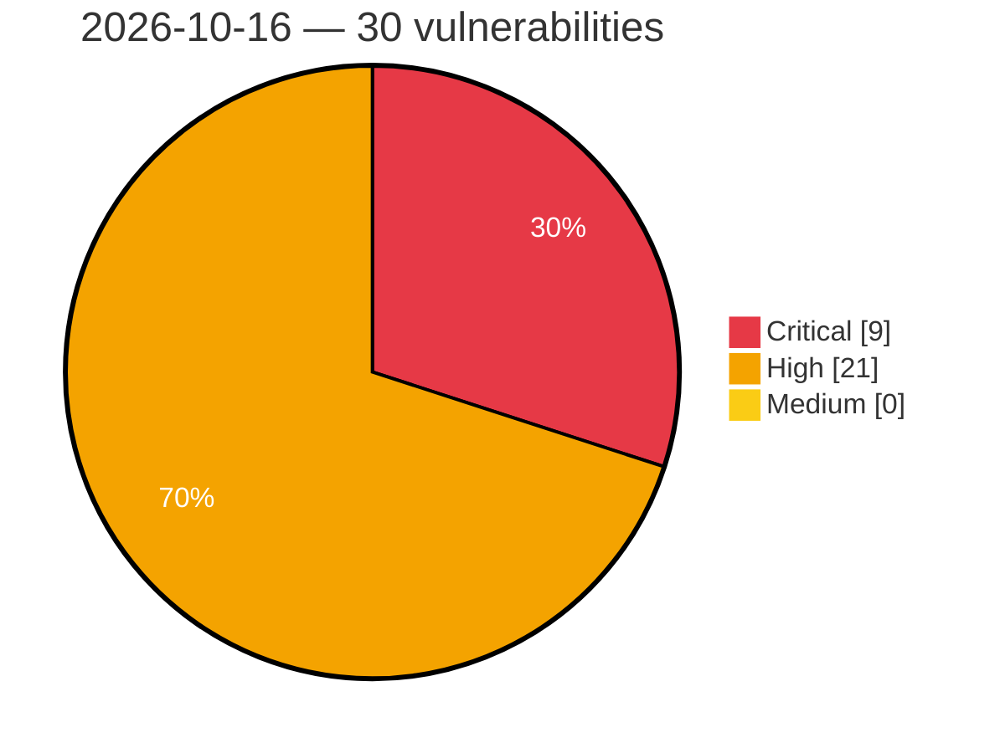

# Critical, High & Medium Severity Vulnerabilities — 2026-10-16

**Source status for this day:**

| Source | Critical | High | Medium | Total |
|--------|---------:|-----:|-------:|------:|
| cvefeed.io (High/Critical) | 9 | 21 | 0 | 30 |

**KEV (actively exploited):** 0  **Watchlist matches:** 26

## Critical (9)

| CVSS | Flags | Source | CVE / Title | Reported |
|------|-------|--------|-------------|----------|
| 10.0 | ⭐ | cvefeed.io (High/Critical) | [CVE-2026-94169 - WordPress The Grid plugin <= 2.8.1 - Remote Code Execution (RCE) vulnerability](https://cvefeed.io/vuln/detail/CVE-2026-94169) | 1 hour, 32 minutes ago |
| 9.8 | ⭐ | cvefeed.io (High/Critical) | [CVE-2026-111444 - Wheels SQL Injection Vulnerability](https://cvefeed.io/vuln/detail/CVE-2026-111444) | 21 minutes ago |
| 9.8 | ⭐ | cvefeed.io (High/Critical) | [CVE-2026-104730 - Sunshine Photo Cart <= 3.7.4 - Unauthenticated PHP Object Injection via 'key' Parameter](https://cvefeed.io/vuln/detail/CVE-2026-104730) | 1 hour, 33 minutes ago |
| 9.8 | ⭐ | cvefeed.io (High/Critical) | [CVE-2026-89079 - Theme My Login <= 7.2.1 - Unauthenticated Privilege Escalation via 'user_pass1' POST Parameter in wp_pre_insert_user_data Filter](https://cvefeed.io/vuln/detail/CVE-2026-89079) | 2 hours, 33 minutes ago |
| 9.8 | ⭐ | cvefeed.io (High/Critical) | [CVE-2026-103768 - ELEX WordPress HelpDesk & Customer Ticketing System <= 3.3.7 - Unauthenticated Arbitrary File Upload via IMAP Email Attachment](https://cvefeed.io/vuln/detail/CVE-2026-103768) | 2 hours, 33 minutes ago |
| 9.8 | ⭐ | cvefeed.io (High/Critical) | [CVE-2026-109515 - MailOptin <= 1.2.78.6 - Unauthenticated Privilege Escalation to 'form_custom_field_mappings' Parameter](https://cvefeed.io/vuln/detail/CVE-2026-109515) | 3 hours, 32 minutes ago |
| 9.8 | ⭐ | cvefeed.io (High/Critical) | [CVE-2026-109219 - Mang Board <= 2.4.4 - Unauthenticated Arbitrary File Upload via 'image_path' Parameter](https://cvefeed.io/vuln/detail/CVE-2026-109219) | 3 hours, 32 minutes ago |
| 9.8 | ⭐ | cvefeed.io (High/Critical) | [CVE-2026-104798 - My Calendar <= 3.8.7 - Unauthenticated Privilege Escalation to 'mcs' Parameter via Reflected Shortcode Injection into 'above' Attribute](https://cvefeed.io/vuln/detail/CVE-2026-104798) | 3 hours, 32 minutes ago |
| 9.3 | ⭐ | cvefeed.io (High/Critical) | [CVE-2026-94388 - WordPress Green Popups plugin < 7.6.3 - SQL Injection vulnerability](https://cvefeed.io/vuln/detail/CVE-2026-94388) | 1 hour, 32 minutes ago |

## High (21)

| CVSS | Flags | Source | CVE / Title | Reported |
|------|-------|--------|-------------|----------|
| 8.8 | — | cvefeed.io (High/Critical) | [CVE-2026-111382 - FreeRDP before 3.32.0 Heap Out-of-Bounds Write in AVC444 YUV444 Combine](https://cvefeed.io/vuln/detail/CVE-2026-111382) | 34 minutes ago |
| 8.8 | — | cvefeed.io (High/Critical) | [CVE-2026-111380 - FreeRDP 3.29.0 before 3.32.0 Heap Overflow via audin Apple Backends](https://cvefeed.io/vuln/detail/CVE-2026-111380) | 34 minutes ago |
| 8.8 | ⭐ | cvefeed.io (High/Critical) | [CVE-2026-111311 - DoubleScale \| All-in-One CRM <= 1.5.1 - Authenticated (Subscriber+) Arbitrary File Upload via Portal 'ticketless' Attachment Endpoint](https://cvefeed.io/vuln/detail/CVE-2026-111311) | 22 minutes ago |
| 8.8 | ⭐ | cvefeed.io (High/Critical) | [CVE-2026-92553 - YaySMTP <= 2.7.7 - Authenticated (Subscriber+) Arbitrary File Upload via Attachment Filename Extension](https://cvefeed.io/vuln/detail/CVE-2026-92553) | 1 hour, 32 minutes ago |
| 8.8 | ⭐ | cvefeed.io (High/Critical) | [CVE-2026-92115 - WP Photo Album Plus <= 9.3.02.002 - Authenticated (Custom+) Command Injection via 'value' Parameter (crop item) in update-photo AJAX Action](https://cvefeed.io/vuln/detail/CVE-2026-92115) | 1 hour, 32 minutes ago |
| 8.8 | ⭐ | cvefeed.io (High/Critical) | [CVE-2026-85659 - PilotPress <= 2.0.43 - Authenticated (Subscriber+) Privilege Escalation via Account Takeover via 'username' Parameter](https://cvefeed.io/vuln/detail/CVE-2026-85659) | 2 hours, 33 minutes ago |
| 8.7 | ⭐ | cvefeed.io (High/Critical) | [CVE-2026-111378 - FreeRDP 3.0.0 before 3.32.0 Unauthenticated Memory Exhaustion via NLA Frame Parser](https://cvefeed.io/vuln/detail/CVE-2026-111378) | 34 minutes ago |
| 8.6 | — | cvefeed.io (High/Critical) | [CVE-2026-109813 - Shared Hard-coded Root CA Private Key](https://cvefeed.io/vuln/detail/CVE-2026-109813) | 35 minutes ago |
| 8.6 | ⭐ | cvefeed.io (High/Critical) | [CVE-2026-75941 - Lenovo Legion Zone Remote Code Execution Vulnerability](https://cvefeed.io/vuln/detail/CVE-2026-75941) | 3 hours, 35 minutes ago |
| 8.6 | ⭐ | cvefeed.io (High/Critical) | [CVE-2026-111446 - Wheels Improper Access Control Vulnerability](https://cvefeed.io/vuln/detail/CVE-2026-111446) | 4 hours, 31 minutes ago |
| 8.3 | ⭐ | cvefeed.io (High/Critical) | [CVE-2026-111389 - Frappe HRMS 14.0.0 before 14.38.2 SQL Injection via Missing Validation](https://cvefeed.io/vuln/detail/CVE-2026-111389) | 34 minutes ago |
| 8.1 | ⭐ | cvefeed.io (High/Critical) | [CVE-2026-75903 - Vulnity Security <= 1.4.3 - Unauthenticated Authentication Bypass to Administrator via Exposed Pairing Credentials](https://cvefeed.io/vuln/detail/CVE-2026-75903) | 33 minutes ago |
| 8.1 | ⭐ | cvefeed.io (High/Critical) | [CVE-2026-97296 - WordPress Gravity Forms plugin < 3.1.1 - PHP Object Injection vulnerability](https://cvefeed.io/vuln/detail/CVE-2026-97296) | 1 hour, 32 minutes ago |
| 8.1 | ⭐ | cvefeed.io (High/Critical) | [CVE-2026-109447 - User Profile Builder <= 4.0.3 - Unauthenticated Privilege Escalation to 'role' Parameter via Legacy Meta-Name Collision on [wppb-register]](https://cvefeed.io/vuln/detail/CVE-2026-109447) | 2 hours, 33 minutes ago |
| 8.1 | ⭐ | cvefeed.io (High/Critical) | [CVE-2026-109221 - Groundhogg <= 4.9.3 - Authenticated (Sales Representative+) Arbitrary File Deletion via CSV Import 'copy_file' Field Mapping](https://cvefeed.io/vuln/detail/CVE-2026-109221) | 3 hours, 32 minutes ago |
| 8.1 | ⭐ | cvefeed.io (High/Critical) | [CVE-2026-103895 - miniOrange OTP Login, Verification and SMS Notifications <= 5.5.8 - Unauthenticated Authentication Bypass via Delay OTP Grace State](https://cvefeed.io/vuln/detail/CVE-2026-103895) | 3 hours, 32 minutes ago |
| 8.1 | — | cvefeed.io (High/Critical) | [CVE-2026-111447 - Wheels Insecure Direct Object Reference Vulnerability](https://cvefeed.io/vuln/detail/CVE-2026-111447) | 4 hours, 31 minutes ago |
| 8.1 | ⭐ | cvefeed.io (High/Critical) | [CVE-2026-111445 - Wheels Improper Access Control via Scope Bypass](https://cvefeed.io/vuln/detail/CVE-2026-111445) | 4 hours, 31 minutes ago |
| 8.1 | ⭐ | cvefeed.io (High/Critical) | [CVE-2026-104745 - Customer Email Verification for WooCommerce <= 3.3.0 - Unauthenticated Privilege Escalation to 'alg_wc_ev_verify_email' Parameter](https://cvefeed.io/vuln/detail/CVE-2026-104745) | 4 hours, 31 minutes ago |
| 8.0 | ⭐ | cvefeed.io (High/Critical) | [CVE-2026-104932 - Search Regex 3.5 - Authenticated (Subscriber+) Remote Code Execution via User Meta Serialized String Corruption](https://cvefeed.io/vuln/detail/CVE-2026-104932) | 2 hours, 33 minutes ago |
| 8.0 | ⭐ | cvefeed.io (High/Critical) | [CVE-2026-93953 - Backuply <= 1.5.8 - Authenticated (Subscriber+) Second-Order SQL Injection via Restore to Privilege Escalation](https://cvefeed.io/vuln/detail/CVE-2026-93953) | 4 hours, 31 minutes ago |
