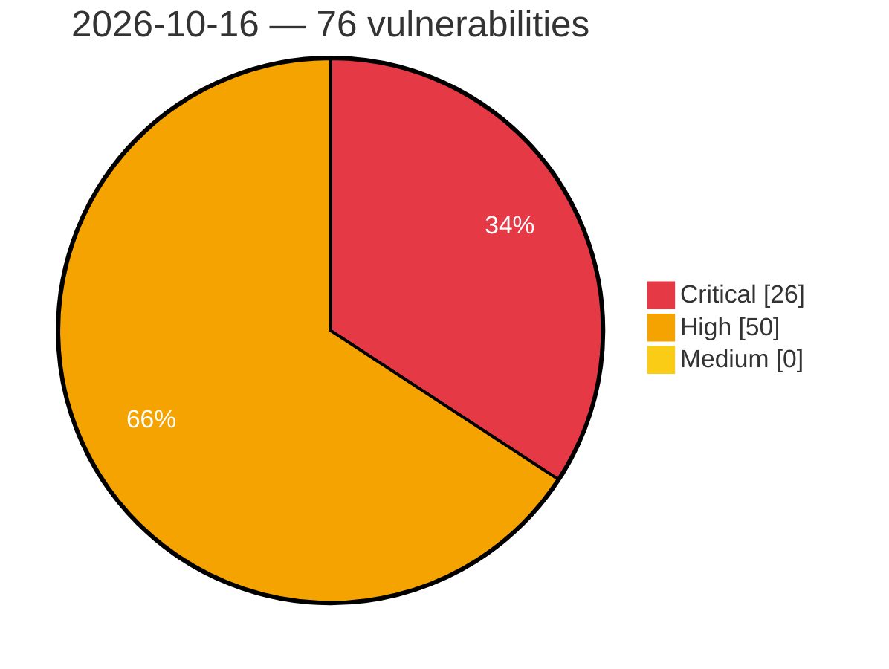

# Critical, High & Medium Severity Vulnerabilities — 2026-10-16

**Source status for this day:**

| Source | Critical | High | Medium | Total |
|--------|---------:|-----:|-------:|------:|
| cvefeed.io (High/Critical) | 26 | 50 | 0 | 76 |

**KEV (actively exploited):** 0  **Watchlist matches:** 65

## Critical (26)

| CVSS | Flags | Source | CVE / Title | Reported |
|------|-------|--------|-------------|----------|
| 10.0 | ⭐ | cvefeed.io (High/Critical) | [CVE-2026-94169 - WordPress The Grid plugin <= 2.8.1 - Remote Code Execution (RCE) vulnerability](https://cvefeed.io/vuln/detail/CVE-2026-94169) | 1 hour, 32 minutes ago |
| 9.8 | ⭐ | cvefeed.io (High/Critical) | [CVE-2026-111444 - Wheels SQL Injection Vulnerability](https://cvefeed.io/vuln/detail/CVE-2026-111444) | 21 minutes ago |
| 9.8 | ⭐ | cvefeed.io (High/Critical) | [CVE-2026-104730 - Sunshine Photo Cart <= 3.7.4 - Unauthenticated PHP Object Injection via 'key' Parameter](https://cvefeed.io/vuln/detail/CVE-2026-104730) | 1 hour, 33 minutes ago |
| 9.8 | ⭐ | cvefeed.io (High/Critical) | [CVE-2026-89079 - Theme My Login <= 7.2.1 - Unauthenticated Privilege Escalation via 'user_pass1' POST Parameter in wp_pre_insert_user_data Filter](https://cvefeed.io/vuln/detail/CVE-2026-89079) | 2 hours, 33 minutes ago |
| 9.8 | ⭐ | cvefeed.io (High/Critical) | [CVE-2026-103768 - ELEX WordPress HelpDesk & Customer Ticketing System <= 3.3.7 - Unauthenticated Arbitrary File Upload via IMAP Email Attachment](https://cvefeed.io/vuln/detail/CVE-2026-103768) | 2 hours, 33 minutes ago |
| 9.8 | ⭐ | cvefeed.io (High/Critical) | [CVE-2026-109515 - MailOptin <= 1.2.78.6 - Unauthenticated Privilege Escalation to 'form_custom_field_mappings' Parameter](https://cvefeed.io/vuln/detail/CVE-2026-109515) | 3 hours, 32 minutes ago |
| 9.8 | ⭐ | cvefeed.io (High/Critical) | [CVE-2026-109219 - Mang Board <= 2.4.4 - Unauthenticated Arbitrary File Upload via 'image_path' Parameter](https://cvefeed.io/vuln/detail/CVE-2026-109219) | 3 hours, 32 minutes ago |
| 9.8 | ⭐ | cvefeed.io (High/Critical) | [CVE-2026-104798 - My Calendar <= 3.8.7 - Unauthenticated Privilege Escalation to 'mcs' Parameter via Reflected Shortcode Injection into 'above' Attribute](https://cvefeed.io/vuln/detail/CVE-2026-104798) | 3 hours, 32 minutes ago |
| 9.8 | — | cvefeed.io (High/Critical) | [CVE-2026-111711 - Netcore NR256CN through 1.5.140116 Pre-Auth Stack Overflow via Boa user_ok()](https://cvefeed.io/vuln/detail/CVE-2026-111711) | 22 minutes ago |
| 9.8 | ⭐ | cvefeed.io (High/Critical) | [CVE-2026-111708 - WhaTicket Community through commit cf04795 Admin Self-Registration via /auth/signup](https://cvefeed.io/vuln/detail/CVE-2026-111708) | 23 minutes ago |
| 9.8 | ⭐ | cvefeed.io (High/Critical) | [CVE-2026-111704 - LangChat through commit 2a6285a Missing Authentication on REST API Controllers](https://cvefeed.io/vuln/detail/CVE-2026-111704) | 23 minutes ago |
| 9.8 | ⭐ | cvefeed.io (High/Critical) | [CVE-2026-111693 - DataBuff ai-apm-web through 0.1.10 Hard-Coded Default Admin Credentials](https://cvefeed.io/vuln/detail/CVE-2026-111693) | 23 minutes ago |
| 9.8 | ⭐ | cvefeed.io (High/Critical) | [CVE-2026-111692 - DataBuff ai-apm-web through 0.1.10 Authentication Bypass via Hardcoded HMAC Secret](https://cvefeed.io/vuln/detail/CVE-2026-111692) | 23 minutes ago |
| 9.8 | ⭐ | cvefeed.io (High/Critical) | [CVE-2026-111690 - Simple Admin Core through 1.8.7 Hard-Coded JWT Secret Authentication Bypass](https://cvefeed.io/vuln/detail/CVE-2026-111690) | 23 minutes ago |
| 9.8 | ⭐ | cvefeed.io (High/Critical) | [CVE-2026-111687 - WeRSS (we-mp-rss) through 1.5.3 RCE via template Parameter in /rss Endpoint](https://cvefeed.io/vuln/detail/CVE-2026-111687) | 23 minutes ago |
| 9.8 | ⭐ | cvefeed.io (High/Critical) | [CVE-2026-111673 - IceCMS through 4.1.5 Missing Authentication via /User Administrative Endpoints](https://cvefeed.io/vuln/detail/CVE-2026-111673) | 23 minutes ago |
| 9.8 | ⭐ | cvefeed.io (High/Critical) | [CVE-2026-111643 - Misaka Danmu Server through 2.8.9 Authentication Bypass via Config-History Rollback](https://cvefeed.io/vuln/detail/CVE-2026-111643) | 23 minutes ago |
| 9.8 | ⭐ | cvefeed.io (High/Critical) | [CVE-2026-111641 - FastapiAdmin through 3.0 Authentication Bypass via Auto-Login Endpoints](https://cvefeed.io/vuln/detail/CVE-2026-111641) | 23 minutes ago |
| 9.8 | ⭐ | cvefeed.io (High/Critical) | [CVE-2026-111626 - Webreaper Damselfly through 4.5.3 Missing Authentication on REST API Controllers](https://cvefeed.io/vuln/detail/CVE-2026-111626) | 23 minutes ago |
| 9.6 | ⭐ | cvefeed.io (High/Critical) | [CVE-2026-18516 - Improper Encoding or Escaping of Output in Crafty Controller](https://cvefeed.io/vuln/detail/CVE-2026-18516) | 24 minutes ago |
| 9.3 | ⭐ | cvefeed.io (High/Critical) | [CVE-2026-94388 - WordPress Green Popups plugin < 7.6.3 - SQL Injection vulnerability](https://cvefeed.io/vuln/detail/CVE-2026-94388) | 1 hour, 32 minutes ago |
| 9.3 | ⭐ | cvefeed.io (High/Critical) | [CVE-2026-111472 - SQL injection in TSG Profleet](https://cvefeed.io/vuln/detail/CVE-2026-111472) | 4 hours, 45 minutes ago |
| 9.2 | ⭐ | cvefeed.io (High/Critical) | [CVE-2026-111391 - SGLang 0.5.10 through 0.5.22 Code Injection via Debug Dumper Filter](https://cvefeed.io/vuln/detail/CVE-2026-111391) | 1 hour, 46 minutes ago |
| 9.2 | — | cvefeed.io (High/Critical) | [CVE-2026-96620 - Claude Agent SDK: Argument Injection via resume Option Allows Arbitrary Command Execution](https://cvefeed.io/vuln/detail/CVE-2026-96620) | 1 hour, 11 minutes ago |
| 9.1 | ⭐ | cvefeed.io (High/Critical) | [CVE-2026-111691 - WIMOOR through commit ec86736 Authentication Bypass via Forged X-USERINFO Header](https://cvefeed.io/vuln/detail/CVE-2026-111691) | 3 hours, 11 minutes ago |
| 9.0 | ⭐ | cvefeed.io (High/Critical) | [CVE-2026-102608 - ZoneMinder: Authenticated OS Command Injection via unsanitized Monitor Name in event export (download_functions.php)](https://cvefeed.io/vuln/detail/CVE-2026-102608) | 1 hour, 12 minutes ago |

## High (50)

| CVSS | Flags | Source | CVE / Title | Reported |
|------|-------|--------|-------------|----------|
| 8.8 | — | cvefeed.io (High/Critical) | [CVE-2026-111382 - FreeRDP before 3.32.0 Heap Out-of-Bounds Write in AVC444 YUV444 Combine](https://cvefeed.io/vuln/detail/CVE-2026-111382) | 34 minutes ago |
| 8.8 | — | cvefeed.io (High/Critical) | [CVE-2026-111380 - FreeRDP 3.29.0 before 3.32.0 Heap Overflow via audin Apple Backends](https://cvefeed.io/vuln/detail/CVE-2026-111380) | 34 minutes ago |
| 8.8 | ⭐ | cvefeed.io (High/Critical) | [CVE-2026-111311 - DoubleScale \| All-in-One CRM <= 1.5.1 - Authenticated (Subscriber+) Arbitrary File Upload via Portal 'ticketless' Attachment Endpoint](https://cvefeed.io/vuln/detail/CVE-2026-111311) | 22 minutes ago |
| 8.8 | ⭐ | cvefeed.io (High/Critical) | [CVE-2026-92553 - YaySMTP <= 2.7.7 - Authenticated (Subscriber+) Arbitrary File Upload via Attachment Filename Extension](https://cvefeed.io/vuln/detail/CVE-2026-92553) | 1 hour, 32 minutes ago |
| 8.8 | ⭐ | cvefeed.io (High/Critical) | [CVE-2026-92115 - WP Photo Album Plus <= 9.3.02.002 - Authenticated (Custom+) Command Injection via 'value' Parameter (crop item) in update-photo AJAX Action](https://cvefeed.io/vuln/detail/CVE-2026-92115) | 1 hour, 32 minutes ago |
| 8.8 | ⭐ | cvefeed.io (High/Critical) | [CVE-2026-85659 - PilotPress <= 2.0.43 - Authenticated (Subscriber+) Privilege Escalation via Account Takeover via 'username' Parameter](https://cvefeed.io/vuln/detail/CVE-2026-85659) | 2 hours, 33 minutes ago |
| 8.8 | ⭐ | cvefeed.io (High/Critical) | [CVE-2026-111413 - WordPress aThemeArt theme Helper plugin <= 1.0.8 - Cross Site Request Forgery (CSRF) vulnerability](https://cvefeed.io/vuln/detail/CVE-2026-111413) | 1 hour ago |
| 8.8 | ⭐ | cvefeed.io (High/Critical) | [CVE-2026-109119 - Missing Authorization in rdiffweb](https://cvefeed.io/vuln/detail/CVE-2026-109119) | 2 hours, 45 minutes ago |
| 8.8 | ⭐ | cvefeed.io (High/Critical) | [CVE-2026-111723 - LingGuo-Drama through commit 8a6924a Broken Access Control via /admin/v1/admins API](https://cvefeed.io/vuln/detail/CVE-2026-111723) | 22 minutes ago |
| 8.8 | ⭐ | cvefeed.io (High/Critical) | [CVE-2026-111681 - EFAK through 5.1.0 Privilege Escalation via /api/users REST API](https://cvefeed.io/vuln/detail/CVE-2026-111681) | 23 minutes ago |
| 8.8 | ⭐ | cvefeed.io (High/Critical) | [CVE-2026-111642 - FastapiAdmin through 3.0 Hard-Coded JWT Secret Privilege Escalation](https://cvefeed.io/vuln/detail/CVE-2026-111642) | 23 minutes ago |
| 8.8 | ⭐ | cvefeed.io (High/Critical) | [CVE-2026-30971 - ZoneMinder: Authenticated RCE via command injection in monitor Device Path](https://cvefeed.io/vuln/detail/CVE-2026-30971) | 1 hour, 12 minutes ago |
| 8.8 | ⭐ | cvefeed.io (High/Critical) | [CVE-2026-102607 - ZoneMinder: Authenticated OS Command Injection (RCE) via Export Feature](https://cvefeed.io/vuln/detail/CVE-2026-102607) | 1 hour, 12 minutes ago |
| 8.7 | ⭐ | cvefeed.io (High/Critical) | [CVE-2026-111378 - FreeRDP 3.0.0 before 3.32.0 Unauthenticated Memory Exhaustion via NLA Frame Parser](https://cvefeed.io/vuln/detail/CVE-2026-111378) | 34 minutes ago |
| 8.7 | ⭐ | cvefeed.io (High/Critical) | [CVE-2026-107564 - gocsaf/csaf: csaf_provider prone to uncontrolled resource consumption](https://cvefeed.io/vuln/detail/CVE-2026-107564) | 46 minutes ago |
| 8.7 | — | cvefeed.io (High/Critical) | [CVE-2026-111710 - Netcore NR256CN through 1.5.140116 Boa Web Server NULL Pointer Dereference DoS](https://cvefeed.io/vuln/detail/CVE-2026-111710) | 3 hours, 11 minutes ago |
| 8.7 | ⭐ | cvefeed.io (High/Critical) | [CVE-2026-111706 - 99AI through 4.3.0 Unauthenticated Information Disclosure via chatLog exportExcel](https://cvefeed.io/vuln/detail/CVE-2026-111706) | 3 hours, 11 minutes ago |
| 8.7 | ⭐ | cvefeed.io (High/Critical) | [CVE-2026-111702 - ChatOllama through commit 96c3ce5 IDOR Exposes Private Knowledge Bases](https://cvefeed.io/vuln/detail/CVE-2026-111702) | 3 hours, 11 minutes ago |
| 8.7 | ⭐ | cvefeed.io (High/Critical) | [CVE-2026-111686 - IceCMS through 4.1.5 SQL Injection via /WebArticle/findarticlesbynum](https://cvefeed.io/vuln/detail/CVE-2026-111686) | 3 hours, 11 minutes ago |
| 8.7 | ⭐ | cvefeed.io (High/Critical) | [CVE-2026-111685 - IceCMS through 4.1.5 SQL Injection via /WebResource/findresourcebynum](https://cvefeed.io/vuln/detail/CVE-2026-111685) | 3 hours, 11 minutes ago |
| 8.6 | — | cvefeed.io (High/Critical) | [CVE-2026-109813 - Shared Hard-coded Root CA Private Key](https://cvefeed.io/vuln/detail/CVE-2026-109813) | 35 minutes ago |
| 8.6 | ⭐ | cvefeed.io (High/Critical) | [CVE-2026-75941 - Lenovo Legion Zone Remote Code Execution Vulnerability](https://cvefeed.io/vuln/detail/CVE-2026-75941) | 3 hours, 35 minutes ago |
| 8.6 | ⭐ | cvefeed.io (High/Critical) | [CVE-2026-111446 - Wheels Improper Access Control Vulnerability](https://cvefeed.io/vuln/detail/CVE-2026-111446) | 4 hours, 31 minutes ago |
| 8.6 | ⭐ | cvefeed.io (High/Critical) | [CVE-2026-14452 - Open redirect and XSS via reset_url parameter](https://cvefeed.io/vuln/detail/CVE-2026-14452) | 3 hours, 44 minutes ago |
| 8.6 | ⭐ | cvefeed.io (High/Critical) | [CVE-2026-111663 - Chaskiq through 2.0.3 SSRF via createUrlUpload GraphQL Mutation](https://cvefeed.io/vuln/detail/CVE-2026-111663) | 23 minutes ago |
| 8.6 | ⭐ | cvefeed.io (High/Critical) | [CVE-2026-111650 - ChronoFrame through 1.0.0 Missing Authentication via Setup Wizard API](https://cvefeed.io/vuln/detail/CVE-2026-111650) | 23 minutes ago |
| 8.6 | ⭐ | cvefeed.io (High/Critical) | [CVE-2026-111633 - ZKEACMS through 4.4 Authentication Bypass via Hard-Coded JWT Signing Key](https://cvefeed.io/vuln/detail/CVE-2026-111633) | 23 minutes ago |
| 8.5 | ⭐ | cvefeed.io (High/Critical) | [CVE-2026-111399 - WordPress MapSVG plugin <= 8.16.1 - SQL Injection vulnerability](https://cvefeed.io/vuln/detail/CVE-2026-111399) | 45 minutes ago |
| 8.3 | ⭐ | cvefeed.io (High/Critical) | [CVE-2026-111389 - Frappe HRMS 14.0.0 before 14.38.2 SQL Injection via Missing Validation](https://cvefeed.io/vuln/detail/CVE-2026-111389) | 34 minutes ago |
| 8.3 | — | cvefeed.io (High/Critical) | [CVE-2026-111684 - Magistrala through 1.0.0 Cross-Tenant Authorization Bypass in Certs Service](https://cvefeed.io/vuln/detail/CVE-2026-111684) | 23 minutes ago |
| 8.3 | ⭐ | cvefeed.io (High/Critical) | [CVE-2026-111680 - APIPark through 1.9.7-beta Cross-Team Authorization Bypass via Team Query Parameter](https://cvefeed.io/vuln/detail/CVE-2026-111680) | 23 minutes ago |
| 8.3 | ⭐ | cvefeed.io (High/Critical) | [CVE-2026-111701 - OtterMind Nubase through 0.1.4 Missing Authentication in Storage Object API](https://cvefeed.io/vuln/detail/CVE-2026-111701) | 3 hours, 11 minutes ago |
| 8.2 | — | cvefeed.io (High/Critical) | [CVE-2026-111719 - Roncoo-pay through commit 9428382 Information Disclosure via /f2fPay/order/query](https://cvefeed.io/vuln/detail/CVE-2026-111719) | 3 hours, 11 minutes ago |
| 8.1 | ⭐ | cvefeed.io (High/Critical) | [CVE-2026-75903 - Vulnity Security <= 1.4.3 - Unauthenticated Authentication Bypass to Administrator via Exposed Pairing Credentials](https://cvefeed.io/vuln/detail/CVE-2026-75903) | 33 minutes ago |
| 8.1 | ⭐ | cvefeed.io (High/Critical) | [CVE-2026-97296 - WordPress Gravity Forms plugin < 3.1.1 - PHP Object Injection vulnerability](https://cvefeed.io/vuln/detail/CVE-2026-97296) | 1 hour, 32 minutes ago |
| 8.1 | ⭐ | cvefeed.io (High/Critical) | [CVE-2026-109447 - User Profile Builder <= 4.0.3 - Unauthenticated Privilege Escalation to 'role' Parameter via Legacy Meta-Name Collision on [wppb-register]](https://cvefeed.io/vuln/detail/CVE-2026-109447) | 2 hours, 33 minutes ago |
| 8.1 | ⭐ | cvefeed.io (High/Critical) | [CVE-2026-109221 - Groundhogg <= 4.9.3 - Authenticated (Sales Representative+) Arbitrary File Deletion via CSV Import 'copy_file' Field Mapping](https://cvefeed.io/vuln/detail/CVE-2026-109221) | 3 hours, 32 minutes ago |
| 8.1 | ⭐ | cvefeed.io (High/Critical) | [CVE-2026-103895 - miniOrange OTP Login, Verification and SMS Notifications <= 5.5.8 - Unauthenticated Authentication Bypass via Delay OTP Grace State](https://cvefeed.io/vuln/detail/CVE-2026-103895) | 3 hours, 32 minutes ago |
| 8.1 | — | cvefeed.io (High/Critical) | [CVE-2026-111447 - Wheels Insecure Direct Object Reference Vulnerability](https://cvefeed.io/vuln/detail/CVE-2026-111447) | 4 hours, 31 minutes ago |
| 8.1 | ⭐ | cvefeed.io (High/Critical) | [CVE-2026-111445 - Wheels Improper Access Control via Scope Bypass](https://cvefeed.io/vuln/detail/CVE-2026-111445) | 4 hours, 31 minutes ago |
| 8.1 | ⭐ | cvefeed.io (High/Critical) | [CVE-2026-104745 - Customer Email Verification for WooCommerce <= 3.3.0 - Unauthenticated Privilege Escalation to 'alg_wc_ev_verify_email' Parameter](https://cvefeed.io/vuln/detail/CVE-2026-104745) | 4 hours, 31 minutes ago |
| 8.1 | ⭐ | cvefeed.io (High/Critical) | [CVE-2026-111722 - LingGuo-Drama through commit 8a6924a IDOR via /admin/v1/projects/:id API](https://cvefeed.io/vuln/detail/CVE-2026-111722) | 22 minutes ago |
| 8.1 | ⭐ | cvefeed.io (High/Critical) | [CVE-2026-111639 - bbs-go through 4.4.6 Account Takeover via Google One Tap Login](https://cvefeed.io/vuln/detail/CVE-2026-111639) | 23 minutes ago |
| 8.1 | ⭐ | cvefeed.io (High/Critical) | [CVE-2026-111636 - OpenBMB StaffDeck through 0.5.6 Authentication Bypass via Hard-Coded Session Secret](https://cvefeed.io/vuln/detail/CVE-2026-111636) | 23 minutes ago |
| 8.1 | ⭐ | cvefeed.io (High/Critical) | [CVE-2026-111634 - Helical Insight through 7.0.0 SQL Injection via /executeDatasource](https://cvefeed.io/vuln/detail/CVE-2026-111634) | 23 minutes ago |
| 8.1 | — | cvefeed.io (High/Critical) | [CVE-2026-111606 - Huly Platform through 0.7.432 Account Takeover via mergeSpecifiedPersons RPC](https://cvefeed.io/vuln/detail/CVE-2026-111606) | 24 minutes ago |
| 8.1 | — | cvefeed.io (High/Critical) | [CVE-2026-111605 - Jpom through 2.11.12 Cross-Workspace Authorization Bypass via SshFileController](https://cvefeed.io/vuln/detail/CVE-2026-111605) | 24 minutes ago |
| 8.1 | ⭐ | cvefeed.io (High/Critical) | [CVE-2026-61726 - Tandoor Recipes: Private recipe authorization bypass via /api/step/ - read and modify another Space member's private recipe content](https://cvefeed.io/vuln/detail/CVE-2026-61726) | 1 hour, 12 minutes ago |
| 8.0 | ⭐ | cvefeed.io (High/Critical) | [CVE-2026-104932 - Search Regex 3.5 - Authenticated (Subscriber+) Remote Code Execution via User Meta Serialized String Corruption](https://cvefeed.io/vuln/detail/CVE-2026-104932) | 2 hours, 33 minutes ago |
| 8.0 | ⭐ | cvefeed.io (High/Critical) | [CVE-2026-93953 - Backuply <= 1.5.8 - Authenticated (Subscriber+) Second-Order SQL Injection via Restore to Privilege Escalation](https://cvefeed.io/vuln/detail/CVE-2026-93953) | 4 hours, 31 minutes ago |
