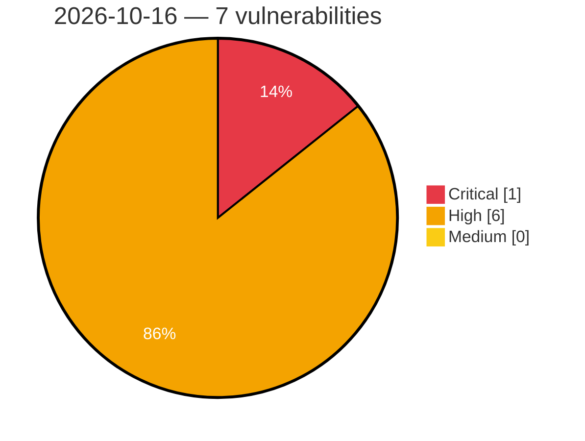

# Critical, High & Medium Severity Vulnerabilities — 2026-10-16

**Source status for this day:**

| Source | Critical | High | Medium | Total |
|--------|---------:|-----:|-------:|------:|
| cvefeed.io (High/Critical) | 1 | 6 | 0 | 7 |

**KEV (actively exploited):** 0  **Watchlist matches:** 4

## Critical (1)

| CVSS | Flags | Source | CVE / Title | Reported |
|------|-------|--------|-------------|----------|
| 9.8 | ⭐ | cvefeed.io (High/Critical) | [CVE-2026-111444 - Wheels SQL Injection Vulnerability](https://cvefeed.io/vuln/detail/CVE-2026-111444) | 21 minutes ago |

## High (6)

| CVSS | Flags | Source | CVE / Title | Reported |
|------|-------|--------|-------------|----------|
| 8.8 | — | cvefeed.io (High/Critical) | [CVE-2026-111382 - FreeRDP before 3.32.0 Heap Out-of-Bounds Write in AVC444 YUV444 Combine](https://cvefeed.io/vuln/detail/CVE-2026-111382) | 34 minutes ago |
| 8.8 | — | cvefeed.io (High/Critical) | [CVE-2026-111380 - FreeRDP 3.29.0 before 3.32.0 Heap Overflow via audin Apple Backends](https://cvefeed.io/vuln/detail/CVE-2026-111380) | 34 minutes ago |
| 8.7 | ⭐ | cvefeed.io (High/Critical) | [CVE-2026-111378 - FreeRDP 3.0.0 before 3.32.0 Unauthenticated Memory Exhaustion via NLA Frame Parser](https://cvefeed.io/vuln/detail/CVE-2026-111378) | 34 minutes ago |
| 8.6 | — | cvefeed.io (High/Critical) | [CVE-2026-109813 - Shared Hard-coded Root CA Private Key](https://cvefeed.io/vuln/detail/CVE-2026-109813) | 35 minutes ago |
| 8.6 | ⭐ | cvefeed.io (High/Critical) | [CVE-2026-75941 - Lenovo Legion Zone Remote Code Execution Vulnerability](https://cvefeed.io/vuln/detail/CVE-2026-75941) | 3 hours, 35 minutes ago |
| 8.3 | ⭐ | cvefeed.io (High/Critical) | [CVE-2026-111389 - Frappe HRMS 14.0.0 before 14.38.2 SQL Injection via Missing Validation](https://cvefeed.io/vuln/detail/CVE-2026-111389) | 34 minutes ago |
