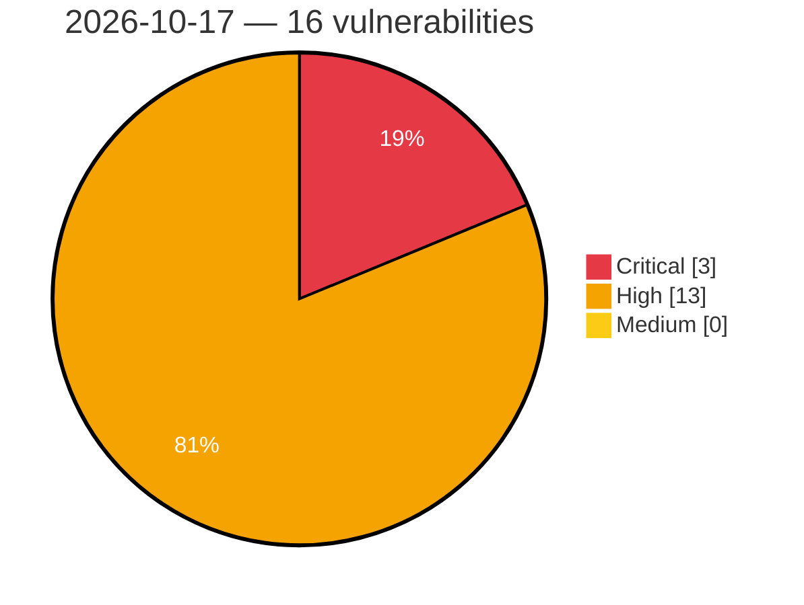

# Critical, High & Medium Severity Vulnerabilities — 2026-10-17

**Source status for this day:**

| Source | Critical | High | Medium | Total |
|--------|---------:|-----:|-------:|------:|
| cvefeed.io (High/Critical) | 3 | 13 | 0 | 16 |

**KEV (actively exploited):** 0  **Watchlist matches:** 12

## Critical (3)

| CVSS | Flags | Source | CVE / Title | Reported |
|------|-------|--------|-------------|----------|
| 9.8 | ⭐ | cvefeed.io (High/Critical) | [CVE-2026-104736 - LearnPress <= 4.4.10 - Unauthenticated PHP Object Injection via 'checkout-email' Parameter](https://cvefeed.io/vuln/detail/CVE-2026-104736) | 1 hour, 38 minutes ago |
| 9.8 | ⭐ | cvefeed.io (High/Critical) | [CVE-2026-111911 - phpMyFAQ 4.0.0 before 4.1.9 Authentication Bypass via WebAuthn Credential Injection](https://cvefeed.io/vuln/detail/CVE-2026-111911) | 49 minutes ago |
| 9.1 | ⭐ | cvefeed.io (High/Critical) | [CVE-2026-110653 - Appointment Booking Plugin <= 5.7.4 - Unauthenticated Authentication Bypass via Race Condition on OTP Attempts Counter](https://cvefeed.io/vuln/detail/CVE-2026-110653) | 2 hours, 38 minutes ago |

## High (13)

| CVSS | Flags | Source | CVE / Title | Reported |
|------|-------|--------|-------------|----------|
| 8.8 | ⭐ | cvefeed.io (High/Critical) | [CVE-2026-111853 - Tektronix 3 Series MDO OS Command Injection Vulnerability](https://cvefeed.io/vuln/detail/CVE-2026-111853) | 3 hours, 37 minutes ago |
| 8.7 | ⭐ | cvefeed.io (High/Critical) | [CVE-2026-111927 - Coder before 2.35.4 Credential Theft via Workspace Proxy Hostname Prefix Match](https://cvefeed.io/vuln/detail/CVE-2026-111927) | 48 minutes ago |
| 8.7 | — | cvefeed.io (High/Critical) | [CVE-2026-111924 - Fleet before 4.83.0 Denial of Service via Unbounded Gzip Decompression](https://cvefeed.io/vuln/detail/CVE-2026-111924) | 49 minutes ago |
| 8.7 | — | cvefeed.io (High/Critical) | [CVE-2026-111923 - Fleet before 4.89.0 Unauthenticated DoS via Apple MDM Enrollment Plist Parsing](https://cvefeed.io/vuln/detail/CVE-2026-111923) | 49 minutes ago |
| 8.7 | ⭐ | cvefeed.io (High/Critical) | [CVE-2026-111908 - phpMyFAQ 4.0.0 before 4.1.9 and 4.2.0-alpha before 4.2.0-beta BOLA in FAQ Update via REST API](https://cvefeed.io/vuln/detail/CVE-2026-111908) | 49 minutes ago |
| 8.7 | ⭐ | cvefeed.io (High/Critical) | [CVE-2026-111901 - phpMyFAQ 4.2.0-alpha before 4.2.0-beta Unauthenticated DoS via API Pagination](https://cvefeed.io/vuln/detail/CVE-2026-111901) | 49 minutes ago |
| 8.7 | ⭐ | cvefeed.io (High/Critical) | [CVE-2026-111884 - phpMyFAQ before 4.1.9 and 4.2.0-alpha before 4.2.0-beta Missing Current-Password Step-Up on E-mail Change Enables Account Takeover](https://cvefeed.io/vuln/detail/CVE-2026-111884) | 49 minutes ago |
| 8.6 | ⭐ | cvefeed.io (High/Critical) | [CVE-2026-111882 - phpMyFAQ 3.2.0-alpha before 4.1.9 and 4.2.0-alpha before 4.2.0-beta TOTP 2FA Bypass via SSO Callbacks](https://cvefeed.io/vuln/detail/CVE-2026-111882) | 49 minutes ago |
| 8.5 | ⭐ | cvefeed.io (High/Critical) | [CVE-2026-111893 - phpMyFAQ 4.2.0-alpha before 4.2.0-beta Privilege Escalation via Group Category Restrictions API](https://cvefeed.io/vuln/detail/CVE-2026-111893) | 49 minutes ago |
| 8.3 | — | cvefeed.io (High/Critical) | [CVE-2026-111880 - FreeRDP 2.0.0 before 3.32.0 Heap Out-of-Bounds Write via NTLM MIC Offset](https://cvefeed.io/vuln/detail/CVE-2026-111880) | 49 minutes ago |
| 8.1 | — | cvefeed.io (High/Critical) | [CVE-2026-92798 - User Registration & Membership <= 5.2.8 - Authenticated (Subscriber+) Arbitrary Shortcode Execution via Referer Header via 'referrer_url' Smart Tag](https://cvefeed.io/vuln/detail/CVE-2026-92798) | 1 hour, 37 minutes ago |
| 8.1 | ⭐ | cvefeed.io (High/Critical) | [CVE-2026-111854 - Tektronix 3 Series MDO Path Traversal Vulnerability](https://cvefeed.io/vuln/detail/CVE-2026-111854) | 3 hours, 37 minutes ago |
| 8.1 | ⭐ | cvefeed.io (High/Critical) | [CVE-2026-111909 - phpMyFAQ before 4.1.9 Missing Authorization Allows Superadmin Deletion via deleteUser API](https://cvefeed.io/vuln/detail/CVE-2026-111909) | 49 minutes ago |
