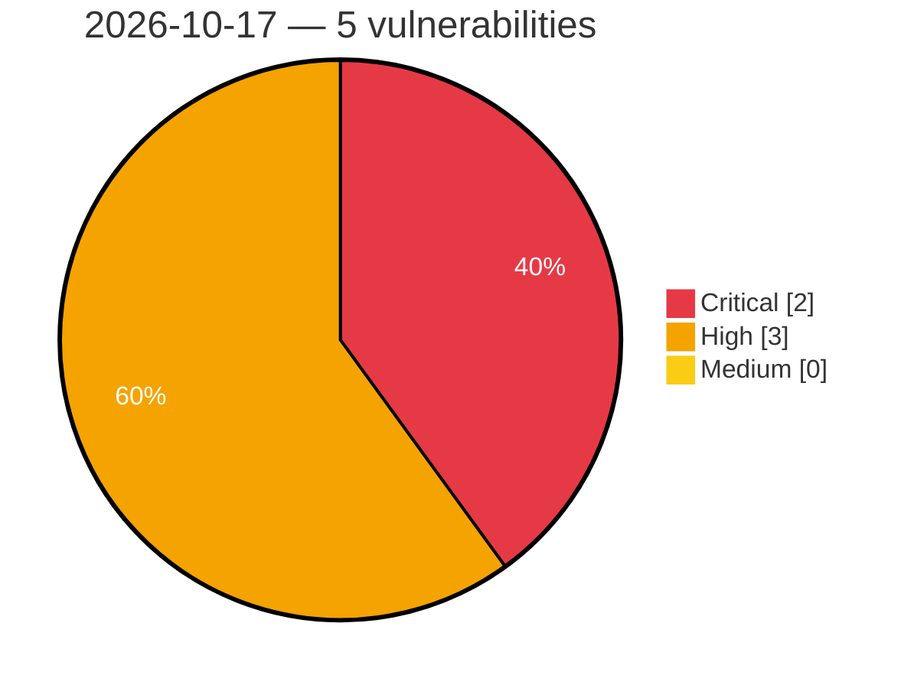

# Critical, High & Medium Severity Vulnerabilities — 2026-10-17

**Source status for this day:**

| Source | Critical | High | Medium | Total |
|--------|---------:|-----:|-------:|------:|
| cvefeed.io (High/Critical) | 2 | 3 | 0 | 5 |

**KEV (actively exploited):** 0  **Watchlist matches:** 4

## Critical (2)

| CVSS | Flags | Source | CVE / Title | Reported |
|------|-------|--------|-------------|----------|
| 9.8 | ⭐ | cvefeed.io (High/Critical) | [CVE-2026-104736 - LearnPress <= 4.4.10 - Unauthenticated PHP Object Injection via 'checkout-email' Parameter](https://cvefeed.io/vuln/detail/CVE-2026-104736) | 1 hour, 38 minutes ago |
| 9.1 | ⭐ | cvefeed.io (High/Critical) | [CVE-2026-110653 - Appointment Booking Plugin <= 5.7.4 - Unauthenticated Authentication Bypass via Race Condition on OTP Attempts Counter](https://cvefeed.io/vuln/detail/CVE-2026-110653) | 2 hours, 38 minutes ago |

## High (3)

| CVSS | Flags | Source | CVE / Title | Reported |
|------|-------|--------|-------------|----------|
| 8.8 | ⭐ | cvefeed.io (High/Critical) | [CVE-2026-111853 - Tektronix 3 Series MDO OS Command Injection Vulnerability](https://cvefeed.io/vuln/detail/CVE-2026-111853) | 3 hours, 37 minutes ago |
| 8.1 | — | cvefeed.io (High/Critical) | [CVE-2026-92798 - User Registration & Membership <= 5.2.8 - Authenticated (Subscriber+) Arbitrary Shortcode Execution via Referer Header via 'referrer_url' Smart Tag](https://cvefeed.io/vuln/detail/CVE-2026-92798) | 1 hour, 37 minutes ago |
| 8.1 | ⭐ | cvefeed.io (High/Critical) | [CVE-2026-111854 - Tektronix 3 Series MDO Path Traversal Vulnerability](https://cvefeed.io/vuln/detail/CVE-2026-111854) | 3 hours, 37 minutes ago |
