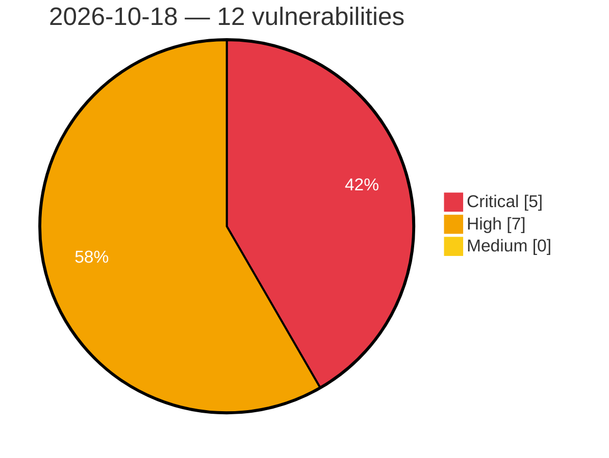

# Critical, High & Medium Severity Vulnerabilities — 2026-10-18

**Source status for this day:**

| Source | Critical | High | Medium | Total |
|--------|---------:|-----:|-------:|------:|
| cvefeed.io (High/Critical) | 5 | 7 | 0 | 12 |

**KEV (actively exploited):** 0  **Watchlist matches:** 9

## Critical (5)

| CVSS | Flags | Source | CVE / Title | Reported |
|------|-------|--------|-------------|----------|
| 9.8 | — | cvefeed.io (High/Critical) | [CVE-2026-111998 - Vanus 0.8.0 through 0.9.0 Default Admin Credentials via Gateway](https://cvefeed.io/vuln/detail/CVE-2026-111998) | 18 minutes ago |
| 9.8 | ⭐ | cvefeed.io (High/Critical) | [CVE-2026-110886 - WordPress Conversational Forms for ChatBot plugin <= 1.5.1 - PHP Object Injection vulnerability](https://cvefeed.io/vuln/detail/CVE-2026-110886) | 40 minutes ago |
| 9.8 | ⭐ | cvefeed.io (High/Critical) | [CVE-2026-110372 - WordPress OttoKit plugin <= 1.1.40 - Privilege Escalation vulnerability](https://cvefeed.io/vuln/detail/CVE-2026-110372) | 40 minutes ago |
| 9.3 | ⭐ | cvefeed.io (High/Critical) | [CVE-2026-109894 - WordPress Booktics plugin <= 1.0.29 - SQL Injection vulnerability](https://cvefeed.io/vuln/detail/CVE-2026-109894) | 40 minutes ago |
| 9.2 | ⭐ | cvefeed.io (High/Critical) | [CVE-2026-112005 - WhoDB 0.104.0 before 0.135.0 Arbitrary File Read/Write via DuckDB Query Editor](https://cvefeed.io/vuln/detail/CVE-2026-112005) | 18 minutes ago |

## High (7)

| CVSS | Flags | Source | CVE / Title | Reported |
|------|-------|--------|-------------|----------|
| 8.8 | ⭐ | cvefeed.io (High/Critical) | [CVE-2026-107436 - WordPress Strong Testimonials plugin <= 3.3.12 - PHP Object Injection vulnerability](https://cvefeed.io/vuln/detail/CVE-2026-107436) | 40 minutes ago |
| 8.7 | — | cvefeed.io (High/Critical) | [CVE-2026-112021 - snac2 before 2.93 Heap-Based Buffer Overflow via JSON Parser _xs_json_load_lexer()](https://cvefeed.io/vuln/detail/CVE-2026-112021) | 18 minutes ago |
| 8.7 | ⭐ | cvefeed.io (High/Critical) | [CVE-2026-111999 - Vanus 0.8.0 through 0.9.0 Missing Authentication via Gateway CloudEvents HTTP Receiver](https://cvefeed.io/vuln/detail/CVE-2026-111999) | 18 minutes ago |
| 8.6 | ⭐ | cvefeed.io (High/Critical) | [CVE-2026-112001 - ProjectSend 2.0.0 before 2.7.0 Incorrect Authorization via Users API Token Abilities](https://cvefeed.io/vuln/detail/CVE-2026-112001) | 18 minutes ago |
| 8.5 | ⭐ | cvefeed.io (High/Critical) | [CVE-2026-110895 - WordPress Support Genix plugin <= 1.4.54 - SQL Injection vulnerability](https://cvefeed.io/vuln/detail/CVE-2026-110895) | 40 minutes ago |
| 8.3 | — | cvefeed.io (High/Critical) | [CVE-2026-112006 - OpenTelemetry opentelemetry-exporter-otlp-proto-http 1.5.0 before 1.45.0 Improper Certificate Validation](https://cvefeed.io/vuln/detail/CVE-2026-112006) | 18 minutes ago |
| 8.1 | ⭐ | cvefeed.io (High/Critical) | [CVE-2026-110373 - WordPress Login with phone number plugin <= 1.8.77 - Privilege Escalation vulnerability](https://cvefeed.io/vuln/detail/CVE-2026-110373) | 40 minutes ago |
