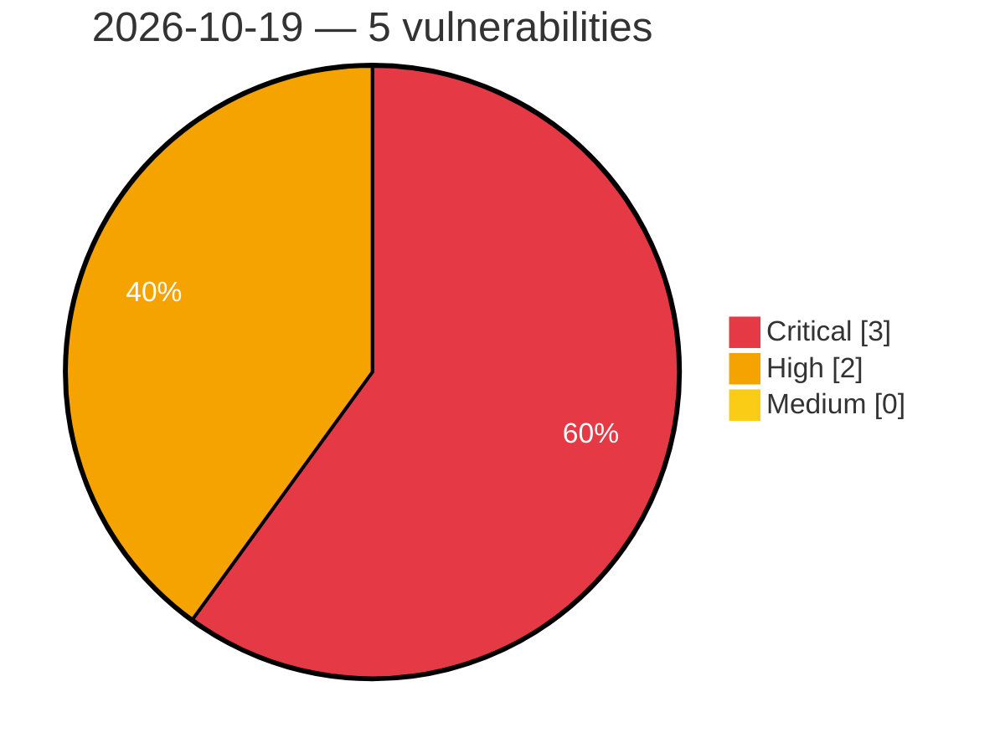

# Critical, High & Medium Severity Vulnerabilities — 2026-10-19

**Source status for this day:**

| Source | Critical | High | Medium | Total |
|--------|---------:|-----:|-------:|------:|
| cvefeed.io (High/Critical) | 3 | 2 | 0 | 5 |

**KEV (actively exploited):** 0  **Watchlist matches:** 3

## Critical (3)

| CVSS | Flags | Source | CVE / Title | Reported |
|------|-------|--------|-------------|----------|
| 9.8 | ⭐ | cvefeed.io (High/Critical) | [CVE-2026-108983 - GV-ASManager Web Server Command Injection Vulnerability](https://cvefeed.io/vuln/detail/CVE-2026-108983) | 3 hours, 40 minutes ago |
| 9.3 | ⭐ | cvefeed.io (High/Critical) | [CVE-2026-103091 - Insecure Default Policy and Unrestricted OIDC Enrollment in Google OSS Agent Mesh (SAM)](https://cvefeed.io/vuln/detail/CVE-2026-103091) | 2 hours, 40 minutes ago |
| 9.3 | ⭐ | cvefeed.io (High/Critical) | [CVE-2026-102503 - Missing Authentication on /libp2p-http Ingress in Google OSS Agent Mesh (SAM)](https://cvefeed.io/vuln/detail/CVE-2026-102503) | 2 hours, 40 minutes ago |

## High (2)

| CVSS | Flags | Source | CVE / Title | Reported |
|------|-------|--------|-------------|----------|
| 8.1 | — | cvefeed.io (High/Critical) | [CVE-2026-16487 - Bootc: containers-common: bootc: automatic updates can apply unsigned mutable-tag content under default containers policy](https://cvefeed.io/vuln/detail/CVE-2026-16487) | 29 minutes ago |
| 8.1 | — | cvefeed.io (High/Critical) | [CVE-2026-111441 - HLL 反序列化 lenTotal/lenUsed 校验缺失导致堆越界写](https://cvefeed.io/vuln/detail/CVE-2026-111441) | 2 hours, 40 minutes ago |
