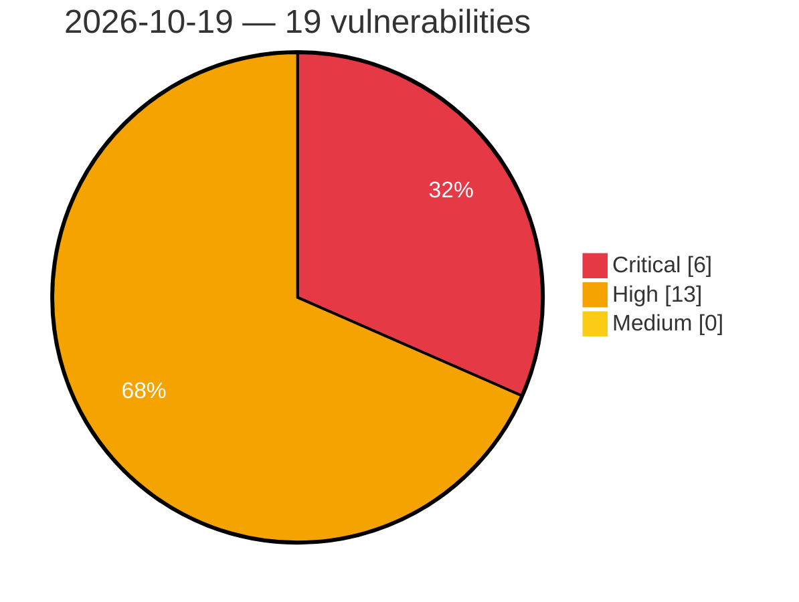

# Critical, High & Medium Severity Vulnerabilities — 2026-10-19

**Source status for this day:**

| Source | Critical | High | Medium | Total |
|--------|---------:|-----:|-------:|------:|
| cvefeed.io (High/Critical) | 6 | 13 | 0 | 19 |

**KEV (actively exploited):** 0  **Watchlist matches:** 14

## Critical (6)

| CVSS | Flags | Source | CVE / Title | Reported |
|------|-------|--------|-------------|----------|
| 10.0 | ⭐ | cvefeed.io (High/Critical) | [CVE-2026-78162 - Apache Camel: Camel-Hazelcast Managed Instances Missing Java Deserialization Filter (Incomplete Fix for CVE-2026-43865)](https://cvefeed.io/vuln/detail/CVE-2026-78162) | 2 hours, 26 minutes ago |
| 9.9 | ⭐ | cvefeed.io (High/Critical) | [CVE-2026-111406 - WordPress MapSVG plugin <= 8.16.1 - Arbitrary File Upload vulnerability](https://cvefeed.io/vuln/detail/CVE-2026-111406) | 3 hours, 26 minutes ago |
| 9.9 | ⭐ | cvefeed.io (High/Critical) | [CVE-2026-110887 - WordPress HivePress plugin <= 1.7.32 - Remote Code Execution (RCE) vulnerability](https://cvefeed.io/vuln/detail/CVE-2026-110887) | 3 hours, 26 minutes ago |
| 9.8 | ⭐ | cvefeed.io (High/Critical) | [CVE-2026-108983 - GV-ASManager Web Server Command Injection Vulnerability](https://cvefeed.io/vuln/detail/CVE-2026-108983) | 3 hours, 40 minutes ago |
| 9.3 | ⭐ | cvefeed.io (High/Critical) | [CVE-2026-103091 - Insecure Default Policy and Unrestricted OIDC Enrollment in Google OSS Agent Mesh (SAM)](https://cvefeed.io/vuln/detail/CVE-2026-103091) | 2 hours, 40 minutes ago |
| 9.3 | ⭐ | cvefeed.io (High/Critical) | [CVE-2026-102503 - Missing Authentication on /libp2p-http Ingress in Google OSS Agent Mesh (SAM)](https://cvefeed.io/vuln/detail/CVE-2026-102503) | 2 hours, 40 minutes ago |

## High (13)

| CVSS | Flags | Source | CVE / Title | Reported |
|------|-------|--------|-------------|----------|
| 8.8 | ⭐ | cvefeed.io (High/Critical) | [CVE-2026-88900 - Apache Camel: Camel-JGroups: Unsafe Java Deserialization of Cluster Messages in the JGroups Consumer Can Lead to Remote Code Execution](https://cvefeed.io/vuln/detail/CVE-2026-88900) | 1 hour, 26 minutes ago |
| 8.8 | — | cvefeed.io (High/Critical) | [CVE-2026-83531 - Apache Camel: Camel-Dynamic-Router Control Endpoint Compiles Predicate Expressions Supplied by Control Messages](https://cvefeed.io/vuln/detail/CVE-2026-83531) | 2 hours, 26 minutes ago |
| 8.8 | ⭐ | cvefeed.io (High/Critical) | [CVE-2026-78165 - Apache Camel: Camel-Spring-Redis Unfiltered Java Deserialization of Redis Payloads](https://cvefeed.io/vuln/detail/CVE-2026-78165) | 2 hours, 26 minutes ago |
| 8.8 | ⭐ | cvefeed.io (High/Critical) | [CVE-2026-111408 - WordPress Quiz And Survey Master plugin <= 11.2.7 - PHP Object Injection vulnerability](https://cvefeed.io/vuln/detail/CVE-2026-111408) | 3 hours, 26 minutes ago |
| 8.8 | ⭐ | cvefeed.io (High/Critical) | [CVE-2026-13695 - SQL Injection in the Integratec Application](https://cvefeed.io/vuln/detail/CVE-2026-13695) | 4 hours, 26 minutes ago |
| 8.5 | ⭐ | cvefeed.io (High/Critical) | [CVE-2026-112161 - Lack of integrity checks in Mobatek’s MobaXterm](https://cvefeed.io/vuln/detail/CVE-2026-112161) | 4 hours, 26 minutes ago |
| 8.2 | — | cvefeed.io (High/Critical) | [CVE-2026-88901 - Apache Camel: Camel-Smooks XML External Entity Processing, external entities resolved by default](https://cvefeed.io/vuln/detail/CVE-2026-88901) | 2 hours, 26 minutes ago |
| 8.2 | ⭐ | cvefeed.io (High/Critical) | [CVE-2026-80344 - Apache Camel: Camel-AS2 Server-Side Request Forgery and Credential Disclosure via Asynchronous MDN Delivery Address](https://cvefeed.io/vuln/detail/CVE-2026-80344) | 2 hours, 26 minutes ago |
| 8.2 | — | cvefeed.io (High/Critical) | [CVE-2026-80343 - Apache Camel: Camel-Netty-HTTP Security Constraint Bypass via Case-Sensitive Context-Path Matching](https://cvefeed.io/vuln/detail/CVE-2026-80343) | 2 hours, 26 minutes ago |
| 8.2 | ⭐ | cvefeed.io (High/Critical) | [CVE-2026-80312 - Apache Camel: Camel-OAuth Authentication Bypass via Fail-Open Processors](https://cvefeed.io/vuln/detail/CVE-2026-80312) | 2 hours, 26 minutes ago |
| 8.2 | ⭐ | cvefeed.io (High/Critical) | [CVE-2026-78164 - Apache Camel: HTTP producers resolve property placeholders in message-supplied URI override headers](https://cvefeed.io/vuln/detail/CVE-2026-78164) | 2 hours, 26 minutes ago |
| 8.1 | — | cvefeed.io (High/Critical) | [CVE-2026-16487 - Bootc: containers-common: bootc: automatic updates can apply unsigned mutable-tag content under default containers policy](https://cvefeed.io/vuln/detail/CVE-2026-16487) | 29 minutes ago |
| 8.1 | — | cvefeed.io (High/Critical) | [CVE-2026-111441 - HLL 反序列化 lenTotal/lenUsed 校验缺失导致堆越界写](https://cvefeed.io/vuln/detail/CVE-2026-111441) | 2 hours, 40 minutes ago |
