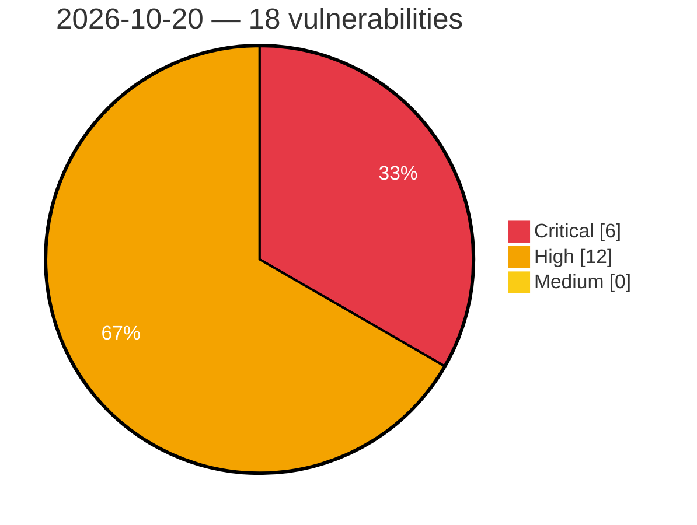

# Critical, High & Medium Severity Vulnerabilities — 2026-10-20

**Source status for this day:**

| Source | Critical | High | Medium | Total |
|--------|---------:|-----:|-------:|------:|
| cvefeed.io (High/Critical) | 6 | 12 | 0 | 18 |

**KEV (actively exploited):** 0  **Watchlist matches:** 12

## Critical (6)

| CVSS | Flags | Source | CVE / Title | Reported |
|------|-------|--------|-------------|----------|
| 9.8 | ⭐ | cvefeed.io (High/Critical) | [CVE-2026-77936 - Letta through 0.16.8 Insecure Default Configuration Unauthenticated API and PostgreSQL Access](https://cvefeed.io/vuln/detail/CVE-2026-77936) | 17 minutes ago |
| 9.8 | ⭐ | cvefeed.io (High/Critical) | [CVE-2026-77933 - DB-GPT through 0.8.2 Hardcoded MySQL Root Credentials in docker-compose Deployment](https://cvefeed.io/vuln/detail/CVE-2026-77933) | 17 minutes ago |
| 9.8 | ⭐ | cvefeed.io (High/Critical) | [CVE-2026-77932 - DB-GPT through 0.8.2 Unauthenticated RCE via /api/v1/chat/react-agent](https://cvefeed.io/vuln/detail/CVE-2026-77932) | 17 minutes ago |
| 9.8 | ⭐ | cvefeed.io (High/Critical) | [CVE-2026-75128 - Langchain-Chatchat through 0.3.1.3 Unauthenticated RCE via /tools/call Endpoint](https://cvefeed.io/vuln/detail/CVE-2026-75128) | 17 minutes ago |
| 9.8 | ⭐ | cvefeed.io (High/Critical) | [CVE-2026-109442 - piflow 2.0.0 through 2.0.1 Unauthenticated RCE via Chat Agent exec_shell](https://cvefeed.io/vuln/detail/CVE-2026-109442) | 18 minutes ago |
| 9.1 | — | cvefeed.io (High/Critical) | [CVE-2026-109395 - Ning compress-lzf before 1.2.0 Out-of-Bounds Memory Access via UnsafeChunkDecoder](https://cvefeed.io/vuln/detail/CVE-2026-109395) | 18 minutes ago |

## High (12)

| CVSS | Flags | Source | CVE / Title | Reported |
|------|-------|--------|-------------|----------|
| 8.8 | ⭐ | cvefeed.io (High/Critical) | [CVE-2026-77934 - Coze Studio before 0.5.0 RCE via Unsandboxed Local Python Code Runner](https://cvefeed.io/vuln/detail/CVE-2026-77934) | 17 minutes ago |
| 8.8 | — | cvefeed.io (High/Critical) | [CVE-2026-77930 - EvoScientist 0.1.0 before 0.2.5 Human Approval Bypass via Async Sub-Agents](https://cvefeed.io/vuln/detail/CVE-2026-77930) | 17 minutes ago |
| 8.8 | ⭐ | cvefeed.io (High/Critical) | [CVE-2026-77926 - Aix-DB 1.2.4 Authenticated RCE via ChatBI Common Agent Execute Tool](https://cvefeed.io/vuln/detail/CVE-2026-77926) | 17 minutes ago |
| 8.8 | ⭐ | cvefeed.io (High/Critical) | [CVE-2026-109444 - OpenSRE through 0.1.2026.10.19 Approval Gate Bypass via shell_run Prompt Injection](https://cvefeed.io/vuln/detail/CVE-2026-109444) | 18 minutes ago |
| 8.8 | ⭐ | cvefeed.io (High/Critical) | [CVE-2026-109443 - JoySafeter through 1.0.0 Authenticated RCE via Copilot Standard Mode Shell](https://cvefeed.io/vuln/detail/CVE-2026-109443) | 18 minutes ago |
| 8.8 | — | cvefeed.io (High/Critical) | [CVE-2026-109126 - IBM Verify Identity Access and IBM Security Verify Access Hard-coded Credentials](https://cvefeed.io/vuln/detail/CVE-2026-109126) | 1 hour, 17 minutes ago |
| 8.8 | — | cvefeed.io (High/Critical) | [CVE-2026-107400 - Security Vulnerability identified in IBM TRIRIGA - GWT Mock Authentication](https://cvefeed.io/vuln/detail/CVE-2026-107400) | 1 hour, 17 minutes ago |
| 8.7 | ⭐ | cvefeed.io (High/Critical) | [CVE-2026-77935 - Coze Studio through 0.5.1 Cross-Space Workflow IDOR via Workflow API Handlers](https://cvefeed.io/vuln/detail/CVE-2026-77935) | 17 minutes ago |
| 8.6 | ⭐ | cvefeed.io (High/Critical) | [CVE-2026-77937 - Letta through 0.16.8 Cross-Tenant Impersonation via user_id Header](https://cvefeed.io/vuln/detail/CVE-2026-77937) | 17 minutes ago |
| 8.6 | ⭐ | cvefeed.io (High/Critical) | [CVE-2026-109440 - LangAlpha through 2026.09.07 Indirect Prompt Injection RCE via Bash and ExecuteCode](https://cvefeed.io/vuln/detail/CVE-2026-109440) | 18 minutes ago |
| 8.4 | — | cvefeed.io (High/Critical) | [CVE-2026-105453 - IBM Sterling Connect:Direct for Unix Improper Privilege Management](https://cvefeed.io/vuln/detail/CVE-2026-105453) | 1 hour, 17 minutes ago |
| 8.3 | — | cvefeed.io (High/Critical) | [CVE-2026-107366 - Langflow OSS Authorization Bypass Through User-Controlled Key](https://cvefeed.io/vuln/detail/CVE-2026-107366) | 1 hour, 17 minutes ago |
