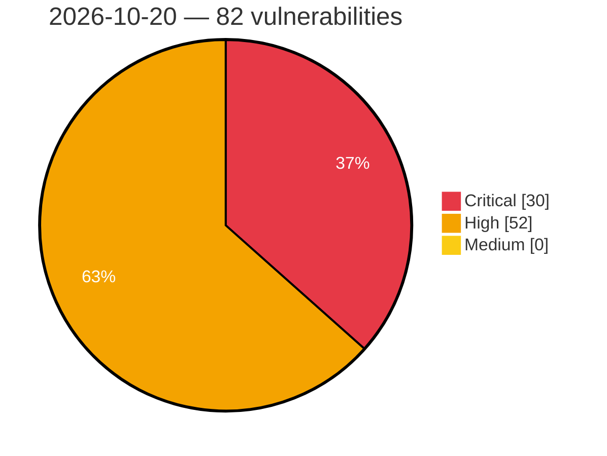

# Critical, High & Medium Severity Vulnerabilities — 2026-10-20

**Source status for this day:**

| Source | Critical | High | Medium | Total |
|--------|---------:|-----:|-------:|------:|
| cvefeed.io (High/Critical) | 30 | 52 | 0 | 82 |

**KEV (actively exploited):** 0  **Watchlist matches:** 43

## Critical (30)

| CVSS | Flags | Source | CVE / Title | Reported |
|------|-------|--------|-------------|----------|
| 9.9 | ⭐ | cvefeed.io (High/Critical) | [CVE-2026-113389 - DrayTek Vigor2960 CGI Process mainfunction.cgi set_table command injection](https://cvefeed.io/vuln/detail/CVE-2026-113389) | 15 minutes ago |
| 9.9 | ⭐ | cvefeed.io (High/Critical) | [CVE-2026-105312 - Console-operator: streams for apache kafka console: tenant-controlled container image on clusterrole-bound pod enables namespace-to-cluster privilege escalation](https://cvefeed.io/vuln/detail/CVE-2026-105312) | 15 minutes ago |
| 9.9 | ⭐ | cvefeed.io (High/Critical) | [CVE-2026-113678 - Froxlor before 2.3.15 Symlink Following Privilege Escalation via Traffic Cron](https://cvefeed.io/vuln/detail/CVE-2026-113678) | 52 minutes ago |
| 9.9 | ⭐ | cvefeed.io (High/Critical) | [CVE-2026-113391 - DrayTek Vigor2960 Upload Endpoint mainfunction.cgi uploadlangs command injection](https://cvefeed.io/vuln/detail/CVE-2026-113391) | 3 hours, 53 minutes ago |
| 9.9 | ⭐ | cvefeed.io (High/Critical) | [CVE-2026-113390 - DrayTek Vigor2960 CGI mainfunction.cgi sub_182B0 os command injection](https://cvefeed.io/vuln/detail/CVE-2026-113390) | 3 hours, 53 minutes ago |
| 9.9 | ⭐ | cvefeed.io (High/Critical) | [CVE-2026-113709 - Argo CD: A Kustomize Helm config home can run commands in the repo-server](https://cvefeed.io/vuln/detail/CVE-2026-113709) | 37 minutes ago |
| 9.9 | ⭐ | cvefeed.io (High/Critical) | [CVE-2026-113708 - Argo CD: A Kustomize remote ref can run commands in the repo-server](https://cvefeed.io/vuln/detail/CVE-2026-113708) | 37 minutes ago |
| 9.9 | ⭐ | cvefeed.io (High/Critical) | [CVE-2026-113672 - Argo CD: A Jsonnet import can read files from the repo-server](https://cvefeed.io/vuln/detail/CVE-2026-113672) | 1 hour, 37 minutes ago |
| 9.9 | ⭐ | cvefeed.io (High/Critical) | [CVE-2026-113506 - aaPanel File Manager common.py ExecShell os command injection](https://cvefeed.io/vuln/detail/CVE-2026-113506) | 1 hour, 37 minutes ago |
| 9.8 | ⭐ | cvefeed.io (High/Critical) | [CVE-2026-77936 - Letta through 0.16.8 Insecure Default Configuration Unauthenticated API and PostgreSQL Access](https://cvefeed.io/vuln/detail/CVE-2026-77936) | 17 minutes ago |
| 9.8 | ⭐ | cvefeed.io (High/Critical) | [CVE-2026-77933 - DB-GPT through 0.8.2 Hardcoded MySQL Root Credentials in docker-compose Deployment](https://cvefeed.io/vuln/detail/CVE-2026-77933) | 17 minutes ago |
| 9.8 | ⭐ | cvefeed.io (High/Critical) | [CVE-2026-77932 - DB-GPT through 0.8.2 Unauthenticated RCE via /api/v1/chat/react-agent](https://cvefeed.io/vuln/detail/CVE-2026-77932) | 17 minutes ago |
| 9.8 | ⭐ | cvefeed.io (High/Critical) | [CVE-2026-75128 - Langchain-Chatchat through 0.3.1.3 Unauthenticated RCE via /tools/call Endpoint](https://cvefeed.io/vuln/detail/CVE-2026-75128) | 17 minutes ago |
| 9.8 | ⭐ | cvefeed.io (High/Critical) | [CVE-2026-109442 - piflow 2.0.0 through 2.0.1 Unauthenticated RCE via Chat Agent exec_shell](https://cvefeed.io/vuln/detail/CVE-2026-109442) | 18 minutes ago |
| 9.8 | ⭐ | cvefeed.io (High/Critical) | [CVE-2026-113620 - Eclipse ioFog operator WebSocket accepts an unverified JWT](https://cvefeed.io/vuln/detail/CVE-2026-113620) | 3 hours, 53 minutes ago |
| 9.8 | ⭐ | cvefeed.io (High/Critical) | [CVE-2026-113802 - Wavlink WL-WN530BE1-A Unauthenticated OS Command Injection in ioos protocol.csp ovpn_file Handler](https://cvefeed.io/vuln/detail/CVE-2026-113802) | 1 hour, 37 minutes ago |
| 9.3 | — | cvefeed.io (High/Critical) | [CVE-2026-113380 - RingRTC Finite State Machine Queue Saturation Denial of Service](https://cvefeed.io/vuln/detail/CVE-2026-113380) | 41 minutes ago |
| 9.3 | ⭐ | cvefeed.io (High/Critical) | [CVE-2026-9589 - Unblu Spark Authorization Bypass in Configuration Cascade Operations](https://cvefeed.io/vuln/detail/CVE-2026-9589) | 1 hour, 15 minutes ago |
| 9.3 | ⭐ | cvefeed.io (High/Critical) | [CVE-2026-43844 - Proprietary Protocol Authentication Bypass](https://cvefeed.io/vuln/detail/CVE-2026-43844) | 3 hours, 15 minutes ago |
| 9.3 | ⭐ | cvefeed.io (High/Critical) | [CVE-2026-43836 - [Product/Vendor Name] Remote Code Execution Vulnerability](https://cvefeed.io/vuln/detail/CVE-2026-43836) | 3 hours, 15 minutes ago |
| 9.3 | — | cvefeed.io (High/Critical) | [CVE-2026-93475 - Out-of-bounds Write via an Unbounded RSA Modulus in NetX Secure X.509](https://cvefeed.io/vuln/detail/CVE-2026-93475) | 52 minutes ago |
| 9.3 | — | cvefeed.io (High/Critical) | [CVE-2026-86471 - Apache CouchDB: Admin credentials leading to code execution as operating system user](https://cvefeed.io/vuln/detail/CVE-2026-86471) | 52 minutes ago |
| 9.3 | ⭐ | cvefeed.io (High/Critical) | [CVE-2026-113703 - SuggestArr before 3.0.0 Authentication Bypass via X-Forwarded-For Spoofing](https://cvefeed.io/vuln/detail/CVE-2026-113703) | 52 minutes ago |
| 9.2 | ⭐ | cvefeed.io (High/Critical) | [CVE-2026-43845 - Authentication Bypass in Password Reset Mechanism](https://cvefeed.io/vuln/detail/CVE-2026-43845) | 3 hours, 15 minutes ago |
| 9.2 | — | cvefeed.io (High/Critical) | [CVE-2026-43838 - Login Functionality Stack-Based Buffer Overflow](https://cvefeed.io/vuln/detail/CVE-2026-43838) | 3 hours, 15 minutes ago |
| 9.2 | ⭐ | cvefeed.io (High/Critical) | [CVE-2026-113613 - FlexGet before 3.20.7 Path Traversal (Zip Slip) via decompress plugin](https://cvefeed.io/vuln/detail/CVE-2026-113613) | 52 minutes ago |
| 9.1 | — | cvefeed.io (High/Critical) | [CVE-2026-109395 - Ning compress-lzf before 1.2.0 Out-of-Bounds Memory Access via UnsafeChunkDecoder](https://cvefeed.io/vuln/detail/CVE-2026-109395) | 18 minutes ago |
| 9.1 | ⭐ | cvefeed.io (High/Critical) | [CVE-2026-113682 - Networknt light-4j 2.1.5 before 2.4.0 Authentication Bypass via Empty LDAP Password](https://cvefeed.io/vuln/detail/CVE-2026-113682) | 52 minutes ago |
| 9.1 | — | cvefeed.io (High/Critical) | [CVE-2026-103119 - Apache Tomcat: AJP response mix-up](https://cvefeed.io/vuln/detail/CVE-2026-103119) | 2 hours, 53 minutes ago |
| 9.1 | ⭐ | cvefeed.io (High/Critical) | [CVE-2026-105772 - Arbitrary file read and write in Google ADK TypeScript (@google/adk) FileArtifactService via path traversal in userId and sessionId](https://cvefeed.io/vuln/detail/CVE-2026-105772) | 1 hour, 37 minutes ago |

## High (52)

| CVSS | Flags | Source | CVE / Title | Reported |
|------|-------|--------|-------------|----------|
| 8.8 | ⭐ | cvefeed.io (High/Critical) | [CVE-2026-77934 - Coze Studio before 0.5.0 RCE via Unsandboxed Local Python Code Runner](https://cvefeed.io/vuln/detail/CVE-2026-77934) | 17 minutes ago |
| 8.8 | — | cvefeed.io (High/Critical) | [CVE-2026-77930 - EvoScientist 0.1.0 before 0.2.5 Human Approval Bypass via Async Sub-Agents](https://cvefeed.io/vuln/detail/CVE-2026-77930) | 17 minutes ago |
| 8.8 | ⭐ | cvefeed.io (High/Critical) | [CVE-2026-77926 - Aix-DB 1.2.4 Authenticated RCE via ChatBI Common Agent Execute Tool](https://cvefeed.io/vuln/detail/CVE-2026-77926) | 17 minutes ago |
| 8.8 | ⭐ | cvefeed.io (High/Critical) | [CVE-2026-109444 - OpenSRE through 0.1.2026.10.19 Approval Gate Bypass via shell_run Prompt Injection](https://cvefeed.io/vuln/detail/CVE-2026-109444) | 18 minutes ago |
| 8.8 | ⭐ | cvefeed.io (High/Critical) | [CVE-2026-109443 - JoySafeter through 1.0.0 Authenticated RCE via Copilot Standard Mode Shell](https://cvefeed.io/vuln/detail/CVE-2026-109443) | 18 minutes ago |
| 8.8 | — | cvefeed.io (High/Critical) | [CVE-2026-109126 - IBM Verify Identity Access and IBM Security Verify Access Hard-coded Credentials](https://cvefeed.io/vuln/detail/CVE-2026-109126) | 1 hour, 17 minutes ago |
| 8.8 | — | cvefeed.io (High/Critical) | [CVE-2026-107400 - Security Vulnerability identified in IBM TRIRIGA - GWT Mock Authentication](https://cvefeed.io/vuln/detail/CVE-2026-107400) | 1 hour, 17 minutes ago |
| 8.8 | ⭐ | cvefeed.io (High/Critical) | [CVE-2026-105949 - Cruise-control: streams for apache kafka cruise control: authentication bypass via extra path segment allows unauthenticated access to all admin endpoints](https://cvefeed.io/vuln/detail/CVE-2026-105949) | 15 minutes ago |
| 8.8 | ⭐ | cvefeed.io (High/Critical) | [CVE-2026-113407 - YS-infoware｜BA-Workflow - SQL Injection](https://cvefeed.io/vuln/detail/CVE-2026-113407) | 4 hours, 15 minutes ago |
| 8.8 | — | cvefeed.io (High/Critical) | [CVE-2026-28328 - SolarWinds Observability Self-Hosted broken authorization schema](https://cvefeed.io/vuln/detail/CVE-2026-28328) | 52 minutes ago |
| 8.8 | — | cvefeed.io (High/Critical) | [CVE-2026-94018 - NetX Duo Web HTTP server releases an uninitialized packet pointer on the PUT Content-Length underflow path](https://cvefeed.io/vuln/detail/CVE-2026-94018) | 52 minutes ago |
| 8.8 | ⭐ | cvefeed.io (High/Critical) | [CVE-2026-112836 - WordPress VikRentCar plugin <= 1.4.8 - Cross Site Request Forgery (CSRF) vulnerability](https://cvefeed.io/vuln/detail/CVE-2026-112836) | 53 minutes ago |
| 8.8 | — | cvefeed.io (High/Critical) | [CVE-2026-75997 - Acrobat for Edge \| Out-of-bounds Write (CWE-787)](https://cvefeed.io/vuln/detail/CVE-2026-75997) | 36 minutes ago |
| 8.8 | — | cvefeed.io (High/Critical) | [CVE-2026-75751 - Acrobat for Edge \| Out-of-bounds Write (CWE-787)](https://cvefeed.io/vuln/detail/CVE-2026-75751) | 36 minutes ago |
| 8.8 | — | cvefeed.io (High/Critical) | [CVE-2026-75747 - Acrobat for Edge \| Out-of-bounds Write (CWE-787)](https://cvefeed.io/vuln/detail/CVE-2026-75747) | 36 minutes ago |
| 8.8 | — | cvefeed.io (High/Critical) | [CVE-2026-48279 - Acrobat for Edge \| Out-of-bounds Write (CWE-787)](https://cvefeed.io/vuln/detail/CVE-2026-48279) | 37 minutes ago |
| 8.8 | — | cvefeed.io (High/Critical) | [CVE-2026-21270 - Acrobat for Edge \| Out-of-bounds Write (CWE-787)](https://cvefeed.io/vuln/detail/CVE-2026-21270) | 37 minutes ago |
| 8.8 | — | cvefeed.io (High/Critical) | [CVE-2026-100134 - Acrobat for Edge \| Out-of-bounds Write (CWE-787)](https://cvefeed.io/vuln/detail/CVE-2026-100134) | 37 minutes ago |
| 8.7 | ⭐ | cvefeed.io (High/Critical) | [CVE-2026-77935 - Coze Studio through 0.5.1 Cross-Space Workflow IDOR via Workflow API Handlers](https://cvefeed.io/vuln/detail/CVE-2026-77935) | 17 minutes ago |
| 8.7 | ⭐ | cvefeed.io (High/Critical) | [CVE-2026-105299 - Pingora forwards client-nominated Connection headers to HTTP/1 upstreams, allowing ACL bypass in specific chained deployments](https://cvefeed.io/vuln/detail/CVE-2026-105299) | 3 hours, 40 minutes ago |
| 8.7 | — | cvefeed.io (High/Critical) | [CVE-2026-113358 - LavaLite CMS through 10.1.2 Missing Authentication via Filer Download Routes](https://cvefeed.io/vuln/detail/CVE-2026-113358) | 1 hour, 15 minutes ago |
| 8.7 | ⭐ | cvefeed.io (High/Critical) | [CVE-2026-85267 - Cross-Site WebSocket Hijacking in Google Cloud Shell](https://cvefeed.io/vuln/detail/CVE-2026-85267) | 2 hours, 15 minutes ago |
| 8.7 | ⭐ | cvefeed.io (High/Critical) | [CVE-2026-112238 - SQL Injection in extension "File manager" (ameos_filemanager)](https://cvefeed.io/vuln/detail/CVE-2026-112238) | 2 hours, 15 minutes ago |
| 8.7 | — | cvefeed.io (High/Critical) | [CVE-2026-43839 - Logs Management Service NULL Pointer Dereference](https://cvefeed.io/vuln/detail/CVE-2026-43839) | 3 hours, 15 minutes ago |
| 8.7 | — | cvefeed.io (High/Critical) | [CVE-2026-92853 - Out-of-bounds Read via a Zero-length TLS 1.3 Certificate Message in NetX Secure](https://cvefeed.io/vuln/detail/CVE-2026-92853) | 52 minutes ago |
| 8.7 | — | cvefeed.io (High/Critical) | [CVE-2026-92843 - Out-of-bounds Read via the TLS 1.3 Certificate extensions_length in NetX Secure](https://cvefeed.io/vuln/detail/CVE-2026-92843) | 52 minutes ago |
| 8.6 | ⭐ | cvefeed.io (High/Critical) | [CVE-2026-77937 - Letta through 0.16.8 Cross-Tenant Impersonation via user_id Header](https://cvefeed.io/vuln/detail/CVE-2026-77937) | 17 minutes ago |
| 8.6 | ⭐ | cvefeed.io (High/Critical) | [CVE-2026-109440 - LangAlpha through 2026.09.07 Indirect Prompt Injection RCE via Bash and ExecuteCode](https://cvefeed.io/vuln/detail/CVE-2026-109440) | 18 minutes ago |
| 8.6 | ⭐ | cvefeed.io (High/Critical) | [CVE-2026-14933 - Unblu Spark Cross-Site Scripting in Embedded Co-Browsing](https://cvefeed.io/vuln/detail/CVE-2026-14933) | 15 minutes ago |
| 8.6 | — | cvefeed.io (High/Critical) | [CVE-2026-43858 - Product Name Stack-Based Buffer Overflow](https://cvefeed.io/vuln/detail/CVE-2026-43858) | 2 hours, 15 minutes ago |
| 8.6 | — | cvefeed.io (High/Critical) | [CVE-2026-43857 - [Product Name] Remote Arbitrary Code Execution Vulnerability](https://cvefeed.io/vuln/detail/CVE-2026-43857) | 2 hours, 15 minutes ago |
| 8.6 | — | cvefeed.io (High/Critical) | [CVE-2026-43856 - FileProcess Stack-Based Buffer Overflow](https://cvefeed.io/vuln/detail/CVE-2026-43856) | 2 hours, 15 minutes ago |
| 8.6 | ⭐ | cvefeed.io (High/Critical) | [CVE-2026-43850 - Command Injection leading to Root-Level Code Execution](https://cvefeed.io/vuln/detail/CVE-2026-43850) | 2 hours, 15 minutes ago |
| 8.6 | — | cvefeed.io (High/Critical) | [CVE-2026-43846 - Vendor Product Stack-Based Buffer Overflow](https://cvefeed.io/vuln/detail/CVE-2026-43846) | 3 hours, 15 minutes ago |
| 8.6 | — | cvefeed.io (High/Critical) | [CVE-2026-43835 - Firmware Integrity Bypass in Device Firmware Upgrade Functionality](https://cvefeed.io/vuln/detail/CVE-2026-43835) | 4 hours, 15 minutes ago |
| 8.6 | — | cvefeed.io (High/Critical) | [CVE-2026-113605 - Stirling-PDF 2.13.2 through 3.2.0 H2 SQL Denylist Bypass via import-database](https://cvefeed.io/vuln/detail/CVE-2026-113605) | 52 minutes ago |
| 8.6 | — | cvefeed.io (High/Critical) | [CVE-2026-111767 - MCP TypeScript SDK: Experimental tasks were not tied to the session that created them](https://cvefeed.io/vuln/detail/CVE-2026-111767) | 37 minutes ago |
| 8.5 | — | cvefeed.io (High/Critical) | [CVE-2026-102438 - ASUS Armoury Crate DLL Hijacking Vulnerability](https://cvefeed.io/vuln/detail/CVE-2026-102438) | 3 hours, 40 minutes ago |
| 8.5 | — | cvefeed.io (High/Critical) | [CVE-2026-95109 - Cortex-A7 module data validation checks only the first address of a caller-supplied range](https://cvefeed.io/vuln/detail/CVE-2026-95109) | 52 minutes ago |
| 8.5 | — | cvefeed.io (High/Critical) | [CVE-2026-94192 - Module object deallocation can free a live ThreadX kernel object](https://cvefeed.io/vuln/detail/CVE-2026-94192) | 52 minutes ago |
| 8.4 | — | cvefeed.io (High/Critical) | [CVE-2026-105453 - IBM Sterling Connect:Direct for Unix Improper Privilege Management](https://cvefeed.io/vuln/detail/CVE-2026-105453) | 1 hour, 17 minutes ago |
| 8.4 | — | cvefeed.io (High/Critical) | [CVE-2026-91186 - PNG decoder: a duplicate IHDR chunk after IDAT resizes the image after allocation, causing a heap out-of-bounds write](https://cvefeed.io/vuln/detail/CVE-2026-91186) | 1 hour, 52 minutes ago |
| 8.3 | — | cvefeed.io (High/Critical) | [CVE-2026-107366 - Langflow OSS Authorization Bypass Through User-Controlled Key](https://cvefeed.io/vuln/detail/CVE-2026-107366) | 1 hour, 17 minutes ago |
| 8.2 | — | cvefeed.io (High/Critical) | [CVE-2026-17518 - ASUS Router Buffer Overflow](https://cvefeed.io/vuln/detail/CVE-2026-17518) | 3 hours, 40 minutes ago |
| 8.2 | — | cvefeed.io (High/Critical) | [CVE-2026-113351 - libexpat 2.7.2 through 2.9.0 Denial of Service via XML_ParserReset](https://cvefeed.io/vuln/detail/CVE-2026-113351) | 1 hour, 15 minutes ago |
| 8.2 | — | cvefeed.io (High/Critical) | [CVE-2026-43853 - Service Denial of Service via Assertion Fault](https://cvefeed.io/vuln/detail/CVE-2026-43853) | 2 hours, 15 minutes ago |
| 8.2 | — | cvefeed.io (High/Critical) | [CVE-2026-43852 - Arbitrary File Write Vulnerability in Application](https://cvefeed.io/vuln/detail/CVE-2026-43852) | 2 hours, 15 minutes ago |
| 8.2 | ⭐ | cvefeed.io (High/Critical) | [CVE-2026-43851 - Arbitrary File Read via Path Traversal](https://cvefeed.io/vuln/detail/CVE-2026-43851) | 2 hours, 15 minutes ago |
| 8.2 | ⭐ | cvefeed.io (High/Critical) | [CVE-2026-43847 - Proprietary Protocol Administrator Password Brute Force Vulnerability](https://cvefeed.io/vuln/detail/CVE-2026-43847) | 3 hours, 15 minutes ago |
| 8.2 | — | cvefeed.io (High/Critical) | [CVE-2026-111756 - follow-redirects array-form headers bypass cross-origin credential stripping](https://cvefeed.io/vuln/detail/CVE-2026-111756) | 1 hour, 37 minutes ago |
| 8.1 | ⭐ | cvefeed.io (High/Critical) | [CVE-2026-90800 - Apache CouchDB: Auth bypass in prefixed _users and _replicator databases](https://cvefeed.io/vuln/detail/CVE-2026-90800) | 52 minutes ago |
| 8.1 | ⭐ | cvefeed.io (High/Critical) | [CVE-2026-105941 - Kroxylicious-kms-provider-azure-key-vault-kms: streams for apache kafka kroxylicious: azure key vault ssrf exfiltrates bearer token via untrusted edek vaultname](https://cvefeed.io/vuln/detail/CVE-2026-105941) | 3 hours, 53 minutes ago |
