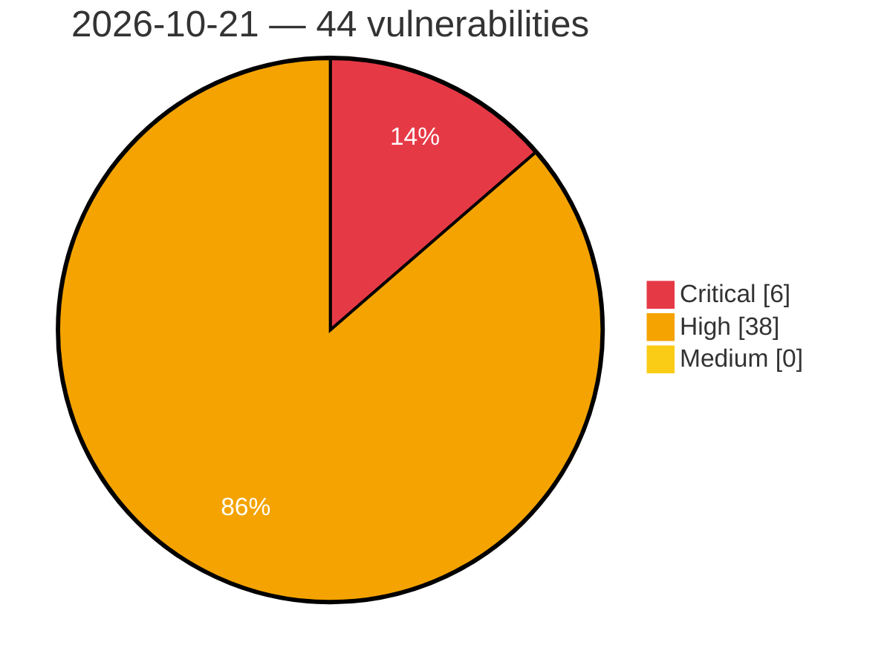

# Critical, High & Medium Severity Vulnerabilities — 2026-10-21

**Source status for this day:**

| Source | Critical | High | Medium | Total |
|--------|---------:|-----:|-------:|------:|
| cvefeed.io (High/Critical) | 6 | 38 | 0 | 44 |

**KEV (actively exploited):** 0  **Watchlist matches:** 34

## Critical (6)

| CVSS | Flags | Source | CVE / Title | Reported |
|------|-------|--------|-------------|----------|
| 10.0 | — | cvefeed.io (High/Critical) | [CVE-2026-113744 - Tenda AC19 httpd Web Management Service SetFirewallCfg formSetFirewallCfg stack-based overflow](https://cvefeed.io/vuln/detail/CVE-2026-113744) | 48 minutes ago |
| 9.9 | ⭐ | cvefeed.io (High/Critical) | [CVE-2026-71195 - OpenStack Manila Improper Authorization Vulnerability](https://cvefeed.io/vuln/detail/CVE-2026-71195) | 48 minutes ago |
| 9.8 | — | cvefeed.io (High/Critical) | [CVE-2026-114119 - Best Practice Software Bp Premier before 1.14.1.1128 Hardcoded SQL Server Administrative Credential](https://cvefeed.io/vuln/detail/CVE-2026-114119) | 1 hour, 47 minutes ago |
| 9.8 | ⭐ | cvefeed.io (High/Critical) | [CVE-2026-114108 - HKUDS Vibe-Trading before 0.1.7 Missing Authentication in FastAPI Server Enabling RCE](https://cvefeed.io/vuln/detail/CVE-2026-114108) | 1 hour, 47 minutes ago |
| 9.2 | ⭐ | cvefeed.io (High/Critical) | [CVE-2026-114087 - Trigger.dev before 4.5.6 Authentication Bypass via Hardcoded Default Secrets](https://cvefeed.io/vuln/detail/CVE-2026-114087) | 1 hour, 47 minutes ago |
| 9.1 | — | cvefeed.io (High/Critical) | [CVE-2026-87095 - Acronis Cyber Infrastructure Improper Authorization Vulnerability](https://cvefeed.io/vuln/detail/CVE-2026-87095) | 1 hour, 48 minutes ago |

## High (38)

| CVSS | Flags | Source | CVE / Title | Reported |
|------|-------|--------|-------------|----------|
| 8.9 | ⭐ | cvefeed.io (High/Critical) | [CVE-2026-114112 - Sharp before 0.35.4 RCE via bundled libheif AVIF decoding](https://cvefeed.io/vuln/detail/CVE-2026-114112) | 1 hour, 47 minutes ago |
| 8.9 | ⭐ | cvefeed.io (High/Critical) | [CVE-2026-114111 - Sharp before 0.35.5 RCE via librsvg Dependency Memory Vulnerability](https://cvefeed.io/vuln/detail/CVE-2026-114111) | 1 hour, 47 minutes ago |
| 8.8 | ⭐ | cvefeed.io (High/Critical) | [CVE-2026-82814 - Duplicator <= 1.5.17 and Duplicator Pro <= 4.6.10 - Unauthenticated PHP Object Injection](https://cvefeed.io/vuln/detail/CVE-2026-82814) | 48 minutes ago |
| 8.8 | ⭐ | cvefeed.io (High/Critical) | [CVE-2026-114109 - uv before 0.11.15 Arbitrary File Write via Entry Point Names](https://cvefeed.io/vuln/detail/CVE-2026-114109) | 1 hour, 47 minutes ago |
| 8.8 | ⭐ | cvefeed.io (High/Critical) | [CVE-2026-114107 - HKUDS Vibe-Trading 0.1.0 before 0.1.7 Indirect Prompt Injection RCE via BashTool and BackgroundRunTool](https://cvefeed.io/vuln/detail/CVE-2026-114107) | 1 hour, 47 minutes ago |
| 8.8 | ⭐ | cvefeed.io (High/Critical) | [CVE-2026-114094 - Dulwich before 1.2.9 Arbitrary File Write via DOS drive letter paths](https://cvefeed.io/vuln/detail/CVE-2026-114094) | 1 hour, 47 minutes ago |
| 8.8 | ⭐ | cvefeed.io (High/Critical) | [CVE-2026-114089 - Trigger.dev before 4.5.2 CLI Auth-Code Phishing Leading to PAT Takeover](https://cvefeed.io/vuln/detail/CVE-2026-114089) | 1 hour, 47 minutes ago |
| 8.8 | ⭐ | cvefeed.io (High/Critical) | [CVE-2026-114085 - Trigger.dev through 4.7.6 Missing Authentication in Supervisor Workload API](https://cvefeed.io/vuln/detail/CVE-2026-114085) | 1 hour, 47 minutes ago |
| 8.8 | ⭐ | cvefeed.io (High/Critical) | [CVE-2026-114387 - Shopper 2.0.0 before 2.6.0 Privilege Escalation via Unguarded Livewire Components](https://cvefeed.io/vuln/detail/CVE-2026-114387) | 25 minutes ago |
| 8.8 | ⭐ | cvefeed.io (High/Critical) | [CVE-2026-110370 - WordPress GS Pins for Pinterest plugin <= 1.9.2 - PHP Object Injection vulnerability](https://cvefeed.io/vuln/detail/CVE-2026-110370) | 2 hours, 48 minutes ago |
| 8.8 | ⭐ | cvefeed.io (High/Critical) | [CVE-2026-110369 - WordPress WordPress Team Members – GS Plugins plugin <= 2.8.2 - PHP Object Injection vulnerability](https://cvefeed.io/vuln/detail/CVE-2026-110369) | 2 hours, 48 minutes ago |
| 8.8 | ⭐ | cvefeed.io (High/Critical) | [CVE-2026-85683 - Jane Menu < 1.5.1 - Unauthenticated Stored XSS via Store Config Proxy URL](https://cvefeed.io/vuln/detail/CVE-2026-85683) | 3 hours, 48 minutes ago |
| 8.7 | ⭐ | cvefeed.io (High/Critical) | [CVE-2026-114198 - Deserialization of untrusted data in floss](https://cvefeed.io/vuln/detail/CVE-2026-114198) | 1 hour, 47 minutes ago |
| 8.7 | ⭐ | cvefeed.io (High/Critical) | [CVE-2026-114197 - Deserialization of untrusted data in capa](https://cvefeed.io/vuln/detail/CVE-2026-114197) | 1 hour, 47 minutes ago |
| 8.7 | ⭐ | cvefeed.io (High/Critical) | [CVE-2026-114110 - Astral uv before 0.11.6 Arbitrary File Deletion via Wheel RECORD Entries](https://cvefeed.io/vuln/detail/CVE-2026-114110) | 1 hour, 47 minutes ago |
| 8.7 | ⭐ | cvefeed.io (High/Critical) | [CVE-2026-114106 - HKUDS Vibe-Trading 0.1.0 before 0.1.7 Path Traversal via read_document and safe_user_path](https://cvefeed.io/vuln/detail/CVE-2026-114106) | 1 hour, 47 minutes ago |
| 8.7 | — | cvefeed.io (High/Critical) | [CVE-2026-114102 - adm-zip before 0.6.1 Denial of Service via inflateAsync Unhandled Error Event](https://cvefeed.io/vuln/detail/CVE-2026-114102) | 1 hour, 47 minutes ago |
| 8.7 | — | cvefeed.io (High/Critical) | [CVE-2026-114405 - Denial of Service via Malformed VATP Packet in Velneo vServer](https://cvefeed.io/vuln/detail/CVE-2026-114405) | 38 minutes ago |
| 8.7 | — | cvefeed.io (High/Critical) | [CVE-2026-110938 - JITServer: Multiple Denial of Service vulnerabilities via out-of-bounds heap reads during message and reply parsing](https://cvefeed.io/vuln/detail/CVE-2026-110938) | 3 hours, 48 minutes ago |
| 8.7 | ⭐ | cvefeed.io (High/Critical) | [CVE-2026-111075 - JITServer: Pre-authentication remote crash via integer underflow and out-of-bounds heap read in DataDescriptor deserialization](https://cvefeed.io/vuln/detail/CVE-2026-111075) | 4 hours, 48 minutes ago |
| 8.7 | — | cvefeed.io (High/Critical) | [CVE-2026-111074 - JITServer: Pre-authentication remote Denial of Service via integer overflow infinite loop in MessageBuffer::computeRequiredCapacity()](https://cvefeed.io/vuln/detail/CVE-2026-111074) | 4 hours, 48 minutes ago |
| 8.6 | ⭐ | cvefeed.io (High/Critical) | [CVE-2026-114083 - Trigger.dev before 4.5.0-rc.3 Path Traversal via Packets Presigned URL Endpoints](https://cvefeed.io/vuln/detail/CVE-2026-114083) | 1 hour, 47 minutes ago |
| 8.6 | ⭐ | cvefeed.io (High/Critical) | [CVE-2026-92998 - Click n Chat 1.0.4 - 1.1.2 - Unauthenticated SQLi via 'sort_by'/'sort_order' Parameters](https://cvefeed.io/vuln/detail/CVE-2026-92998) | 6 hours, 48 minutes ago |
| 8.6 | ⭐ | cvefeed.io (High/Critical) | [CVE-2026-92997 - Click n Chat < 1.1.3 - Unauthenticated SQLi via 'datacolumn' Parameter](https://cvefeed.io/vuln/detail/CVE-2026-92997) | 6 hours, 48 minutes ago |
| 8.5 | ⭐ | cvefeed.io (High/Critical) | [CVE-2026-70386 - OnePlus OxygenOS improper neutralization of special elements vulnerability](https://cvefeed.io/vuln/detail/CVE-2026-70386) | 3 hours, 48 minutes ago |
| 8.4 | ⭐ | cvefeed.io (High/Critical) | [CVE-2026-114113 - Sharp before 0.35.0 Multiple Vulnerabilities via Bundled libvips Image Decoders](https://cvefeed.io/vuln/detail/CVE-2026-114113) | 1 hour, 47 minutes ago |
| 8.4 | ⭐ | cvefeed.io (High/Critical) | [CVE-2026-70387 - OnePlus OxygenOS exposed dangerous method vulnerability](https://cvefeed.io/vuln/detail/CVE-2026-70387) | 3 hours, 48 minutes ago |
| 8.3 | ⭐ | cvefeed.io (High/Critical) | [CVE-2026-114092 - Trigger.dev before 4.5.0 Missing Authentication in Dashboard Run Replay Action](https://cvefeed.io/vuln/detail/CVE-2026-114092) | 1 hour, 47 minutes ago |
| 8.3 | ⭐ | cvefeed.io (High/Critical) | [CVE-2026-114088 - Trigger.dev before 4.5.4 Hardcoded Coordinator Secret Authentication Bypass via Socket.IO](https://cvefeed.io/vuln/detail/CVE-2026-114088) | 1 hour, 47 minutes ago |
| 8.3 | ⭐ | cvefeed.io (High/Critical) | [CVE-2026-114084 - Trigger.dev before 4.5.6 SQL Injection via tags in Realtime Runs API](https://cvefeed.io/vuln/detail/CVE-2026-114084) | 1 hour, 47 minutes ago |
| 8.2 | — | cvefeed.io (High/Critical) | [CVE-2026-114117 - Vyper 0.3.8 through 0.5.0b1 Optimizer Miscompilation of msg.value \| K in Ternary Branches](https://cvefeed.io/vuln/detail/CVE-2026-114117) | 1 hour, 47 minutes ago |
| 8.2 | — | cvefeed.io (High/Critical) | [CVE-2026-114104 - adm-zip before 0.6.1 Duplicate ZIP Entry Name Validation Bypass](https://cvefeed.io/vuln/detail/CVE-2026-114104) | 1 hour, 47 minutes ago |
| 8.2 | — | cvefeed.io (High/Critical) | [CVE-2026-107237 - Backup and Staging by WP Time Capsule < 1.22.28 - Subscriber+ Staging-to-Live Deployment via wptc_copy_stage_to_live](https://cvefeed.io/vuln/detail/CVE-2026-107237) | 6 hours, 48 minutes ago |
| 8.1 | ⭐ | cvefeed.io (High/Critical) | [CVE-2026-114082 - Trigger.dev before 4.6.2 Overly Broad Realtime Session Stream Credentials](https://cvefeed.io/vuln/detail/CVE-2026-114082) | 1 hour, 47 minutes ago |
| 8.1 | ⭐ | cvefeed.io (High/Critical) | [CVE-2026-94300 - Concurrent GSS-TSIG messages corrupt memory](https://cvefeed.io/vuln/detail/CVE-2026-94300) | 19 minutes ago |
| 8.1 | ⭐ | cvefeed.io (High/Critical) | [CVE-2026-114403 - PHPOffice PHPPresentation through 1.2.0 Deserialization via Reader\Serialized::load](https://cvefeed.io/vuln/detail/CVE-2026-114403) | 25 minutes ago |
| 8.1 | ⭐ | cvefeed.io (High/Critical) | [CVE-2026-110523 - WP User Manager 2.9.21 - 2.9.25 - Unauthenticated Privilege Escalation via Paid Registration Role After Stripe Disconnect](https://cvefeed.io/vuln/detail/CVE-2026-110523) | 6 hours, 48 minutes ago |
| 8.0 | ⭐ | cvefeed.io (High/Critical) | [CVE-2026-105262 - Falang multilanguage for WordPress < 1.4.6 - Subscriber+ Stored XSS via Term Translation](https://cvefeed.io/vuln/detail/CVE-2026-105262) | 6 hours, 48 minutes ago |
