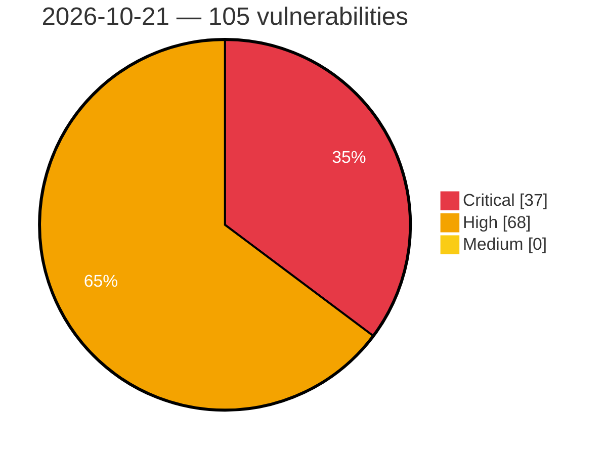

# Critical, High & Medium Severity Vulnerabilities — 2026-10-21

**Source status for this day:**

| Source | Critical | High | Medium | Total |
|--------|---------:|-----:|-------:|------:|
| cvefeed.io (High/Critical) | 37 | 68 | 0 | 105 |

**KEV (actively exploited):** 0  **Watchlist matches:** 71

## Critical (37)

| CVSS | Flags | Source | CVE / Title | Reported |
|------|-------|--------|-------------|----------|
| 10.0 | — | cvefeed.io (High/Critical) | [CVE-2026-113744 - Tenda AC19 httpd Web Management Service SetFirewallCfg formSetFirewallCfg stack-based overflow](https://cvefeed.io/vuln/detail/CVE-2026-113744) | 48 minutes ago |
| 10.0 | ⭐ | cvefeed.io (High/Critical) | [CVE-2026-111832 - WordPress WP Mailster plugin <= 1.9.1.0 - Arbitrary File Upload vulnerability](https://cvefeed.io/vuln/detail/CVE-2026-111832) | 2 hours, 58 minutes ago |
| 10.0 | ⭐ | cvefeed.io (High/Critical) | [CVE-2026-111815 - Apache Traffic Server: TLS session ticket resumption bypasses per-SNI verify_client STRICT enforcement](https://cvefeed.io/vuln/detail/CVE-2026-111815) | 54 minutes ago |
| 10.0 | — | cvefeed.io (High/Critical) | [CVE-2026-111814 - Apache Traffic Server: Default server_session_sharing.match omits MASK_CERT, allowing pooled mTLS identity confusion at the origin](https://cvefeed.io/vuln/detail/CVE-2026-111814) | 54 minutes ago |
| 10.0 | ⭐ | cvefeed.io (High/Critical) | [CVE-2026-111812 - Apache Traffic Server: origin_server_auth signs client-controlled AWS headers under the proxy's IAM credentials](https://cvefeed.io/vuln/detail/CVE-2026-111812) | 54 minutes ago |
| 10.0 | — | cvefeed.io (High/Critical) | [CVE-2026-111813 - Apache Traffic Server: magick plugin passes client query strings unfiltered to ImageMagick convert in the default configuration](https://cvefeed.io/vuln/detail/CVE-2026-111813) | 1 hour, 54 minutes ago |
| 10.0 | ⭐ | cvefeed.io (High/Critical) | [CVE-2026-105944 - Apache Pulsar Manager: Missing authentication and authorization and disclosure of the Pulsar admin credential; end of life](https://cvefeed.io/vuln/detail/CVE-2026-105944) | 1 hour, 54 minutes ago |
| 10.0 | — | cvefeed.io (High/Critical) | [CVE-2026-114383 - TOTOLINK EX200 wireless.so cstecgi.cgi setWiFiAclAddConfig stack-based overflow](https://cvefeed.io/vuln/detail/CVE-2026-114383) | 2 hours, 17 minutes ago |
| 10.0 | — | cvefeed.io (High/Critical) | [CVE-2026-114382 - TOTOLINK EX200 lan.so cstecgi.cgi setStaticDhcpConfig stack-based overflow](https://cvefeed.io/vuln/detail/CVE-2026-114382) | 2 hours, 17 minutes ago |
| 9.9 | ⭐ | cvefeed.io (High/Critical) | [CVE-2026-71195 - OpenStack Manila Improper Authorization Vulnerability](https://cvefeed.io/vuln/detail/CVE-2026-71195) | 48 minutes ago |
| 9.9 | ⭐ | cvefeed.io (High/Critical) | [CVE-2026-111834 - WordPress Mang Board WP plugin <= 2.4.4 - Arbitrary File Upload vulnerability](https://cvefeed.io/vuln/detail/CVE-2026-111834) | 2 hours, 58 minutes ago |
| 9.9 | — | cvefeed.io (High/Critical) | [CVE-2026-114268 - Tenda BE3L Pro WifiBasicSet formWifiBasicSet buffer overflow](https://cvefeed.io/vuln/detail/CVE-2026-114268) | 1 hour, 54 minutes ago |
| 9.8 | — | cvefeed.io (High/Critical) | [CVE-2026-114119 - Best Practice Software Bp Premier before 1.14.1.1128 Hardcoded SQL Server Administrative Credential](https://cvefeed.io/vuln/detail/CVE-2026-114119) | 1 hour, 47 minutes ago |
| 9.8 | ⭐ | cvefeed.io (High/Critical) | [CVE-2026-114108 - HKUDS Vibe-Trading before 0.1.7 Missing Authentication in FastAPI Server Enabling RCE](https://cvefeed.io/vuln/detail/CVE-2026-114108) | 1 hour, 47 minutes ago |
| 9.8 | — | cvefeed.io (High/Critical) | [CVE-2026-76474 - Cisco Unified Communications Products Hardening Release: October 2026 - Improper Authentication Vulnerabilities](https://cvefeed.io/vuln/detail/CVE-2026-76474) | 56 minutes ago |
| 9.8 | ⭐ | cvefeed.io (High/Critical) | [CVE-2026-76473 - Cisco Unified Communications Products Hardening Release: October 2026 - Improper control of a resource through its lifetime.](https://cvefeed.io/vuln/detail/CVE-2026-76473) | 56 minutes ago |
| 9.8 | ⭐ | cvefeed.io (High/Critical) | [CVE-2026-76466 - Cisco Expressway Series Remote Code Execution Vulnerability](https://cvefeed.io/vuln/detail/CVE-2026-76466) | 56 minutes ago |
| 9.8 | ⭐ | cvefeed.io (High/Critical) | [CVE-2026-111183 - GStreamer rtpL16depay Heap-based Buffer Overflow Remote Code Execution Vulnerability](https://cvefeed.io/vuln/detail/CVE-2026-111183) | 1 hour ago |
| 9.8 | ⭐ | cvefeed.io (High/Critical) | [CVE-2026-109619 - RCE via stale global state](https://cvefeed.io/vuln/detail/CVE-2026-109619) | 3 hours, 58 minutes ago |
| 9.8 | ⭐ | cvefeed.io (High/Critical) | [CVE-2026-109618 - RCE via OOM corruption](https://cvefeed.io/vuln/detail/CVE-2026-109618) | 3 hours, 58 minutes ago |
| 9.8 | — | cvefeed.io (High/Critical) | [CVE-2026-96639 - Pillow multi-frame loaders can reuse stale native image storage after mode transitions](https://cvefeed.io/vuln/detail/CVE-2026-96639) | 3 hours, 14 minutes ago |
| 9.4 | ⭐ | cvefeed.io (High/Critical) | [CVE-2026-113788 - Lagoon core ssh service vulnerable to remote code execution](https://cvefeed.io/vuln/detail/CVE-2026-113788) | 1 hour, 58 minutes ago |
| 9.4 | ⭐ | cvefeed.io (High/Critical) | [CVE-2026-112408 - Missing bucket ownership verification in Amazon SageMaker Python SDK default_bucket()](https://cvefeed.io/vuln/detail/CVE-2026-112408) | 54 minutes ago |
| 9.4 | — | cvefeed.io (High/Critical) | [CVE-2026-111811 - Apache Traffic Server: tsmemcache plugin exposes the shared proxy cache over the network with no authentication](https://cvefeed.io/vuln/detail/CVE-2026-111811) | 54 minutes ago |
| 9.3 | ⭐ | cvefeed.io (High/Critical) | [CVE-2026-76475 - Cisco Unified Communications Products Hardening Release: October 2026 - Cross-site Scripting Vulnerabilities](https://cvefeed.io/vuln/detail/CVE-2026-76475) | 56 minutes ago |
| 9.3 | ⭐ | cvefeed.io (High/Critical) | [CVE-2026-111852 - WordPress Ajax Search Lite plugin <= 4.14.6 - SQL Injection vulnerability](https://cvefeed.io/vuln/detail/CVE-2026-111852) | 2 hours, 58 minutes ago |
| 9.3 | — | cvefeed.io (High/Critical) | [CVE-2026-111809 - Apache Traffic Server: HEAD requests carrying Content-Length or Transfer-Encoding enable request smuggling](https://cvefeed.io/vuln/detail/CVE-2026-111809) | 54 minutes ago |
| 9.3 | — | cvefeed.io (High/Critical) | [CVE-2026-111816 - Apache Traffic Server: A malformed 302 response bypasses parse-error rejection through the Transfer-Encoding: chunked carve-out](https://cvefeed.io/vuln/detail/CVE-2026-111816) | 1 hour, 54 minutes ago |
| 9.2 | ⭐ | cvefeed.io (High/Critical) | [CVE-2026-114087 - Trigger.dev before 4.5.6 Authentication Bypass via Hardcoded Default Secrets](https://cvefeed.io/vuln/detail/CVE-2026-114087) | 1 hour, 47 minutes ago |
| 9.2 | ⭐ | cvefeed.io (High/Critical) | [CVE-2026-105869 - Apache Pulsar: MultiRolesTokenAuthorizationProvider uses roles from unverified tokens for HTTP requests that fall back to the anonymous user role](https://cvefeed.io/vuln/detail/CVE-2026-105869) | 16 minutes ago |
| 9.2 | ⭐ | cvefeed.io (High/Critical) | [CVE-2026-114493 - LocalAI v4.6.0 through v4.11.0 SSRF Guard Bypass via HTTP Redirects](https://cvefeed.io/vuln/detail/CVE-2026-114493) | 21 minutes ago |
| 9.2 | ⭐ | cvefeed.io (High/Critical) | [CVE-2026-114509 - Laravel TokenGuard authentication bypass through non-string API credentials](https://cvefeed.io/vuln/detail/CVE-2026-114509) | 2 hours, 17 minutes ago |
| 9.1 | — | cvefeed.io (High/Critical) | [CVE-2026-87095 - Acronis Cyber Infrastructure Improper Authorization Vulnerability](https://cvefeed.io/vuln/detail/CVE-2026-87095) | 1 hour, 48 minutes ago |
| 9.1 | ⭐ | cvefeed.io (High/Critical) | [CVE-2025-31699 - Apache Traffic Server: Origin connection still owed a request body is reused, enabling request smuggling](https://cvefeed.io/vuln/detail/CVE-2025-31699) | 1 hour, 54 minutes ago |
| 9.1 | ⭐ | cvefeed.io (High/Critical) | [CVE-2026-91403 - Vulnerability in the Oracle Java SE, Oracle GraalV](https://cvefeed.io/vuln/detail/CVE-2026-91403) | 2 hours, 17 minutes ago |
| 9.1 | — | cvefeed.io (High/Critical) | [CVE-2026-114139 - Sentry-Javascript: Middleware Bypass when using Tunnel route](https://cvefeed.io/vuln/detail/CVE-2026-114139) | 3 hours, 16 minutes ago |
| 9.0 | ⭐ | cvefeed.io (High/Critical) | [CVE-2026-20043 - Multiple Cisco Products Snort 3 Software Hardening Release: October 2026](https://cvefeed.io/vuln/detail/CVE-2026-20043) | 57 minutes ago |

## High (68)

| CVSS | Flags | Source | CVE / Title | Reported |
|------|-------|--------|-------------|----------|
| 8.9 | ⭐ | cvefeed.io (High/Critical) | [CVE-2026-114112 - Sharp before 0.35.4 RCE via bundled libheif AVIF decoding](https://cvefeed.io/vuln/detail/CVE-2026-114112) | 1 hour, 47 minutes ago |
| 8.9 | ⭐ | cvefeed.io (High/Critical) | [CVE-2026-114111 - Sharp before 0.35.5 RCE via librsvg Dependency Memory Vulnerability](https://cvefeed.io/vuln/detail/CVE-2026-114111) | 1 hour, 47 minutes ago |
| 8.8 | ⭐ | cvefeed.io (High/Critical) | [CVE-2026-82814 - Duplicator <= 1.5.17 and Duplicator Pro <= 4.6.10 - Unauthenticated PHP Object Injection](https://cvefeed.io/vuln/detail/CVE-2026-82814) | 48 minutes ago |
| 8.8 | ⭐ | cvefeed.io (High/Critical) | [CVE-2026-114109 - uv before 0.11.15 Arbitrary File Write via Entry Point Names](https://cvefeed.io/vuln/detail/CVE-2026-114109) | 1 hour, 47 minutes ago |
| 8.8 | ⭐ | cvefeed.io (High/Critical) | [CVE-2026-114107 - HKUDS Vibe-Trading 0.1.0 before 0.1.7 Indirect Prompt Injection RCE via BashTool and BackgroundRunTool](https://cvefeed.io/vuln/detail/CVE-2026-114107) | 1 hour, 47 minutes ago |
| 8.8 | ⭐ | cvefeed.io (High/Critical) | [CVE-2026-114094 - Dulwich before 1.2.9 Arbitrary File Write via DOS drive letter paths](https://cvefeed.io/vuln/detail/CVE-2026-114094) | 1 hour, 47 minutes ago |
| 8.8 | ⭐ | cvefeed.io (High/Critical) | [CVE-2026-114089 - Trigger.dev before 4.5.2 CLI Auth-Code Phishing Leading to PAT Takeover](https://cvefeed.io/vuln/detail/CVE-2026-114089) | 1 hour, 47 minutes ago |
| 8.8 | ⭐ | cvefeed.io (High/Critical) | [CVE-2026-114085 - Trigger.dev through 4.7.6 Missing Authentication in Supervisor Workload API](https://cvefeed.io/vuln/detail/CVE-2026-114085) | 1 hour, 47 minutes ago |
| 8.8 | ⭐ | cvefeed.io (High/Critical) | [CVE-2026-114387 - Shopper 2.0.0 before 2.6.0 Privilege Escalation via Unguarded Livewire Components](https://cvefeed.io/vuln/detail/CVE-2026-114387) | 25 minutes ago |
| 8.8 | ⭐ | cvefeed.io (High/Critical) | [CVE-2026-110370 - WordPress GS Pins for Pinterest plugin <= 1.9.2 - PHP Object Injection vulnerability](https://cvefeed.io/vuln/detail/CVE-2026-110370) | 2 hours, 48 minutes ago |
| 8.8 | ⭐ | cvefeed.io (High/Critical) | [CVE-2026-110369 - WordPress WordPress Team Members – GS Plugins plugin <= 2.8.2 - PHP Object Injection vulnerability](https://cvefeed.io/vuln/detail/CVE-2026-110369) | 2 hours, 48 minutes ago |
| 8.8 | ⭐ | cvefeed.io (High/Critical) | [CVE-2026-85683 - Jane Menu < 1.5.1 - Unauthenticated Stored XSS via Store Config Proxy URL](https://cvefeed.io/vuln/detail/CVE-2026-85683) | 3 hours, 48 minutes ago |
| 8.8 | ⭐ | cvefeed.io (High/Critical) | [CVE-2026-76478 - Cisco Unified Communications Products Hardening Release: October 2026 - Improper Access Control Vulnerabilities](https://cvefeed.io/vuln/detail/CVE-2026-76478) | 56 minutes ago |
| 8.8 | — | cvefeed.io (High/Critical) | [CVE-2026-76477 - Cisco Unified Communications Products Hardening Release: October 2026 - Injection Vulnerabilities](https://cvefeed.io/vuln/detail/CVE-2026-76477) | 56 minutes ago |
| 8.8 | — | cvefeed.io (High/Critical) | [CVE-2026-76476 - Cisco Unified Communications Products Hardening Release: October 2026 - Improper Input Validation Vulnerabilities](https://cvefeed.io/vuln/detail/CVE-2026-76476) | 56 minutes ago |
| 8.8 | ⭐ | cvefeed.io (High/Critical) | [CVE-2026-92207 - MindsDB OpenBBtable Code Injection Remote Code Execution Vulnerability](https://cvefeed.io/vuln/detail/CVE-2026-92207) | 57 minutes ago |
| 8.8 | ⭐ | cvefeed.io (High/Critical) | [CVE-2026-92206 - CrewAI crewAI Framework Agent Loading Unsafe Reflection Remote Code Execution Vulnerability](https://cvefeed.io/vuln/detail/CVE-2026-92206) | 58 minutes ago |
| 8.8 | ⭐ | cvefeed.io (High/Critical) | [CVE-2026-92208 - NoMachine mDNS Heap-based Buffer Overflow Remote Code Execution Vulnerability](https://cvefeed.io/vuln/detail/CVE-2026-92208) | 59 minutes ago |
| 8.8 | ⭐ | cvefeed.io (High/Critical) | [CVE-2026-113779 - pfSense REST API package Vulnerable to Privilege Escalation via Scoped HA Settings Sync Permission](https://cvefeed.io/vuln/detail/CVE-2026-113779) | 2 hours, 58 minutes ago |
| 8.8 | ⭐ | cvefeed.io (High/Critical) | [CVE-2026-114135 - Jupyter Server: Gateway WebSocket handler bypasses kernel execute authorization](https://cvefeed.io/vuln/detail/CVE-2026-114135) | 54 minutes ago |
| 8.8 | ⭐ | cvefeed.io (High/Critical) | [CVE-2026-113870 - Improper Encoding of Server-Supplied JavaScript Values in MongoDB Compass BSON Parsing](https://cvefeed.io/vuln/detail/CVE-2026-113870) | 1 hour, 54 minutes ago |
| 8.8 | ⭐ | cvefeed.io (High/Critical) | [CVE-2026-111804 - Apache Traffic Server: wasm plugin has a use-after-free and forwards unvalidated guest metric IDs](https://cvefeed.io/vuln/detail/CVE-2026-111804) | 1 hour, 54 minutes ago |
| 8.8 | — | cvefeed.io (High/Critical) | [CVE-2026-76298 - Use of Hard-coded Cryptographic Key in the PostgreSQL Sidecar Service in Splunk Enterprise](https://cvefeed.io/vuln/detail/CVE-2026-76298) | 1 hour, 17 minutes ago |
| 8.8 | ⭐ | cvefeed.io (High/Critical) | [CVE-2026-76291 - Improper Access Control through Scheduled Search Safeguards in Splunk Enterprise](https://cvefeed.io/vuln/detail/CVE-2026-76291) | 1 hour, 17 minutes ago |
| 8.8 | ⭐ | cvefeed.io (High/Critical) | [CVE-2026-103090 - Unauthenticated Biscuit Credential Disclosure via GET /enroll/status in Google OSS Agent Mesh (SAM)](https://cvefeed.io/vuln/detail/CVE-2026-103090) | 1 hour, 17 minutes ago |
| 8.8 | — | cvefeed.io (High/Critical) | [CVE-2026-114142 - toml-node: Prototype pollution: parsing a TOML document can write to Object.prototype](https://cvefeed.io/vuln/detail/CVE-2026-114142) | 3 hours, 16 minutes ago |
| 8.8 | ⭐ | cvefeed.io (High/Critical) | [CVE-2026-114140 - nbconvert: File write via path traversal in cell output filenames](https://cvefeed.io/vuln/detail/CVE-2026-114140) | 3 hours, 16 minutes ago |
| 8.7 | ⭐ | cvefeed.io (High/Critical) | [CVE-2026-114198 - Deserialization of untrusted data in floss](https://cvefeed.io/vuln/detail/CVE-2026-114198) | 1 hour, 47 minutes ago |
| 8.7 | ⭐ | cvefeed.io (High/Critical) | [CVE-2026-114197 - Deserialization of untrusted data in capa](https://cvefeed.io/vuln/detail/CVE-2026-114197) | 1 hour, 47 minutes ago |
| 8.7 | ⭐ | cvefeed.io (High/Critical) | [CVE-2026-114110 - Astral uv before 0.11.6 Arbitrary File Deletion via Wheel RECORD Entries](https://cvefeed.io/vuln/detail/CVE-2026-114110) | 1 hour, 47 minutes ago |
| 8.7 | ⭐ | cvefeed.io (High/Critical) | [CVE-2026-114106 - HKUDS Vibe-Trading 0.1.0 before 0.1.7 Path Traversal via read_document and safe_user_path](https://cvefeed.io/vuln/detail/CVE-2026-114106) | 1 hour, 47 minutes ago |
| 8.7 | — | cvefeed.io (High/Critical) | [CVE-2026-114102 - adm-zip before 0.6.1 Denial of Service via inflateAsync Unhandled Error Event](https://cvefeed.io/vuln/detail/CVE-2026-114102) | 1 hour, 47 minutes ago |
| 8.7 | — | cvefeed.io (High/Critical) | [CVE-2026-114405 - Denial of Service via Malformed VATP Packet in Velneo vServer](https://cvefeed.io/vuln/detail/CVE-2026-114405) | 38 minutes ago |
| 8.7 | — | cvefeed.io (High/Critical) | [CVE-2026-110938 - JITServer: Multiple Denial of Service vulnerabilities via out-of-bounds heap reads during message and reply parsing](https://cvefeed.io/vuln/detail/CVE-2026-110938) | 3 hours, 48 minutes ago |
| 8.7 | ⭐ | cvefeed.io (High/Critical) | [CVE-2026-111075 - JITServer: Pre-authentication remote crash via integer underflow and out-of-bounds heap read in DataDescriptor deserialization](https://cvefeed.io/vuln/detail/CVE-2026-111075) | 4 hours, 48 minutes ago |
| 8.7 | — | cvefeed.io (High/Critical) | [CVE-2026-111074 - JITServer: Pre-authentication remote Denial of Service via integer overflow infinite loop in MessageBuffer::computeRequiredCapacity()](https://cvefeed.io/vuln/detail/CVE-2026-111074) | 4 hours, 48 minutes ago |
| 8.7 | — | cvefeed.io (High/Critical) | [CVE-2026-111810 - Apache Traffic Server: Unthrottled per-header diagnostic logging enables a log-flood denial of service](https://cvefeed.io/vuln/detail/CVE-2026-111810) | 54 minutes ago |
| 8.7 | — | cvefeed.io (High/Critical) | [CVE-2026-110803 - Session Lock Leak on an Invalid UI Id Allows Denial of Service in Vaadin Framework 8](https://cvefeed.io/vuln/detail/CVE-2026-110803) | 1 hour, 54 minutes ago |
| 8.7 | ⭐ | cvefeed.io (High/Critical) | [CVE-2026-105937 - Apache Pulsar: Missing authorization of the shadow topic source allows cross-tenant message disclosure and deletion of source topic data](https://cvefeed.io/vuln/detail/CVE-2026-105937) | 1 hour, 54 minutes ago |
| 8.7 | — | cvefeed.io (High/Critical) | [CVE-2025-55702 - Apache Traffic Server: An unread Expect: 100-continue request body is framed as a new request](https://cvefeed.io/vuln/detail/CVE-2025-55702) | 1 hour, 54 minutes ago |
| 8.7 | — | cvefeed.io (High/Critical) | [CVE-2026-114143 - toml-node: Quadratic-complexity DoS via long dotted keys or table paths in toml.parse()](https://cvefeed.io/vuln/detail/CVE-2026-114143) | 3 hours, 16 minutes ago |
| 8.7 | — | cvefeed.io (High/Critical) | [CVE-2026-114141 - toml-node: Quadratic-complexity DoS via many array-of-tables headers in toml.parse()](https://cvefeed.io/vuln/detail/CVE-2026-114141) | 3 hours, 16 minutes ago |
| 8.6 | ⭐ | cvefeed.io (High/Critical) | [CVE-2026-114083 - Trigger.dev before 4.5.0-rc.3 Path Traversal via Packets Presigned URL Endpoints](https://cvefeed.io/vuln/detail/CVE-2026-114083) | 1 hour, 47 minutes ago |
| 8.6 | ⭐ | cvefeed.io (High/Critical) | [CVE-2026-92998 - Click n Chat 1.0.4 - 1.1.2 - Unauthenticated SQLi via 'sort_by'/'sort_order' Parameters](https://cvefeed.io/vuln/detail/CVE-2026-92998) | 6 hours, 48 minutes ago |
| 8.6 | ⭐ | cvefeed.io (High/Critical) | [CVE-2026-92997 - Click n Chat < 1.1.3 - Unauthenticated SQLi via 'datacolumn' Parameter](https://cvefeed.io/vuln/detail/CVE-2026-92997) | 6 hours, 48 minutes ago |
| 8.6 | — | cvefeed.io (High/Critical) | [CVE-2026-76490 - Cisco Expressway Series Software Hardening Release: October 2026 - Out-of-bounds Write Vulnerabilities](https://cvefeed.io/vuln/detail/CVE-2026-76490) | 56 minutes ago |
| 8.6 | — | cvefeed.io (High/Critical) | [CVE-2026-111808 - Apache Traffic Server: HTTP/2 DATA frame padding underflow lets a client trigger backend worker-pool exhaustion](https://cvefeed.io/vuln/detail/CVE-2026-111808) | 54 minutes ago |
| 8.6 | — | cvefeed.io (High/Critical) | [CVE-2026-111805 - Apache Traffic Server: HTTP/2 Content-Length truncation lets a client trigger backend worker-pool exhaustion](https://cvefeed.io/vuln/detail/CVE-2026-111805) | 54 minutes ago |
| 8.6 | ⭐ | cvefeed.io (High/Critical) | [CVE-2026-29001 - TastyIgniter 4.4.5 PHP Object Injection via Settings Deserialization](https://cvefeed.io/vuln/detail/CVE-2026-29001) | 3 hours, 16 minutes ago |
| 8.5 | ⭐ | cvefeed.io (High/Critical) | [CVE-2026-70386 - OnePlus OxygenOS improper neutralization of special elements vulnerability](https://cvefeed.io/vuln/detail/CVE-2026-70386) | 3 hours, 48 minutes ago |
| 8.4 | ⭐ | cvefeed.io (High/Critical) | [CVE-2026-114113 - Sharp before 0.35.0 Multiple Vulnerabilities via Bundled libvips Image Decoders](https://cvefeed.io/vuln/detail/CVE-2026-114113) | 1 hour, 47 minutes ago |
| 8.4 | ⭐ | cvefeed.io (High/Critical) | [CVE-2026-70387 - OnePlus OxygenOS exposed dangerous method vulnerability](https://cvefeed.io/vuln/detail/CVE-2026-70387) | 3 hours, 48 minutes ago |
| 8.4 | ⭐ | cvefeed.io (High/Critical) | [CVE-2026-107588 - Multiple Vulnerabilities in the Highcharts Library Bundled with Vaadin Charts](https://cvefeed.io/vuln/detail/CVE-2026-107588) | 1 hour, 54 minutes ago |
| 8.3 | ⭐ | cvefeed.io (High/Critical) | [CVE-2026-114092 - Trigger.dev before 4.5.0 Missing Authentication in Dashboard Run Replay Action](https://cvefeed.io/vuln/detail/CVE-2026-114092) | 1 hour, 47 minutes ago |
| 8.3 | ⭐ | cvefeed.io (High/Critical) | [CVE-2026-114088 - Trigger.dev before 4.5.4 Hardcoded Coordinator Secret Authentication Bypass via Socket.IO](https://cvefeed.io/vuln/detail/CVE-2026-114088) | 1 hour, 47 minutes ago |
| 8.3 | ⭐ | cvefeed.io (High/Critical) | [CVE-2026-114084 - Trigger.dev before 4.5.6 SQL Injection via tags in Realtime Runs API](https://cvefeed.io/vuln/detail/CVE-2026-114084) | 1 hour, 47 minutes ago |
| 8.2 | — | cvefeed.io (High/Critical) | [CVE-2026-114117 - Vyper 0.3.8 through 0.5.0b1 Optimizer Miscompilation of msg.value \| K in Ternary Branches](https://cvefeed.io/vuln/detail/CVE-2026-114117) | 1 hour, 47 minutes ago |
| 8.2 | — | cvefeed.io (High/Critical) | [CVE-2026-114104 - adm-zip before 0.6.1 Duplicate ZIP Entry Name Validation Bypass](https://cvefeed.io/vuln/detail/CVE-2026-114104) | 1 hour, 47 minutes ago |
| 8.2 | — | cvefeed.io (High/Critical) | [CVE-2026-107237 - Backup and Staging by WP Time Capsule < 1.22.28 - Subscriber+ Staging-to-Live Deployment via wptc_copy_stage_to_live](https://cvefeed.io/vuln/detail/CVE-2026-107237) | 6 hours, 48 minutes ago |
| 8.2 | — | cvefeed.io (High/Critical) | [CVE-2026-112381 - Apache Traffic Server: Nullptr dereference in net_write_io on a POST half-close with chunked response](https://cvefeed.io/vuln/detail/CVE-2026-112381) | 54 minutes ago |
| 8.2 | ⭐ | cvefeed.io (High/Critical) | [CVE-2026-15723 - Improper Neutralization of Special Elements used in an LDAP Query ('LDAP Injection') in GitLab](https://cvefeed.io/vuln/detail/CVE-2026-15723) | 59 minutes ago |
| 8.2 | ⭐ | cvefeed.io (High/Critical) | [CVE-2026-96640 - Pillow PDF append accepts malformed shared page-tree DAG causing resource exhaustion](https://cvefeed.io/vuln/detail/CVE-2026-96640) | 3 hours, 14 minutes ago |
| 8.1 | ⭐ | cvefeed.io (High/Critical) | [CVE-2026-114082 - Trigger.dev before 4.6.2 Overly Broad Realtime Session Stream Credentials](https://cvefeed.io/vuln/detail/CVE-2026-114082) | 1 hour, 47 minutes ago |
| 8.1 | ⭐ | cvefeed.io (High/Critical) | [CVE-2026-94300 - Concurrent GSS-TSIG messages corrupt memory](https://cvefeed.io/vuln/detail/CVE-2026-94300) | 19 minutes ago |
| 8.1 | ⭐ | cvefeed.io (High/Critical) | [CVE-2026-114403 - PHPOffice PHPPresentation through 1.2.0 Deserialization via Reader\Serialized::load](https://cvefeed.io/vuln/detail/CVE-2026-114403) | 25 minutes ago |
| 8.1 | ⭐ | cvefeed.io (High/Critical) | [CVE-2026-110523 - WP User Manager 2.9.21 - 2.9.25 - Unauthenticated Privilege Escalation via Paid Registration Role After Stripe Disconnect](https://cvefeed.io/vuln/detail/CVE-2026-110523) | 6 hours, 48 minutes ago |
| 8.1 | ⭐ | cvefeed.io (High/Critical) | [CVE-2026-114489 - Missing Authorization in hMailServer](https://cvefeed.io/vuln/detail/CVE-2026-114489) | 1 hour, 57 minutes ago |
| 8.0 | ⭐ | cvefeed.io (High/Critical) | [CVE-2026-105262 - Falang multilanguage for WordPress < 1.4.6 - Subscriber+ Stored XSS via Term Translation](https://cvefeed.io/vuln/detail/CVE-2026-105262) | 6 hours, 48 minutes ago |
