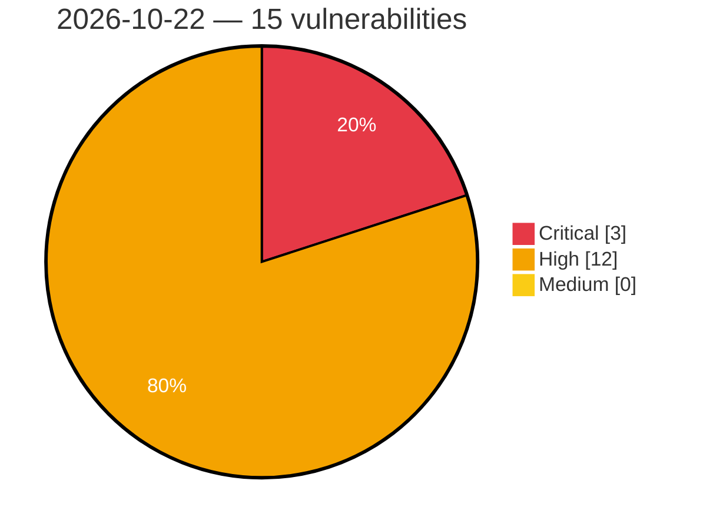

# Critical, High & Medium Severity Vulnerabilities — 2026-10-22

**Source status for this day:**

| Source | Critical | High | Medium | Total |
|--------|---------:|-----:|-------:|------:|
| cvefeed.io (High/Critical) | 3 | 12 | 0 | 15 |

**KEV (actively exploited):** 0  **Watchlist matches:** 11

## Critical (3)

| CVSS | Flags | Source | CVE / Title | Reported |
|------|-------|--------|-------------|----------|
| 10.0 | ⭐ | cvefeed.io (High/Critical) | [CVE-2026-114575 - TOTOLINK A950RG product.so UploadCustomModule command injection](https://cvefeed.io/vuln/detail/CVE-2026-114575) | 2 hours, 33 minutes ago |
| 10.0 | — | cvefeed.io (High/Critical) | [CVE-2026-110264 - Integer Overflow or Wraparound in GitLab](https://cvefeed.io/vuln/detail/CVE-2026-110264) | 2 hours, 33 minutes ago |
| 9.0 | ⭐ | cvefeed.io (High/Critical) | [CVE-2026-114661 - OpenRemote 1.2.0 before 1.31.0 Missing Authorization in Gateway Tunnel Endpoints](https://cvefeed.io/vuln/detail/CVE-2026-114661) | 1 hour, 33 minutes ago |

## High (12)

| CVSS | Flags | Source | CVE / Title | Reported |
|------|-------|--------|-------------|----------|
| 8.8 | ⭐ | cvefeed.io (High/Critical) | [CVE-2026-114658 - Grav Login plugin 3.6.0 before 3.9.13 Privilege Escalation via login.invite](https://cvefeed.io/vuln/detail/CVE-2026-114658) | 1 hour, 33 minutes ago |
| 8.7 | — | cvefeed.io (High/Critical) | [CVE-2026-114642 - Traefik before 2.11.58 and 3.7.14 TLS Config Bypass via NTLM/Kerberos Round Tripper](https://cvefeed.io/vuln/detail/CVE-2026-114642) | 1 hour, 33 minutes ago |
| 8.7 | ⭐ | cvefeed.io (High/Critical) | [CVE-2026-114640 - Traefik v3.7.0 before v3.7.14 mTLS Header Spoofing via Ingress-NGINX HTTP Router](https://cvefeed.io/vuln/detail/CVE-2026-114640) | 1 hour, 33 minutes ago |
| 8.7 | ⭐ | cvefeed.io (High/Critical) | [CVE-2026-114639 - Traefik before 2.11.58 and 3.7.14 Authentication Bypass via Negotiate Connection Pool](https://cvefeed.io/vuln/detail/CVE-2026-114639) | 1 hour, 33 minutes ago |
| 8.7 | ⭐ | cvefeed.io (High/Critical) | [CVE-2026-114638 - Traefik v3.7.0 before v3.7.14 Client CA Mix-up via auth-tls-secret Name Collision](https://cvefeed.io/vuln/detail/CVE-2026-114638) | 1 hour, 33 minutes ago |
| 8.7 | ⭐ | cvefeed.io (High/Critical) | [CVE-2026-114637 - Traefik v3.2.0 before v3.7.14 FastProxy NTLM/Negotiate Connection Pool Identity Leak](https://cvefeed.io/vuln/detail/CVE-2026-114637) | 1 hour, 33 minutes ago |
| 8.7 | ⭐ | cvefeed.io (High/Critical) | [CVE-2026-114636 - Traefik v3.7.13 Authentication Bypass via ssl-passthrough Ingress HTTP Router](https://cvefeed.io/vuln/detail/CVE-2026-114636) | 1 hour, 33 minutes ago |
| 8.7 | ⭐ | cvefeed.io (High/Critical) | [CVE-2026-114635 - Traefik before v2.11.58 and v3.7.14 SNI Check Bypass via HTTP/2 Scheme](https://cvefeed.io/vuln/detail/CVE-2026-114635) | 1 hour, 33 minutes ago |
| 8.6 | — | cvefeed.io (High/Critical) | [CVE-2026-114663 - Vyper 0.4.0b1 through 0.5.0b1 Name Shadowing of Imported Constants and Default Arguments](https://cvefeed.io/vuln/detail/CVE-2026-114663) | 1 hour, 33 minutes ago |
| 8.6 | ⭐ | cvefeed.io (High/Critical) | [CVE-2026-114662 - Obot before 0.26.0 API Key Theft via CLI Login Token Request](https://cvefeed.io/vuln/detail/CVE-2026-114662) | 1 hour, 33 minutes ago |
| 8.5 | — | cvefeed.io (High/Critical) | [CVE-2026-114716 - Roundcube Webmail Mail Header Injection Vulnerability](https://cvefeed.io/vuln/detail/CVE-2026-114716) | 1 hour, 33 minutes ago |
| 8.3 | ⭐ | cvefeed.io (High/Critical) | [CVE-2026-114727 - Roundcube Webmail Arbitrary File Processing Vulnerability](https://cvefeed.io/vuln/detail/CVE-2026-114727) | 1 hour, 33 minutes ago |
