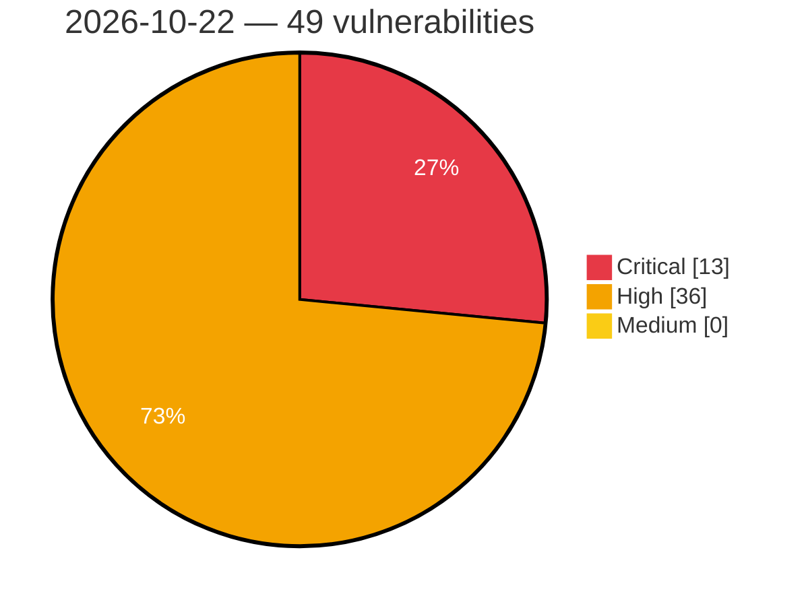

# Critical, High & Medium Severity Vulnerabilities — 2026-10-22

**Source status for this day:**

| Source | Critical | High | Medium | Total |
|--------|---------:|-----:|-------:|------:|
| cvefeed.io (High/Critical) | 13 | 36 | 0 | 49 |

**KEV (actively exploited):** 0  **Watchlist matches:** 40

## Critical (13)

| CVSS | Flags | Source | CVE / Title | Reported |
|------|-------|--------|-------------|----------|
| 10.0 | ⭐ | cvefeed.io (High/Critical) | [CVE-2026-114575 - TOTOLINK A950RG product.so UploadCustomModule command injection](https://cvefeed.io/vuln/detail/CVE-2026-114575) | 2 hours, 33 minutes ago |
| 10.0 | — | cvefeed.io (High/Critical) | [CVE-2026-110264 - Integer Overflow or Wraparound in GitLab](https://cvefeed.io/vuln/detail/CVE-2026-110264) | 2 hours, 33 minutes ago |
| 10.0 | ⭐ | cvefeed.io (High/Critical) | [CVE-2026-102785 - Joomla Extension - yootheme.com - Unauthenticated remote code execution in YOOtheme Pro 5.0.0-5.0.55](https://cvefeed.io/vuln/detail/CVE-2026-102785) | 1 hour, 48 minutes ago |
| 9.8 | ⭐ | cvefeed.io (High/Critical) | [CVE-2026-112241 - WordPress SureCart plugin <= 4.9.5 - Broken Authentication vulnerability](https://cvefeed.io/vuln/detail/CVE-2026-112241) | 1 hour, 22 minutes ago |
| 9.8 | — | cvefeed.io (High/Critical) | [CVE-2026-112832 - WordPress Rootblox plugin <= 1.0.6 - Local File Inclusion vulnerability](https://cvefeed.io/vuln/detail/CVE-2026-112832) | 3 hours, 48 minutes ago |
| 9.8 | ⭐ | cvefeed.io (High/Critical) | [CVE-2021-48016 - DedeCMS 5.8.1-beta Unauthenticated RCE via plus/flink.php](https://cvefeed.io/vuln/detail/CVE-2021-48016) | 3 hours, 49 minutes ago |
| 9.3 | ⭐ | cvefeed.io (High/Critical) | [CVE-2026-112327 - WordPress Amelia plugin <= 2.4.11 - SQL Injection vulnerability](https://cvefeed.io/vuln/detail/CVE-2026-112327) | 2 hours, 21 minutes ago |
| 9.3 | ⭐ | cvefeed.io (High/Critical) | [CVE-2026-114220 - NewType Infortech｜NT OneAPP - Improper Certificate Validation](https://cvefeed.io/vuln/detail/CVE-2026-114220) | 4 hours, 6 minutes ago |
| 9.2 | — | cvefeed.io (High/Critical) | [CVE-2026-111497 - Out-of-Bounds Write in Google Brotli Decoder](https://cvefeed.io/vuln/detail/CVE-2026-111497) | 48 minutes ago |
| 9.2 | ⭐ | cvefeed.io (High/Critical) | [CVE-2026-115324 - mem0 0.1.117 before 1.0.8 SQL Injection via Databricks Vector Store](https://cvefeed.io/vuln/detail/CVE-2026-115324) | 3 hours, 48 minutes ago |
| 9.1 | — | cvefeed.io (High/Critical) | [CVE-2026-114219 - NewType Infortech｜NT OneAPP - Hard-coded Credentials](https://cvefeed.io/vuln/detail/CVE-2026-114219) | 4 hours, 6 minutes ago |
| 9.1 | ⭐ | cvefeed.io (High/Critical) | [CVE-2022-51022 - YiShaAdmin 3.1 Unauthenticated Path Traversal via DownloadFile endpoint](https://cvefeed.io/vuln/detail/CVE-2022-51022) | 3 hours, 49 minutes ago |
| 9.0 | ⭐ | cvefeed.io (High/Critical) | [CVE-2026-114661 - OpenRemote 1.2.0 before 1.31.0 Missing Authorization in Gateway Tunnel Endpoints](https://cvefeed.io/vuln/detail/CVE-2026-114661) | 1 hour, 33 minutes ago |

## High (36)

| CVSS | Flags | Source | CVE / Title | Reported |
|------|-------|--------|-------------|----------|
| 8.8 | ⭐ | cvefeed.io (High/Critical) | [CVE-2026-114658 - Grav Login plugin 3.6.0 before 3.9.13 Privilege Escalation via login.invite](https://cvefeed.io/vuln/detail/CVE-2026-114658) | 1 hour, 33 minutes ago |
| 8.8 | ⭐ | cvefeed.io (High/Critical) | [CVE-2026-112242 - WordPress Profile Builder plugin <= 4.0.4 - Privilege Escalation vulnerability](https://cvefeed.io/vuln/detail/CVE-2026-112242) | 1 hour, 22 minutes ago |
| 8.8 | ⭐ | cvefeed.io (High/Critical) | [CVE-2026-114177 - WordPress Xpro Elementor Addons plugin <= 1.7.10 - Cross Site Request Forgery (CSRF) vulnerability](https://cvefeed.io/vuln/detail/CVE-2026-114177) | 2 hours, 6 minutes ago |
| 8.8 | ⭐ | cvefeed.io (High/Critical) | [CVE-2026-115332 - Lotus through 0.10.2 SQL Injection via Subscription Filter Keys](https://cvefeed.io/vuln/detail/CVE-2026-115332) | 3 hours, 48 minutes ago |
| 8.8 | ⭐ | cvefeed.io (High/Critical) | [CVE-2026-115331 - Lotus through 0.10.2 SQL Injection via Metric Property Names and Filters](https://cvefeed.io/vuln/detail/CVE-2026-115331) | 3 hours, 48 minutes ago |
| 8.8 | ⭐ | cvefeed.io (High/Critical) | [CVE-2026-115330 - Lotus through 0.10.2 SQL Injection via Custom SQL Billable Metrics](https://cvefeed.io/vuln/detail/CVE-2026-115330) | 3 hours, 48 minutes ago |
| 8.8 | ⭐ | cvefeed.io (High/Critical) | [CVE-2026-115328 - JSON-SCADA before 0.65-alpha SQL Injection via OPC HistoryRead API](https://cvefeed.io/vuln/detail/CVE-2026-115328) | 3 hours, 48 minutes ago |
| 8.8 | ⭐ | cvefeed.io (High/Critical) | [CVE-2025-71434 - Weaver E-cology < 10.76 Unauthenticated SQL Injection via doc/out/more/list](https://cvefeed.io/vuln/detail/CVE-2025-71434) | 3 hours, 49 minutes ago |
| 8.8 | ⭐ | cvefeed.io (High/Critical) | [CVE-2024-58393 - i-Netsolution Readymade Unilevel Ecommerce MLM SQL Injection via product-details.php](https://cvefeed.io/vuln/detail/CVE-2024-58393) | 3 hours, 49 minutes ago |
| 8.8 | ⭐ | cvefeed.io (High/Critical) | [CVE-2022-51023 - PHPOK < 5.4.081 SQL Injection via api.php sort Parameter](https://cvefeed.io/vuln/detail/CVE-2022-51023) | 3 hours, 49 minutes ago |
| 8.8 | ⭐ | cvefeed.io (High/Critical) | [CVE-2022-51021 - NotificationX WordPress Plugin < 2.3.12 Unauthenticated SQL Injection via notification REST endpoint](https://cvefeed.io/vuln/detail/CVE-2022-51021) | 3 hours, 49 minutes ago |
| 8.7 | — | cvefeed.io (High/Critical) | [CVE-2026-114642 - Traefik before 2.11.58 and 3.7.14 TLS Config Bypass via NTLM/Kerberos Round Tripper](https://cvefeed.io/vuln/detail/CVE-2026-114642) | 1 hour, 33 minutes ago |
| 8.7 | ⭐ | cvefeed.io (High/Critical) | [CVE-2026-114640 - Traefik v3.7.0 before v3.7.14 mTLS Header Spoofing via Ingress-NGINX HTTP Router](https://cvefeed.io/vuln/detail/CVE-2026-114640) | 1 hour, 33 minutes ago |
| 8.7 | ⭐ | cvefeed.io (High/Critical) | [CVE-2026-114639 - Traefik before 2.11.58 and 3.7.14 Authentication Bypass via Negotiate Connection Pool](https://cvefeed.io/vuln/detail/CVE-2026-114639) | 1 hour, 33 minutes ago |
| 8.7 | ⭐ | cvefeed.io (High/Critical) | [CVE-2026-114638 - Traefik v3.7.0 before v3.7.14 Client CA Mix-up via auth-tls-secret Name Collision](https://cvefeed.io/vuln/detail/CVE-2026-114638) | 1 hour, 33 minutes ago |
| 8.7 | ⭐ | cvefeed.io (High/Critical) | [CVE-2026-114637 - Traefik v3.2.0 before v3.7.14 FastProxy NTLM/Negotiate Connection Pool Identity Leak](https://cvefeed.io/vuln/detail/CVE-2026-114637) | 1 hour, 33 minutes ago |
| 8.7 | ⭐ | cvefeed.io (High/Critical) | [CVE-2026-114636 - Traefik v3.7.13 Authentication Bypass via ssl-passthrough Ingress HTTP Router](https://cvefeed.io/vuln/detail/CVE-2026-114636) | 1 hour, 33 minutes ago |
| 8.7 | ⭐ | cvefeed.io (High/Critical) | [CVE-2026-114635 - Traefik before v2.11.58 and v3.7.14 SNI Check Bypass via HTTP/2 Scheme](https://cvefeed.io/vuln/detail/CVE-2026-114635) | 1 hour, 33 minutes ago |
| 8.7 | ⭐ | cvefeed.io (High/Critical) | [CVE-2026-105270 - Unbounded atom creation while parsing SAML messages in esaml allows atom table exhaustion](https://cvefeed.io/vuln/detail/CVE-2026-105270) | 2 hours, 6 minutes ago |
| 8.7 | ⭐ | cvefeed.io (High/Critical) | [CVE-2026-93471 - Unbounded SAML message decompression in esaml allows memory exhaustion](https://cvefeed.io/vuln/detail/CVE-2026-93471) | 2 hours, 23 minutes ago |
| 8.7 | — | cvefeed.io (High/Critical) | [CVE-2026-113582 - Apache Abdera: XML external entity expansion in Atom document parsing](https://cvefeed.io/vuln/detail/CVE-2026-113582) | 48 minutes ago |
| 8.7 | ⭐ | cvefeed.io (High/Critical) | [CVE-2026-115325 - Netmaker through 1.7.0 Authorization Bypass via updateExtClient Unscoped Lookup](https://cvefeed.io/vuln/detail/CVE-2026-115325) | 3 hours, 48 minutes ago |
| 8.7 | ⭐ | cvefeed.io (High/Critical) | [CVE-2024-58396 - YouDataSum CPAS Audit Management System V4 Path Traversal via downPlugs fileId](https://cvefeed.io/vuln/detail/CVE-2024-58396) | 3 hours, 49 minutes ago |
| 8.7 | ⭐ | cvefeed.io (High/Critical) | [CVE-2022-51024 - Kavita < 0.5.4.1 Unauthenticated Path Traversal via cover-upload Endpoint](https://cvefeed.io/vuln/detail/CVE-2022-51024) | 3 hours, 49 minutes ago |
| 8.7 | ⭐ | cvefeed.io (High/Critical) | [CVE-2021-48017 - OrbiTeam BSCW Server < 5.2.5 / 7.4.4 Path Traversal via bscw.cgi](https://cvefeed.io/vuln/detail/CVE-2021-48017) | 3 hours, 49 minutes ago |
| 8.7 | ⭐ | cvefeed.io (High/Critical) | [CVE-2021-48015 - JeeWMS Path Traversal via showOrDownByurl.do](https://cvefeed.io/vuln/detail/CVE-2021-48015) | 3 hours, 49 minutes ago |
| 8.6 | — | cvefeed.io (High/Critical) | [CVE-2026-114663 - Vyper 0.4.0b1 through 0.5.0b1 Name Shadowing of Imported Constants and Default Arguments](https://cvefeed.io/vuln/detail/CVE-2026-114663) | 1 hour, 33 minutes ago |
| 8.6 | ⭐ | cvefeed.io (High/Critical) | [CVE-2026-114662 - Obot before 0.26.0 API Key Theft via CLI Login Token Request](https://cvefeed.io/vuln/detail/CVE-2026-114662) | 1 hour, 33 minutes ago |
| 8.5 | — | cvefeed.io (High/Critical) | [CVE-2026-114716 - Roundcube Webmail Mail Header Injection Vulnerability](https://cvefeed.io/vuln/detail/CVE-2026-114716) | 1 hour, 33 minutes ago |
| 8.5 | ⭐ | cvefeed.io (High/Critical) | [CVE-2026-112822 - WordPress Workreap Core plugin < 3.4.4 - SQL Injection vulnerability](https://cvefeed.io/vuln/detail/CVE-2026-112822) | 3 hours, 48 minutes ago |
| 8.4 | ⭐ | cvefeed.io (High/Critical) | [CVE-2026-16477 - Insecure Deserialization of .cleanshot Files in CleanShot X](https://cvefeed.io/vuln/detail/CVE-2026-16477) | 18 minutes ago |
| 8.3 | ⭐ | cvefeed.io (High/Critical) | [CVE-2026-114727 - Roundcube Webmail Arbitrary File Processing Vulnerability](https://cvefeed.io/vuln/detail/CVE-2026-114727) | 1 hour, 33 minutes ago |
| 8.2 | ⭐ | cvefeed.io (High/Critical) | [CVE-2026-86696 - Unbounded atom creation from unsigned LogoutResponse status codes in esaml allows atom table exhaustion](https://cvefeed.io/vuln/detail/CVE-2026-86696) | 2 hours, 23 minutes ago |
| 8.2 | ⭐ | cvefeed.io (High/Critical) | [CVE-2026-115333 - Lotus through 0.10.2 Improper Authentication via Event Ingestion API Key Prefix](https://cvefeed.io/vuln/detail/CVE-2026-115333) | 3 hours, 48 minutes ago |
| 8.1 | ⭐ | cvefeed.io (High/Critical) | [CVE-2026-92709 - Rsyslog: DynFile Path Traversal → Arbitrary File Write as Root → RCE](https://cvefeed.io/vuln/detail/CVE-2026-92709) | 48 minutes ago |
| 8.1 | — | cvefeed.io (High/Critical) | [CVE-2026-112820 - WordPress Academist Core plugin <= 1.4.1 - Local File Inclusion vulnerability](https://cvefeed.io/vuln/detail/CVE-2026-112820) | 3 hours, 48 minutes ago |
