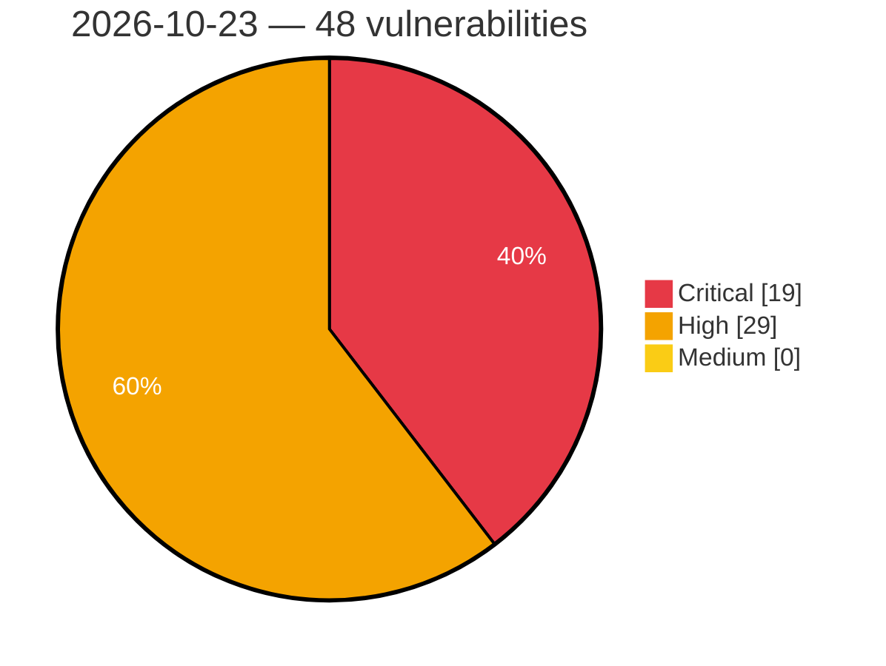

# Critical, High & Medium Severity Vulnerabilities — 2026-10-23

**Source status for this day:**

| Source | Critical | High | Medium | Total |
|--------|---------:|-----:|-------:|------:|
| cvefeed.io (High/Critical) | 19 | 29 | 0 | 48 |

**KEV (actively exploited):** 0  **Watchlist matches:** 39

## Critical (19)

| CVSS | Flags | Source | CVE / Title | Reported |
|------|-------|--------|-------------|----------|
| 9.9 | ⭐ | cvefeed.io (High/Critical) | [CVE-2026-53942 - Conda Organization Infrastructure: Pwn Request in update workflow allows PR-controlled template rendering with SYNC_TOKEN](https://cvefeed.io/vuln/detail/CVE-2026-53942) | 48 minutes ago |
| 9.8 | ⭐ | cvefeed.io (High/Critical) | [CVE-2026-25784 - bluespice/wiki container: Insecure default configuration of service token authentication allows privilege escalation to sysop](https://cvefeed.io/vuln/detail/CVE-2026-25784) | 1 hour, 7 minutes ago |
| 9.8 | ⭐ | cvefeed.io (High/Critical) | [CVE-2026-112862 - WordPress Participants Database plugin <= 2.7.8.5 - PHP Object Injection vulnerability](https://cvefeed.io/vuln/detail/CVE-2026-112862) | 1 hour, 7 minutes ago |
| 9.8 | ⭐ | cvefeed.io (High/Critical) | [CVE-2026-63244 - Authentication Bypass Vulnerability](https://cvefeed.io/vuln/detail/CVE-2026-63244) | 2 hours, 7 minutes ago |
| 9.8 | — | cvefeed.io (High/Critical) | [CVE-2026-53921 - odhcpd: Stack buffer overflow in DHCPv6 IA reply serialization (2 independent sites)](https://cvefeed.io/vuln/detail/CVE-2026-53921) | 56 minutes ago |
| 9.8 | ⭐ | cvefeed.io (High/Critical) | [CVE-2026-46652 - Path traversal via HTTP `Content-Disposition` header in ExternalFilesDownloader enables remote code execution in Goobi viewer](https://cvefeed.io/vuln/detail/CVE-2026-46652) | 58 minutes ago |
| 9.8 | ⭐ | cvefeed.io (High/Critical) | [CVE-2026-46651 - Unauthenticated SSRF and local file inclusion via DownloadTaskEndpoint WebSocket in Goobi viewer](https://cvefeed.io/vuln/detail/CVE-2026-46651) | 58 minutes ago |
| 9.8 | ⭐ | cvefeed.io (High/Critical) | [CVE-2026-57116 - PraisonAI: AgentOS remains unauthenticated after GHSA-pm96 patched version and allows remote agent invocation](https://cvefeed.io/vuln/detail/CVE-2026-57116) | 1 hour, 56 minutes ago |
| 9.6 | ⭐ | cvefeed.io (High/Critical) | [CVE-2026-54630 - Part-DB: Authenticated RCE via .phar attachment upload served from public/media](https://cvefeed.io/vuln/detail/CVE-2026-54630) | 1 hour, 24 minutes ago |
| 9.6 | — | cvefeed.io (High/Critical) | [CVE-2026-55981 - Firmware verification vulnerability](https://cvefeed.io/vuln/detail/CVE-2026-55981) | 3 hours, 8 minutes ago |
| 9.4 | ⭐ | cvefeed.io (High/Critical) | [CVE-2025-30050 - Remote Code Execution in CGM CLININET](https://cvefeed.io/vuln/detail/CVE-2025-30050) | 1 hour, 7 minutes ago |
| 9.4 | ⭐ | cvefeed.io (High/Critical) | [CVE-2025-30047 - Remote Code Execution via Java Deserialization in CGM CLININET](https://cvefeed.io/vuln/detail/CVE-2025-30047) | 1 hour, 7 minutes ago |
| 9.3 | ⭐ | cvefeed.io (High/Critical) | [CVE-2026-19677 - Authentication Bypass Leading to Server-Side Command Execution](https://cvefeed.io/vuln/detail/CVE-2026-19677) | 3 hours, 25 minutes ago |
| 9.3 | ⭐ | cvefeed.io (High/Critical) | [CVE-2026-112860 - WordPress Participants Database plugin <= 2.7.8.5 - SQL Injection vulnerability](https://cvefeed.io/vuln/detail/CVE-2026-112860) | 1 hour, 7 minutes ago |
| 9.3 | ⭐ | cvefeed.io (High/Critical) | [CVE-2025-30054 - Local Privilege Escalation in CGM CLININET](https://cvefeed.io/vuln/detail/CVE-2025-30054) | 1 hour, 7 minutes ago |
| 9.3 | ⭐ | cvefeed.io (High/Critical) | [CVE-2026-114357 - DJI CrystalSky ZS600C ships ADB without authentication (ro.adb.secure=0)](https://cvefeed.io/vuln/detail/CVE-2026-114357) | 56 minutes ago |
| 9.3 | ⭐ | cvefeed.io (High/Critical) | [CVE-2026-55486 - Goobi viewer: IIIF Auth 2.0 origin parameter unsanitized — CSP malformation and reflected XSS](https://cvefeed.io/vuln/detail/CVE-2026-55486) | 56 minutes ago |
| 9.1 | — | cvefeed.io (High/Critical) | [CVE-2026-115547 - Command Execution via Admin Console Input in Okta Access Gateway](https://cvefeed.io/vuln/detail/CVE-2026-115547) | 1 hour, 24 minutes ago |
| 9.0 | ⭐ | cvefeed.io (High/Critical) | [CVE-2025-30046 - Remote Code Execution in CGM CLININET](https://cvefeed.io/vuln/detail/CVE-2025-30046) | 1 hour, 7 minutes ago |

## High (29)

| CVSS | Flags | Source | CVE / Title | Reported |
|------|-------|--------|-------------|----------|
| 8.8 | — | cvefeed.io (High/Critical) | [CVE-2026-89320 - HmacShaCryptor.Hash never hashes its input — returns constant HMAC_K("") for all inputs, voiding CBC-HMAC JWE integrity](https://cvefeed.io/vuln/detail/CVE-2026-89320) | 1 hour, 7 minutes ago |
| 8.8 | ⭐ | cvefeed.io (High/Critical) | [CVE-2025-30052 - Authentication Bypass via IP Spoofing in CGM CLININET rsyncd](https://cvefeed.io/vuln/detail/CVE-2025-30052) | 1 hour, 7 minutes ago |
| 8.8 | ⭐ | cvefeed.io (High/Critical) | [CVE-2026-53918 - odhcpd DHCPv6 IA dangling first pointer use-after-free](https://cvefeed.io/vuln/detail/CVE-2026-53918) | 56 minutes ago |
| 8.8 | ⭐ | cvefeed.io (High/Critical) | [CVE-2026-114621 - baserCMS: SQL injection in the admin panel and admin API](https://cvefeed.io/vuln/detail/CVE-2026-114621) | 56 minutes ago |
| 8.8 | ⭐ | cvefeed.io (High/Critical) | [CVE-2026-57144 - PraisonAI SandlockSandbox falls back to unrestricted subprocess execution when Landlock is unavailable](https://cvefeed.io/vuln/detail/CVE-2026-57144) | 1 hour, 56 minutes ago |
| 8.8 | ⭐ | cvefeed.io (High/Critical) | [CVE-2026-57117 - PraisonAI: Compute-bridged file tools allow shell command injection](https://cvefeed.io/vuln/detail/CVE-2026-57117) | 1 hour, 56 minutes ago |
| 8.8 | ⭐ | cvefeed.io (High/Critical) | [CVE-2026-55888 - XDG Desktop Portal: Arbitrary file access via SaveFiles "files" option path traversal](https://cvefeed.io/vuln/detail/CVE-2026-55888) | 1 hour, 56 minutes ago |
| 8.7 | ⭐ | cvefeed.io (High/Critical) | [CVE-2026-86055 - Part-DB: Password Reset Link Poisoning via Host Header Injection leads to pre-authentication Account Takeover](https://cvefeed.io/vuln/detail/CVE-2026-86055) | 25 minutes ago |
| 8.7 | ⭐ | cvefeed.io (High/Critical) | [CVE-2026-19678 - Server-Side Request Forgery (SSRF) Leading to Internal Solr Data Disclosure](https://cvefeed.io/vuln/detail/CVE-2026-19678) | 3 hours, 25 minutes ago |
| 8.7 | — | cvefeed.io (High/Critical) | [CVE-2026-16762 - Denial-of-service vulnerability in the Qt Core QXmlStream parser (QXmlStreamReader) impacts Qt](https://cvefeed.io/vuln/detail/CVE-2026-16762) | 1 hour, 7 minutes ago |
| 8.7 | — | cvefeed.io (High/Critical) | [CVE-2026-93489 - ASUS Router Improper Authentication Vulnerability](https://cvefeed.io/vuln/detail/CVE-2026-93489) | 2 hours, 7 minutes ago |
| 8.7 | ⭐ | cvefeed.io (High/Critical) | [CVE-2026-93639 - Zimbra Collaboration Suite Missing Authorization in ConfigureZimlet Enables Delegated Administrator Privilege Escalation](https://cvefeed.io/vuln/detail/CVE-2026-93639) | 55 minutes ago |
| 8.7 | ⭐ | cvefeed.io (High/Critical) | [CVE-2026-55826 - Customer Order Data Exposed via Unauthenticated gtm_server_side_order_id Cookie Manipulation in GTM Server Side WordPress Plugin](https://cvefeed.io/vuln/detail/CVE-2026-55826) | 56 minutes ago |
| 8.7 | — | cvefeed.io (High/Critical) | [CVE-2026-53920 - odhcpd DHCPv6 Short IA_NA/IA_PD Body Stack Disclosure](https://cvefeed.io/vuln/detail/CVE-2026-53920) | 56 minutes ago |
| 8.7 | ⭐ | cvefeed.io (High/Critical) | [CVE-2026-50053 - Zimbra Collaboration Suite RestFilter Request Attribute Override via Unauthenticated URL Parameters](https://cvefeed.io/vuln/detail/CVE-2026-50053) | 56 minutes ago |
| 8.7 | ⭐ | cvefeed.io (High/Critical) | [CVE-2026-10632 - Zimbra Collaboration Suite Classic Web Client Reflected Cross-Site Scripting via Document Editor Packages Parameter](https://cvefeed.io/vuln/detail/CVE-2026-10632) | 56 minutes ago |
| 8.6 | — | cvefeed.io (High/Critical) | [CVE-2025-30045 - Code Injection in CGM CLININET](https://cvefeed.io/vuln/detail/CVE-2025-30045) | 1 hour, 7 minutes ago |
| 8.6 | ⭐ | cvefeed.io (High/Critical) | [CVE-2026-75779 - ASUS Router OS Command Injection and Cross-Site Request Forgery](https://cvefeed.io/vuln/detail/CVE-2026-75779) | 2 hours, 7 minutes ago |
| 8.6 | ⭐ | cvefeed.io (High/Critical) | [CVE-2026-102786 - Joomla Extension - phoca.cz - Authenticated stored cross-site scripting through HTML attribute injection in Phoca Gallery 4.5.0 - 6.1.5](https://cvefeed.io/vuln/detail/CVE-2026-102786) | 38 minutes ago |
| 8.6 | ⭐ | cvefeed.io (High/Critical) | [CVE-2026-114355 - DJI CrystalSky ZS600C hardware_monitor evaluates attacker-controlled log data as root](https://cvefeed.io/vuln/detail/CVE-2026-114355) | 56 minutes ago |
| 8.6 | ⭐ | cvefeed.io (High/Critical) | [CVE-2026-114354 - DJI CrystalSky ZS600C android.dji.server binder transaction 1018 command injection as root](https://cvefeed.io/vuln/detail/CVE-2026-114354) | 56 minutes ago |
| 8.5 | ⭐ | cvefeed.io (High/Critical) | [CVE-2026-112837 - WordPress GamiPress plugin <= 8.0.7 - SQL Injection vulnerability](https://cvefeed.io/vuln/detail/CVE-2026-112837) | 1 hour, 7 minutes ago |
| 8.5 | ⭐ | cvefeed.io (High/Critical) | [CVE-2026-115481 - baserCMS: BcCustomContent file fields can be configured to allow executable file extensions such as php, leading to arbitrary PHP file upload](https://cvefeed.io/vuln/detail/CVE-2026-115481) | 56 minutes ago |
| 8.4 | ⭐ | cvefeed.io (High/Critical) | [CVE-2026-63120 - PGHoard: Incomplete Path Traversal fix in restore.py allows Arbitrary File Write](https://cvefeed.io/vuln/detail/CVE-2026-63120) | 1 hour, 56 minutes ago |
| 8.3 | ⭐ | cvefeed.io (High/Critical) | [CVE-2026-55889 - XDG Desktop Portal: Drag-and-drop and copy-paste theft via predictable FileTransfer key](https://cvefeed.io/vuln/detail/CVE-2026-55889) | 1 hour, 56 minutes ago |
| 8.2 | — | cvefeed.io (High/Critical) | [CVE-2025-30049 - Use of Unsalted MD5 Password Hashes in CGM CLININET](https://cvefeed.io/vuln/detail/CVE-2025-30049) | 1 hour, 7 minutes ago |
| 8.1 | ⭐ | cvefeed.io (High/Critical) | [CVE-2026-115546 - Authentication Source Verification Issue in Okta Access Gateway](https://cvefeed.io/vuln/detail/CVE-2026-115546) | 1 hour, 24 minutes ago |
| 8.1 | ⭐ | cvefeed.io (High/Critical) | [CVE-2026-57121 - PraisonAI: Missing ownership check on DELETE endpoints allows members to delete others' content in Platform API](https://cvefeed.io/vuln/detail/CVE-2026-57121) | 1 hour, 56 minutes ago |
| 8.1 | ⭐ | cvefeed.io (High/Critical) | [CVE-2026-57113 - PraisonAI GitHub template cache path traversal allows outside-cache file write and directory deletion](https://cvefeed.io/vuln/detail/CVE-2026-57113) | 1 hour, 56 minutes ago |
