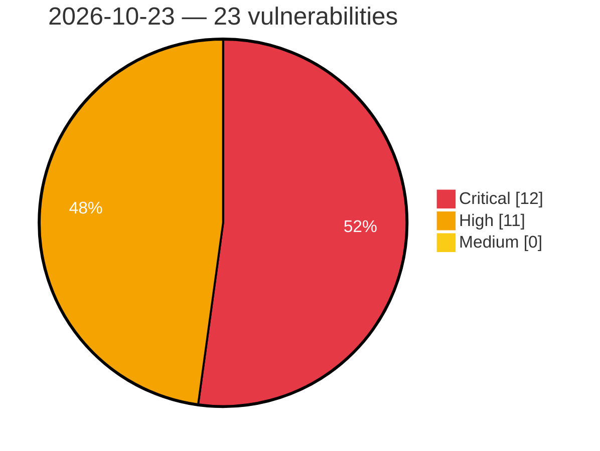

# Critical, High & Medium Severity Vulnerabilities — 2026-10-23

**Source status for this day:**

| Source | Critical | High | Medium | Total |
|--------|---------:|-----:|-------:|------:|
| cvefeed.io (High/Critical) | 12 | 11 | 0 | 23 |

**KEV (actively exploited):** 0  **Watchlist matches:** 16

## Critical (12)

| CVSS | Flags | Source | CVE / Title | Reported |
|------|-------|--------|-------------|----------|
| 9.8 | ⭐ | cvefeed.io (High/Critical) | [CVE-2026-25784 - bluespice/wiki container: Insecure default configuration of service token authentication allows privilege escalation to sysop](https://cvefeed.io/vuln/detail/CVE-2026-25784) | 1 hour, 7 minutes ago |
| 9.8 | ⭐ | cvefeed.io (High/Critical) | [CVE-2026-112862 - WordPress Participants Database plugin <= 2.7.8.5 - PHP Object Injection vulnerability](https://cvefeed.io/vuln/detail/CVE-2026-112862) | 1 hour, 7 minutes ago |
| 9.8 | ⭐ | cvefeed.io (High/Critical) | [CVE-2026-63244 - Authentication Bypass Vulnerability](https://cvefeed.io/vuln/detail/CVE-2026-63244) | 2 hours, 7 minutes ago |
| 9.6 | ⭐ | cvefeed.io (High/Critical) | [CVE-2026-54630 - Part-DB: Authenticated RCE via .phar attachment upload served from public/media](https://cvefeed.io/vuln/detail/CVE-2026-54630) | 1 hour, 24 minutes ago |
| 9.6 | — | cvefeed.io (High/Critical) | [CVE-2026-55981 - Firmware verification vulnerability](https://cvefeed.io/vuln/detail/CVE-2026-55981) | 3 hours, 8 minutes ago |
| 9.4 | ⭐ | cvefeed.io (High/Critical) | [CVE-2025-30050 - Remote Code Execution in CGM CLININET](https://cvefeed.io/vuln/detail/CVE-2025-30050) | 1 hour, 7 minutes ago |
| 9.4 | ⭐ | cvefeed.io (High/Critical) | [CVE-2025-30047 - Remote Code Execution via Java Deserialization in CGM CLININET](https://cvefeed.io/vuln/detail/CVE-2025-30047) | 1 hour, 7 minutes ago |
| 9.3 | ⭐ | cvefeed.io (High/Critical) | [CVE-2026-19677 - Authentication Bypass Leading to Server-Side Command Execution](https://cvefeed.io/vuln/detail/CVE-2026-19677) | 3 hours, 25 minutes ago |
| 9.3 | ⭐ | cvefeed.io (High/Critical) | [CVE-2026-112860 - WordPress Participants Database plugin <= 2.7.8.5 - SQL Injection vulnerability](https://cvefeed.io/vuln/detail/CVE-2026-112860) | 1 hour, 7 minutes ago |
| 9.3 | ⭐ | cvefeed.io (High/Critical) | [CVE-2025-30054 - Local Privilege Escalation in CGM CLININET](https://cvefeed.io/vuln/detail/CVE-2025-30054) | 1 hour, 7 minutes ago |
| 9.1 | — | cvefeed.io (High/Critical) | [CVE-2026-115547 - Command Execution via Admin Console Input in Okta Access Gateway](https://cvefeed.io/vuln/detail/CVE-2026-115547) | 1 hour, 24 minutes ago |
| 9.0 | ⭐ | cvefeed.io (High/Critical) | [CVE-2025-30046 - Remote Code Execution in CGM CLININET](https://cvefeed.io/vuln/detail/CVE-2025-30046) | 1 hour, 7 minutes ago |

## High (11)

| CVSS | Flags | Source | CVE / Title | Reported |
|------|-------|--------|-------------|----------|
| 8.8 | — | cvefeed.io (High/Critical) | [CVE-2026-89320 - HmacShaCryptor.Hash never hashes its input — returns constant HMAC_K("") for all inputs, voiding CBC-HMAC JWE integrity](https://cvefeed.io/vuln/detail/CVE-2026-89320) | 1 hour, 7 minutes ago |
| 8.8 | ⭐ | cvefeed.io (High/Critical) | [CVE-2025-30052 - Authentication Bypass via IP Spoofing in CGM CLININET rsyncd](https://cvefeed.io/vuln/detail/CVE-2025-30052) | 1 hour, 7 minutes ago |
| 8.7 | ⭐ | cvefeed.io (High/Critical) | [CVE-2026-86055 - Part-DB: Password Reset Link Poisoning via Host Header Injection leads to pre-authentication Account Takeover](https://cvefeed.io/vuln/detail/CVE-2026-86055) | 25 minutes ago |
| 8.7 | ⭐ | cvefeed.io (High/Critical) | [CVE-2026-19678 - Server-Side Request Forgery (SSRF) Leading to Internal Solr Data Disclosure](https://cvefeed.io/vuln/detail/CVE-2026-19678) | 3 hours, 25 minutes ago |
| 8.7 | — | cvefeed.io (High/Critical) | [CVE-2026-16762 - Denial-of-service vulnerability in the Qt Core QXmlStream parser (QXmlStreamReader) impacts Qt](https://cvefeed.io/vuln/detail/CVE-2026-16762) | 1 hour, 7 minutes ago |
| 8.7 | — | cvefeed.io (High/Critical) | [CVE-2026-93489 - ASUS Router Improper Authentication Vulnerability](https://cvefeed.io/vuln/detail/CVE-2026-93489) | 2 hours, 7 minutes ago |
| 8.6 | — | cvefeed.io (High/Critical) | [CVE-2025-30045 - Code Injection in CGM CLININET](https://cvefeed.io/vuln/detail/CVE-2025-30045) | 1 hour, 7 minutes ago |
| 8.6 | ⭐ | cvefeed.io (High/Critical) | [CVE-2026-75779 - ASUS Router OS Command Injection and Cross-Site Request Forgery](https://cvefeed.io/vuln/detail/CVE-2026-75779) | 2 hours, 7 minutes ago |
| 8.5 | ⭐ | cvefeed.io (High/Critical) | [CVE-2026-112837 - WordPress GamiPress plugin <= 8.0.7 - SQL Injection vulnerability](https://cvefeed.io/vuln/detail/CVE-2026-112837) | 1 hour, 7 minutes ago |
| 8.2 | — | cvefeed.io (High/Critical) | [CVE-2025-30049 - Use of Unsalted MD5 Password Hashes in CGM CLININET](https://cvefeed.io/vuln/detail/CVE-2025-30049) | 1 hour, 7 minutes ago |
| 8.1 | ⭐ | cvefeed.io (High/Critical) | [CVE-2026-115546 - Authentication Source Verification Issue in Okta Access Gateway](https://cvefeed.io/vuln/detail/CVE-2026-115546) | 1 hour, 24 minutes ago |
