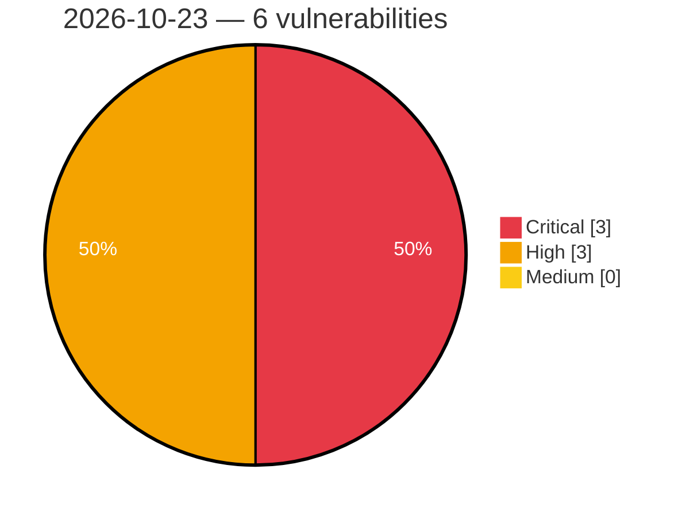

# Critical, High & Medium Severity Vulnerabilities — 2026-10-23

**Source status for this day:**

| Source | Critical | High | Medium | Total |
|--------|---------:|-----:|-------:|------:|
| cvefeed.io (High/Critical) | 3 | 3 | 0 | 6 |

**KEV (actively exploited):** 0  **Watchlist matches:** 5

## Critical (3)

| CVSS | Flags | Source | CVE / Title | Reported |
|------|-------|--------|-------------|----------|
| 9.6 | ⭐ | cvefeed.io (High/Critical) | [CVE-2026-54630 - Part-DB: Authenticated RCE via .phar attachment upload served from public/media](https://cvefeed.io/vuln/detail/CVE-2026-54630) | 1 hour, 24 minutes ago |
| 9.3 | ⭐ | cvefeed.io (High/Critical) | [CVE-2026-19677 - Authentication Bypass Leading to Server-Side Command Execution](https://cvefeed.io/vuln/detail/CVE-2026-19677) | 3 hours, 25 minutes ago |
| 9.1 | — | cvefeed.io (High/Critical) | [CVE-2026-115547 - Command Execution via Admin Console Input in Okta Access Gateway](https://cvefeed.io/vuln/detail/CVE-2026-115547) | 1 hour, 24 minutes ago |

## High (3)

| CVSS | Flags | Source | CVE / Title | Reported |
|------|-------|--------|-------------|----------|
| 8.7 | ⭐ | cvefeed.io (High/Critical) | [CVE-2026-86055 - Part-DB: Password Reset Link Poisoning via Host Header Injection leads to pre-authentication Account Takeover](https://cvefeed.io/vuln/detail/CVE-2026-86055) | 25 minutes ago |
| 8.7 | ⭐ | cvefeed.io (High/Critical) | [CVE-2026-19678 - Server-Side Request Forgery (SSRF) Leading to Internal Solr Data Disclosure](https://cvefeed.io/vuln/detail/CVE-2026-19678) | 3 hours, 25 minutes ago |
| 8.1 | ⭐ | cvefeed.io (High/Critical) | [CVE-2026-115546 - Authentication Source Verification Issue in Okta Access Gateway](https://cvefeed.io/vuln/detail/CVE-2026-115546) | 1 hour, 24 minutes ago |
