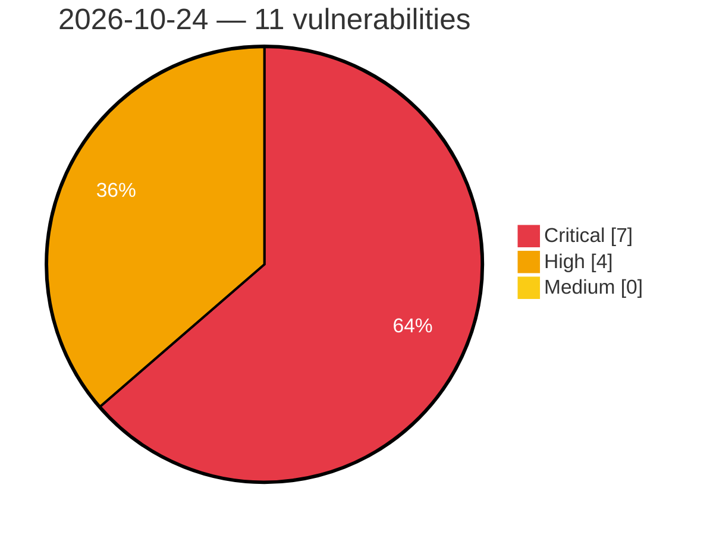

# Critical, High & Medium Severity Vulnerabilities — 2026-10-24

**Source status for this day:**

| Source | Critical | High | Medium | Total |
|--------|---------:|-----:|-------:|------:|
| cvefeed.io (High/Critical) | 7 | 4 | 0 | 11 |

**KEV (actively exploited):** 0  **Watchlist matches:** 8

## Critical (7)

| CVSS | Flags | Source | CVE / Title | Reported |
|------|-------|--------|-------------|----------|
| 9.8 | ⭐ | cvefeed.io (High/Critical) | [CVE-2026-115806 - Prime Mover <= 2.2.1 - Unauthenticated PHP Object Injection via Base64-Encoded Comment during Migration Search-and-Replace](https://cvefeed.io/vuln/detail/CVE-2026-115806) | 29 minutes ago |
| 9.8 | ⭐ | cvefeed.io (High/Critical) | [CVE-2026-114196 - WordPress Paytium plugin <= 5.0.5 - PHP Object Injection vulnerability](https://cvefeed.io/vuln/detail/CVE-2026-114196) | 21 minutes ago |
| 9.8 | ⭐ | cvefeed.io (High/Critical) | [CVE-2026-94075 - WordPress Newsletters plugin <= 4.18.1 - PHP Object Injection vulnerability](https://cvefeed.io/vuln/detail/CVE-2026-94075) | 21 minutes ago |
| 9.6 | ⭐ | cvefeed.io (High/Critical) | [CVE-2026-115932 - Path traversal in post media lets any registered user read server files](https://cvefeed.io/vuln/detail/CVE-2026-115932) | 29 minutes ago |
| 9.3 | ⭐ | cvefeed.io (High/Critical) | [CVE-2026-112866 - WordPress Product Filter by WBW plugin <= 3.4.6 - SQL Injection vulnerability](https://cvefeed.io/vuln/detail/CVE-2026-112866) | 21 minutes ago |
| 9.3 | ⭐ | cvefeed.io (High/Critical) | [CVE-2026-111402 - WordPress Newsletters plugin <= 4.18.1 - SQL Injection vulnerability](https://cvefeed.io/vuln/detail/CVE-2026-111402) | 21 minutes ago |
| 9.2 | — | cvefeed.io (High/Critical) | [CVE-2026-116014 - open62541 1.5.0 before 1.5.7 Integer Overflow Heap Buffer Overflow via Custom DataType](https://cvefeed.io/vuln/detail/CVE-2026-116014) | 41 minutes ago |

## High (4)

| CVSS | Flags | Source | CVE / Title | Reported |
|------|-------|--------|-------------|----------|
| 8.8 | — | cvefeed.io (High/Critical) | [CVE-2026-116019 - Grav 2.0.15 before 2.2.13 Allowlist Bypass via Flex Form Override Directives](https://cvefeed.io/vuln/detail/CVE-2026-116019) | 41 minutes ago |
| 8.8 | ⭐ | cvefeed.io (High/Critical) | [CVE-2026-116009 - Camaleon CMS before 2.9.3 Path Traversal RCE via Media crop_url Action](https://cvefeed.io/vuln/detail/CVE-2026-116009) | 41 minutes ago |
| 8.8 | ⭐ | cvefeed.io (High/Critical) | [CVE-2026-110018 - aBlocks <= 2.17.0 - Authenticated (Contributor+) Privilege Escalation to 'roleSlug' Block Attribute](https://cvefeed.io/vuln/detail/CVE-2026-110018) | 41 minutes ago |
| 8.7 | — | cvefeed.io (High/Critical) | [CVE-2026-116011 - Crow before 1.3.4 Denial of Service via Deeply Nested JSON in crow::json::load()](https://cvefeed.io/vuln/detail/CVE-2026-116011) | 41 minutes ago |
