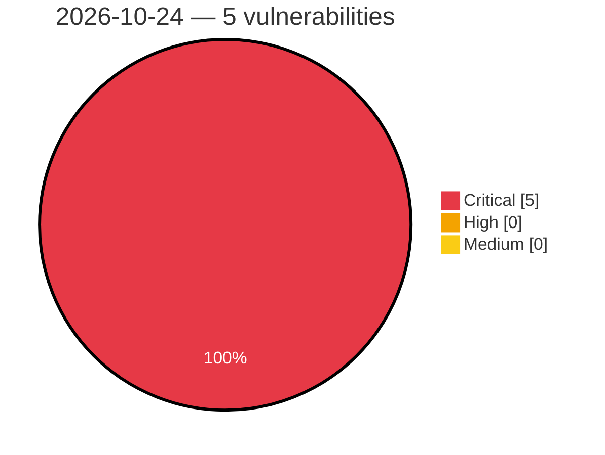

# Critical, High & Medium Severity Vulnerabilities — 2026-10-24

**Source status for this day:**

| Source | Critical | High | Medium | Total |
|--------|---------:|-----:|-------:|------:|
| cvefeed.io (High/Critical) | 5 | 0 | 0 | 5 |

**KEV (actively exploited):** 0  **Watchlist matches:** 5

## Critical (5)

| CVSS | Flags | Source | CVE / Title | Reported |
|------|-------|--------|-------------|----------|
| 9.8 | ⭐ | cvefeed.io (High/Critical) | [CVE-2026-115806 - Prime Mover <= 2.2.1 - Unauthenticated PHP Object Injection via Base64-Encoded Comment during Migration Search-and-Replace](https://cvefeed.io/vuln/detail/CVE-2026-115806) | 29 minutes ago |
| 9.8 | ⭐ | cvefeed.io (High/Critical) | [CVE-2026-114196 - WordPress Paytium plugin <= 5.0.5 - PHP Object Injection vulnerability](https://cvefeed.io/vuln/detail/CVE-2026-114196) | 21 minutes ago |
| 9.8 | ⭐ | cvefeed.io (High/Critical) | [CVE-2026-94075 - WordPress Newsletters plugin <= 4.18.1 - PHP Object Injection vulnerability](https://cvefeed.io/vuln/detail/CVE-2026-94075) | 21 minutes ago |
| 9.3 | ⭐ | cvefeed.io (High/Critical) | [CVE-2026-112866 - WordPress Product Filter by WBW plugin <= 3.4.6 - SQL Injection vulnerability](https://cvefeed.io/vuln/detail/CVE-2026-112866) | 21 minutes ago |
| 9.3 | ⭐ | cvefeed.io (High/Critical) | [CVE-2026-111402 - WordPress Newsletters plugin <= 4.18.1 - SQL Injection vulnerability](https://cvefeed.io/vuln/detail/CVE-2026-111402) | 21 minutes ago |
