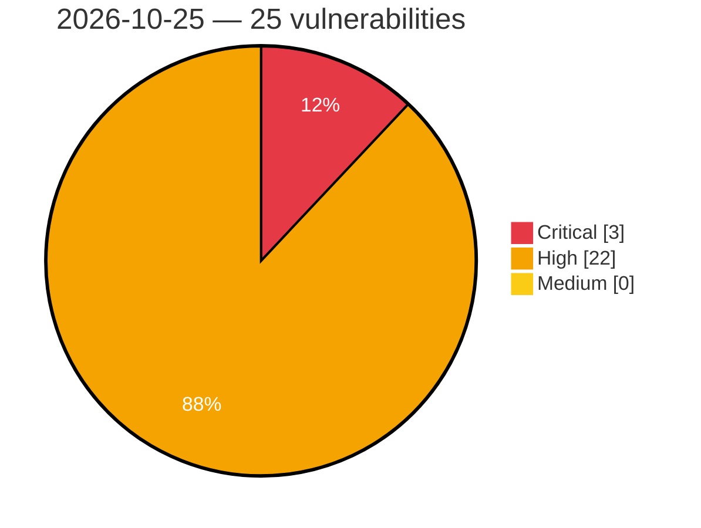

# Critical, High & Medium Severity Vulnerabilities — 2026-10-25

**Source status for this day:**

| Source | Critical | High | Medium | Total |
|--------|---------:|-----:|-------:|------:|
| cvefeed.io (High/Critical) | 3 | 22 | 0 | 25 |

**KEV (actively exploited):** 0  **Watchlist matches:** 18

## Critical (3)

| CVSS | Flags | Source | CVE / Title | Reported |
|------|-------|--------|-------------|----------|
| 9.2 | ⭐ | cvefeed.io (High/Critical) | [CVE-2026-116199 - Snipe-IT before 8.6.3 Authentication Bypass via Google SSO Callback](https://cvefeed.io/vuln/detail/CVE-2026-116199) | 12 minutes ago |
| 9.1 | ⭐ | cvefeed.io (High/Critical) | [CVE-2026-116207 - YesWiki 4.6.0 before 4.7.0 SQL Injection via Bazar Entries Search API](https://cvefeed.io/vuln/detail/CVE-2026-116207) | 12 minutes ago |
| 9.1 | ⭐ | cvefeed.io (High/Critical) | [CVE-2026-116163 - Parse Server 9.0.0 before 9.10.5-alpha.2 Authentication Bypass via AuthAdapter Subclasses](https://cvefeed.io/vuln/detail/CVE-2026-116163) | 12 minutes ago |

## High (22)

| CVSS | Flags | Source | CVE / Title | Reported |
|------|-------|--------|-------------|----------|
| 8.8 | ⭐ | cvefeed.io (High/Critical) | [CVE-2026-116211 - YesWiki 4.5.0 before 4.7.0 SQL Injection via date_maj_fiche in Bazar entry create](https://cvefeed.io/vuln/detail/CVE-2026-116211) | 12 minutes ago |
| 8.8 | ⭐ | cvefeed.io (High/Critical) | [CVE-2026-116201 - Snipe-IT before 8.5.0 SAML Assertion Replay via Race Condition](https://cvefeed.io/vuln/detail/CVE-2026-116201) | 12 minutes ago |
| 8.8 | ⭐ | cvefeed.io (High/Critical) | [CVE-2026-116176 - vLLM 0.9.2 before 0.24.0 SSRF via X-Request-Id in P2pNcclConnector](https://cvefeed.io/vuln/detail/CVE-2026-116176) | 12 minutes ago |
| 8.8 | ⭐ | cvefeed.io (High/Critical) | [CVE-2026-116165 - Parse Server 9.0.0 before 9.10.4-alpha.4 Unauthenticated Class Schema Deletion on MongoDB](https://cvefeed.io/vuln/detail/CVE-2026-116165) | 12 minutes ago |
| 8.8 | ⭐ | cvefeed.io (High/Critical) | [CVE-2026-116068 - Dokploy through 0.30.10 Cross-Organization Authorization Bypass via Application tRPC Router](https://cvefeed.io/vuln/detail/CVE-2026-116068) | 1 hour, 16 minutes ago |
| 8.8 | ⭐ | cvefeed.io (High/Critical) | [CVE-2026-116067 - Paisa before 0.7.8 Path Traversal via Editor and Sheet API](https://cvefeed.io/vuln/detail/CVE-2026-116067) | 1 hour, 16 minutes ago |
| 8.7 | ⭐ | cvefeed.io (High/Critical) | [CVE-2026-116191 - Rclone before 1.75.2 Path Traversal via serve webdav MKCOL](https://cvefeed.io/vuln/detail/CVE-2026-116191) | 12 minutes ago |
| 8.7 | ⭐ | cvefeed.io (High/Critical) | [CVE-2026-116183 - phpMyFAQ before 4.1.10 Authorization Bypass via /api/faq/create openQuestionID](https://cvefeed.io/vuln/detail/CVE-2026-116183) | 12 minutes ago |
| 8.7 | ⭐ | cvefeed.io (High/Critical) | [CVE-2026-116179 - vLLM 0.18.0 before 0.31.0 Memory Exhaustion via media_io_kwargs num_frames Override](https://cvefeed.io/vuln/detail/CVE-2026-116179) | 12 minutes ago |
| 8.7 | ⭐ | cvefeed.io (High/Critical) | [CVE-2026-116177 - vLLM 0.10.2 before 0.25.0 DoS via Nemotron-VL Processor Decompression-Bomb Guard Bypass](https://cvefeed.io/vuln/detail/CVE-2026-116177) | 12 minutes ago |
| 8.7 | ⭐ | cvefeed.io (High/Critical) | [CVE-2026-116171 - SiYuan 3.5.4 before 3.8.7 Sensitive Path Bypass via Windows Extended-Length Prefix](https://cvefeed.io/vuln/detail/CVE-2026-116171) | 12 minutes ago |
| 8.3 | — | cvefeed.io (High/Critical) | [CVE-2026-116180 - vLLM from 0.8.5 before 0.31.0 Cross-Tenant DoS via Uninitialized LogprobsTensors](https://cvefeed.io/vuln/detail/CVE-2026-116180) | 12 minutes ago |
| 8.2 | ⭐ | cvefeed.io (High/Critical) | [CVE-2026-116200 - Snipe-IT before 8.6.3 LDAP StartTLS Downgrade via connectToLdap()](https://cvefeed.io/vuln/detail/CVE-2026-116200) | 12 minutes ago |
| 8.2 | ⭐ | cvefeed.io (High/Critical) | [CVE-2026-116192 - rclone from 1.37 before 1.74.2 SSRF via --rc-serve scheme-relative remote roots](https://cvefeed.io/vuln/detail/CVE-2026-116192) | 12 minutes ago |
| 8.2 | — | cvefeed.io (High/Critical) | [CVE-2026-116178 - vLLM 0.20.0 before 0.30.0 DoS via /inference/v1/generate mm_placeholders](https://cvefeed.io/vuln/detail/CVE-2026-116178) | 12 minutes ago |
| 8.2 | — | cvefeed.io (High/Critical) | [CVE-2026-116174 - vLLM 0.22.0 before 0.24.0 Denial of Service via Rust gRPC Generate](https://cvefeed.io/vuln/detail/CVE-2026-116174) | 12 minutes ago |
| 8.2 | — | cvefeed.io (High/Critical) | [CVE-2026-116173 - vLLM 0.22.0 before 0.24.0 Denial of Service via gRPC output_candidates.token_ids](https://cvefeed.io/vuln/detail/CVE-2026-116173) | 12 minutes ago |
| 8.2 | — | cvefeed.io (High/Critical) | [CVE-2026-116172 - vLLM 0.22.0 before 0.24.0 DoS via Rust gRPC CandidateTokens.top_n](https://cvefeed.io/vuln/detail/CVE-2026-116172) | 12 minutes ago |
| 8.2 | ⭐ | cvefeed.io (High/Critical) | [CVE-2026-116071 - rotki before 1.44.2 Weak Key Derivation for Premium Cloud Backup Encryption](https://cvefeed.io/vuln/detail/CVE-2026-116071) | 1 hour, 16 minutes ago |
| 8.1 | — | cvefeed.io (High/Critical) | [CVE-2026-116208 - YesWiki 4.6.2 before 4.7.0 Missing Authorization in ActivityPub syncActorPosts](https://cvefeed.io/vuln/detail/CVE-2026-116208) | 12 minutes ago |
| 8.1 | ⭐ | cvefeed.io (High/Critical) | [CVE-2026-116204 - YesWiki before 4.7.0 CSRF via despam Admin Action](https://cvefeed.io/vuln/detail/CVE-2026-116204) | 12 minutes ago |
| 8.1 | — | cvefeed.io (High/Critical) | [CVE-2026-116149 - ImageMagick before 6.9.13-58 and 7.x before 7.1.2-33 Stack Buffer Overflow via bzip2 Compressed Images](https://cvefeed.io/vuln/detail/CVE-2026-116149) | 13 minutes ago |
