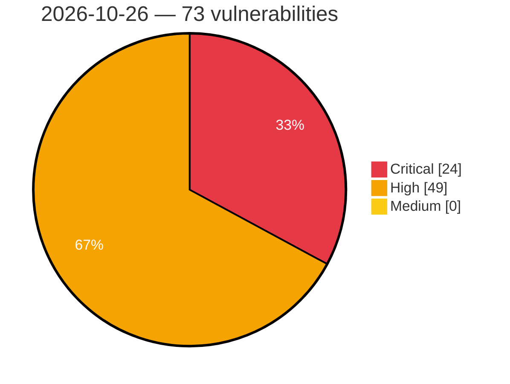

# Critical, High & Medium Severity Vulnerabilities — 2026-10-26

**Source status for this day:**

| Source | Critical | High | Medium | Total |
|--------|---------:|-----:|-------:|------:|
| cvefeed.io (High/Critical) | 24 | 49 | 0 | 73 |

**KEV (actively exploited):** 0  **Watchlist matches:** 35

## Critical (24)

| CVSS | Flags | Source | CVE / Title | Reported |
|------|-------|--------|-------------|----------|
| 10.0 | ⭐ | cvefeed.io (High/Critical) | [CVE-2026-115905 - zip: Critical Parser Differential & Security Control Bypass via Dual-Header Inconsistencies (Zip Cloaking) Leading to Arbitrary File Overwrite & RCE](https://cvefeed.io/vuln/detail/CVE-2026-115905) | 4 hours, 30 minutes ago |
| 10.0 | — | cvefeed.io (High/Critical) | [CVE-2026-116508 - TOTOLINK A950RG Device-Information CGI infostat.cgi sub_402340 stack-based overflow](https://cvefeed.io/vuln/detail/CVE-2026-116508) | 2 hours, 44 minutes ago |
| 9.9 | — | cvefeed.io (High/Critical) | [CVE-2026-116232 - Oray Pugongying X5 Pro SNMP snmp_set crlf injection](https://cvefeed.io/vuln/detail/CVE-2026-116232) | 2 hours, 5 minutes ago |
| 9.9 | — | cvefeed.io (High/Critical) | [CVE-2026-116231 - Oray Pugongying X5 Pro Ser2net crlf injection](https://cvefeed.io/vuln/detail/CVE-2026-116231) | 2 hours, 5 minutes ago |
| 9.9 | ⭐ | cvefeed.io (High/Critical) | [CVE-2026-115188 - Mautic Unrestricted File Upload Remote Code Execution](https://cvefeed.io/vuln/detail/CVE-2026-115188) | 1 hour, 21 minutes ago |
| 9.9 | ⭐ | cvefeed.io (High/Critical) | [CVE-2026-116506 - TOTOLINK A950RG firewall.so apmib_set command injection](https://cvefeed.io/vuln/detail/CVE-2026-116506) | 29 minutes ago |
| 9.9 | ⭐ | cvefeed.io (High/Critical) | [CVE-2026-116504 - TOTOLINK A950RG Cloud Upgrade upgrade.so setCloudUpgradeFW command injection](https://cvefeed.io/vuln/detail/CVE-2026-116504) | 29 minutes ago |
| 9.9 | ⭐ | cvefeed.io (High/Critical) | [CVE-2026-110720 - Consul-k8s vulnerable to a cross-namespace authorization bypass in component ACL binding rules](https://cvefeed.io/vuln/detail/CVE-2026-110720) | 2 hours, 31 minutes ago |
| 9.9 | ⭐ | cvefeed.io (High/Critical) | [CVE-2026-102649 - Burrito: Unauthenticated webhooks trigger unauthorized Terraform plans when webhookSecret is unset](https://cvefeed.io/vuln/detail/CVE-2026-102649) | 3 hours, 30 minutes ago |
| 9.8 | ⭐ | cvefeed.io (High/Critical) | [CVE-2026-65184 - Avocent ACS8000 wsserver command injection](https://cvefeed.io/vuln/detail/CVE-2026-65184) | 21 minutes ago |
| 9.8 | — | cvefeed.io (High/Critical) | [CVE-2026-59107 - Shared SSH Authentication Key in vSolution Matrix File Sharing](https://cvefeed.io/vuln/detail/CVE-2026-59107) | 1 hour, 21 minutes ago |
| 9.8 | ⭐ | cvefeed.io (High/Critical) | [CVE-2026-59106 - Unauthenticated RCE Vulnerability in WolfProt interface implementation](https://cvefeed.io/vuln/detail/CVE-2026-59106) | 1 hour, 21 minutes ago |
| 9.8 | ⭐ | cvefeed.io (High/Critical) | [CVE-2026-116485 - danmu_api before 1.21.7 Authentication Bypass via Default Token in Env Endpoints](https://cvefeed.io/vuln/detail/CVE-2026-116485) | 1 hour, 21 minutes ago |
| 9.8 | ⭐ | cvefeed.io (High/Critical) | [CVE-2026-10757 - BUG-000187511 - ArcGIS Server has a security vulnerability.](https://cvefeed.io/vuln/detail/CVE-2026-10757) | 3 hours, 30 minutes ago |
| 9.8 | ⭐ | cvefeed.io (High/Critical) | [CVE-2026-112346 - OpenHands Software Agent SDK < 1.52.0 Unauthenticated Sandbox Agent Server RCE](https://cvefeed.io/vuln/detail/CVE-2026-112346) | 5 hours, 30 minutes ago |
| 9.3 | ⭐ | cvefeed.io (High/Critical) | [CVE-2026-93328 - Missing Authorization in MCP Toolbox for Databases allows Arbitrary File Read and Write](https://cvefeed.io/vuln/detail/CVE-2026-93328) | 21 minutes ago |
| 9.3 | ⭐ | cvefeed.io (High/Critical) | [CVE-2026-77055 - Improper Privilege Assignment in boneIO](https://cvefeed.io/vuln/detail/CVE-2026-77055) | 21 minutes ago |
| 9.3 | ⭐ | cvefeed.io (High/Critical) | [CVE-2026-116214 - MacCMS v10 before 2026.1000.4054 Account Takeover via Unbound Password Recovery Code](https://cvefeed.io/vuln/detail/CVE-2026-116214) | 1 hour, 21 minutes ago |
| 9.2 | ⭐ | cvefeed.io (High/Critical) | [CVE-2026-116747 - Kener 3.0.0 before 4.1.10 Authentication Bypass via Hardcoded Fallback JWT Secret](https://cvefeed.io/vuln/detail/CVE-2026-116747) | 2 hours, 44 minutes ago |
| 9.1 | — | cvefeed.io (High/Critical) | [CVE-2026-116235 - Oray Pugongying X5 Pro L2TP Authentication crlf injection](https://cvefeed.io/vuln/detail/CVE-2026-116235) | 1 hour, 5 minutes ago |
| 9.1 | — | cvefeed.io (High/Critical) | [CVE-2026-116234 - Oray Pugongying X5 Pro IPsec Policy ipsec.conf crlf injection](https://cvefeed.io/vuln/detail/CVE-2026-116234) | 1 hour, 5 minutes ago |
| 9.1 | — | cvefeed.io (High/Critical) | [CVE-2026-116233 - Oray Pugongying X5 Pro Dnsmasq crlf injection](https://cvefeed.io/vuln/detail/CVE-2026-116233) | 1 hour, 5 minutes ago |
| 9.1 | — | cvefeed.io (High/Critical) | [CVE-2026-115693 - Custom cacerts or cacertfile do not restrict trust to the pinned CA in hackney](https://cvefeed.io/vuln/detail/CVE-2026-115693) | 1 hour, 21 minutes ago |
| 9.1 | ⭐ | cvefeed.io (High/Critical) | [CVE-2026-116505 - TOTOLINK A950RG device-information udhcpd.leases getDeviceInfo command injection](https://cvefeed.io/vuln/detail/CVE-2026-116505) | 29 minutes ago |

## High (49)

| CVSS | Flags | Source | CVE / Title | Reported |
|------|-------|--------|-------------|----------|
| 8.8 | — | cvefeed.io (High/Critical) | [CVE-2026-82944 - Buffer Overflow in CoE SDO Upload Multi-Segment Data Transfers](https://cvefeed.io/vuln/detail/CVE-2026-82944) | 1 hour, 5 minutes ago |
| 8.8 | ⭐ | cvefeed.io (High/Critical) | [CVE-2026-111841 - WordPress FunnelKit Automations plugin <= 3.8.5.2 - Cross Site Request Forgery (CSRF) vulnerability](https://cvefeed.io/vuln/detail/CVE-2026-111841) | 1 hour, 5 minutes ago |
| 8.8 | ⭐ | cvefeed.io (High/Critical) | [CVE-2026-77059 - TOCTOU Race Condition in boneIO](https://cvefeed.io/vuln/detail/CVE-2026-77059) | 21 minutes ago |
| 8.8 | — | cvefeed.io (High/Critical) | [CVE-2026-115748 - Apache Vysper: Authorization bypass](https://cvefeed.io/vuln/detail/CVE-2026-115748) | 36 minutes ago |
| 8.8 | ⭐ | cvefeed.io (High/Critical) | [CVE-2026-115189 - Mautic Server-Side Template Injection Vulnerability](https://cvefeed.io/vuln/detail/CVE-2026-115189) | 1 hour, 21 minutes ago |
| 8.8 | — | cvefeed.io (High/Critical) | [CVE-2026-113947 - Apple macOS Archive Processing Arbitrary Code Execution](https://cvefeed.io/vuln/detail/CVE-2026-113947) | 29 minutes ago |
| 8.8 | — | cvefeed.io (High/Critical) | [CVE-2026-105608 - Consul vulnerable to an authorization bypass in service mesh registration](https://cvefeed.io/vuln/detail/CVE-2026-105608) | 3 hours, 30 minutes ago |
| 8.8 | ⭐ | cvefeed.io (High/Critical) | [CVE-2026-116748 - Transmission 4.0.0 before 4.1.3 Permissive CORS Leaks RPC Anti-CSRF Token](https://cvefeed.io/vuln/detail/CVE-2026-116748) | 2 hours, 44 minutes ago |
| 8.8 | — | cvefeed.io (High/Critical) | [CVE-2026-116738 - VMime through 0.9.2 Stack-Based Buffer Overflow via uuencode Decoder](https://cvefeed.io/vuln/detail/CVE-2026-116738) | 2 hours, 44 minutes ago |
| 8.8 | — | cvefeed.io (High/Critical) | [CVE-2026-86929 - Apple macOS Out-of-Bounds Write Vulnerability](https://cvefeed.io/vuln/detail/CVE-2026-86929) | 3 hours, 41 minutes ago |
| 8.8 | — | cvefeed.io (High/Critical) | [CVE-2026-64759 - Apple Image Processing Integer Overflow Vulnerability](https://cvefeed.io/vuln/detail/CVE-2026-64759) | 3 hours, 42 minutes ago |
| 8.8 | — | cvefeed.io (High/Critical) | [CVE-2026-112688 - Apple iOS, iPadOS, and macOS Memory Corruption Vulnerability](https://cvefeed.io/vuln/detail/CVE-2026-112688) | 3 hours, 43 minutes ago |
| 8.7 | ⭐ | cvefeed.io (High/Critical) | [CVE-2026-77053 - Missing Authentication in Default Configuration in boneIO](https://cvefeed.io/vuln/detail/CVE-2026-77053) | 21 minutes ago |
| 8.7 | ⭐ | cvefeed.io (High/Critical) | [CVE-2026-77052 - Missing Authentication for Node-RED in boneIO](https://cvefeed.io/vuln/detail/CVE-2026-77052) | 21 minutes ago |
| 8.7 | — | cvefeed.io (High/Critical) | [CVE-2026-116543 - Open5GS 1.3.0 through 2.8.0 Heap Out-of-Bounds Write via SBI Multipart Parser](https://cvefeed.io/vuln/detail/CVE-2026-116543) | 38 minutes ago |
| 8.7 | ⭐ | cvefeed.io (High/Critical) | [CVE-2026-115269 - HTTP/2 WINDOW_UPDATE and SETTINGS frames reset the request body read timeout in Bandit](https://cvefeed.io/vuln/detail/CVE-2026-115269) | 1 hour, 21 minutes ago |
| 8.7 | ⭐ | cvefeed.io (High/Critical) | [CVE-2026-114213 - WebSocket 1-byte continuation frames bypass `max_fragmented_message_size` in Bandit](https://cvefeed.io/vuln/detail/CVE-2026-114213) | 1 hour, 21 minutes ago |
| 8.7 | — | cvefeed.io (High/Critical) | [CVE-2026-116591 - compress zstd: Panic on two-block frames](https://cvefeed.io/vuln/detail/CVE-2026-116591) | 2 hours, 44 minutes ago |
| 8.7 | — | cvefeed.io (High/Critical) | [CVE-2026-116588 - Datadog dd-trace-py: ReDOS in URL query string obfuscation](https://cvefeed.io/vuln/detail/CVE-2026-116588) | 2 hours, 44 minutes ago |
| 8.6 | ⭐ | cvefeed.io (High/Critical) | [CVE-2026-112345 - TTLock Android App < 9.8.260718 Hardcoded BLE Pairing Key Exposure](https://cvefeed.io/vuln/detail/CVE-2026-112345) | 21 minutes ago |
| 8.6 | ⭐ | cvefeed.io (High/Critical) | [CVE-2026-116219 - Dolibarr ERP CRM before 24.0.0 OS Command Injection via mysqldump Parameter](https://cvefeed.io/vuln/detail/CVE-2026-116219) | 1 hour, 21 minutes ago |
| 8.6 | ⭐ | cvefeed.io (High/Critical) | [CVE-2026-115924 - Rembg: Unauthenticated SAM model injection permits local-file disclosure through malicious ONNX graphs](https://cvefeed.io/vuln/detail/CVE-2026-115924) | 1 hour, 30 minutes ago |
| 8.6 | ⭐ | cvefeed.io (High/Critical) | [CVE-2026-112343 - Syncplify Server! < 8.8.0 Permission Override Bypass via Path Casing](https://cvefeed.io/vuln/detail/CVE-2026-112343) | 5 hours, 30 minutes ago |
| 8.5 | ⭐ | cvefeed.io (High/Critical) | [CVE-2026-113345 - Electronic delivery item Inspection Support System Improper File Access Control Vulnerability](https://cvefeed.io/vuln/detail/CVE-2026-113345) | 16 minutes ago |
| 8.5 | — | cvefeed.io (High/Critical) | [CVE-2026-71456 - Johnson Controls Kantech Entrapass Hard-coded Cryptographic Key Vulnerability](https://cvefeed.io/vuln/detail/CVE-2026-71456) | 4 hours, 30 minutes ago |
| 8.5 | — | cvefeed.io (High/Critical) | [CVE-2026-116724 - FLTK through 1.4.5 Heap Buffer Overflow via Fl_BMP_Image Integer Overflow](https://cvefeed.io/vuln/detail/CVE-2026-116724) | 2 hours, 44 minutes ago |
| 8.5 | — | cvefeed.io (High/Critical) | [CVE-2026-116723 - FLTK through 1.4.5 Stack Buffer Overflow via Fl_BMP_Image colors_used Field](https://cvefeed.io/vuln/detail/CVE-2026-116723) | 2 hours, 44 minutes ago |
| 8.4 | — | cvefeed.io (High/Critical) | [CVE-2026-116116 - Yoosee GM8135S Camera Secure Boot signature verification](https://cvefeed.io/vuln/detail/CVE-2026-116116) | 42 minutes ago |
| 8.4 | — | cvefeed.io (High/Critical) | [CVE-2026-107900 - Fuji Electric V-SFT Out-of-Bounds Read Vulnerability](https://cvefeed.io/vuln/detail/CVE-2026-107900) | 3 hours, 5 minutes ago |
| 8.4 | — | cvefeed.io (High/Critical) | [CVE-2026-107899 - Fuji Electric V-SFT Out-of-Bounds Read Vulnerability](https://cvefeed.io/vuln/detail/CVE-2026-107899) | 3 hours, 5 minutes ago |
| 8.4 | — | cvefeed.io (High/Critical) | [CVE-2026-107898 - Fuji Electric V-SFT Out-of-Bounds Read Vulnerability](https://cvefeed.io/vuln/detail/CVE-2026-107898) | 3 hours, 5 minutes ago |
| 8.4 | — | cvefeed.io (High/Critical) | [CVE-2026-107897 - Fuji Electric V-SFT Out-of-Bounds Read Vulnerability](https://cvefeed.io/vuln/detail/CVE-2026-107897) | 3 hours, 5 minutes ago |
| 8.4 | — | cvefeed.io (High/Critical) | [CVE-2026-107896 - Fuji Electric V-SFT Out-of-Bounds Read Vulnerability](https://cvefeed.io/vuln/detail/CVE-2026-107896) | 3 hours, 5 minutes ago |
| 8.4 | — | cvefeed.io (High/Critical) | [CVE-2026-107895 - Fuji Electric V-SFT Out-of-Bounds Write Vulnerability](https://cvefeed.io/vuln/detail/CVE-2026-107895) | 3 hours, 5 minutes ago |
| 8.4 | — | cvefeed.io (High/Critical) | [CVE-2026-107894 - FUJI ELECTRIC V-SFT Stack-Based Buffer Overflow](https://cvefeed.io/vuln/detail/CVE-2026-107894) | 3 hours, 5 minutes ago |
| 8.4 | ⭐ | cvefeed.io (High/Critical) | [CVE-2026-65327 - Apple macOS Privilege Escalation Vulnerability](https://cvefeed.io/vuln/detail/CVE-2026-65327) | 3 hours, 42 minutes ago |
| 8.3 | — | cvefeed.io (High/Critical) | [CVE-2026-70388 - Memory Corruption via Integer Underflow in Message Length Validation](https://cvefeed.io/vuln/detail/CVE-2026-70388) | 1 hour, 5 minutes ago |
| 8.3 | — | cvefeed.io (High/Critical) | [CVE-2026-116236 - Oray Pugongying X5 Pro PPPoE WAN Setting upload_files plugin_init unrestricted upload](https://cvefeed.io/vuln/detail/CVE-2026-116236) | 1 hour, 5 minutes ago |
| 8.3 | — | cvefeed.io (High/Critical) | [CVE-2026-116741 - Speex through 1.2.1 Out-of-Bounds Write via speex_bits_read_whole_bytes](https://cvefeed.io/vuln/detail/CVE-2026-116741) | 2 hours, 44 minutes ago |
| 8.2 | — | cvefeed.io (High/Critical) | [CVE-2026-116541 - netty-tcnative before 2.0.84.Final Denial of Service via BIO Write Overcount](https://cvefeed.io/vuln/detail/CVE-2026-116541) | 38 minutes ago |
| 8.2 | — | cvefeed.io (High/Critical) | [CVE-2026-116540 - netty-tcnative 2.0.66.Final before 2.0.84.Final Use-After-Free in Session Ticket Callback](https://cvefeed.io/vuln/detail/CVE-2026-116540) | 38 minutes ago |
| 8.2 | — | cvefeed.io (High/Critical) | [CVE-2026-116539 - Netty netty-tcnative before 2.0.84.Final Heap Buffer Overflow via OpenSSL BIO](https://cvefeed.io/vuln/detail/CVE-2026-116539) | 38 minutes ago |
| 8.2 | ⭐ | cvefeed.io (High/Critical) | [CVE-2026-97200 - Unbounded response body buffering and decompression in hackney](https://cvefeed.io/vuln/detail/CVE-2026-97200) | 1 hour, 21 minutes ago |
| 8.2 | ⭐ | cvefeed.io (High/Critical) | [CVE-2026-115193 - Mautic Stored Cross-Site Scripting](https://cvefeed.io/vuln/detail/CVE-2026-115193) | 1 hour, 21 minutes ago |
| 8.2 | — | cvefeed.io (High/Critical) | [CVE-2026-72753 - Routinator incorrectly handles delta updates](https://cvefeed.io/vuln/detail/CVE-2026-72753) | 3 hours, 29 minutes ago |
| 8.2 | ⭐ | cvefeed.io (High/Critical) | [CVE-2026-116634 - OmniRoute 3.8.50 before 3.8.52 Missing Authentication via /api/sync/tokens](https://cvefeed.io/vuln/detail/CVE-2026-116634) | 3 hours, 30 minutes ago |
| 8.2 | — | cvefeed.io (High/Critical) | [CVE-2026-116589 - Datadog dd-trace-py: IAST instrumentation can lead to application DOS](https://cvefeed.io/vuln/detail/CVE-2026-116589) | 2 hours, 44 minutes ago |
| 8.1 | ⭐ | cvefeed.io (High/Critical) | [CVE-2026-115915 - vLLM: Untrusted EPS inputs can trigger denial of service or Ghostscript RCE](https://cvefeed.io/vuln/detail/CVE-2026-115915) | 3 hours, 30 minutes ago |
| 8.0 | ⭐ | cvefeed.io (High/Critical) | [CVE-2026-115190 - Mautic Insecure Deserialization Vulnerability](https://cvefeed.io/vuln/detail/CVE-2026-115190) | 1 hour, 21 minutes ago |
