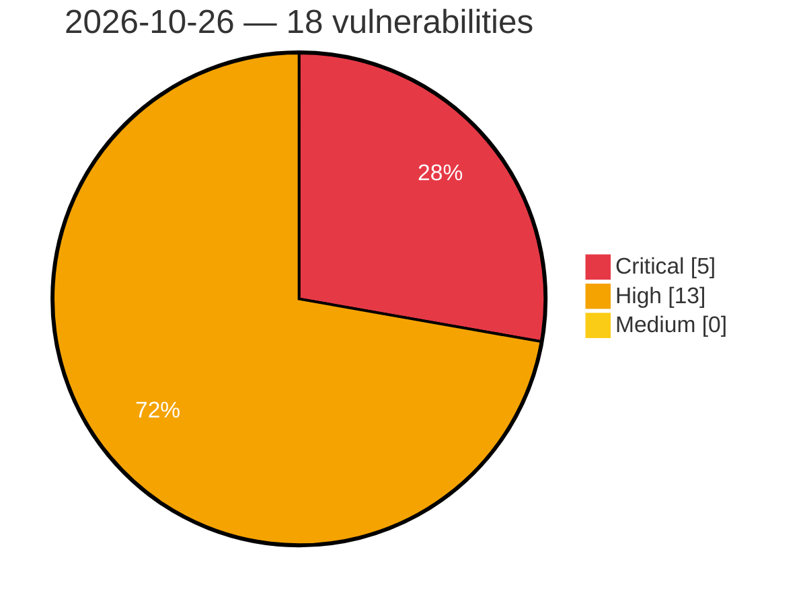

# Critical, High & Medium Severity Vulnerabilities — 2026-10-26

**Source status for this day:**

| Source | Critical | High | Medium | Total |
|--------|---------:|-----:|-------:|------:|
| cvefeed.io (High/Critical) | 5 | 13 | 0 | 18 |

**KEV (actively exploited):** 0  **Watchlist matches:** 2

## Critical (5)

| CVSS | Flags | Source | CVE / Title | Reported |
|------|-------|--------|-------------|----------|
| 9.9 | — | cvefeed.io (High/Critical) | [CVE-2026-116232 - Oray Pugongying X5 Pro SNMP snmp_set crlf injection](https://cvefeed.io/vuln/detail/CVE-2026-116232) | 2 hours, 5 minutes ago |
| 9.9 | — | cvefeed.io (High/Critical) | [CVE-2026-116231 - Oray Pugongying X5 Pro Ser2net crlf injection](https://cvefeed.io/vuln/detail/CVE-2026-116231) | 2 hours, 5 minutes ago |
| 9.1 | — | cvefeed.io (High/Critical) | [CVE-2026-116235 - Oray Pugongying X5 Pro L2TP Authentication crlf injection](https://cvefeed.io/vuln/detail/CVE-2026-116235) | 1 hour, 5 minutes ago |
| 9.1 | — | cvefeed.io (High/Critical) | [CVE-2026-116234 - Oray Pugongying X5 Pro IPsec Policy ipsec.conf crlf injection](https://cvefeed.io/vuln/detail/CVE-2026-116234) | 1 hour, 5 minutes ago |
| 9.1 | — | cvefeed.io (High/Critical) | [CVE-2026-116233 - Oray Pugongying X5 Pro Dnsmasq crlf injection](https://cvefeed.io/vuln/detail/CVE-2026-116233) | 1 hour, 5 minutes ago |

## High (13)

| CVSS | Flags | Source | CVE / Title | Reported |
|------|-------|--------|-------------|----------|
| 8.8 | — | cvefeed.io (High/Critical) | [CVE-2026-82944 - Buffer Overflow in CoE SDO Upload Multi-Segment Data Transfers](https://cvefeed.io/vuln/detail/CVE-2026-82944) | 1 hour, 5 minutes ago |
| 8.8 | ⭐ | cvefeed.io (High/Critical) | [CVE-2026-111841 - WordPress FunnelKit Automations plugin <= 3.8.5.2 - Cross Site Request Forgery (CSRF) vulnerability](https://cvefeed.io/vuln/detail/CVE-2026-111841) | 1 hour, 5 minutes ago |
| 8.5 | ⭐ | cvefeed.io (High/Critical) | [CVE-2026-113345 - Electronic delivery item Inspection Support System Improper File Access Control Vulnerability](https://cvefeed.io/vuln/detail/CVE-2026-113345) | 16 minutes ago |
| 8.4 | — | cvefeed.io (High/Critical) | [CVE-2026-116116 - Yoosee GM8135S Camera Secure Boot signature verification](https://cvefeed.io/vuln/detail/CVE-2026-116116) | 42 minutes ago |
| 8.4 | — | cvefeed.io (High/Critical) | [CVE-2026-107900 - Fuji Electric V-SFT Out-of-Bounds Read Vulnerability](https://cvefeed.io/vuln/detail/CVE-2026-107900) | 3 hours, 5 minutes ago |
| 8.4 | — | cvefeed.io (High/Critical) | [CVE-2026-107899 - Fuji Electric V-SFT Out-of-Bounds Read Vulnerability](https://cvefeed.io/vuln/detail/CVE-2026-107899) | 3 hours, 5 minutes ago |
| 8.4 | — | cvefeed.io (High/Critical) | [CVE-2026-107898 - Fuji Electric V-SFT Out-of-Bounds Read Vulnerability](https://cvefeed.io/vuln/detail/CVE-2026-107898) | 3 hours, 5 minutes ago |
| 8.4 | — | cvefeed.io (High/Critical) | [CVE-2026-107897 - Fuji Electric V-SFT Out-of-Bounds Read Vulnerability](https://cvefeed.io/vuln/detail/CVE-2026-107897) | 3 hours, 5 minutes ago |
| 8.4 | — | cvefeed.io (High/Critical) | [CVE-2026-107896 - Fuji Electric V-SFT Out-of-Bounds Read Vulnerability](https://cvefeed.io/vuln/detail/CVE-2026-107896) | 3 hours, 5 minutes ago |
| 8.4 | — | cvefeed.io (High/Critical) | [CVE-2026-107895 - Fuji Electric V-SFT Out-of-Bounds Write Vulnerability](https://cvefeed.io/vuln/detail/CVE-2026-107895) | 3 hours, 5 minutes ago |
| 8.4 | — | cvefeed.io (High/Critical) | [CVE-2026-107894 - FUJI ELECTRIC V-SFT Stack-Based Buffer Overflow](https://cvefeed.io/vuln/detail/CVE-2026-107894) | 3 hours, 5 minutes ago |
| 8.3 | — | cvefeed.io (High/Critical) | [CVE-2026-70388 - Memory Corruption via Integer Underflow in Message Length Validation](https://cvefeed.io/vuln/detail/CVE-2026-70388) | 1 hour, 5 minutes ago |
| 8.3 | — | cvefeed.io (High/Critical) | [CVE-2026-116236 - Oray Pugongying X5 Pro PPPoE WAN Setting upload_files plugin_init unrestricted upload](https://cvefeed.io/vuln/detail/CVE-2026-116236) | 1 hour, 5 minutes ago |
