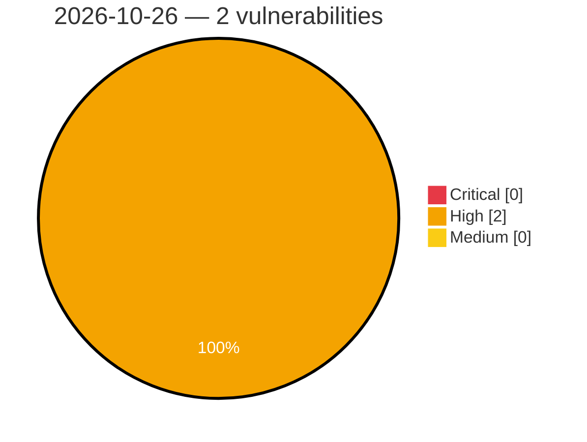

# Critical, High & Medium Severity Vulnerabilities — 2026-10-26

**Source status for this day:**

| Source | Critical | High | Medium | Total |
|--------|---------:|-----:|-------:|------:|
| cvefeed.io (High/Critical) | 0 | 2 | 0 | 2 |

**KEV (actively exploited):** 0  **Watchlist matches:** 1

## High (2)

| CVSS | Flags | Source | CVE / Title | Reported |
|------|-------|--------|-------------|----------|
| 8.5 | ⭐ | cvefeed.io (High/Critical) | [CVE-2026-113345 - Electronic delivery item Inspection Support System Improper File Access Control Vulnerability](https://cvefeed.io/vuln/detail/CVE-2026-113345) | 16 minutes ago |
| 8.4 | — | cvefeed.io (High/Critical) | [CVE-2026-116116 - Yoosee GM8135S Camera Secure Boot signature verification](https://cvefeed.io/vuln/detail/CVE-2026-116116) | 42 minutes ago |
