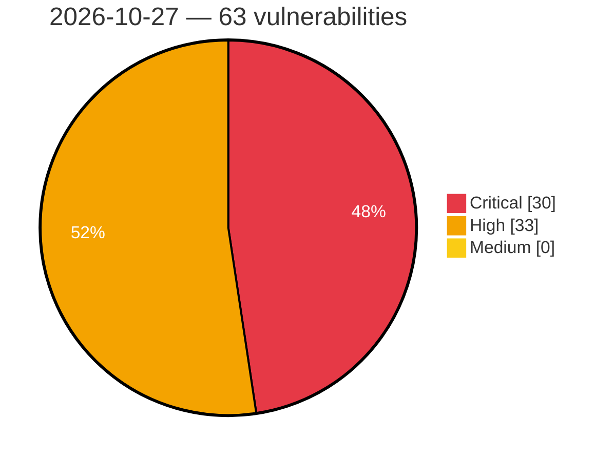

# Critical, High & Medium Severity Vulnerabilities — 2026-10-27

**Source status for this day:**

| Source | Critical | High | Medium | Total |
|--------|---------:|-----:|-------:|------:|
| cvefeed.io (High/Critical) | 30 | 33 | 0 | 63 |

**KEV (actively exploited):** 0  **Watchlist matches:** 37

## Critical (30)

| CVSS | Flags | Source | CVE / Title | Reported |
|------|-------|--------|-------------|----------|
| 10.0 | ⭐ | cvefeed.io (High/Critical) | [CVE-2026-105781 - Adobe Campaign Classic (ACC) \| Improper Neutralization of Special Elements used in an SQL Command ('SQL Injection') (CWE-89)](https://cvefeed.io/vuln/detail/CVE-2026-105781) | 16 minutes ago |
| 9.9 | — | cvefeed.io (High/Critical) | [CVE-2026-105780 - Adobe Campaign Classic (ACC) \| Incorrect Authorization (CWE-863)](https://cvefeed.io/vuln/detail/CVE-2026-105780) | 16 minutes ago |
| 9.9 | ⭐ | cvefeed.io (High/Critical) | [CVE-2026-105489 - Adobe Campaign Classic (ACC) \| Improper Neutralization of Special Elements used in an SQL Command ('SQL Injection') (CWE-89)](https://cvefeed.io/vuln/detail/CVE-2026-105489) | 16 minutes ago |
| 9.9 | ⭐ | cvefeed.io (High/Critical) | [CVE-2026-104353 - Adobe Campaign Classic (ACC) \| Improper Neutralization of Special Elements used in an OS Command ('OS Command Injection') (CWE-78)](https://cvefeed.io/vuln/detail/CVE-2026-104353) | 16 minutes ago |
| 9.9 | — | cvefeed.io (High/Critical) | [CVE-2026-104351 - Adobe Campaign Classic (ACC) \| Improper Control of Generation of Code ('Code Injection') (CWE-94)](https://cvefeed.io/vuln/detail/CVE-2026-104351) | 16 minutes ago |
| 9.8 | ⭐ | cvefeed.io (High/Critical) | [CVE-2026-117532 - REDAXO Core 5.3.0 before 5.21.4 Authentication Bypass via History Plugin](https://cvefeed.io/vuln/detail/CVE-2026-117532) | 1 hour, 14 minutes ago |
| 9.8 | — | cvefeed.io (High/Critical) | [CVE-2026-86574 - Heap-based Buffer Overflow Vulnerability in JP1/Base](https://cvefeed.io/vuln/detail/CVE-2026-86574) | 2 hours, 15 minutes ago |
| 9.8 | — | cvefeed.io (High/Critical) | [CVE-2026-82120 - Heap-based Buffer Overflow Vulnerability in HiRDB](https://cvefeed.io/vuln/detail/CVE-2026-82120) | 2 hours, 15 minutes ago |
| 9.8 | ⭐ | cvefeed.io (High/Critical) | [CVE-2026-82119 - OS Command Injection Vulnerability in HiRDB](https://cvefeed.io/vuln/detail/CVE-2026-82119) | 2 hours, 15 minutes ago |
| 9.8 | — | cvefeed.io (High/Critical) | [CVE-2026-82118 - Stack-based Buffer Overflow Vulnerability in HiRDB](https://cvefeed.io/vuln/detail/CVE-2026-82118) | 2 hours, 15 minutes ago |
| 9.8 | ⭐ | cvefeed.io (High/Critical) | [CVE-2026-82117 - Authentication Bypass by Spoofing Vulnerability in HiRDB](https://cvefeed.io/vuln/detail/CVE-2026-82117) | 2 hours, 15 minutes ago |
| 9.8 | — | cvefeed.io (High/Critical) | [CVE-2026-82116 - Missing Authentication for Critical Function Vulnerability in HiRDB](https://cvefeed.io/vuln/detail/CVE-2026-82116) | 2 hours, 15 minutes ago |
| 9.8 | ⭐ | cvefeed.io (High/Critical) | [CVE-2026-114595 - Integer overflow or wraparound in EPICS Base](https://cvefeed.io/vuln/detail/CVE-2026-114595) | 16 minutes ago |
| 9.6 | — | cvefeed.io (High/Critical) | [CVE-2026-48360 - Adobe Connect \| Improper Control of Generation of Code ('Code Injection') (CWE-94)](https://cvefeed.io/vuln/detail/CVE-2026-48360) | 16 minutes ago |
| 9.4 | — | cvefeed.io (High/Critical) | [CVE-2026-86577 - Out-of-bounds Write Vulnerability in JP1 Products](https://cvefeed.io/vuln/detail/CVE-2026-86577) | 2 hours, 15 minutes ago |
| 9.4 | — | cvefeed.io (High/Critical) | [CVE-2026-86576 - Heap-based Buffer Overflow Vulnerability in JP1 Products](https://cvefeed.io/vuln/detail/CVE-2026-86576) | 2 hours, 15 minutes ago |
| 9.4 | — | cvefeed.io (High/Critical) | [CVE-2026-86575 - Stack-based Buffer Overflow Vulnerability in JP1 Products](https://cvefeed.io/vuln/detail/CVE-2026-86575) | 2 hours, 15 minutes ago |
| 9.4 | — | cvefeed.io (High/Critical) | [CVE-2026-82122 - Stack-based Buffer Overflow Vulnerability in HiRDB](https://cvefeed.io/vuln/detail/CVE-2026-82122) | 2 hours, 15 minutes ago |
| 9.3 | ⭐ | cvefeed.io (High/Critical) | [CVE-2026-104350 - Adobe Campaign Classic (ACC) \| Cross-site Scripting (Reflected XSS) (CWE-79)](https://cvefeed.io/vuln/detail/CVE-2026-104350) | 16 minutes ago |
| 9.2 | — | cvefeed.io (High/Critical) | [CVE-2026-93866 - Fireware OS Pre-Authentication Integer Overflow in Access Portal Allows Out-of-Bounds Write](https://cvefeed.io/vuln/detail/CVE-2026-93866) | 1 hour, 15 minutes ago |
| 9.2 | — | cvefeed.io (High/Critical) | [CVE-2026-93865 - Fireware OS Missing Authentication in FireCluster Sync Daemon Allows Remote Root Action Injection](https://cvefeed.io/vuln/detail/CVE-2026-93865) | 1 hour, 15 minutes ago |
| 9.2 | ⭐ | cvefeed.io (High/Critical) | [CVE-2026-93857 - Fireware OS Pre-Authentication Stack Buffer Overflow in SIP Proxy Allows Remote Code Execution](https://cvefeed.io/vuln/detail/CVE-2026-93857) | 1 hour, 15 minutes ago |
| 9.1 | ⭐ | cvefeed.io (High/Critical) | [CVE-2026-115216 - Eclipse ioFog Operator disables TLS certificate verification when sending Controller and OIDC credentials](https://cvefeed.io/vuln/detail/CVE-2026-115216) | 14 minutes ago |
| 9.1 | ⭐ | cvefeed.io (High/Critical) | [CVE-2026-112362 - @fastify/express vulnerable to path-scoped middleware bypass via absolute-form request targets](https://cvefeed.io/vuln/detail/CVE-2026-112362) | 14 minutes ago |
| 9.1 | — | cvefeed.io (High/Critical) | [CVE-2026-108142 - CDP Coordinator Service Authorization Bypass](https://cvefeed.io/vuln/detail/CVE-2026-108142) | 16 minutes ago |
| 9.1 | ⭐ | cvefeed.io (High/Critical) | [CVE-2026-108015 - eMudhra Compromised Certficate vulnerability impacts HCL Notes Client](https://cvefeed.io/vuln/detail/CVE-2026-108015) | 16 minutes ago |
| 9.1 | ⭐ | cvefeed.io (High/Critical) | [CVE-2026-108014 - eMudhra Compromised Certficate vulnerability impacts HCL Domino Server](https://cvefeed.io/vuln/detail/CVE-2026-108014) | 16 minutes ago |
| 9.1 | ⭐ | cvefeed.io (High/Critical) | [CVE-2026-105779 - Adobe Campaign Classic (ACC) \| Improper Neutralization of Special Elements used in an SQL Command ('SQL Injection') (CWE-89)](https://cvefeed.io/vuln/detail/CVE-2026-105779) | 16 minutes ago |
| 9.1 | ⭐ | cvefeed.io (High/Critical) | [CVE-2026-104354 - Adobe Campaign Classic (ACC) \| Improper Neutralization of Special Elements used in an SQL Command ('SQL Injection') (CWE-89)](https://cvefeed.io/vuln/detail/CVE-2026-104354) | 16 minutes ago |
| 9.0 | ⭐ | cvefeed.io (High/Critical) | [CVE-2026-106076 - Veeam Backup for Microsoft 365 SQL Injection Vulnerability](https://cvefeed.io/vuln/detail/CVE-2026-106076) | 16 minutes ago |

## High (33)

| CVSS | Flags | Source | CVE / Title | Reported |
|------|-------|--------|-------------|----------|
| 8.8 | ⭐ | cvefeed.io (High/Critical) | [CVE-2026-116818 - OpenPanel before 3.0.0 Unauthenticated ClickHouse SQL Injection via /live/visitors WebSocket](https://cvefeed.io/vuln/detail/CVE-2026-116818) | 44 minutes ago |
| 8.8 | ⭐ | cvefeed.io (High/Critical) | [CVE-2026-116811 - OpenPanel before 3.0.0 Sandbox Escape RCE via Webhook JavaScript Template](https://cvefeed.io/vuln/detail/CVE-2026-116811) | 44 minutes ago |
| 8.8 | ⭐ | cvefeed.io (High/Critical) | [CVE-2026-116843 - Mistral Vibe before 3.0.3 RCE via Git Filter Drivers in Worktree Mode](https://cvefeed.io/vuln/detail/CVE-2026-116843) | 4 hours, 28 minutes ago |
| 8.8 | ⭐ | cvefeed.io (High/Critical) | [CVE-2026-116838 - Ubiquiti airMAX M Cross-Site Request Forgery to Command Injection](https://cvefeed.io/vuln/detail/CVE-2026-116838) | 4 hours, 28 minutes ago |
| 8.8 | — | cvefeed.io (High/Critical) | [CVE-2026-116837 - Ubiquiti airMAX M, LTU, SolarPoint, and SolarSwitch Heap-based Buffer Overflow](https://cvefeed.io/vuln/detail/CVE-2026-116837) | 4 hours, 28 minutes ago |
| 8.8 | ⭐ | cvefeed.io (High/Critical) | [CVE-2026-116836 - Ubiquiti airMAX M Stored Cross-Site Scripting Privilege Escalation](https://cvefeed.io/vuln/detail/CVE-2026-116836) | 4 hours, 28 minutes ago |
| 8.8 | — | cvefeed.io (High/Critical) | [CVE-2024-58400 - llama.cpp before b3701 Out-of-Bounds Read in llama_decode via Token IDs](https://cvefeed.io/vuln/detail/CVE-2024-58400) | 4 hours, 28 minutes ago |
| 8.8 | — | cvefeed.io (High/Critical) | [CVE-2026-4337 - Unrestricted Upload of File in PuMuKIT application](https://cvefeed.io/vuln/detail/CVE-2026-4337) | 14 minutes ago |
| 8.8 | ⭐ | cvefeed.io (High/Critical) | [CVE-2026-117536 - REDAXO before 5.21.3 CSRF Token Bypass via users/users Privilege Escalation](https://cvefeed.io/vuln/detail/CVE-2026-117536) | 1 hour, 14 minutes ago |
| 8.8 | ⭐ | cvefeed.io (High/Critical) | [CVE-2026-116672 - Authlib RFC 7592 examples omit registration-access-token client binding](https://cvefeed.io/vuln/detail/CVE-2026-116672) | 16 minutes ago |
| 8.8 | — | cvefeed.io (High/Critical) | [CVE-2026-114596 - Integer overflow or wraparound in EPICS Base](https://cvefeed.io/vuln/detail/CVE-2026-114596) | 16 minutes ago |
| 8.7 | — | cvefeed.io (High/Critical) | [CVE-2026-106087 - TRO600 contains an arbitrary file read vulnerabili](https://cvefeed.io/vuln/detail/CVE-2026-106087) | 14 minutes ago |
| 8.7 | ⭐ | cvefeed.io (High/Critical) | [CVE-2026-102800 - Joomla Extension - dj-extensions.com - Unauthenticated Stored XSS in DJ-HelpfulArticles < 1.3.0](https://cvefeed.io/vuln/detail/CVE-2026-102800) | 14 minutes ago |
| 8.7 | — | cvefeed.io (High/Critical) | [CVE-2026-117540 - svg-sanitizer before 1.1.0 Quadratic CPU-Exhaustion DoS via PHP-Tag Stripping Loop](https://cvefeed.io/vuln/detail/CVE-2026-117540) | 1 hour, 14 minutes ago |
| 8.7 | ⭐ | cvefeed.io (High/Critical) | [CVE-2026-116878 - Semantic MediaWiki 2.5.0 before 7.3.1 Resource Exhaustion via Special:PropertyLabelSimilarity](https://cvefeed.io/vuln/detail/CVE-2026-116878) | 1 hour, 14 minutes ago |
| 8.7 | ⭐ | cvefeed.io (High/Critical) | [CVE-2026-116877 - Semantic MediaWiki 2.5.0 before 7.3.1 Resource Exhaustion via #set_recurring_event](https://cvefeed.io/vuln/detail/CVE-2026-116877) | 1 hour, 14 minutes ago |
| 8.7 | — | cvefeed.io (High/Critical) | [CVE-2026-116872 - Semantic MediaWiki 3.0.0 before 7.3.1 Denial of Service via Special:Search Compact Filters](https://cvefeed.io/vuln/detail/CVE-2026-116872) | 1 hour, 14 minutes ago |
| 8.7 | ⭐ | cvefeed.io (High/Critical) | [CVE-2026-116871 - Semantic MediaWiki 3.0.0 before 7.3.1 Uncontrolled Recursion via Special:Ask](https://cvefeed.io/vuln/detail/CVE-2026-116871) | 1 hour, 14 minutes ago |
| 8.7 | — | cvefeed.io (High/Critical) | [CVE-2026-116870 - Octopus Server OIDC Token Issuer Validation Bypass](https://cvefeed.io/vuln/detail/CVE-2026-116870) | 1 hour, 14 minutes ago |
| 8.7 | ⭐ | cvefeed.io (High/Critical) | [CVE-2026-114598 - Access of resource using incompatible type ('type confusion') in EPICS Base](https://cvefeed.io/vuln/detail/CVE-2026-114598) | 16 minutes ago |
| 8.7 | — | cvefeed.io (High/Critical) | [CVE-2026-114597 - Improper handling of length parameter inconsistency in EPICS Base](https://cvefeed.io/vuln/detail/CVE-2026-114597) | 16 minutes ago |
| 8.6 | ⭐ | cvefeed.io (High/Critical) | [CVE-2026-116808 - OpenPanel before 3.0.0 ClickHouse SQL Injection via profile.values](https://cvefeed.io/vuln/detail/CVE-2026-116808) | 44 minutes ago |
| 8.6 | ⭐ | cvefeed.io (High/Critical) | [CVE-2026-117466 - Octopus Server Privilege Escalation Vulnerability](https://cvefeed.io/vuln/detail/CVE-2026-117466) | 1 hour, 14 minutes ago |
| 8.5 | — | cvefeed.io (High/Critical) | [CVE-2026-116819 - OpenPanel before 3.0.0 Credential Disclosure via notification.rules Query](https://cvefeed.io/vuln/detail/CVE-2026-116819) | 44 minutes ago |
| 8.5 | — | cvefeed.io (High/Critical) | [CVE-2026-116816 - llama.cpp b5899 before b10261 Heap Out-of-Bounds Write via plamo2 Tokenizer](https://cvefeed.io/vuln/detail/CVE-2026-116816) | 4 hours, 28 minutes ago |
| 8.5 | ⭐ | cvefeed.io (High/Critical) | [CVE-2026-116675 - TinyMCE Cross-Site Scripting (XSS) vulnerability using media plugin `data-mce-object` serialization](https://cvefeed.io/vuln/detail/CVE-2026-116675) | 16 minutes ago |
| 8.5 | ⭐ | cvefeed.io (High/Critical) | [CVE-2026-107671 - Multi-Factor Authentication Bypass via Administrator Privilege Escalation](https://cvefeed.io/vuln/detail/CVE-2026-107671) | 16 minutes ago |
| 8.3 | ⭐ | cvefeed.io (High/Critical) | [CVE-2026-116825 - YesWiki from 4.6.2 before 4.7.0 HTTP Signature Replay via ActivityPub Inbox](https://cvefeed.io/vuln/detail/CVE-2026-116825) | 44 minutes ago |
| 8.3 | ⭐ | cvefeed.io (High/Critical) | [CVE-2026-85299 - Missing Authorization in Compute Engine allows Cross-Project Disk Exfiltration](https://cvefeed.io/vuln/detail/CVE-2026-85299) | 2 hours, 15 minutes ago |
| 8.3 | — | cvefeed.io (High/Critical) | [CVE-2026-106077 - Veeam Backup for Microsoft 365 Arbitrary File Read Vulnerability](https://cvefeed.io/vuln/detail/CVE-2026-106077) | 16 minutes ago |
| 8.2 | ⭐ | cvefeed.io (High/Critical) | [CVE-2026-116827 - YesWiki before 4.7.0 SSRF via copyUrlToLocalFile in Bazar CSV Import](https://cvefeed.io/vuln/detail/CVE-2026-116827) | 44 minutes ago |
| 8.2 | ⭐ | cvefeed.io (High/Critical) | [CVE-2026-116826 - YesWiki before 4.7.0 Authenticated SSRF via Page Duplication API downloadFile](https://cvefeed.io/vuln/detail/CVE-2026-116826) | 44 minutes ago |
| 8.2 | ⭐ | cvefeed.io (High/Critical) | [CVE-2026-112353 - GFI KerioConnect < 10.0.8p2 Stored XSS via SVG Attachment](https://cvefeed.io/vuln/detail/CVE-2026-112353) | 16 minutes ago |
