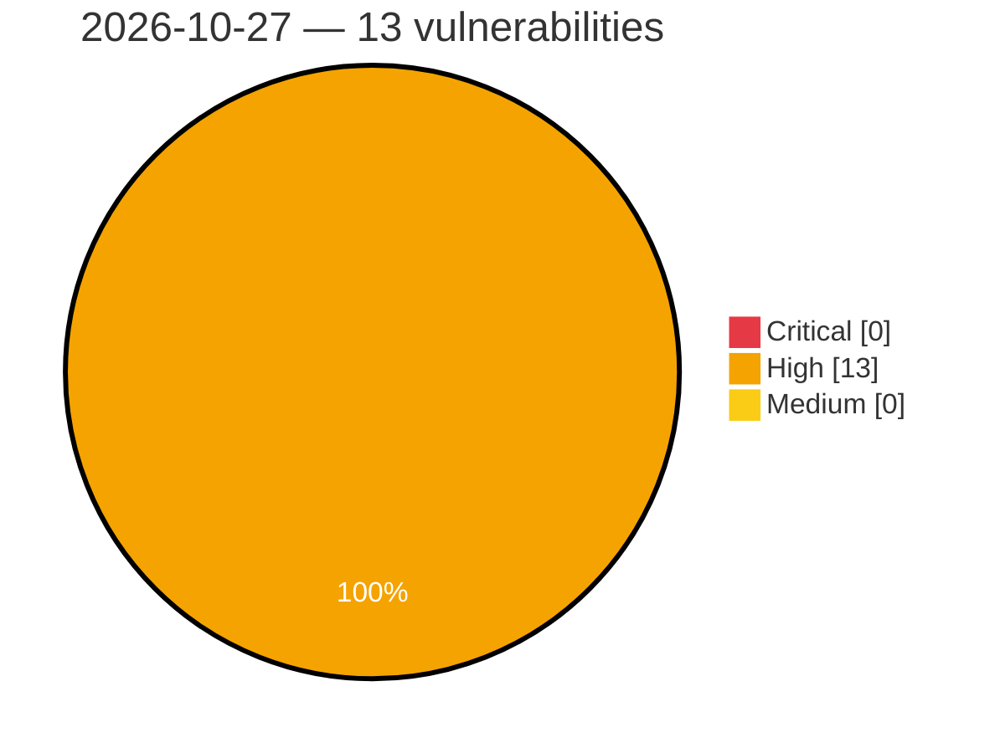

# Critical, High & Medium Severity Vulnerabilities — 2026-10-27

**Source status for this day:**

| Source | Critical | High | Medium | Total |
|--------|---------:|-----:|-------:|------:|
| cvefeed.io (High/Critical) | 0 | 13 | 0 | 13 |

**KEV (actively exploited):** 0  **Watchlist matches:** 9

## High (13)

| CVSS | Flags | Source | CVE / Title | Reported |
|------|-------|--------|-------------|----------|
| 8.8 | ⭐ | cvefeed.io (High/Critical) | [CVE-2026-116818 - OpenPanel before 3.0.0 Unauthenticated ClickHouse SQL Injection via /live/visitors WebSocket](https://cvefeed.io/vuln/detail/CVE-2026-116818) | 44 minutes ago |
| 8.8 | ⭐ | cvefeed.io (High/Critical) | [CVE-2026-116811 - OpenPanel before 3.0.0 Sandbox Escape RCE via Webhook JavaScript Template](https://cvefeed.io/vuln/detail/CVE-2026-116811) | 44 minutes ago |
| 8.8 | ⭐ | cvefeed.io (High/Critical) | [CVE-2026-116843 - Mistral Vibe before 3.0.3 RCE via Git Filter Drivers in Worktree Mode](https://cvefeed.io/vuln/detail/CVE-2026-116843) | 4 hours, 28 minutes ago |
| 8.8 | ⭐ | cvefeed.io (High/Critical) | [CVE-2026-116838 - Ubiquiti airMAX M Cross-Site Request Forgery to Command Injection](https://cvefeed.io/vuln/detail/CVE-2026-116838) | 4 hours, 28 minutes ago |
| 8.8 | — | cvefeed.io (High/Critical) | [CVE-2026-116837 - Ubiquiti airMAX M, LTU, SolarPoint, and SolarSwitch Heap-based Buffer Overflow](https://cvefeed.io/vuln/detail/CVE-2026-116837) | 4 hours, 28 minutes ago |
| 8.8 | ⭐ | cvefeed.io (High/Critical) | [CVE-2026-116836 - Ubiquiti airMAX M Stored Cross-Site Scripting Privilege Escalation](https://cvefeed.io/vuln/detail/CVE-2026-116836) | 4 hours, 28 minutes ago |
| 8.8 | — | cvefeed.io (High/Critical) | [CVE-2024-58400 - llama.cpp before b3701 Out-of-Bounds Read in llama_decode via Token IDs](https://cvefeed.io/vuln/detail/CVE-2024-58400) | 4 hours, 28 minutes ago |
| 8.6 | ⭐ | cvefeed.io (High/Critical) | [CVE-2026-116808 - OpenPanel before 3.0.0 ClickHouse SQL Injection via profile.values](https://cvefeed.io/vuln/detail/CVE-2026-116808) | 44 minutes ago |
| 8.5 | — | cvefeed.io (High/Critical) | [CVE-2026-116819 - OpenPanel before 3.0.0 Credential Disclosure via notification.rules Query](https://cvefeed.io/vuln/detail/CVE-2026-116819) | 44 minutes ago |
| 8.5 | — | cvefeed.io (High/Critical) | [CVE-2026-116816 - llama.cpp b5899 before b10261 Heap Out-of-Bounds Write via plamo2 Tokenizer](https://cvefeed.io/vuln/detail/CVE-2026-116816) | 4 hours, 28 minutes ago |
| 8.3 | ⭐ | cvefeed.io (High/Critical) | [CVE-2026-116825 - YesWiki from 4.6.2 before 4.7.0 HTTP Signature Replay via ActivityPub Inbox](https://cvefeed.io/vuln/detail/CVE-2026-116825) | 44 minutes ago |
| 8.2 | ⭐ | cvefeed.io (High/Critical) | [CVE-2026-116827 - YesWiki before 4.7.0 SSRF via copyUrlToLocalFile in Bazar CSV Import](https://cvefeed.io/vuln/detail/CVE-2026-116827) | 44 minutes ago |
| 8.2 | ⭐ | cvefeed.io (High/Critical) | [CVE-2026-116826 - YesWiki before 4.7.0 Authenticated SSRF via Page Duplication API downloadFile](https://cvefeed.io/vuln/detail/CVE-2026-116826) | 44 minutes ago |
